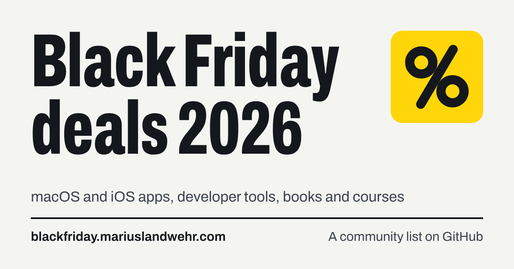

<a href="https://blackfriday.mariuslandwehr.com">
  <picture>
    <source media="(prefers-color-scheme: dark)" srcset=".github/assets/banner-dark.png">
    
  </picture>
</a>

Community-collected Black Friday and Cyber Monday deals on macOS and iOS apps, developer tools, books and courses.

**[Search and filter all deals](https://blackfriday.mariuslandwehr.com)** · **[Submit a deal](https://blackfriday.mariuslandwehr.com/submit/)**

Black Friday is November 27, 2026 and Cyber Monday is November 30. Each offer has its own dates.

<!-- DEALS:START - Everything from here to DEALS:END is generated from the files in deals/. Do not edit it by hand: see CONTRIBUTING.md to add or change a deal. -->

## Categories

**248 deals** in 20 categories. 💸 marks 50% off or more, 💰 less than 50%.

🛠&nbsp;[Development Software](#development-software)&nbsp;`39` · 🤖&nbsp;[AI Tools](#ai-tools)&nbsp;`20` · 🌈&nbsp;[Marketing Software](#marketing-software)&nbsp;`12` · 🎩&nbsp;[Security Software](#security-software)&nbsp;`11` · 🎛&nbsp;[Utility Software](#utility-software)&nbsp;`52` · 📌&nbsp;[Productivity Software](#productivity-software)&nbsp;`38` · 🎥&nbsp;[Video Software](#video-software)&nbsp;`14` · 🎨&nbsp;[Graphic Software](#graphic-software)&nbsp;`12` · 🏝️&nbsp;[Lifestyle](#lifestyle)&nbsp;`9` · 🗣️&nbsp;[Social](#social)&nbsp;`1` · 🎓&nbsp;[Reference & Education](#reference--education)&nbsp;`4` · 👩‍🎓&nbsp;[Courses and Videos](#courses-and-videos)&nbsp;`7` · 📈&nbsp;[Business Software](#business-software)&nbsp;`7` · 🏃🏻‍♀️&nbsp;[Health & Fitness Software](#health--fitness-software)&nbsp;`4` · 🎁&nbsp;[Bundles](#bundles)&nbsp;`2` · 🎶&nbsp;[Creative Content](#creative-content)&nbsp;`2` · 🤑&nbsp;[Finance](#finance)&nbsp;`4` · 🗺️&nbsp;[Navigation](#navigation)&nbsp;`1` · 🔎&nbsp;[SEO](#seo)&nbsp;`8` · 🕹&nbsp;[Games](#games)&nbsp;`1`

## 🛠 Development Software

|  | Name | Offer |
| :-: | --- | --- |
| 💰 | **[Proxyman](https://proxyman.com/)** Capture, inspect, and modify HTTP/HTTPS traffic with a native debugging proxy. | <b>30% off all plans</b> `BF2026` · Nov&nbsp;16&nbsp;–&nbsp;Dec&nbsp;3 |
| 💰 | **[Device MCP](https://devicemcp.ai/)** Mirror and control iPhone and iPad from your Mac, with MCP tools for AI agents. | <b>30% off all plans</b> `BF2026` · applies to early-bird prices · Nov&nbsp;16&nbsp;–&nbsp;Dec&nbsp;3 |
| 💰 | **[TCP Viewer](https://tcpviewer.proxyman.com/)** Capture and inspect TCP/UDP packets in a native macOS app. | <b>30% off all plans</b> `BF2026` · Nov&nbsp;16&nbsp;–&nbsp;Dec&nbsp;3 |
| 💸 | **[Atelier](https://appsbymo.app/atelier/?ref=bf-deals)** A Mac studio your AI coding sessions work in: every app's tasks, releases, feedback and memory, with a brief each time a session starts. | <b>50% off</b> with code **BLACKFRIDAY** at appsbymo.app (regular $19.99). Nov 9 - Dec 1, 2026 |
| 💸 | **[DevUtils](https://devutils.com/?utm_source=mrsbf)** Offline developer toolbox for macOS with Apple Silicon support. | <b>60% off all plans</b> `BLACKFRIDAY2026` · Nov&nbsp;2&nbsp;–&nbsp;Dec&nbsp;30 |
| 💸 | **[ShipAhead](https://shipahe.ad)** Nuxt starter kit for building and launching a SaaS product. | <b>50% off</b> Automatically applied; no code needed · Nov&nbsp;1&nbsp;–&nbsp;Dec&nbsp;31 |
| 💰 | **[Layerwise](https://layerwise.app/pricing)** Build and ship full-stack apps with database, login, email and cloud storage built in. Use your existing ChatGPT or Claude subscription for AI coding. | <b>20% off all plans for 12 months</b> `BLACKFRIDAY2026` · monthly or annual billing; Redeem by 2026-12-02 |
| 💰 | **[Buildkit for Astro](https://astrobuildkit.com)** Astro design system with blocks, backgrounds, and animated visuals for marketing websites. | <b>Up to 47% off</b> Automatically applied; varies by plan · Nov&nbsp;23&nbsp;–&nbsp;Dec&nbsp;1 |
| 💰 | **[CodedVisuals](https://codedvisuals.com)** Visual and illustration components for React and shadcn/ui, with AI agent skills. | <b>Up to 40% off</b> Automatically applied; varies by plan · Nov&nbsp;23&nbsp;–&nbsp;Dec&nbsp;1 |
| 💸 | **[Tailkit](https://tailkit.com)** Tailwind CSS UI components for React, Vue, Laravel, Alpine.js, and HTML, with an MCP server. | <b>Up to 60% off</b> Automatically applied; varies by plan · Nov&nbsp;23&nbsp;–&nbsp;Dec&nbsp;1 |
| 💰 | **[JuxtaCode](https://juxtacode.app/black-friday/)** Compare Git branches and resolve merge conflicts with ease on macOS. | <b>40% off</b> `BLACKFRIDAY26` · direct purchase from juxtacode.app only, not the Mac App Store · Nov&nbsp;20&nbsp;–&nbsp;Dec&nbsp;1 |
| 💰 | **[Poedit](https://poedit.com/purchase/?utm_source=mRs)** Translations editor for app and websites, supports PO, XLIFF, JSON, RESX and other formats, with built-in auto-translation. | <b>30% off</b> Code **BF26**; one-time or 1st year · Nov&nbsp;4&nbsp;–&nbsp;Dec&nbsp;3 |
| 💸 | **[Runestone](https://apps.apple.com/us/app/runestone-text-editor/id1548193893)** Plain text editor with syntax highlighting for iPhone, iPad, and Apple Vision Pro. | <b>50% off Premium ($4.99 USD)</b> Automatically applied to the one-time in-app purchase. No code needed. November 24–30, 2026. |
| 💰 | **[WhaleDeck](https://apple.co/3NQJi4w)** Effortlessly manage and monitor your Docker servers on your iPhone, iPad, and Mac. | <b>Lifetime 40% off ($57 → $35)</b> Automatically applied; no code needed; 2026-11-27 to 2026-12-1 |
| 💸 | **[1bench](https://1bench.dev/black-friday?utm_source=mrsbf)** Desktop GUI for 25+ databases including PostgreSQL, MySQL, Redis, ClickHouse, MongoDB and Qdrant. Mac, Windows and Linux. | <b>50% off the Solo lifetime licence ($199 → $99)</b> `FCBF26` · lifetime licence only · Nov&nbsp;20&nbsp;–&nbsp;Dec&nbsp;7 |
| 💸 | **[Needling](https://andretan0.gumroad.com/l/leqnw/BLACKFRIDAY)** Claude Code status around the MacBook notch: two thin eyes show what Claude is doing, two bars show your 5-hour and weekly limits, and it nudges you when Claude needs you. Independent app, not made by Anthropic. | <b>60% off</b> **BLACKFRIDAY** (the link applies it); one-time purchase, $9.67 to $3.82; Apple Silicon, macOS 13+; 2026-11-27 to 2026-11-28 PST |
| 💸 | **[Dirstarter](https://dirstarter.com/?discountCode=BF2026)** Next.js directory template with built-in payments, SEO and an MCP server for AI agents. Pay once, launch unlimited directories. | <b>50% off lifetime license ($150 → $75 Basic, $200 → $100 Pro)</b> `BF2026` · one-time purchase · Nov&nbsp;10&nbsp;–&nbsp;Dec&nbsp;1 |
| 💰 | **[POSH](https://poshtui.com/black-friday?utm_source=mrs-bf&utm_campaign=bf2026)** Version-matched Ruby and Rails docs for coding agents via CLI and MCP. Free terminal browser. macOS & Linux. | <b>30% off monthly and yearly plans</b> `BLACKFRIDAY2026` · €7 → €4.90/month, €60 → €42/year; kept while you stay subscribed; new subscriptions only; until 2026-12-02 |
| 💰 | **[Runheed](https://runheed.com/black-friday?ref=mrs-bf-deals)** Error tracking your coding agent can read: Claude Code, Cursor or any MCP client reads the stack trace from your Node.js or Python app, fixes the code and resolves the error. | <b>40% off the first year</b> `RUNHEEDBF26` · annual plans only (Solo $290 → $174, Pro $790 → $474, Scale $1,990 → $1,194), new customers; until 2026-12-03 |
| 💰 | **[FormBold](https://formbold.com/pricing)** Form backend and API; get submissions via email, Slack, Notion, and more. | <b>30% off all yearly plans</b> `BLFCM2026` · yearly plans; 2026-11-17 to 2026-12-01 23:59 UTC |
| 💰 | **[TailGrids](https://tailgrids.com/pricing)** 600+ Tailwind CSS UI components, blocks, and templates for HTML, React, Vue, and Figma. | <b>30% off All Access plans</b> `BLFCM2026` · All Access plans; 2026-11-17 to 2026-12-01 23:59 UTC |
| 💰 | **[TailAdmin](https://tailadmin.com/pricing)** Tailwind CSS admin dashboard template with 500+ components for HTML, React, Next.js, Angular, and Vue. | <b>30% off Business plans</b> `BLFCM2026` · Business plans; 2026-11-17 to 2026-12-01 23:59 UTC |
| 💸 | **[TailTemplates](https://tailtemplates.com/all-access)** Premium Tailwind CSS templates for startups, SaaS, and landing pages. | <b>80% off all yearly plans</b> `BLFCM2026` · yearly plans; 2026-11-17 to 2026-12-01 23:59 UTC |
| 💸 | **[UIdeck](https://uideck.com/all-access)** 100+ Tailwind CSS and Bootstrap templates and landing pages. | <b>60% off all plans</b> `BLFCM2026` · 2026-11-17 to 2026-12-01 23:59 UTC |
| 💰 | **[NextJS Templates](https://nextjstemplates.com/all-access)** 20+ Next.js templates, starter kits, and boilerplates. | <b>40% off Business plans</b> `BLFCM2026` · Business plans; 2026-11-17 to 2026-12-01 23:59 UTC |
| 💰 | **[SaaSBold](https://saasbold.com/pricing)** Full-stack Next.js SaaS boilerplate. | <b>40% off all plans</b> `BLFCM2026` · 2026-11-17 to 2026-12-01 23:59 UTC |
| 💰 | **[Static.run](https://static.run/pricing)** Static site hosting with analytics and one-click deploy. | <b>30% off all yearly plans</b> `BLFCM2026` · yearly plans; 2026-11-17 to 2026-12-01 23:59 UTC |
| 💰 | **[CozyCommerce](https://cozycommerce.dev/pricing)** Next.js and Tailwind eCommerce kit with 100+ components and 20+ pages. | <b>30% off all plans</b> `BLFCM2026` · 2026-11-17 to 2026-12-01 23:59 UTC |
| 💰 | **[NextAdmin](https://nextadmin.co/pricing)** 200+ Next.js dashboard templates and UI components. | <b>30% off Business plans</b> `BLFCM2026` · Business plans; 2026-11-17 to 2026-12-01 23:59 UTC |
| 💰 | **[NextMerce](https://nextmerce.com/pricing)** Next.js eCommerce boilerplate. | <b>30% off all plans</b> `BLFCM2026` · 2026-11-17 to 2026-12-01 23:59 UTC |
| 💰 | **[BucketMate](https://www.bucketmate.app/pricing)** S3 GUI for Mac, iPhone, iPad, and web for AWS S3, Cloudflare R2, Backblaze B2, and other S3-compatible storage. | <b>40% off ($39 → $23.40)</b> `BF2026` · lifetime license, one-time purchase · Nov&nbsp;2&nbsp;–&nbsp;Dec&nbsp;1 |
| 💰 | **[HackUtilities](https://hackutilities.com)** Desktop workspace for AI coding agents: dev servers, terminals and Claude Code or Codex sessions side by side, plus 46 offline developer tools. | <b>35% off lifetime licenses</b> `BFCM2026` · one-time purchase · Nov&nbsp;26&nbsp;–&nbsp;Dec&nbsp;12 |
| 💸 | **[Kinsta](https://kinsta.com/black-friday/)** Fast, secure, feature-rich managed hosting for WordPress on next-generation cloud infrastructure, secured by Cloudflare. | <b>3 months free on annual plans or 50% off the first 3 months on monthly plans</b> new customers only · until&nbsp;Dec&nbsp;1 |
| 💰 | **[TablePro](https://tablepro.app/black-friday)** Native database client for Mac and Linux: PostgreSQL, MySQL, SQLite, MongoDB, Redis and more. | <b>40% off Pro one-time ($79 → $47.40) and the first year of Pro yearly ($39 → $23.40)</b> `BLACKFRIDAY2026` · Applied automatically on the site. Pro yearly renews at $39. Pro monthly and Team are not on sale. Ends December 1, 8:00 AM UTC. · Nov&nbsp;24&nbsp;–&nbsp;Dec&nbsp;1 |
| 💰 | **[Perch](https://perch.run/black-friday?ref=mrs-bf-deals)** Mac menu bar app for Claude Code, Codex, Cursor and six more AI coding agents: see every session, and approve from your iPhone and Apple Watch. | <b>40% off the one-time licence, $29 → $17.40, solo or per team seat</b> `BLACKFRIDAY2026` · First 500 orders. The Buy buttons on perch.run apply the code automatically. The Perch Pro iPhone subscription is not part of this offer. · Nov&nbsp;2&nbsp;–&nbsp;Dec&nbsp;1 |
| 💰 | **[DevWorkspace Pro](https://devworkspacepro.com)** One desktop app to run, code and ship any dev project: Files, Git, GitHub, AI agents, terminal, and DDEV, Docker or native runtimes. | <b>40% off all plans</b> `BLACKFRIDAY40OFF` · New purchases; first month on monthly plans. · Nov&nbsp;10&nbsp;–&nbsp;Dec&nbsp;10 |
| 💰 | **[DropDMG](https://c-command.com/store/sale)** Create professional disk images (.dmg files) for your Mac app | <b>25% off</b> `BLACKFRIDAY2026` |
| 💰 | **[MacVisor](https://scaleninja.com/macvisor/)** Run your Mac as a virtualization host: macOS, Windows, Linux & FreeBSD VMs setup automatically with account, SSH keys and guest tools. | <b>15% off with BLACKFRIDAY15</b> `BLACKFRIDAY15` · Nov&nbsp;12&nbsp;–&nbsp;Nov&nbsp;30 |
| 💰 | **[DevIntern](https://devintern.com/pricing/)** Self-hosted worker that turns tracker tickets into PRs with your own coding agent across multiple repos, plus automations. | <b>40% off the first invoice</b> `BLACKFRIDAY26` · Team $99 → $59.40 first month or $990 → $594 first year; Business $299 → $179.40 first month or $2,990 → $1,794 first year; Supporter License $99 → $59.40. Then regular price. · Nov&nbsp;20&nbsp;–&nbsp;Dec&nbsp;1 |

<a href="#categories">↑ Categories</a>

## 🤖 AI Tools

|  | Name | Offer |
| :-: | --- | --- |
| 💰 | **[ScribeToAny](https://scribetoany.com/)** AI audio and video transcription with speaker labels and multilingual translation. | <b>30% off monthly or $20 off yearly</b> **FIRST&#95;30&#95;OFF** (monthly); **FIRST&#95;20&#95;OFF** (yearly) |
| 💸 | **[Cue](https://appsbymo.app/cue/?ref=bf-deals)** Menu-bar writing assistant that drafts and proofreads replies inside Messages, Mail, Slack and WhatsApp, and remembers who you write to. | <b>50% off</b> with code **BLACKFRIDAY** at appsbymo.app (~~$29~~ $14.50). Nov 9 - Dec 1, 2026 |
| 💸 | **[Mo](https://appsbymo.app/mo/?ref=bf-deals)** A little character on your Mac: ask in your own words, typed or spoken, and it tidies files, plans your day and drafts replies, asking first. | <b>50% off</b> with code **BLACKFRIDAY** at appsbymo.app (regular $19.99). Nov 9 - Dec 1, 2026 |
| 💸 | **[TypingMind](https://www.typingmind.com/?utm_source=mrsbf)** Chat UI for ChatGPT, Claude, Gemini, and more, with MCP, plugins, agents, and local storage. | <b>60% off Lifetime Premium</b> `BLACKFRIDAY2026` · Nov&nbsp;2&nbsp;–&nbsp;Dec&nbsp;15 |
| 💸 | **[PromptClaw](https://vifly.net/)** Save, organize, and reuse AI prompts locally on Android and share them with your PC. | <b>50% off Lifetime ($8.99 → $4.49 USD)</b> No code needed · Nov&nbsp;27&nbsp;–&nbsp;Dec&nbsp;1 |
| 💰 | **[Fluent 2](https://fluentmac.app/?ref=mrsbf)** Context-aware AI assistant for Mac apps, with writing tools, automation, and support for hosted or local models. | <b>25% off lifetime licenses</b> `BF2026` · one-time purchase · Nov&nbsp;1&nbsp;–&nbsp;Dec&nbsp;1 |
| 💸 | **[RewriteBar](https://rewritebar.com?ref=mrs)** Menu-bar AI writing assistant for macOS that fixes grammar, adjusts tone, translates, and rewrites text in any app. | <b>50% off</b> `BF2026` · Standard lifetime license ~~$29~~ $14.50 · Nov&nbsp;2&nbsp;–&nbsp;Dec&nbsp;3 |
| 💰 | **[Outlier](https://outlier.host/)** Private local AI assistant for Mac (Apple silicon, macOS 15+). | <b>Black Friday sale: $16.99 once, 31% off our November price of $24.50, through December 2. Then $29.</b> No code needed: the Buy button applies the sale; pay once, runs on your computer; free version available; 30-day refund; ends end of 2 December 2026, US Pacific |
| 💰 | **[BoltAI](https://boltai.com/pricing?utm_source=mrsdeals&utm_medium=partner&utm_campaign=bf2026)** Native AI workspace for Mac: ChatGPT, Claude, Gemini and local AI models in one app, now with agents that browse in Chrome and use the apps you allow. | <b>40% off Pro, Pro+ and Lifetime</b> `BFCM2026` · Lifetime ~~$399~~ $239.40, Pro ~~$99~~ $58.80, Pro+ ~~$199~~ $118.80; one-time purchase; until 2026-12-01 |
| 💰 | **[PDF Pals](https://pdfpals.com/buy?utm_source=mrsdeals&utm_medium=partner&utm_campaign=bf2026)** Chat with your PDF, Word, Excel, PowerPoint, EPUB and Markdown files on Mac, with cited answers and built-in local AI models. | <b>Lifetime ~~$249~~ $149; 20% off Basic and Plus</b> Lifetime: automatically applied; **BF20** for Basic (~~$59~~ $47.20) and Plus (~~$99~~ $79.20); one-time purchase; until 2026-12-01 |
| 💰 | **[SmartyTab](https://smartytab.app/)** Private AI autocomplete, writing check and rephrase for every app on your Mac; runs on device. | <b>30% off yearly and lifetime</b> `BF2026` · Lifetime ~~$99~~ $69.30, yearly ~~$49~~ $34.30 for the first year; until 2026-12-01 |
| 💰 | **[Nivon](https://nivon.ai/pricing)** No-code AI customer support chatbot trained on your website and docs, with 95+ languages and human handoff. | <b>40% off all paid plans</b> `BLFCM2026` · all paid plans; 2026-11-17 to 2026-12-01 23:59 UTC |
| 💰 | **[Aymo AI](https://aymo.ai/pricing)** All-in-one multi-AI chat platform for developers and teams. | <b>30% off Premium yearly</b> `BLFCM2026` · Premium yearly plan; 2026-11-17 to 2026-12-01 23:59 UTC |
| 💰 | **[Meku](https://meku.dev/pricing)** AI builder for websites and web apps. | <b>30% off all yearly plans</b> `BLFCM2026` · yearly plans; 2026-11-17 to 2026-12-01 23:59 UTC |
| 💰 | **[MeetingDebrief](https://meetingdebrief.com)** Record, transcribe and summarize meetings on your Mac or PC, with no bot in the call and nothing uploaded. | <b>35% off lifetime licenses</b> `BFCM2026` · one-time purchase · Nov&nbsp;26&nbsp;–&nbsp;Dec&nbsp;12 |
| 💰 | **[Vinaa](https://www.vinaa.ai/?utm_source=mrsbf)** Native Mac app for chatting with cloud and local AI models. | <b>Up to 45% off lifetime licenses</b> Until 2026-11-30 |
| 💸 | **[Wovo](https://wovo.one/?ref=mrs2026#pricing)** One MCP that turns any AI into a multi-device agent across all your computers. | <b>50% off Pro and Max yearly: Pro $144 → $72/yr ($6/mo), Max $348 → $174/yr ($14.50/mo)</b> Applied automatically at checkout, no coupon code. Price locked for the subscription. New and existing users. Pro up to 5 computers; Max up to 20 computers + on-demand GitHub runners. · until&nbsp;Dec&nbsp;15 |
|  | **[Orwellix](https://orwellix.com/lifetime-deal?utm_source=mrs-black-friday-deals&utm_medium=deal-directory&utm_campaign=lifetime-deal-2026)** AI writing editor: an agent edits your document in place and you accept or reject every change, plus grammar, readability and plagiarism checks in one document. | <b>Premium $468/yr → Lifetime plan $249 once</b> No code needed. More AI credits, grammar characters and plagiarism words than Premium every month. One per account, only 300 deals · Nov&nbsp;12&nbsp;–&nbsp;Dec&nbsp;31 |
| 💰 | **[Flit](https://flit.fyi/pricing?utm_source=mrsbf2026)** Dictation for Mac that runs on the Mac: hold a key, talk, and clean text lands in any app. Local voice models for 1,600+ languages, a dictionary that learns, and file transcripts. | <b>40% off, from $9 (one year) and $23.40 (lifetime)</b> Applied automatically at checkout, no code needed. One-time purchase, 7-day free trial, 14-day refund. · Nov&nbsp;20&nbsp;–&nbsp;Nov&nbsp;30 |
| 💰 | **[MakeItSay](https://makeitsay.com/pricing?utm_source=mrsdeals&utm_medium=github&utm_campaign=bf2026)** Edit or translate text inside photos, screenshots, and badges while keeping the original font and background intact. Web app, HTTP API, and MCP server. | <b>30% off non-expiring image edit credit packs</b> `BF2026` · 6-edit pack ~~$3~~ $2.10, 40-edit pack ~~$10~~ $7; one-time purchase, credits never expire · Nov&nbsp;13&nbsp;–&nbsp;Dec&nbsp;1 |

<a href="#categories">↑ Categories</a>

## 🌈 Marketing Software

|  | Name | Offer |
| :-: | --- | --- |
| 💰 | **[ZipWP](https://zipwp.com/black-friday/)** AI WordPress website builder from the team behind Astra, with hosting, domain, and email. | <b>Up to 47% off all plans, from $79</b> Automatically applied at checkout · Nov&nbsp;5&nbsp;–&nbsp;Dec&nbsp;7 |
| 💰 | **[Outmano](https://outmano.com/?utm_source=mrsbf)** AI competitive intelligence for SaaS teams, with change alerts and MCP access. | <b>30% off any monthly plan for 12 months</b> `BF2026` · new customers only · Nov&nbsp;3&nbsp;–&nbsp;Dec&nbsp;2 |
| 💸 | **[LandinTools](https://tools.landin.page/advertise?ref=Black-Friday-Deals)** Directory of 1,000+ AI and SaaS tools. Get your tool featured for a full year. | <b>50% off Featured listing: $49 → $24.50</b> `BF2026` · one year of Featured placement; Black Friday offer |
| 💰 | **[Quotion](https://quotion.co/#pricing)** Turn Apple Notes into blogs, portfolios and portals. Web-based, no coding required. | <b>30% off all paid plans for 12 months</b> `BLACKFRIDAY2026` · monthly or annual billing · Nov&nbsp;9&nbsp;–&nbsp;Dec&nbsp;2 |
| 💰 | **[Terlido](https://terlido.com/pricing?utm_source=mrsbf&utm_medium=deal-list&utm_campaign=bfcm-2026)** Cold email and newsletters from your own mailbox, with warmup, campaigns, inbox and an AI agent. | <b>40% off for 12 months: Email Pro $39 → $23.40/seat/mo, Newsletter Pro $29 → $17.40/mo</b> `BF2026` · Nov&nbsp;9&nbsp;–&nbsp;Dec&nbsp;1 |
| 💰 | **[LeadMerlin](https://leadmerlin.com/black-friday/?utm_source=mrsbf)** Local business leads (owner names, checked emails, phone line types, site tech) via API, agent skill or dashboard. | <b>40% off</b> `BF2026` · first payment, so the whole first year on yearly plans (Starter $348 → $208.80/yr, Pro $468 → $280.80/yr, Agency $948 → $568.80/yr); monthly plans get 40% off the first month; until 2026-12-02 |
| 💰 | **[Sequenzy](https://sequenzy.com/black-friday)** Email marketing for SaaS: newsletters, automated sequences and transactional email, with unlimited contacts. | <b>30% off any annual plan</b> `BLACKFRIDAY` · annual plans only; e.g. 15,000 emails/month $205 → $143.50/year |
| 💸 | **[Replug](https://replug.io/black-friday)** Link management service for branded short links, bio-link pages and QR codes, aimed at marketers and agencies. | <b>60% off annual plans</b> No code; annual Essentials, Scale and Agency plans; monthly plans and extra Agency workspaces excluded; not combined with regional pricing; ends 11:59 PM Pacific · Nov&nbsp;20&nbsp;–&nbsp;Dec&nbsp;4 |
|  | **[AppTrack Ninja](https://apptrack.ninja/pricing?utm_source=mrs-bf-deals&utm_medium=deal_list&utm_campaign=bfcm2026)** App Store intelligence and ASO for indie developers: new and trending apps, keyword ranks, publisher portfolios, app transfers and competitors' Apple Search Ads, plus an MCP server. | <b>Lifetime Pro $89, one payment (normally $69.99/year)</b> Automatically shown as the Lifetime option on the pricing page; free plan available · until&nbsp;Nov&nbsp;30 |
| 💰 | **[Evendeals](https://www.evendeals.com)** Purchasing power parity pricing for SaaS and digital products. Shows location-based discounts in 150+ countries and blocks VPN abuse. | <b>40% off all plans</b> `BF2026` · the Unlimited lifetime deal is back for November only · Nov&nbsp;13&nbsp;–&nbsp;Dec&nbsp;2 |
| 💸 | **[Ascope](https://ascope.app/?ref=mrs-bf-deals#pricing)** ASO tool and keyword rank tracker for Mac and Windows: daily App Store and Google Play rankings in 50+ countries, with popularity and difficulty for every keyword, plus an MCP server. | <b>Lifetime licence $189 → $69, one payment</b> Automatically applied on the pricing page, no code needed; 14-day money-back guarantee · Nov&nbsp;1&nbsp;–&nbsp;Nov&nbsp;30 |
| 💰 | **[Fourth Feed](https://fourthfeed.com/write?utm_source=mrsdeals&utm_medium=github&utm_campaign=bf2026)** Publish side-by-side sponsored comparison benchmarks on an AI video tools directory. | <b>30% off all maker post credit packs</b> `BF2026` · 1 post ~~$19~~ $13.30, 3 posts ~~$39~~ $27.30, 9 posts ~~$99~~ $69.30; one-time packs, credits never expire · Nov&nbsp;13&nbsp;–&nbsp;Dec&nbsp;1 |

<a href="#categories">↑ Categories</a>

## 🎩 Security Software

|  | Name | Offer |
| :-: | --- | --- |
| 💰 | **[TinyShield](https://tinyshield.proxyman.com/)** Monitor app connections and block unwanted apps or domains with a macOS firewall. | <b>30% off all plans</b> `BF2026` · Nov&nbsp;16&nbsp;–&nbsp;Dec&nbsp;3 |
| 💸 | **[PortDroid](https://portdroid.net/sale)** Android network toolkit: port scanner, ping, traceroute, DNS, WHOIS, LAN device discovery, WiFi analyser and certificate inspection in one app. | <b>50% off Pro Lifetime ($9.49 → $4.69 USD)</b> `CYBER_2026` · Nov&nbsp;5&nbsp;–&nbsp;Dec&nbsp;4 |
| 💰 | **[OkayTab](https://okaytab.app/)** Browser extension for Chrome, Edge and Firefox that checks every site you open with AI and blocks fake shops, phishing and scam pages. | <b>30% off first period ($3.59 → $2.51 monthly, $8.59 → $6.01 3 months, $22.99 → $16.09 yearly)</b> `BLACKFRIDAY2026` · first billing period only, once per customer · Nov&nbsp;1&nbsp;–&nbsp;Dec&nbsp;5 |
| 💰 | **[SimpleumSafe](https://simpleum.com/en/?utm_source=bf26-mRs)** Keep private photos and important documents in an encrypted safe on Mac, iPhone and iPad. | <b>30% off the one-time purchase and the first year of an annual subscription</b> **No Code needed**; Automatically applied to in-app purchases on the App Store · Nov&nbsp;16&nbsp;–&nbsp;Dec&nbsp;6 |
| 💸 | **[Vibe App Scanner](https://vibeappscanner.com/black-friday)** Live-app and source-code security checks with evidence and fix guidance. | <b>60% off the first month of Go or Pro</b> Automatically applied; first subscriptions only, previous subscriptions and AppSumo excluded. New-account Go $11.60 then $29/month, Pro $19.60 then $49/month (USD). Nov 10–30, 2026, ends 11:59pm Toronto time. |
| 💰 | **[Safe Screen Share](https://www.safescreenshare.com)** Chrome and Firefox extension that auto-blurs emails, API keys and customer data before you screen share or record. Detection runs locally in the browser. | <b>40% off the lifetime license</b> `BF2026` · Nov&nbsp;13&nbsp;–&nbsp;Dec&nbsp;2 |
| 💸 | **[OffSeq Breach](https://breach.offseq.com/#pricing)** Credential-exposure monitoring for your domains across leaked datasets, forums, Telegram channels and marketplaces, with alerts by email, Slack, webhook or API. | <b>50% off the first month: Basic €24 → €12, Pro €60 → €30, Enterprise €120 → €60</b> `BLACK` · First billing period of a new subscription only, then the regular price. Prices excl. VAT. · Nov&nbsp;13&nbsp;–&nbsp;Dec&nbsp;2 |
| 💸 | **[Guard by OffSeq](https://guard.report/monitoring)** Website security and NIS2/GDPR compliance check covering TLS, security headers, DNS and SPF/DKIM/DMARC, with prioritised reports and continuous monitoring. | <b>50% off the full report (€39.90 → €19.95) and the first month of monitoring (€25 → €12.50 per domain)</b> Applied automatically; monitoring renews at €25/month. Prices incl. 21% VAT. The basic scan is free. · Nov&nbsp;13&nbsp;–&nbsp;Dec&nbsp;1 |
| 💸 | **[OffSeq Mirage](https://mirage.offseq.com/pricing)** Real-time honeypot threat intelligence from a worldwide sensor fleet, with attacker clustering, campaign attribution, session replay, blocklists and STIX/MISP exports. | <b>50% off the first 3 months: Starter €49 → €24.50/mo, Pro €149 → €74.50/mo, Business €399 → €199.50/mo</b> `BFCM2026` · Code is pre-filled at checkout; first 3 months, then the regular price. Prices excl. VAT. Free plan with 1 honeypot. · Nov&nbsp;13&nbsp;–&nbsp;Nov&nbsp;30 |
| 💸 | **[OffSeq Pulse](https://pulse.offseq.com/pricing)** EU-hosted device posture for Windows, macOS and Linux: 12 hardening checks mapped to NIS2, CIS v8.1 and Latvian Cabinet Regulation No. 397, with one-click fixes and audit evidence. | <b>50% off the first year or month: €4 → €2 per device/mo billed annually, Managed €12 → €6</b> Applied automatically for new customers, then the regular price. Monthly billing €5 → €2.50. Prices excl. VAT. First 2 devices free. · Nov&nbsp;13&nbsp;–&nbsp;Dec&nbsp;2 |
| 💸 | **[OffSeq Threat Radar](https://radar.offseq.com/pricing)** Live threat intelligence for CVEs, actively exploited vulnerabilities (CISA KEV), malware and attack patterns, with API, RSS, SBOM scans and alerts. | <b>50% off the first month or first year: Individual €120 → €60/yr, Base €490 → €245/yr, Pro €1,490 → €745/yr</b> Applied automatically; first payment only, renewals at the regular price. Prices incl. 21% VAT. Free plan with API access. · Nov&nbsp;13&nbsp;–&nbsp;Dec&nbsp;1 |

<a href="#categories">↑ Categories</a>

## 🎛 Utility Software

|  | Name | Offer |
| :-: | --- | --- |
| 💰 | **[Aurio](https://aurio.dev/)** Remove background noise from your microphone in real time on Mac, on-device with no account. | <b>25% off ($40 → $30)</b> `BLACKFRIDAY26` · keep the app with one year of updates · Nov&nbsp;24&nbsp;–&nbsp;Dec&nbsp;1 |
| 💸 | **[Picmal](https://picmal.app)** Convert, compress, and edit images, video, audio, and PDFs locally on Mac. | <b>50% off ($29 → $14.50)</b> `BLACKFRIDAY` · one-time purchase; 2026-11-23 to 2026-11-30 (Pacific time) |
| 💰 | **[NeoTiler](https://getneotiler.com/?utm_source=mRs-Black-Friday-Deals)** Native macOS window manager with shortcuts, snapping, workspaces, and Dock previews. | <b>30% off Lifetime ($9.99 → $6.99)</b> `BF30` · automatically applied at checkout; Until 2026-12-01 |
| 💸 | **[Vigil](https://appsbymo.app/vigil/?ref=bf-deals)** Keeps your MacBook awake with the lid closed while Claude Code, Codex, a build or an export runs, then sleeps the moment it's done. | <b>50% off</b> with code **BLACKFRIDAY** at appsbymo.app (regular $9.99). Nov 9 - Dec 1, 2026 |
| 💸 | **[Chute](https://appsbymo.app/chute/?ref=bf-deals)** A drop tray for Mac: shake a file while you drag it, then one key zips, resizes, converts, renames, AirDrops or sends it to your other Mac. | <b>50% off</b> with code **BLACKFRIDAY** at appsbymo.app (regular $14.99). Nov 9 - Dec 1, 2026 |
| 💸 | **[Emojist](https://appsbymo.app/emojist/?ref=bf-deals)** Type a word anywhere on your Mac and matching emoji appear above the cursor; press a number to swap one in. | <b>50% off</b> with code **BLACKFRIDAY** at appsbymo.app (regular $6.99). Nov 9 - Dec 1, 2026 |
| 💸 | **[What Happened](https://appsbymo.app/whathappened/?ref=bf-deals)** Tells you in plain words why your Mac is slow, hot or full, and fixes it with your OK. | <b>50% off</b> with code **BLACKFRIDAY** at appsbymo.app (regular $13.99). Nov 9 - Dec 1, 2026 |
| 💰 | **[DockView 2](https://noteifyapp.com/dockview/)** Live window previews for the macOS Dock. | <b>30% off: $14.99 → $10.49; Lifetime $49.99 → $34.99</b> `MACPLUSBLACKFRIDAY26` · Nov&nbsp;1&nbsp;–&nbsp;Nov&nbsp;30 |
| 💰 | **[ActiveDock 2](https://noteifyapp.com/activedock/)** Dock replacement for macOS. | <b>30% off: $19.99 → $13.99; Lifetime $59.99 → $41.99</b> `MACPLUSBLACKFRIDAY26` · Nov&nbsp;1&nbsp;–&nbsp;Nov&nbsp;30 |
| 💰 | **[SuperTab 7](https://noteifyapp.com/supertab/)** Apps, windows, and clipboard in one panel. | <b>30% off: $19.99 → $13.99; Lifetime $49.99 → $34.99</b> `MACPLUSBLACKFRIDAY26` · Nov&nbsp;1&nbsp;–&nbsp;Nov&nbsp;30 |
| 💰 | **[Quick Exposé 3](https://noteifyapp.com/quick-expose/)** Classic Exposé on modern macOS. | <b>30% off ($39.99 → $27.99)</b> `MACPLUSBLACKFRIDAY26` · Nov&nbsp;1&nbsp;–&nbsp;Nov&nbsp;30 |
| 💰 | **[MacPlus Software, other apps](https://noteifyapp.com/apps/)** Command-Tab Plus 2, Stage View, Tab Finder 2, MultiDock 2, Classic Commander, Tree Outliner, and ContextClip. | <b>30% off</b> `MACPLUSBLACKFRIDAY26` · Nov&nbsp;1&nbsp;–&nbsp;Nov&nbsp;30 |
| 💸 | **[DockMagic](https://dockmagic.app/?ref=mRs-Black-Friday-Deals#dm-pricing)** Widget Dock for macOS with calendars, clocks, system stats, and everyday controls. | <b>Up to 50% off: 1 Mac $25 → $12.99; 2 Macs $40 → $19.99; 3 Macs $60 → $29.99</b> Automatically applied; one-time purchase with lifetime updates; prices in USD · Nov&nbsp;3&nbsp;–&nbsp;Nov&nbsp;30 |
| 💰 | **[KeyScreen](https://keyscreen.app)** Show keystrokes on screen for tutorials, streams, and demos on Mac. | <b>30% off ($5.99 → $4.19)</b> `KEYSCREEN30` · direct website purchase, one-time payment · Nov&nbsp;18&nbsp;–&nbsp;Dec&nbsp;2 |
| 💸 | **[ExtraDock](https://extradock.app)** Create floating docks anywhere on any Mac screen. | <b>50% off all Lifetime licenses</b> `BLACK2026FRIDAY50` · automatically applied on the website · Nov&nbsp;12&nbsp;–&nbsp;Dec&nbsp;1 |
| 💸 | **[DockFlow](https://dockflowapp.io)** Save and switch between macOS Dock presets. | <b>50% off all Lifetime licenses</b> `BLACK2026FRIDAY50` · automatically applied on the website · Nov&nbsp;12&nbsp;–&nbsp;Dec&nbsp;1 |
| 💸 | **[CoolDock](https://cooldock.app)** Second Dock with live widgets for music, calendars, weather, tasks, and system stats. | <b>50% off all Lifetime licenses</b> `BLACK2026FRIDAY50` · automatically applied on the website · Nov&nbsp;12&nbsp;–&nbsp;Dec&nbsp;1 |
| 💸 | **[ExtraBar](https://extrabar.app)** Customize the Mac menu bar with shortcuts, quick actions, and deep links. | <b>50% off all Lifetime licenses</b> `BLACK2026FRIDAY50` · automatically applied on the website · Nov&nbsp;12&nbsp;–&nbsp;Dec&nbsp;1 |
| 💸 | **[Dictionaries](https://dictionaries.io/?utm_source=mRs)** Add dictionaries for 80+ languages to Mac’s Look Up, with pronunciation; also for Kindle. | <b>50% off</b> `BF26` · Nov&nbsp;4&nbsp;–&nbsp;Dec&nbsp;3 |
| 💸 | **[DriveDex](https://apple.co/3C8HoJX)** Track mileage and expenses for all your vehicles. Available for iOS, iPadOS, and visionOS. | <b>Lifetime 50% off</b> Automatically applied; no code needed; 2026-11-27 to 2026-12-1 |
| 💸 | **[Fileside](https://www.fileside.app/?ref=mRsbfd)** A slick file manager with unlimited panes. Create workspaces for your projects. Build layouts of your folders. | <b>50% OFF at ~~$33~~ $16.50</b> 23-30 Nov. Code: BLKFRD26 |
| 💸 | **[Almighty](https://indiegoodies.com/almighty)** Over 100 Mac tweaks and utilities in one native app, from hidden settings to notch actions. | <b>50% off ($14.99 → $7.49)</b> `INDIEGOODIESBF26` · lifetime license · Nov&nbsp;20&nbsp;–&nbsp;Nov&nbsp;30 |
| 💰 | **[Wins](https://wins.cool/)** Native macOS window manager with window snapping, Dock previews, and keyboard shortcuts. | <b>40% off</b> Use **BF_26** at checkout on Single, Pro, and X lifetime licenses and eligible update renewals. 2026-11-11 to 2026-12-01. |
| 💰 | **[Iruka](https://iruka.sh/black-friday)** Native file manager for Mac with dual panes, previews, and a terminal that follows your folder. | <b>30% off: Personal $19.99 → $13.99; Team $39.99 → $27.99</b> `BF30` · new licences only, one-time purchase · Nov&nbsp;6&nbsp;–&nbsp;Dec&nbsp;3 |
| 💰 | **[SnowWall](https://snowwall.app)** Weather for the Mac desktop: snow settles on your windows and slides off when you drag them; rain fogs the glass. | <b>33% off ($14.99 → $9.99)</b> Automatically applied in the Mac App Store; SnowWall Pro one-time in-app purchase, free download · Nov&nbsp;27&nbsp;–&nbsp;Dec&nbsp;1 |
| 💸 | **[Mac 4 Breakfast](https://www.mac4breakfast.app)** Menu bar battery app for Mac: battery health, cycle count, live watts and smart alerts, plus iPhone, iPad and AirPods batteries. | <b>50% off ($9.99 → $4.99)</b> `BLACKFRIDAY26` · one-time purchase, license covers 3 Macs; 2026-11-23 to 2026-12-01 (UTC) |
| 💰 | **[PeakHour](https://peakhour.app)** Real-time network, Wi-Fi and bandwidth monitor for the Mac menu bar. | <b>30% off</b> Automatically applied; lifetime purchase on the Mac App Store, $49.99 → $34.99 · Nov&nbsp;27&nbsp;–&nbsp;Dec&nbsp;1 |
| 💰 | **[CleanClip](https://pricing.cleanclip.cc/src?ref=mrsbf2026)** Minimalist clipboard manager for Mac with searchable history, smart lists, quick paste and Paste Stack. | <b>30% off: Standard $19.99 → $13.99; Pro $29.99 → $20.99</b> `BF2026` · one-time purchase · Nov&nbsp;4&nbsp;–&nbsp;Dec&nbsp;15 |
| 💰 | **[iKnowMyMac](https://iknowmymac.com)** Menu bar app that remembers what your Mac did while you weren't looking: what woke it, overnight battery drain by app, every USB device and new login items. Agent Undo puts back files a coding agent changed. | <b>With iKnowMyDisplay as the iKnow Suite: 25% off, both apps $7.99 → $5.99 (2 Macs $10.99; 5 Macs $29.99). iKnowMyMac alone: $4.99 launch price</b> Suite at [iknowmydisplay.com/suite](https://iknowmydisplay.com/suite), automatically applied, no code needed; one-time purchase; Apple silicon, macOS 15 or later; 2026-11-27 to 2026-12-01, while launch licences last |
| 💰 | **[iKnowMyDisplay](https://iknowmydisplay.com)** Every display control macOS hides, in the menu bar: external monitor brightness, resolution, refresh rate, HDR, colour and a TV remote, plus Check this monitor for 30 Hz, blurry text or flicker. | <b>With iKnowMyMac as the iKnow Suite: 25% off, both apps $7.99 → $5.99 (2 Macs $10.99; 5 Macs $29.99). iKnowMyDisplay alone: $4.99 launch price</b> Suite at [iknowmydisplay.com/suite](https://iknowmydisplay.com/suite), automatically applied, no code needed; one-time purchase; Apple silicon, macOS 15 or later; 2026-11-27 to 2026-12-01, while launch licences last |
| 💸 | **[AudioRecorder.app](https://apps.apple.com/app/apple-store/id6742782372?pt=551454&ct=bfcm26-gh-mrs&mt=8)** Record system audio and microphone on your Mac in one click, no drivers needed. | <b>60% off Lifetime ($24.99 → $9.99)</b> Automatically applied on the Mac App Store; one-time Lifetime unlock (monthly and yearly plans not discounted); macOS 15.2+ · Nov&nbsp;20&nbsp;–&nbsp;Dec&nbsp;1 |
| 💰 | **[Kilobat Pro](https://kilobat.app)** Native macOS network monitoring and diagnostics for app connections and hotspot data. | <b>30% off (US$29 → US$20.30 before tax)</b> `BLACKFRIDAY30` · one-time Pro license for two Macs, includes v1 updates; 2026-11-20 to 2026-11-30 (upcoming) |
| 💸 | **[FileOctopus](https://www.fileoctopus.com/black-friday.html?ref=mRs-Black-Friday-Deals)** Native Mac file manager that feels like Finder, with split panes, named workspaces, a Shelf, Compare Folders and fast search. | <b>50% off PRO ($29.99 → $14.99)</b> `BLACKFRIDAY2026` · automatically applied by the Buy button on the sale page; one-time purchase, up to 2 Macs, lifetime updates; 2026-11-27 to 2026-11-30 (UTC) |
| 💸 | **[Transcrybe](https://transcrybe.app/)** Live translated subtitles for your microphone or any Mac app. | <b>50% off one-time purchase ($29.99 → $14.99 USD)</b> Automatically applied; Mac App Store and direct website; no code needed · Nov&nbsp;16&nbsp;–&nbsp;Dec&nbsp;2 |
| 💸 | **[SnapTidy: Photo Swipe & Delete](https://snaptidyapp.github.io/snaptidy-site/blackfriday/)** Photo cleaner for iPhone and iPad: swipe a few photos at a time to keep or mark; nothing is deleted until you confirm. | <b>50% off ($39.99 → $19.99)</b> Automatically applied; Pro Lifetime one-time in-app purchase; US price, local prices vary, not in mainland China · Nov&nbsp;27&nbsp;–&nbsp;Nov&nbsp;30 |
| 💰 | **[WebWatch](https://apps.apple.com/app/id1610565796?pt=119552309&ct=bf26_mrs&mt=8)** Website change monitor for iPhone and iPad: get alerts when pages change, prices drop or items are back in stock. | <b>40% off Pro Lifetime ($56.99 → $34.00 USD)</b> Automatically applied in the app; no code needed; local prices vary · Nov&nbsp;25&nbsp;–&nbsp;Dec&nbsp;1 |
| 💸 | **[BookletMaker](https://bookletmaker.app/black-friday/)** Turn any PDF into a booklet that prints, folds and staples correctly, on Mac, iPad and iPhone. | <b>50% off lifetime</b> Automatically applied in the App Store; one-time purchase · Nov&nbsp;25&nbsp;–&nbsp;Dec&nbsp;1 |
| 💰 | **[SiftMac](https://siftmac.com/?utm_source=mRs-Black-Friday-Deals)** Mac cleaner that tells you, for every file, whether it comes back before anything is deleted; 7-day undo. | <b>25% off ($12 → $9)</b> Automatically applied at checkout, or code **BLACKFRIDAY**; one-time purchase for 2 Macs · Nov&nbsp;27&nbsp;–&nbsp;Nov&nbsp;30 |
|  | **[Lunille](https://lunille.com/?ref=bf-mrs)** Notch app for Mac with Luni, a little moon that reacts to your music, volume, AirPods and coding assistant, around music, calls, notifications, calendar and a file tray. | <b>Launch price: $9.99 once, through November 30. From December 1: $14.99</b> No code needed; one-time purchase for up to 3 Macs, every future update included; free 14-day trial without an account; 14-day refund; macOS 14 or later; launch price ends end of 30 November 2026, UTC |
| 💸 | **[MouseUp](https://mouseup.app)** Make an external mouse feel right on Mac with smooth scrolling, click debounce, and wheel zoom. | <b>50% off ($7.99 → $4.00)</b> `MMFBF2026` · lifetime license, one-time purchase · Nov&nbsp;2&nbsp;–&nbsp;Dec&nbsp;5 |
| 💰 | **[Tele](https://teleportez.moi/?ref=bf-mrs)** Open one app window from your other Mac as a real window here, with sound, clipboard and ⌘-Tab; no account, no cloud. | <b>25% off ($39.99 → $29.99)</b> Automatically applied; one-time purchase, one licence for 5 sharing Macs, 14-day free trial; until 2026-12-01 23:59 CET |
| 💰 | **[WhatPulse](https://whatpulse.org)** Track keystrokes, mouse clicks, app usage and bandwidth on Windows, macOS and Linux, with heatmaps and stats. | <b>35% off annual plan</b> `BFCM2026` · annual plan only · Nov&nbsp;26&nbsp;–&nbsp;Dec&nbsp;12 |
| 💰 | **[DisplayBuddy](https://displaybuddy.app)** Control the brightness of your monitors directly from your Mac — no need to touch clunky monitor buttons. | <b>33% off</b> `BLACKFRIDAY26` |
| 💰 | **[Looq](https://parcse.com/looq?utm_source=black-friday-deals)** Press Space in Finder to preview Markdown with math and Mermaid, Jupyter notebooks, LaTeX, source code, SQLite databases, archives, 3D models, and maps. | <b>10% off: Personal (3 Macs) $15 → $13.50, Team (10 Macs) $35 → $31.50</b> `PARCSEBLACKFRIDAY` · One-time purchase · Nov&nbsp;10&nbsp;–&nbsp;Dec&nbsp;1 |
| 💰 | **[Sweeper](https://parcse.com/sweeper?utm_source=black-friday-deals)** Removes Mac apps together with the files they leave behind, shows every file before it goes, and keeps what it clears in quarantine so a mistake can be undone. | <b>10% off: Personal (3 Macs) $10 → $9</b> `PARCSEBLACKFRIDAY` · One-time purchase · Nov&nbsp;10&nbsp;–&nbsp;Dec&nbsp;1 |
| 💰 | **[Upto](https://macupto.com/?utm_source=black-friday-deals)** Keeps every app on your Mac up to date from one window, checking the App Store, Sparkle, Homebrew, TestFlight, and more. | <b>10% off: Yearly (5 Macs) $14.99 → $13.49, Pay once (3 Macs) $39 → $35.10</b> `UPTOBLACKFRIDAY` · Yearly renews at $14.99/yr after the first year; Pay once is a one-time purchase · Nov&nbsp;10&nbsp;–&nbsp;Dec&nbsp;1 |
| 💰 | **[Ratio](https://useratio.app/?ref=bf-deals)** Notepad calculator for Mac, Windows and Linux. Write sums like a note and see the answer as you type: 160+ live currencies, units, dates and time zones. | <b>30% off: 1 computer ~~$9.99~~ $6.99, 2 ~~$14.99~~ $10.49, 3 ~~$19.99~~ $13.99</b> `BLACKFRIDAY26` · one-time purchase, direct from the website · Nov&nbsp;24&nbsp;–&nbsp;Dec&nbsp;1 |
| 💸 | **[WheelClick](https://wheelclick.app/?ref=mrsbf)** Click with three fingers, and your Mac finally has a middle button: open links in new tabs, close tabs, pan in Blender and CAD. On the trackpad and, in the download from the site, the Magic Mouse. From the maker of MiddleClick. | <b>50% off the one-time unlock, ~~$4.99~~ $2.49</b> Applied automatically, no code needed, on wheelclick.app and the Mac App Store. The unlock adds the Magic Mouse, fn+click, Force Click, Middle-Drag, Autoscroll and per-app rules; three-finger click and tap on the trackpad are free forever · Nov&nbsp;20&nbsp;–&nbsp;Dec&nbsp;3 |
| 💰 | **[DiskFox](https://diskfox.app/?ref=bf-mrs)** See what's filling your Mac's storage, when it grew and why, with System Data split into named parts and a storage history. | <b>$7.99 instead of $10.99 (£5.99 / €6.99), one-time for 2 Macs</b> `BLACKFRIDAY` · Applied automatically on diskfox.app; type the code if buying from inside the app. 14-day free trial. · Nov&nbsp;27&nbsp;–&nbsp;Nov&nbsp;30 |
| 💰 | **[Nomen](https://astrvm.app/apps/nomen/?utm_source=directory&utm_medium=deals&utm_campaign=nomen_directory_bfmrs_202611)** Batch rename photos and files on Mac: name photos and videos by date taken, keep RAW, JPEG and sidecars together, see every new name first and undo later. | <b>Nomen Pro $6.99 → $4.99, one-time in-app purchase</b> No code: the lower price shows in the app and on the App Store. The free version has basic rules with no file limit. Local prices vary. · Nov&nbsp;26&nbsp;–&nbsp;Dec&nbsp;1 |
| 💸 | **[OptiClear](https://opticlear.app/?ref=bf-mrs)** Storage cleaner for Mac: finds caches, app leftovers, duplicates and large or old files, and uninstalls apps. You choose what gets removed. Free to scan, on the Mac App Store. | <b>Lifetime $99.99 → $39.99</b> One-time in-app purchase on the Mac App Store; the price is applied automatically, no code. · Nov&nbsp;16&nbsp;–&nbsp;Dec&nbsp;1 |
| 💰 | **[Vitals](https://vitalsmac.com/pricing?utm_source=mrsbf2026)** Mac system monitor that shows apps, not processes: CPU, memory, energy, disk, network and GPU per app, with a year of history, dev servers and ports, and a menu bar view. | <b>40% off all plans, from $7.20 (one year) and $11.40 (lifetime)</b> Applied automatically at checkout, no code needed. One-time purchase, 3-day free trial. · Nov&nbsp;20&nbsp;–&nbsp;Nov&nbsp;30 |

<a href="#categories">↑ Categories</a>

## 📌 Productivity Software

|  | Name | Offer |
| :-: | --- | --- |
| 💸 | **[SupaSidebar](https://supasidebar.com?r=mrs)** Arc-style sidebar for browser tabs, bookmarks, and Finder files, with fuzzy search. | <b>50% off Lifetime</b> `SIDEBARBF50` · one-time purchase · Nov&nbsp;9&nbsp;–&nbsp;Dec&nbsp;7 |
| 💸 | **[Cozy](https://cozyjournal.app)** Private journal for Mac, Windows, and iPhone with entries stored as local files. | <b>50% off ($49 → $24.50)</b> `BLACKFRIDAY` · one-time purchase; 2026-11-23 to 2026-11-30 (Pacific time) |
| 💸 | **[Noteline](https://noteline.io/pricing)** Markdown editor for Mac, Windows, and Linux with local files and offline Word/PDF export. | <b>50% off ($9.99 → $4.99)</b> Automatically applied at checkout; one-time desktop license · Nov&nbsp;25&nbsp;–&nbsp;Nov&nbsp;30 |
| 💰 | **[Aevo](https://aevo.so/en)** Task board with tiles and calendar sync for macOS and web. | <b>30% off yearly Pro; lifetime €199 → €149</b> Direct purchase from the website; yearly discount applies to the first year · Nov&nbsp;27&nbsp;–&nbsp;Nov&nbsp;30 |
| 💸 | **[Margin](https://appsbymo.app/margin/?ref=bf-deals)** Menu-bar day planner: type a plain sentence and it becomes an Apple Reminder or Calendar event on a live day timeline. | <b>50% off</b> with code **BLACKFRIDAY** at appsbymo.app (regular $9.99); Mac App Store ~~$9.99~~ $4.99, no code; App Store (iPhone) ~~$5.99~~ $2.99, no code. Nov 9 - Dec 1, 2026 |
| 💸 | **[Scry](https://appsbymo.app/scry/?ref=bf-deals)** Captures, annotates and files screenshots, records your screen, and makes the text in every image on your Mac searchable. | <b>50% off</b> with code **BLACKFRIDAY** at appsbymo.app (~~$24~~ $12). Nov 9 - Dec 1, 2026 |
| 💸 | **[Thurayya](https://appsbymo.app/thurayya/?ref=bf-deals)** A Mac launcher that learns your routine: press a key and the apps, folders, files and sites you need next are already there. | <b>50% off</b> with code **BLACKFRIDAY** at appsbymo.app (regular $14.99). Nov 9 - Dec 1, 2026 |
| 💸 | **[Wick](https://appsbymo.app/wick/?ref=bf-deals)** Every deadline as a burning wick on your Mac: tasks, loans, subscriptions and renewals counting down where you can see them. | <b>50% off</b> with code **BLACKFRIDAY** at appsbymo.app (regular $14.99); Mac App Store ~~$15.99~~ $7.99, no code. Nov 9 - Dec 1, 2026 |
| 💸 | **[Yonder](https://appsbymo.app/yonder/?ref=bf-deals)** Your bookmarks and open tabs in the address bar you already use, then the real site, with no ads; plus a bookmark keyboard for iPhone. | <b>50% off</b> with code **BLACKFRIDAY** at appsbymo.app (regular $14.99); App Store (iPhone keyboard) ~~$6.99~~ $3.49, no code. Nov 9 - Dec 1, 2026 |
| 💸 | **[Soluna](https://appsbymo.app/soluna/?ref=bf-deals)** Any two of ten calendar systems side by side, with world clocks, occasions and a date converter, on Mac, iPhone, iPad and Apple Watch. | <b>50% off</b> with code **BLACKFRIDAY** at appsbymo.app (regular $6.99); App Store ~~$9.99~~ $4.99, no code. Nov 9 - Dec 1, 2026 |
| 💸 | **[Chronoid - Automatic Time Tracking](https://www.chronoid.app/pricing)** Track apps, sites, and documents, organize projects, and turn hours into invoices on Mac. | <b>50% off: Lifetime $149 → $74.50; Personal $99 → $49.50</b> `BLACKFRIDAY26` · automatically applied from the pricing page or entered at checkout; Until 2026-12-02 |
| 💰 | **[Presentify](https://presentifyapp.com)** Annotate your screen, highlight clicks, spotlight, and zoom during presentations and calls on Mac. | <b>30% off ($14 → $9.80)</b> `PRESENTIFY30` · direct website purchase, one-time payment · Nov&nbsp;18&nbsp;–&nbsp;Dec&nbsp;2 |
| 💸 | **[Shiori](https://shioriapp.io)** Bookmark manager with tags and folders for Mac, web, and Chrome. | <b>50% off all Lifetime licenses</b> `BLACK2026FRIDAY50` · automatically applied on the website · Nov&nbsp;12&nbsp;–&nbsp;Dec&nbsp;1 |
| 💰 | **[Deckloud](https://deckloud.com/black-friday/?ref=mrs-black-friday-deals)** Native Nextcloud Deck app for iPhone, iPad, Android, Mac, Windows, and Linux, with offline sync to your own server. | <b>40% off Pro Lifetime ($39 → $22.99)</b> Automatically applied on the App Store and Google Play; one-time purchase; desktop-only Pro $19 → $11.40 with **BF2026**; subscriptions excluded · Nov&nbsp;27&nbsp;–&nbsp;Dec&nbsp;2 |
| 💰 | **[InfiniDesk](https://infinidesk.app/?ref=mrs-black-friday-deals)** Create multiple desktop 'surfaces' on your Mac, each with its own layout of file and folder icons, widget visibility, and wallpaper. | <b>30% off ($12.99 → $8.99)</b> With code **INFINIBLACK** · Nov&nbsp;25&nbsp;–&nbsp;Dec&nbsp;4 |
| 💸 | **[PastePal](https://indiegoodies.com/pastepal)** Clipboard manager for Mac, iPhone and iPad that keeps everything you copy searchable, organized and synced through iCloud. Native, private, one-time purchase. | <b>50% off ($14.99 → $7.49)</b> `INDIEGOODIESBF26` · standalone Mac version, lifetime license · Nov&nbsp;20&nbsp;–&nbsp;Nov&nbsp;30 |
| 💸 | **[Overcal](https://indiegoodies.com/overcal)** Your calendar in the Mac menu bar: month view, agenda, world clocks, and a countdown with one-click join for your next meeting. | <b>50% off ($7.99 → $3.99)</b> `INDIEGOODIESBF26` · lifetime license · Nov&nbsp;20&nbsp;–&nbsp;Nov&nbsp;30 |
| 💰 | **[Spacepal](https://getspacepal.com/black-friday/?ref=mrs-black-friday-deals)** Names and live previews for Mac desktops (Spaces), with window search and instant switching. | <b>20% off ($9.99 → $7.99)</b> Automatically applied at checkout; one-time license for up to 3 Macs; 2026-11-27 to 2026-12-01 (Pacific time) |
| 💸 | **[Pretty Progress – Countdown](https://prettyprogress.app/download)** Beautiful countdown and progress bar widgets to visualise and track your events and deadlines. | <b>50% off Lifetime ($59.99 → $29.99 USD)</b> Automatically applied in the app; no code needed; lifetime one-time purchase · Nov&nbsp;20&nbsp;–&nbsp;Dec&nbsp;1 |
| 💰 | **[OneMax](https://onemaxagent.com/en?ref=mrs)** Mac voice dictation that types clean text into any app and organizes your notes into topics and next steps. | <b>33% off Pro ($30 → $20/month, $300 → $200/year)</b> Automatically applied; first 100 subscribers, price locked while subscribed; 7-day free trial and free plan (5,000 words/week); until 2026-12-31 |
| 💰 | **[ShiftPlus](https://shiftplus.app/black-friday/?ref=mRs-Black-Friday-Deals)** Switch your whole Mac workspace with one hotkey: apps, browser profiles, windows, monitors and Spaces. | <b>40% off: 1 Mac $24 → $14.40; 2 Macs $39 → $23.40</b> `BF2026` · automatically applied from the sale page; one-time purchase · Nov&nbsp;20&nbsp;–&nbsp;Dec&nbsp;2 |
| 💸 | **[Dueful](https://apps.apple.com/app/id6761528337?pt=119552309&ct=bf26_mrs&mt=8)** Recurring task and reminder app for iPhone, for home upkeep, health and self-care routines. | <b>Up to 60% off the first year of Pro (USA $18.99 → $7.59)</b> Automatically applied in the app; no code needed; discount varies by region; USA 2026-11-25 to 2026-11-30 |
| 💸 | **[ScreenSnap Pro](https://www.screensnap.pro/pricing)** All-in-one screenshot and screen recording app for Mac and Windows: 17 annotation tools, scrolling capture, a built-in video editor, OCR and cloud share links. | <b>50% off lifetime license ($39 → $19.50)</b> **BLACKFRIDAY** at checkout; one-time purchase, one license covers 2 computers · Nov&nbsp;10&nbsp;–&nbsp;Nov&nbsp;30 |
| 💰 | **[Email Me](https://emailmeapp.net/)** Send voice and text notes, to-dos and reminders straight to your own inbox in one tap, on iPhone, iPad, Mac, Apple Watch and Vision Pro. | <b>23% off yearly ($12.99 → $9.99)</b> Automatically applied, no code needed; yearly plan · Nov&nbsp;27&nbsp;–&nbsp;Dec&nbsp;1 |
| 💰 | **[Mailflare](https://mailflare.co/#pricing)** Self-hosted Google Workspace alternative: custom-domain email, calendar, booking, drive and AI agents, with a native Mac app. | <b>40% off Pro and Team lifetime licenses</b> `MRSBF2026` · Pro $29 to $17.40, Team $249 to $149.40; one-time purchase · Nov&nbsp;20&nbsp;–&nbsp;Dec&nbsp;2 |
| 💸 | **[ScreenVerb](https://screenverb.com)** AI screenshot app for Mac, iPhone, and iPad: capture, run an AI action, and insert the result where you were typing. | <b>50% off Pro ($39 → $19.50) and Universal Lifetime</b> `SVBF2026` · one-time purchase · Nov&nbsp;2&nbsp;–&nbsp;Dec&nbsp;5 |
| 💸 | **[Book Reading Habit](https://apps.apple.com/app/id6742913266?ct=bf2026-mrs)** Reading tracker for iPhone, iPad and Mac. Time your reading sessions, keep a streak going and save notes on whatever you're reading, paper, ebook or audiobook. | <b>55% off Lifetime Pro ($44.99 → $19.99)</b> No code needed, the lower price is already in the app; one-time purchase, no subscription; US price, other countries get 50 to 60% off · Nov&nbsp;10&nbsp;–&nbsp;Nov&nbsp;30 |
| 💰 | **[MuteDeck](https://mutedeck.com)** One-press mute, camera, screen share and recording controls across Zoom, Teams, Google Meet and more, with Stream Deck support. | <b>35% off lifetime licenses</b> `BFCM2026` · one-time purchase · Nov&nbsp;26&nbsp;–&nbsp;Dec&nbsp;12 |
| 💸 | **[Koofr](https://koofr.eu/black-friday/)** European cloud storage service for backing up, syncing and sharing files, with a focus on privacy. | <b>55% off yearly plans from 250 GB to 5 TB</b> `BF2026` · Yearly plans only, prices excl. VAT; also valid for gift cards. Free accounts upgrade with the code; current or former paid users buy a gift card with it · Nov&nbsp;16&nbsp;–&nbsp;Nov&nbsp;30 |
|  | **[Crest](https://crestnotch.app/?ref=bf-mrs)** A notch app for Mac with music, a file shelf, Drop, and Claude Code and Codex prompts with your usage limits. macOS 14 or later. | <b>Crest Pro $9.99 once, no code needed</b> Applied automatically at checkout from Nov 24 00:00 UTC to Dec 1 23:59 UTC, then $14.99 from Dec 2. · Nov&nbsp;24&nbsp;–&nbsp;Dec&nbsp;1 |
| 💰 | **[Daily Time Tracking](https://dailytimetracking.com/?utm_source=bf2026-github-mrs)** Daily tracks time on Mac by periodically asking what you're doing, without timers or activity monitoring. Export CSV, JSON and PDF; integrate via API or MCP; automate via Zapier or AppleScript. | <b>Up to 30% off Annual and Lifetime: USD/EUR 39.99 to 29.99 for one year; 99.99 to 69.99 Lifetime</b> `DAILYBF2026` · Code applies to Annual only: one upcoming year, then standard renewal; new/existing/expired subscribers. Compare preserved rates before redeeming. Lifetime: automatic in-app discount, no code needed. Local prices/savings vary. · Nov&nbsp;23&nbsp;–&nbsp;Nov&nbsp;30 |
| 💰 | **[SpamSieve](https://c-command.com/store/sale)** Add powerful spam filtering to the e-mail client on your Mac | <b>25% off</b> `BLACKFRIDAY2026` |
| 💰 | **[EagleFiler](https://c-command.com/store/sale)** Organize files, archive e-mails, save Web pages and notes, search everything (Mac) | <b>25% off</b> `BLACKFRIDAY2026` |
| 💰 | **[Spencer for macOS](https://macspencer.app/?utm_source=Black-Friday-Deals&utm_medium=github&utm_campaign=Black-Friday-Deals)** Restore your entire workspace across displays and Spaces — including native Full Screen. | <b>40% off Lifetime ($14.99)</b> `BLK26` · Nov&nbsp;12&nbsp;–&nbsp;Dec&nbsp;6 |
| 💸 | **[Trickster](https://tricksterapp.com/?utm_source=github&utm_medium=referral&utm_campaign=black_friday_2026&utm_content=mrs_black_friday_deals)** Your recently used files and links at your fingertips. Trickster is a powerful Mac app that you will use dozens of times a day. It will boost your productivity by eliminating the "Where's that file I just worked on" question. | <b>Half price (one-time purchase)</b> Nov&nbsp;20&nbsp;–&nbsp;Nov&nbsp;30 |
| 💰 | **[Snippety](https://apps.apple.com/us/app/snippety-snippets-manager/id1530751461?platform=mac)** The most powerful text expander for Mac and iPhone | <b>40% off lifetime deal ($49.99 -> $29.99)</b> Nov&nbsp;13&nbsp;–&nbsp;Nov&nbsp;30 |
| 💰 | **[Levers](https://leversmac.com/pricing?utm_source=mrsbf2026)** Sixty Mac switches and actions in the menu bar, like Dark Mode, Hide the Notch and Keep Awake, with hotkeys, modes that switch many at once, and a palette on ⌃⌥Space. | <b>40% off, from $5.40 for one Mac</b> Applied automatically at checkout, no code needed. One-time purchase with every update, 14-day refund. · Nov&nbsp;20&nbsp;–&nbsp;Nov&nbsp;30 |
| 💸 | **[SinceWhen: Days Since Tracker](https://devapt.com/sincewhen/?utm_source=mrsbf)** SinceWhen is a one-tap tracker for things you do now and then, like haircuts, meds and oil changes. It learns your rhythm and nudges you before anything slips. No streaks, no account, no ads. | <b>50% off the Lifetime plan ($59.99 → $29.99).</b> Nov&nbsp;20&nbsp;–&nbsp;Nov&nbsp;30 |

<a href="#categories">↑ Categories</a>

## 🎥 Video Software

|  | Name | Offer |
| :-: | --- | --- |
| 💸 | **[SmoothCapture](https://www.smoothcapture.app/pricing)** Turn screen recordings into app demo videos with auto zoom, smooth cursors, and 3D device models. | <b>50% off: Lifetime $149 → $74.50; Personal $79 → $39.50</b> `BLACKFRIDAY26` · automatically applied from the pricing page or entered at checkout; Until 2026-12-02 |
| 💰 | **[FaceScreen](https://facescreen.app)** Floating camera and text overlays with a ring light for recordings and video calls. | <b>30% off ($5.99 → $4.19)</b> `FACESCREEN30` · direct website purchase, one-time payment · Nov&nbsp;18&nbsp;–&nbsp;Dec&nbsp;2 |
| 💰 | **[MatchCut FCP](https://matchcutfcp.aquaflamingolabs.com/?utm_source=github&utm_campaign=blackfriday26)** Transcribes audio to SRT and automatically aligns ordered media assets to caption timestamps in Final Cut Pro in seconds. | <b>40% off</b> Use code `BLACKFRIDAY26` |
| 💰 | **[Crisp](https://crispvideo.app/pricing/)** Offline video and photo upscaler and restorer for Mac (Apple silicon, macOS 14+) and Windows 10/11. | <b>Black Friday sale: $9.99 once, 31% off our November price of $14.50, through December 2. Then $19.</b> No code needed: the Buy button applies the sale; pay once, runs on your computer; free version exports 15 seconds with a small mark; 30-day refund; ends end of 2 December 2026, US Pacific |
| 💰 | **[Oil Studio](https://studio.oiloil.org/en/?ref=bf-deals#price)** Native macOS screen recorder and transcript video editor with auto zoom on clicks, smooth cursor, on-device Whisper captions, and AI agent CLI. | <b>20% off ($49 → $39)</b> Automatically applied; one-time purchase for 2 Macs, free trial · Nov&nbsp;7&nbsp;–&nbsp;Dec&nbsp;1 |
| 💸 | **[ScreenSage Pro](https://screensage.pro/bf2026?ref=mrsbf2026)** Screen recorder and video editor for Mac with cursor-following auto zoom, camera layouts, and iPhone/iPad capture. | <b>Up to 53% off: Lifetime $449 → $209.90; Pro (3 Macs) $149 → $79.90 (46% off)</b> **BFS2026L** for Lifetime; **BFS2026P** for Pro; one-time purchase; until 2026-12-15 |
| 💸 | **[Recorder.app](https://apps.apple.com/app/apple-store/id6740995613?pt=551454&ct=bfcm26-gh-mrs&mt=8)** Native Mac recorder: screen, windows, camera, mic and system audio at the same time, into separate, perfectly synced files. | <b>60% off Lifetime ($44.99 → $17.99)</b> Automatically applied on the Mac App Store; one-time Lifetime unlock (monthly and yearly plans not discounted) · Nov&nbsp;20&nbsp;–&nbsp;Dec&nbsp;1 |
| 💰 | **[SmoothCut](https://smoothcut.studio/pricing)** Screen recorder for macOS and Windows that auto-zooms on your clicks, smooths the cursor, and adds a camera bubble and on-device captions. | <b>40% off: Personal $79 → $47.40; Pro $169 → $101.40</b> `BLACKFRIDAY40` · automatically applied at checkout; one-time payment; free to use (720p exports with a small mark); until 2026-12-01 23:59 UTC |
| 💰 | **[Pimosa](https://pimosa.app)** Offline desktop toolkit with 36 tools for video, audio, images, GIFs and PDFs, for macOS 12.4+ (Apple Silicon) and Windows. | <b>40% off: Personal $29 → $17.40; Plus $49 → $29.40</b> `BLACKFRIDAY40` · automatically applied at checkout; one-time purchase; Nov 10 – Nov 30, 2026 |
| 💸 | **[BlitzReels](https://blitzreels.com/black-friday?utm_source=mrsbf)** Web app that turns long videos into captioned vertical clips for TikTok, Reels and Shorts, then schedules them to your accounts. | <b>60% less than paying monthly, yearly plans from $139</b> Automatically applied, no code; first year $139 / $379 / $949 (Starter / Growth / Agency) instead of $348 / $948 / $2,388 paid monthly, then the normal yearly price; +90 bonus credits; until 2026-12-01 |
| 💸 | **[MotionShine](https://motionshine.com/?utm_source=github&utm_medium=deal-list&utm_campaign=black-friday-2026)** Native Mac screen recorder that adds auto zoom, a smooth cursor, backgrounds and captions for you, with a built-in editor. Free version with no watermark. | <b>50% off every paid plan (Pro Forever $99 → $49.50, one-time)</b> `BF50` · One-time purchase, direct from the website; Pro $24.50, Agency $89.50; 30-day money-back guarantee; ends Dec 5, 11:59 pm US Pacific. · Nov&nbsp;12&nbsp;–&nbsp;Dec&nbsp;5 |
| 💰 | **[KwaFlux](https://kwaflux.com/pricing?utm_source=github&utm_medium=referral&utm_campaign=github-mrs-bf2026)** Local AI video, photo and audio enhancer for Mac (Apple silicon) and Windows: upscaling, restoration, frame interpolation, plus converter, compressor and file repair. | <b>Up to 35% off: Perpetual License $199.99 → $129.99; 1 Year License $59.99 first year; 1 Month License $19.99 first month</b> Automatically applied at checkout, no code. Subscriptions renew at $79.99/yr or $35.99/mo. USD, excluding tax. 2 computers per license, Mac and Windows in any mix. US Pacific time. · Nov&nbsp;27&nbsp;–&nbsp;Nov&nbsp;30 |
| 💰 | **[PugSoda](https://pugsoda.com/pricing?utm_source=mrsdeals&utm_medium=github&utm_campaign=bf2026)** Turn one photo into trending AI meme, dance, and photo-studio videos in your browser. | <b>30% off first month on monthly plans + up to 30% bonus pack credits</b> `BF2026` · BF2026 for Starter (~~$14~~ $9.80), Creator (~~$34~~ $23.80), or Studio (~~$96~~ $67.20) first month; +25%–30% bonus credits auto-applied on top-up packs · Nov&nbsp;13&nbsp;–&nbsp;Dec&nbsp;1 |
| 💰 | **[Magic Automa AI](https://www.magicautoma.com/#pricing)** One-click macros for DaVinci Resolve, Premiere Pro, After Effects, VEGAS Pro and OBS, plus the Blackmagic Speed Editor as a controller for any app. Windows and macOS. | <b>40% off lifetime licences: Studio €49.99 → €29.99, Studio Max €149.99 → €89.99</b> `BLACKFRIDAY2026` · Lifetime licence, no subscription; also on the upgrades from v3. Free version available. · Nov&nbsp;13&nbsp;–&nbsp;Nov&nbsp;30 |

<a href="#categories">↑ Categories</a>

## 🎨 Graphic Software

|  | Name | Offer |
| :-: | --- | --- |
| 💰 | **[Bindrik](https://bindrik.com/en?ref=mrs-bf)** Create Amazon KDP book interiors and covers with calculated bleed, gutter, and spine width, offline on Mac. | <b>43% off ($69 → $39)</b> `BLACKFRIDAY2026` · one-time purchase · Nov&nbsp;23&nbsp;–&nbsp;Nov&nbsp;30 |
| 💰 | **[BirdFrame](https://getbirdframe.com/?utm_source=bf26-mrs)** Batch-crop bird photos at full resolution on Mac, from Apple Photos or a folder. | <b>33% off ($29.99 → $19.99)</b> No code needed; one-time Mac App Store unlock · Nov&nbsp;20&nbsp;–&nbsp;Dec&nbsp;1 |
| 💰 | **[MingCute ICONS](https://mgc.mingcute.com/?utm_source=mrsbf)** Carefully crafted icon pack collection featuring over 27,000 high-quality vector icons | <b>**30% OFF** ($59 → $41)</b> code **BF2026** ; Nov 15, 2026 - Dec 5, 2026 |
| 💰 | **[MingCute UI](https://ui.mingcute.com/?utm_source=mrsbf)** Design system and UI Kit for Figma | <b>**30% OFF** ($59 → $41)</b> code **BF2026** ; Nov 15, 2026 - Dec 5, 2026 |
| 💰 | **[Animation Icons](https://www.mingcute.com/animation?utm_source=mrsbf)** 120+ lively and smooth animated icons | <b>**30% OFF** ($25 → $17.5)</b> code **BF2026** ; Nov 15, 2026 - Dec 5, 2026 |
| 💰 | **[Weather Icons](https://mgcweather.framer.website/?utm_source=mrsbf)** 120 graceful weather icons | <b>**30% OFF** ($25 → $17.5)</b> code **BF2026** ; Nov 15, 2026 - Dec 5, 2026 |
| 💰 | **[PAPLO](https://getpaplo.com/news/black-friday-2026?utm_source=press-mrs-bf&utm_medium=listing&utm_campaign=press-mrs-bf)** Turn photos of your pets, friends and food into chat stickers on iPhone. | <b>43% off ($6.99 → $3.99)</b> No code needed; one-time in-app purchase (PAPLO Plus) · Nov&nbsp;27&nbsp;–&nbsp;Nov&nbsp;30 |
| 💸 | **[Sip](https://sipapp.io/pricing/?ref=mrs-bf)** Modern color picker for Mac that brings ease to color organization and team collaboration. | <b>50% off</b> `BLACKFRIDAY26` · Nov&nbsp;27&nbsp;–&nbsp;Dec&nbsp;1 |
| 💰 | **[Lineicons](https://lineicons.com/pricing)** 30,000+ icons in 10 styles, including SVG, JSX, TSX, and PNG. | <b>40% off Business plans</b> `BLFCM2026` · Business plans; 2026-11-17 to 2026-12-01 23:59 UTC |
| 💸 | **[LS Graphics](https://www.ls.graphics/)** Browser-based editor for static and animated mockups, plus 100+ branding and device bundles with downloadable PSD, Figma and Sketch files for editing in your preferred software. | <b>50% off all bundles, monthly plans and annual plans</b> Automatically applied; one product or subscription per email. Subscription discount covers the first billing period; renewals at regular price. Existing subscribers must use a different checkout email from their active subscription. · Nov&nbsp;6&nbsp;–&nbsp;Dec&nbsp;1 |
| 💸 | **[ImageFramer](https://imageframer.net/?utm_source=github&utm_medium=referral&utm_campaign=black_friday_2026&utm_content=mrs_black_friday_deals)** Easily add frames, mats and borders to your art. ImageFramer is used by artists, professional and amateur photographers, scrapbookers, framers, and people who just want their family photos to look better. | <b>Half price (one-time purchase)</b> Nov&nbsp;20&nbsp;–&nbsp;Nov&nbsp;30 |
| 💰 | **[Unmerge](https://unmerge.app/pricing?utm_source=mrsdeals&utm_medium=github&utm_campaign=bf2026)** Separate flat images, illustrations, and anime character art into transparent PSD and PNG layers with AI background fill. Web app, API, and MCP server. | <b>Up to 35% bonus non-expiring credits on one-time packs (~26% lower cost per layer)</b> Automatically applied, no code needed: Starter $3.90 gives 60 credits (was 45); Basic $10 gives 175 credits (was 130) · Nov&nbsp;13&nbsp;–&nbsp;Dec&nbsp;1 |

<a href="#categories">↑ Categories</a>

## 🏝️ Lifestyle

|  | Name | Offer |
| :-: | --- | --- |
| 💸 | **[Everlog Journal](https://apps.apple.com/app/everlog-journal/id1519935634)** Private journal for iPhone, iPad and Mac with Markdown, photos, places and iCloud sync. | <b>50% off Premium: Lifetime $59.99 → $29.99, first year of Yearly $29.99 → $14.99</b> Automatically applied in the app for anyone not on Premium; yearly renews at $29.99 · Nov&nbsp;27&nbsp;–&nbsp;Dec&nbsp;1 |
| 💸 | **[Copet](https://andretan0.gumroad.com/l/btdicz/BLACKFRIDAY)** A tiny cat-bunny that hangs from your Mac's top bar and reacts to your day: happy when Claude Code finishes, panics before meetings, asks for a pet after an hour without a break. Nothing leaves your Mac. | <b>60% off</b> **BLACKFRIDAY** (the link applies it); one-time purchase, $9.67 to $3.82; macOS 14+; 2026-11-27 to 2026-11-28 PST |
| 💸 | **[Comic Weather](https://apps.apple.com/app/apple-store/id6816097524?pt=129027920&ct=bf26-mrs&mt=8)** Weather app for iPhone that turns your forecast into a comic book page. | <b>67% off ($2.99 → $0.99 USD)</b> Automatically applied on the App Store; no code needed; paid app, one-time purchase, no in-app purchases; regular price $2.99 since launch; iPhone, iOS 18+; local prices vary · Nov&nbsp;27&nbsp;–&nbsp;Nov&nbsp;30 |
| 💸 | **[Digital Photo Frame](https://digitalphotoframeapp.com/)** Turn your iPhone, iPad, Mac or Apple TV into a smart photo frame with slideshows of your albums. | <b>50% off yearly ($19.99 → $9.99)</b> Automatically applied, no code needed; yearly plan · Nov&nbsp;27&nbsp;–&nbsp;Dec&nbsp;1 |
| 💸 | **[Photo Booth App](https://thephotoboothapp.com/)** Turn an iPad or iPhone into a photo booth for weddings, parties and events, with photos, GIFs, guest sharing and AirPrint printing. | <b>50% off yearly ($99.99 → $49.99)</b> Automatically applied, no code needed; yearly plan · Nov&nbsp;27&nbsp;–&nbsp;Dec&nbsp;1 |
| 💸 | **[Our Family Album](https://ourfamilyalbum.com/)** Share your children's photos privately with family on iPhone and iPad, with read-only browser links for grandparents. | <b>50% off yearly ($49.99 → $24.99)</b> Automatically applied, no code needed; yearly plan · Nov&nbsp;27&nbsp;–&nbsp;Dec&nbsp;1 |
|  | **[Recipe Organizer by Vima](https://apps.apple.com/app/apple-store/id6757971278?pt=296584&ct=bf26-mrs&mt=8)** Recipe keeper for iPhone and iPad: save recipes from websites, YouTube, TikTok, Instagram or a photo of a recipe card, then plan meals, build a grocery list and cook hands-free. | <b>Lifetime unlock $9.99 (regularly a $29.99/year subscription)</b> Automatically applied on the App Store; one-time in-app purchase, no code needed · Nov&nbsp;26&nbsp;–&nbsp;Dec&nbsp;2 |
| 💸 | **[Eter](https://eter.apparentsoft.com/?utm_source=github&utm_medium=referral&utm_campaign=black_friday_2026&utm_content=mrs_black_friday_deals)** Internet Radio player for all Apple platforms and Android, Native iOS, macOS, watchOS, tvOS app with Car Play support | <b>Half price (one-time purchase)</b> Nov&nbsp;20&nbsp;–&nbsp;Nov&nbsp;30 |
| 💸 | **[Calm My Dog](https://calmmydog.app/?utm_source=github&utm_medium=referral&utm_campaign=black_friday_2026&utm_content=mrs_black_friday_deals)** Ease your dog's separation anxiety with daily exercises that focus on desensitization | <b>Half price (one-time purchase)</b> Nov&nbsp;20&nbsp;–&nbsp;Nov&nbsp;30 |

<a href="#categories">↑ Categories</a>

## 🗣️ Social

|  | Name | Offer |
| :-: | --- | --- |
| 💸 | **[Nuelink](https://offer.nuelink.com/mcp/?utm_source=github&utm_medium=referral&utm_campaign=bfcm_2026&utm_content=mrs_black_friday_deals)** Agentic social media scheduler: tell Claude or ChatGPT what to post and Nuelink publishes it to 12 platforms. | <b>50% off yearly plans (6 months free) or 25% off your first 3 monthly payments</b> `BFCM26` · yearly: first year only; monthly: first 3 paid months · Nov&nbsp;6&nbsp;–&nbsp;Nov&nbsp;30 |

<a href="#categories">↑ Categories</a>

## 🎓 Reference & Education

|  | Name | Offer |
| :-: | --- | --- |
| 💸 | **[FindExams](https://findexams.com)** Certification exam simulator with mock exams and performance analytics for PMP, PMI-ACP, PMI-PBA, IIBA-AAC, and ITIL 4. | <b>75% off selected packages</b> Automatically applied; limited time |
| 💰 | **[KTool](https://ktool.io/pricing?utm_source=mrsdeals&utm_medium=partner&utm_campaign=bf2026)** Send articles, newsletters and RSS feeds to your Kindle, from your browser or your phone. | <b>Lifetime ~~$179~~ $149</b> Automatically applied; one-time purchase; until 2026-12-01 |
| 💸 | **[Nihongo](https://nihongo-app.com/)** Japanese dictionary and study app for words you encounter. | <b>50% off Nihongo Pro lifetime ($179.99 → $89.99 USD)</b> Automatically applied in-app; no code needed · Nov&nbsp;16&nbsp;–&nbsp;Dec&nbsp;2 |
| 💸 | **[Nihongo Lessons](https://lessons.nihongo-app.com/)** Learn Japanese vocabulary and grammar with sentence-based flashcards. | <b>50% off All Access lifetime ($299.99 → $149.99 USD)</b> Automatically applied in-app; no code needed · Nov&nbsp;16&nbsp;–&nbsp;Dec&nbsp;2 |

<a href="#categories">↑ Categories</a>

## 👩‍🎓 Courses and Videos

|  | Name | Offer |
| :-: | --- | --- |
| 💸 | **[learningtodj.com](https://school.learningtodj.com?utm_source=github&utm_campaign=blackfriday26)** Online house & techno DJ academy featuring comprehensive courses, publications, and books covering mixing fundamentals, theory, equipment, and track curation. | <b>50% off all courses, publications & books</b> Use code `BLACKFRIDAY26` |
| 💸 | **[Get Your First Client](https://getyourfirstclient.freelancerpath.com/?ref=Black-Friday-Deals)** Step-by-step guide plus Notion templates (proposal, contract, invoice, CRM) to land your first freelance client. | <b>50% off: $49.99 → $24.99</b> `BLACK` · limited redemptions |
| 💰 | **[pwn.guide](https://pwn.guide/pricing)** Hands-on ethical hacking and cybersecurity tutorials, plus CompTIA Security+ and PenTest+ certification training. | <b>20% off all plans, forever (Certificate lifetime $249 → $199.20)</b> `BLKFRI20` · applies to every renewal and to lifetime plans; card checkout · Nov&nbsp;1&nbsp;–&nbsp;Dec&nbsp;5 |
| 💸 | **[LabEx Pro](https://labex.io/)** Learn Linux, DevOps, Cybersecurity, and Cloud with hands-on labs. | <b>50% off two years; 30% off one year</b> [Two years](https://labex.io/checkout?type=4&coupon=2026BF50): **2026BF50**; [One year](https://labex.io/checkout?type=2&coupon=2026BF30): **2026BF30**; ends 2026-12-07 |
|  | **[Flavio Copes AI Workshop and Masterclasses](https://flaviocopes.com/black-friday/)** Online programming courses by Flavio Copes: an AI workshop plus TypeScript, React, Git and AHA Stack masterclasses. | <b>AI Workshop $299 → $99; four masterclasses $49 together (usually $396 bought individually)</b> No code; join the email list and the purchase link is sent when the offers open · from&nbsp;Nov&nbsp;23 |
| 💸 | **[Erla: language learning in 22 languages](https://erla.app/black-friday)** Learn a language by understanding it: listen to and read short stories at your level, watch short videos, then talk with an AI teacher. One app per language, 22 languages, iPhone & iPad. | <b>7 days free, then 70% off the first year of Erla PRO ($18 instead of $59.99)</b> `BLACKFRIDAY` · Annual plan, first year; new subscribers only; iPhone & iPad; works in all 22 language apps; renews at the regular price, cancel anytime. Redeem via erla.app/black-friday. · Nov&nbsp;12&nbsp;–&nbsp;Nov&nbsp;30 |
| 💸 | **[Vantagepoint](https://vantagepoint.enciphers.com/)** Hands-on cybersecurity learning platform featuring real-world pentesting labs across Web, Mobile, Cloud, Red Teaming, CVEs, and more. | <b>70% off on all hacking labs and certifications</b> Nov&nbsp;2&nbsp;–&nbsp;Dec&nbsp;15 |

<a href="#categories">↑ Categories</a>

## 📈 Business Software

|  | Name | Offer |
| :-: | --- | --- |
| 💸 | **[ConnectWizard](https://apple.co/3ZsiEEZ)** Unlock hidden App Store Connect Analytics. | <b>Pro Annual 50% off ($100 → $50)</b> Automatically applied; no code needed; 2026-11-27 to 2026-12-1 |
| 💰 | **[Umami Manager](https://apple.co/40MP50F)** Monitor & Analyze & Manage your Umami Analytics on the go. | <b>Lifetime 25% off</b> Automatically applied; no code needed; 2026-11-27 to 2026-12-1 |
| 💰 | **[PageDuel](https://pageduel.com/pricing?utm_source=mrsbf&utm_medium=deal-list&utm_campaign=bfcm-2026)** Web analytics, A/B testing and revenue attribution in one tool. | <b>40% off for 12 months, plans from $9 → $5.40/mo</b> `BF2026` · Nov&nbsp;9&nbsp;–&nbsp;Dec&nbsp;1 |
|  | **[Clappia](https://www.clappia.com/black-friday-offer)** No-code platform for building business apps and automating workflows without programming. | <b>50% off yearly plans, including the standard 25% annual discount</b> `BLCKFRD26` · New customers only; annual plans only; valid until 11:59 PM GMT · until&nbsp;Dec&nbsp;31 |
| 💸 | **[MotionOps](https://www.motionops.com/black-friday?utm_source=black-friday-deals-mrs&utm_medium=deal_listing&utm_campaign=bfcm_2026)** Field service management software for contractor teams: proposals, crew scheduling, job costing, invoicing and payments in one place. | <b>50% off every monthly bill for 6 months, plans from $59 → $29.50/mo</b> No code; claim on the deal page by booking a short onboarding call; any plan (Solo, Go, Scale); new customers; free migration and setup · Nov&nbsp;11&nbsp;–&nbsp;Nov&nbsp;30 |
| 💰 | **[Opskeet](https://opskeet.com)** All-in-one customer support: AI agent that answers from your docs, live chat, shared inbox, tickets and a help center, in your brand. | <b>40% off all plans</b> `BF26` · Nov&nbsp;13&nbsp;–&nbsp;Dec&nbsp;2 |
|  | **[Larderly full menu costing](https://bardachtechnologies.gumroad.com/l/larderly-full-menu-costing)** Done-for-you menu costing: send your menu and supplier invoices and every dish is costed in the Larderly workbook (Excel / Google Sheets): plate cost, food cost % and target price, in 3 business days. | <b>Full menu costing (service + workbook) $79 → $49</b> `BLACKFRIDAY49` · Enter the code at checkout; one-time purchase; valid 2026-11-24 00:00 UTC to 2026-12-01 23:59 UTC · Nov&nbsp;24&nbsp;–&nbsp;Dec&nbsp;1 |

<a href="#categories">↑ Categories</a>

## 🏃🏻‍♀️ Health & Fitness Software

|  | Name | Offer |
| :-: | --- | --- |
| 💰 | **[Habit Pixel](https://habitpixel.com/get)** Offline habit tracker with pixel check-ins, streak goals, reminders, and widgets for iPhone and Android. | <b>33% off Lifetime ($29.99 → $19.99 USD)</b> Automatically applied in the app; local prices vary · Nov&nbsp;19&nbsp;–&nbsp;Dec&nbsp;2 |
| 💸 | **[PepFlow](https://pepflow.app/download)** Track your peptide routine with dose history, flexible schedules, and reminders. | <b>50% off the first year of the annual plan ($29.99 → $14.99 USD)</b> Automatically applied in the app; no code needed; first year only · Nov&nbsp;20&nbsp;–&nbsp;Dec&nbsp;1 |
| 💸 | **[Gymfile](https://apps.apple.com/app/id1448100591?pt=119552309&ct=bf26_mrs&mt=8)** Workout tracker for lifters on iPhone, iPad and Apple Watch: log sets fast, follow routines and track progressive overload. | <b>50% off Pro Lifetime ($109.99 → $54.99 USD)</b> Automatically applied in the app; no code needed; local prices vary · Nov&nbsp;25&nbsp;–&nbsp;Dec&nbsp;1 |
|  | **[Prover: Workout Tracker](https://apps.apple.com/app/id6769863805)** Strength training and nutrition tracker for iPhone. It calculates weight and reps for your next set from your last session, sets your calorie target by your activity, and tracks food by search, barcode or photo. | <b>3 months of Premium free instead of 1</b> New subscribers, monthly plan; then $11.99 a month, cancel anytime. Redeem on iPhone: [open the offer](https://apps.apple.com/redeem?ctx=offercodes&id=6769863805&code=INDIEAPPSALES). · until&nbsp;Dec&nbsp;1 |

<a href="#categories">↑ Categories</a>

## 🎁 Bundles

|  | Name | Offer |
| :-: | --- | --- |
| 💰 | **[Crisp, Check Engine SEO and Outlier bundle](https://crispvideo.app/pricing/)** All three apps from one person in Grand Rapids: video upscaler, SEO audit, private local assistant. | <b>Black Friday sale: $34.99 once, 29% off our November price of $49.50, through December 2. Then $59.</b> No code needed: the Buy button applies the sale; pay once; 30-day refund on each app; ends end of 2 December 2026, US Pacific |
| 💰 | **[iKnow Suite: iKnowMyMac + iKnowMyDisplay](https://iknowmydisplay.com/suite)** Both Mac apps on one key: iKnowMyMac remembers what your Mac did while you weren't looking, iKnowMyDisplay gives you the display controls macOS hides. | <b>25% off: 1 Mac $7.99 → $5.99; 2 Macs $14.99 → $10.99; 5 Macs $39.99 → $29.99</b> Automatically applied, no code needed; one-time purchase, 14-day refund; Apple silicon, macOS 15 or later; 2026-11-27 to 2026-12-01, while launch licences last |

<a href="#categories">↑ Categories</a>

## 🎶 Creative Content

|  | Name | Offer |
| :-: | --- | --- |
|  | **[Songwriting by Clay and Kelsy](https://apps.apple.com/app/apple-store/id6817031276?pt=129169856&ct=landwehr&mt=8)** Record a part and it loops, stack up to 16 layers, add chords and drums, and write your lyrics with rhymes colored as you type. Free to try with three songs. | <b>Unlimited is $49.99 instead of $79.99. One-time purchase.</b> No code needed. The sale price shows in the app. · Nov&nbsp;27&nbsp;–&nbsp;Dec&nbsp;1 |
| 💰 | **[RapStar Studio](https://rapstarstudio.com/pricing?utm_source=mrsdeals&utm_medium=github&utm_campaign=bf2026)** Create a custom AI rap song from names and inside jokes with two full versions and two 720p lyric videos. No account needed. | <b>30% off custom rap song + two lyric videos (~~$9.90~~ $6.93)</b> `BF2026` · One-time purchase; includes two song versions, two 720p lyric videos, and one free redo · Nov&nbsp;13&nbsp;–&nbsp;Dec&nbsp;1 |

<a href="#categories">↑ Categories</a>

## 🤑 Finance

|  | Name | Offer |
| :-: | --- | --- |
| 💰 | **[Wealthfolio Connect](https://wealthfolio.app/connect/)** Encrypted sync and backups for Wealthfolio; Essentials/Duo add supported brokerage imports | <b>35% off</b> `BLACKFRIDAY35` · annual Basic, Essentials and Duo; first year only; renews at regular price; Nov 15–30, 2026, ends 11:59 p.m. ET; core app stays free |
| 💸 | **[SubManager](https://submanager.app)** Track subscriptions across iOS, macOS and visionOS and never miss a renewal. | <b>50% off</b> Discount available from Nov 27 to Nov 30. During the discount period go to Settings -> SubManager+ to purchase. |
| 💸 | **[OrbySystems](https://orbysystems.ai/offers)** Private financial AI that runs on your laptop. No forms to fill in: add your bank and brokerage statements and see answers in about five minutes. Spending, real investment returns and a retirement outlook, every figure traced to its statement. | <b>75% off Plus and Premium: Plus ~~$49.95~~ $12.49, Premium ~~$249.95~~ $62.49</b> `BLACKFRIDAY26` · Enter the code at checkout. Covers 2027 and all earlier statement years. Premium is US only. Prices before tax. Everyday plan is free. · until&nbsp;Nov&nbsp;30 |
| 💸 | **[Cashculator](https://cashculator.app/?utm_source=github&utm_medium=referral&utm_campaign=black_friday_2026&utm_content=mrs_black_friday_deals)** See where your money is going — not just where it went! Cashculator is a unique personal finance app that's not only helping you track your past expenses, but also plan into the future. | <b>Half price (one-time purchase)</b> Nov&nbsp;20&nbsp;–&nbsp;Nov&nbsp;30 |

<a href="#categories">↑ Categories</a>

## 🗺️ Navigation

|  | Name | Offer |
| :-: | --- | --- |
| 💸 | **[Pinvoy](https://appsbymo.app/pinvoy/?ref=bf-deals)** Opens any shared map link, from Google Maps, Waze, Apple Maps and more, at the exact place in the navigation app you drive with. | <b>50% off</b> on the App Store (iPhone) ~~$2.99~~ $1.49, no code. Nov 9 - Dec 1, 2026 |

<a href="#categories">↑ Categories</a>

## 🔎 SEO

|  | Name | Offer |
| :-: | --- | --- |
| 💸 | **[Uprankly Link Builder](https://www.uprankly.com/link-builder)** Automate SEO link prospecting, outreach, reply management, and backlink monitoring. | <b>72% off all 3-month plans</b> `BFCM72` |
| 💸 | **[Supacite](https://supacite.com?ref=mrs)** SEO tools for Claude Code and Cursor: keywords, blogs, listings, AI visibility, and competitor tracking. | <b>Lifetime: $299 → $89, then $129</b> `CITEBF` · $89 for the first 100 buyers through November 30, then $129 through December 7; Ends 2026-12-07; start not announced |
| 💸 | **[CiteWing](https://citewing.com)** AI backlink outreach agent for search and AI recommendations. | <b>36% off Pro; 50% off directory submission</b> Automatically applied; [directory submission service](https://citewing.com/directory-submission-service) · Nov&nbsp;1&nbsp;–&nbsp;Dec&nbsp;31 |
| 💰 | **[Outpublished](https://outpublished.com/black-friday)** Shows content and SEO teams every page their competitors have that they don't, and each new one they publish. | <b>40% off</b> Automatically applied; all paid plans, monthly or yearly, for as long as you stay subscribed; first 150 accounts · Nov&nbsp;20&nbsp;–&nbsp;Dec&nbsp;4 |
| 💰 | **[Check Engine SEO](https://checkengineseo.com/)** Formerly Docket. SEO audit app that runs on your own computer. Mac, Windows, and a Linux command line. | <b>Black Friday sale: $19.99 once, 32% off our November price of $29.50, through December 2. Then $39.</b> No code needed: the Buy button applies the sale; pay once; free version shows the score and the top problem; 30-day refund; ends end of 2 December 2026, US Pacific |
| 💰 | **[LinkBunny](https://getlinkbunny.com/pricing#black-friday-2026)** Build and exchange contextual nofollow backlinks through your coding agent. | <b>30% off the first annual payment (USD210 → USD147)</b> `BLACKFRIDAY2026` · first-time paying customers; annual only; then USD210/year before applicable tax; no stacking; starts Nov 5, 2026; payment must complete before Dec 1, 2026 at 00:00 UTC |
| 💸 | **[SEOcrawl AI](https://seocrawl.ai/blog/black-friday-2026-prompt-tracking)** SEO and AI search visibility platform with prompt tracking across search engines and AI assistants such as ChatGPT and Perplexity. | <b>50% off the first year of any annual plan</b> `BLACKFRIDAY2026` · Starter, Growth, Pro and Agency; new users or monthly subscribers switching to annual; renews at the regular price; applied automatically from the pricing page; ends 23:59 CET · Nov&nbsp;2&nbsp;–&nbsp;Nov&nbsp;30 |
|  | **[ZeroRank](https://zerorank.ai)** AI visibility tracking and GEO software. Monitor brand mentions, citations and competitors in AI search. | <b>About 45% off the first annual year vs 12 standard monthly payments, or 28% off the first 3 monthly payments</b> Click the Black Friday deal; discount auto-applies at checkout. Eligible subscriptions only; standard rates afterward; no stacking. Ends 23:59 Europe/Tirane. [Offer terms](https://zerorank.ai/pricing). · until&nbsp;Nov&nbsp;30 |

<a href="#categories">↑ Categories</a>

## 🕹 Games

|  | Name | Offer |
| :-: | --- | --- |
| 💸 | **[Wavy Road](https://apps.apple.com/dk/app/wavy-road-endless-driving/id6804942333)** Endless driving game for iPhone where you steer the road and dodge obstacles. | <b>Up to 50% off Unlimited Play and vehicles</b> Automatically applied to in-app purchases. No code needed. November 24–30, 2026. |

<a href="#categories">↑ Categories</a>

No deals yet in Books and Home Automation. [Add the first one](https://blackfriday.mariuslandwehr.com/submit/).

<!-- DEALS:END checksum:5edb226ff006 -->

## Add your deal

Fill in the form at [blackfriday.mariuslandwehr.com/submit](https://blackfriday.mariuslandwehr.com/submit/). It opens GitHub with your deal file ready to commit, so you never touch this README. You can also add one YAML file to `deals/2026/<category>/` yourself: [CONTRIBUTING.md](CONTRIBUTING.md) has a complete example and the field list. Entries are first come, first served.

The category index and the tables above are generated from those files after every merge. Do not edit them by hand: your change would be overwritten, and a pull request that touches them fails its checks.

## Earlier years

Deals from previous years are in the [Git history](https://github.com/mRs-/Black-Friday-Deals/commits/master/README.md).
