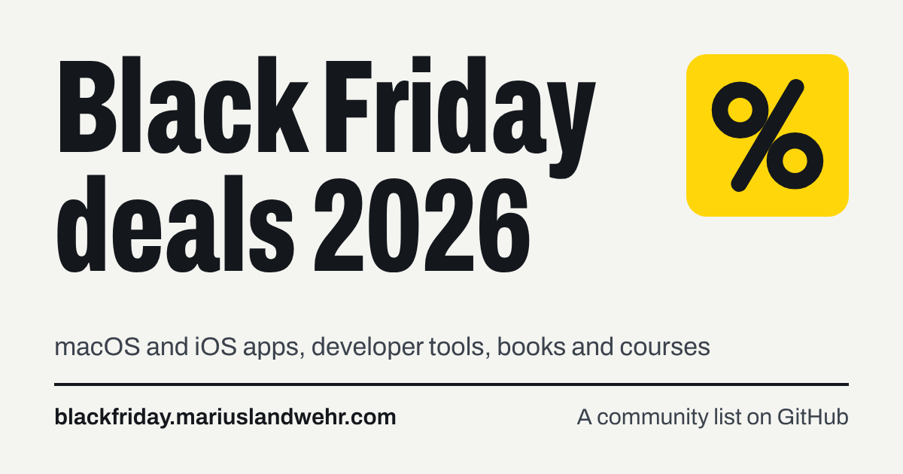

<a href="https://blackfriday.mariuslandwehr.com">
  <picture>
    <source media="(prefers-color-scheme: dark)" srcset=".github/assets/banner-dark.png">
    
  </picture>
</a>

Community-collected Black Friday and Cyber Monday deals on macOS and iOS apps, developer tools, books and courses.

**[Search and filter all deals](https://blackfriday.mariuslandwehr.com)** · **[Submit a deal](https://blackfriday.mariuslandwehr.com/submit/)**

Black Friday is November 27, 2026 and Cyber Monday is November 30. Each offer has its own dates.

<!-- DEALS:START - Everything from here to DEALS:END is generated from the files in deals/. Do not edit it by hand: see CONTRIBUTING.md to add or change a deal. -->

## Categories

**857 deals** in 22 categories. 💸 marks 50% off or more, 💰 less than 50%.

🛠&nbsp;[Development Software](#development-software)&nbsp;`98` · 🤖&nbsp;[AI Tools](#ai-tools)&nbsp;`80` · 🌈&nbsp;[Marketing Software](#marketing-software)&nbsp;`32` · 🎩&nbsp;[Security Software](#security-software)&nbsp;`30` · 🎛&nbsp;[Utility Software](#utility-software)&nbsp;`168` · 📌&nbsp;[Productivity Software](#productivity-software)&nbsp;`147` · 🎥&nbsp;[Video Software](#video-software)&nbsp;`49` · 🎨&nbsp;[Graphic Software](#graphic-software)&nbsp;`52` · 🏝️&nbsp;[Lifestyle](#lifestyle)&nbsp;`30` · 🗣️&nbsp;[Social](#social)&nbsp;`9` · 🎓&nbsp;[Reference & Education](#reference--education)&nbsp;`18` · 📖&nbsp;[Books](#books)&nbsp;`1` · 👩‍🎓&nbsp;[Courses and Videos](#courses-and-videos)&nbsp;`17` · 📈&nbsp;[Business Software](#business-software)&nbsp;`24` · 🏃🏻‍♀️&nbsp;[Health & Fitness Software](#health--fitness-software)&nbsp;`31` · 🎁&nbsp;[Bundles](#bundles)&nbsp;`5` · 🎶&nbsp;[Creative Content](#creative-content)&nbsp;`8` · 🤑&nbsp;[Finance](#finance)&nbsp;`18` · 🗺️&nbsp;[Navigation](#navigation)&nbsp;`3` · 🔎&nbsp;[SEO](#seo)&nbsp;`24` · 🏡&nbsp;[Home Automation](#home-automation)&nbsp;`2` · 🕹&nbsp;[Games](#games)&nbsp;`11`

## 🛠 Development Software

|  | Name | Offer |
| :-: | --- | --- |
| 💰 | **[Proxyman](https://proxyman.com/)** Capture, inspect, and modify HTTP/HTTPS traffic with a native debugging proxy. | <b>30% off all plans</b> `BF2026` · Nov&nbsp;16&nbsp;–&nbsp;Dec&nbsp;3 |
| 💰 | **[Device MCP](https://devicemcp.ai/)** Mirror and control iPhone and iPad from your Mac, with MCP tools for AI agents. | <b>30% off all plans</b> `BF2026` · applies to early-bird prices · Nov&nbsp;16&nbsp;–&nbsp;Dec&nbsp;3 |
| 💰 | **[TCP Viewer](https://tcpviewer.proxyman.com/)** Capture and inspect TCP/UDP packets in a native macOS app. | <b>30% off all plans</b> `BF2026` · Nov&nbsp;16&nbsp;–&nbsp;Dec&nbsp;3 |
| 💸 | **[Atelier](https://appsbymo.app/atelier/?ref=bf-deals)** A Mac studio your AI coding sessions work in: every app's tasks, releases, feedback and memory, with a brief each time a session starts. | <b>50% off</b> with code **BLACKFRIDAY** at appsbymo.app (regular $19.99). Nov 9 - Dec 1, 2026 |
| 💸 | **[DevUtils](https://devutils.com/?utm_source=mrsbf)** Offline developer toolbox for macOS with Apple Silicon support. | <b>60% off all plans</b> `BLACKFRIDAY2026` · Nov&nbsp;2&nbsp;–&nbsp;Dec&nbsp;30 |
| 💸 | **[ShipAhead](https://shipahe.ad)** Nuxt starter kit for building and launching a SaaS product. | <b>50% off</b> Automatically applied; no code needed · Nov&nbsp;1&nbsp;–&nbsp;Dec&nbsp;31 |
| 💰 | **[Layerwise](https://layerwise.app/pricing)** Build and ship full-stack apps with database, login, email and cloud storage built in. Use your existing ChatGPT or Claude subscription for AI coding. | <b>20% off all plans for 12 months</b> `BLACKFRIDAY2026` · monthly or annual billing; Redeem by 2026-12-02 |
| 💰 | **[Buildkit for Astro](https://astrobuildkit.com)** Astro design system with blocks, backgrounds, and animated visuals for marketing websites. | <b>Up to 47% off</b> Automatically applied; varies by plan · Nov&nbsp;23&nbsp;–&nbsp;Dec&nbsp;1 |
| 💰 | **[CodedVisuals](https://codedvisuals.com)** Visual and illustration components for React and shadcn/ui, with AI agent skills. | <b>Up to 40% off</b> Automatically applied; varies by plan · Nov&nbsp;23&nbsp;–&nbsp;Dec&nbsp;1 |
| 💸 | **[Tailkit](https://tailkit.com)** Tailwind CSS UI components for React, Vue, Laravel, Alpine.js, and HTML, with an MCP server. | <b>Up to 60% off</b> Automatically applied; varies by plan · Nov&nbsp;23&nbsp;–&nbsp;Dec&nbsp;1 |
| 💰 | **[JuxtaCode](https://juxtacode.app/black-friday/)** Compare Git branches and resolve merge conflicts with ease on macOS. | <b>40% off</b> `BLACKFRIDAY26` · direct purchase from juxtacode.app only, not the Mac App Store · Nov&nbsp;20&nbsp;–&nbsp;Dec&nbsp;1 |
| 💰 | **[Poedit](https://poedit.com/purchase/?utm_source=mRs)** Translations editor for app and websites, supports PO, XLIFF, JSON, RESX and other formats, with built-in auto-translation. | <b>30% off</b> Code **BF26**; one-time or 1st year · Nov&nbsp;4&nbsp;–&nbsp;Dec&nbsp;3 |
| 💸 | **[Runestone](https://apps.apple.com/us/app/runestone-text-editor/id1548193893)** Plain text editor with syntax highlighting for iPhone, iPad, and Apple Vision Pro. | <b>50% off Premium ($4.99 USD)</b> Automatically applied to the one-time in-app purchase. No code needed. November 24–30, 2026. |
| 💰 | **[WhaleDeck](https://apple.co/3NQJi4w)** Effortlessly manage and monitor your Docker servers on your iPhone, iPad, and Mac. | <b>Lifetime 40% off ($57 → $35)</b> Automatically applied; no code needed; 2026-11-27 to 2026-12-1 |
| 💸 | **[1bench](https://1bench.dev/black-friday?utm_source=mrsbf)** Desktop GUI for 25+ databases including PostgreSQL, MySQL, Redis, ClickHouse, MongoDB and Qdrant. Mac, Windows and Linux. | <b>50% off the Solo lifetime licence ($199 → $99)</b> `FCBF26` · lifetime licence only · Nov&nbsp;20&nbsp;–&nbsp;Dec&nbsp;7 |
| 💸 | **[Needling](https://andretan0.gumroad.com/l/leqnw/BLACKFRIDAY)** Claude Code status around the MacBook notch: two thin eyes show what Claude is doing, two bars show your 5-hour and weekly limits, and it nudges you when Claude needs you. Independent app, not made by Anthropic. | <b>60% off</b> **BLACKFRIDAY** (the link applies it); one-time purchase, $9.67 to $3.82; Apple Silicon, macOS 13+; 2026-11-27 to 2026-11-28 PST |
| 💸 | **[Dirstarter](https://dirstarter.com/?discountCode=BF2026)** Next.js directory template with built-in payments, SEO and an MCP server for AI agents. Pay once, launch unlimited directories. | <b>50% off lifetime license ($150 → $75 Basic, $200 → $100 Pro)</b> `BF2026` · one-time purchase · Nov&nbsp;10&nbsp;–&nbsp;Dec&nbsp;1 |
| 💰 | **[POSH](https://poshtui.com/black-friday?utm_source=mrs-bf&utm_campaign=bf2026)** Version-matched Ruby and Rails docs for coding agents via CLI and MCP. Free terminal browser. macOS & Linux. | <b>30% off monthly and yearly plans</b> `BLACKFRIDAY2026` · €7 → €4.90/month, €60 → €42/year; kept while you stay subscribed; new subscriptions only; until 2026-12-02 |
| 💰 | **[Runheed](https://runheed.com/black-friday?ref=mrs-bf-deals)** Error tracking your coding agent can read: Claude Code, Cursor or any MCP client reads the stack trace from your Node.js or Python app, fixes the code and resolves the error. | <b>40% off the first year</b> `RUNHEEDBF26` · annual plans only (Solo $290 → $174, Pro $790 → $474, Scale $1,990 → $1,194), new customers; until 2026-12-03 |
| 💰 | **[FormBold](https://formbold.com/pricing)** Form backend and API; get submissions via email, Slack, Notion, and more. | <b>40% off all paid plans, recurring</b> `BLFCM2026` · all paid plans; discount kept on every renewal; 2026-11-16 to 2026-12-01 23:59 UTC |
| 💸 | **[TailGrids](https://tailgrids.com/pricing)** 600+ Tailwind CSS UI components, blocks, and templates for HTML, React, Vue, and Figma. | <b>50% off All Access plans</b> `BLFCM2026` · All Access plans; 2026-11-16 to 2026-12-01 23:59 UTC |
| 💰 | **[TailAdmin](https://tailadmin.com/pricing)** Tailwind CSS admin dashboard template with 500+ components for HTML, React, Next.js, Angular, and Vue. | <b>30% off all plans</b> `BLFCM2026` · all plans; 2026-11-16 to 2026-12-01 23:59 UTC |
| 💸 | **[TailTemplates](https://tailtemplates.com/all-access)** Premium Tailwind CSS templates for startups, SaaS, and landing pages. | <b>80% off all yearly plans</b> `BLFCM2026` · yearly plans; 2026-11-16 to 2026-12-01 23:59 UTC |
| 💸 | **[UIdeck](https://uideck.com/all-access)** 100+ Tailwind CSS and Bootstrap templates and landing pages. | <b>60% off all plans, recurring</b> `BLFCM2026` · all plans; discount kept on every renewal; 2026-11-16 to 2026-12-01 23:59 UTC |
| 💰 | **[NextJS Templates](https://nextjstemplates.com/all-access)** 20+ Next.js templates, starter kits, and boilerplates. | <b>40% off all plans</b> `BLFCM2026` · all plans; 2026-11-16 to 2026-12-01 23:59 UTC |
| 💸 | **[SaaSBold](https://saasbold.com/pricing)** Full-stack Next.js SaaS boilerplate. | <b>50% off all plans</b> `BLFCM2026` · all plans; 2026-11-16 to 2026-12-01 23:59 UTC |
| 💰 | **[Static.run](https://static.run/pricing)** Static site hosting with analytics and one-click deploy. | <b>30% off all paid plans, recurring</b> `BLFCM2026` · all paid plans; discount kept on every renewal; 2026-11-16 to 2026-12-01 23:59 UTC |
| 💸 | **[CozyCommerce](https://cozycommerce.dev/pricing)** Next.js and Tailwind eCommerce kit with 100+ components and 20+ pages. | <b>50% off all plans</b> `BLFCM2026` · all plans; 2026-11-16 to 2026-12-01 23:59 UTC |
| 💰 | **[NextAdmin](https://nextadmin.co/pricing)** 200+ Next.js dashboard templates and UI components. | <b>40% off all plans</b> `BLFCM2026` · all plans; 2026-11-16 to 2026-12-01 23:59 UTC |
| 💸 | **[NextMerce](https://nextmerce.com/pricing)** Next.js eCommerce boilerplate. | <b>50% off all plans</b> `BLFCM2026` · all plans; 2026-11-16 to 2026-12-01 23:59 UTC |
| 💰 | **[BucketMate](https://www.bucketmate.app/pricing)** S3 GUI for Mac, iPhone, iPad, and web for AWS S3, Cloudflare R2, Backblaze B2, and other S3-compatible storage. | <b>40% off ($39 → $23.40)</b> `BF2026` · lifetime license, one-time purchase · Nov&nbsp;2&nbsp;–&nbsp;Dec&nbsp;1 |
| 💰 | **[HackUtilities](https://hackutilities.com)** Desktop workspace for AI coding agents: dev servers, terminals and Claude Code or Codex sessions side by side, plus 46 offline developer tools. | <b>35% off lifetime licenses</b> `BFCM2026` · one-time purchase · Nov&nbsp;26&nbsp;–&nbsp;Dec&nbsp;12 |
| 💸 | **[Kinsta](https://kinsta.com/black-friday/)** Fast, secure, feature-rich managed hosting for WordPress on next-generation cloud infrastructure, secured by Cloudflare. | <b>3 months free on annual plans or 50% off the first 3 months on monthly plans</b> new customers only · until&nbsp;Dec&nbsp;1 |
| 💰 | **[TablePro](https://tablepro.app/black-friday)** Native database client for Mac and Linux: PostgreSQL, MySQL, SQLite, MongoDB, Redis and more. | <b>40% off Pro one-time ($79 → $47.40) and the first year of Pro yearly ($39 → $23.40)</b> `BLACKFRIDAY2026` · Applied automatically on the site. Pro yearly renews at $39. Pro monthly and Team are not on sale. Ends December 1, 8:00 AM UTC. · Nov&nbsp;19&nbsp;–&nbsp;Dec&nbsp;1 |
| 💰 | **[Perch](https://perch.run/black-friday?ref=mrs-bf-deals)** Mac menu bar app for Claude Code, Codex, Cursor and six more AI coding agents: see every session, and approve from your iPhone and Apple Watch. | <b>40% off the one-time licence, $29 → $17.40, solo or per team seat</b> `BLACKFRIDAY2026` · First 500 orders. The Buy buttons on perch.run apply the code automatically. The Perch Pro iPhone subscription is not part of this offer. · Nov&nbsp;2&nbsp;–&nbsp;Dec&nbsp;1 |
| 💰 | **[DevWorkspace Pro](https://devworkspacepro.com)** One desktop app to run, code and ship any dev project: Files, Git, GitHub, AI agents, terminal, and DDEV, Docker or native runtimes. | <b>40% off all plans</b> `BLACKFRIDAY40OFF` · New purchases; first month on monthly plans. · Nov&nbsp;10&nbsp;–&nbsp;Dec&nbsp;10 |
| 💰 | **[DropDMG](https://c-command.com/store/sale)** Create professional disk images (.dmg files) for your Mac app | <b>25% off</b> `BLACKFRIDAY2026` |
| 💰 | **[MacVisor](https://scaleninja.com/macvisor/)** Run your Mac as a virtualization host: macOS, Windows, Linux & FreeBSD VMs setup automatically with account, SSH keys and guest tools. | <b>15% off with BLACKFRIDAY15</b> `BLACKFRIDAY15` · Nov&nbsp;12&nbsp;–&nbsp;Nov&nbsp;30 |
| 💰 | **[DevIntern](https://devintern.com/pricing/)** Self-hosted worker that turns tracker tickets into PRs with your own coding agent across multiple repos, plus automations. | <b>40% off the first invoice</b> `BLACKFRIDAY26` · Team $99 → $59.40 first month or $990 → $594 first year; Business $299 → $179.40 first month or $2,990 → $1,794 first year; Supporter License $99 → $59.40. Then regular price. · Nov&nbsp;20&nbsp;–&nbsp;Dec&nbsp;1 |
| 💸 | **[SaaSykit](https://saasykit.com/)** Production-ready Laravel SaaS boilerplate with billing (Stripe, Paddle, Lemon Squeezy), auth, admin panel, multi-tenancy and SaaS metrics. Pay once, build unlimited projects. | <b>50% off all versions: SaaSykit ~~$239~~ $119.50, Tenancy ~~$269~~ $134.50, Complete ~~$299~~ $149.50</b> `BLACKFRIDAY26` · Also applied automatically at checkout; one-time purchase with lifetime updates · Nov&nbsp;14&nbsp;–&nbsp;Dec&nbsp;6 |
| 💰 | **[Stratos](https://stratosapp.dev/buy/)** Native Swift macOS PHP 8.1-8.5 & Laravel local dev stack (Nginx, .test HTTPS, Visual Tinker REPL, DB Hub + ER Diagrams, Cloudflare Tunnels, v1.7.1 MCP bridge for Cursor & Claude Code). Zero Docker VM. | <b>20% off Founder Lifetime ($89 -> $71.20, 3 Macs), Pro Annual ($39/yr -> $31.20/yr) & Team ($129/yr -> $103.20/yr)</b> `BFCM20` · Nov&nbsp;15&nbsp;–&nbsp;Nov&nbsp;30 |
| 💰 | **[Toplify](https://toplify.app/)** Our **multi-cloud** infrastructure scans App Store charts **24/7** and tracks your app’s positions in 175 countries. | <b>45% off Lifetime: ~~$89.99~~ → $49.99</b> `BLKFR2026` · Nov&nbsp;15&nbsp;–&nbsp;Dec&nbsp;1 |
| 💰 | **[AtAt](https://atatapp.com/black-friday?ref=bf-mrs)** @ for people. @@ for AI. Call in Claude Code, Codex, Ollama, Siri AI, or your own API key anywhere you type on Mac — emails, chats, docs, or code — with screen, clipboard, and Finder context, plus an atat CLI for terminal agents. | <b>34% off first year of Yearly ($59 → $39), or Lifetime for $89 once ($119 early-bird, $169 regular)</b> Applied automatically at checkout, no code needed. Yearly renews at $59/year; Monthly ($9/mo) is not discounted. 14-day free trial, macOS 15+ (Apple silicon). Runs Nov 24 – Dec 15, 2026 (UTC). · Nov&nbsp;24&nbsp;–&nbsp;Dec&nbsp;15 |
| 💸 | **[RegExp](https://loshadki.app/regexp/)** Write and test regular expressions in Swift Regex, NSRegularExpression, JavaScript, PCRE2 and Go, on Mac, iPhone and iPad. RegExp is free; Pro adds Explain, test cases, Apple Intelligence and every flavor's advanced options. | <b>60% off RegExp Pro: ~~$2.99~~ $1.19</b> In-app purchase on the App Store, no code needed. · Nov&nbsp;14&nbsp;–&nbsp;Dec&nbsp;1 |
| 💸 | **[ShellHistory](https://loshadki.app/shellhistory/)** Keep, search and sync your zsh, bash and fish history on Mac, iPhone and iPad, with statistics, notebooks and Explain Command. | <b>60% off: Mac App Store ~~$13.99~~ $5.59 (iPhone and iPad included), or ~~$13.99~~ $5.60 on loshadki.app</b> `BLACKFRIDAY26` · The code is for the loshadki.app store; on the Mac App Store the price is already lower, no code needed. One-time purchase. · Nov&nbsp;14&nbsp;–&nbsp;Dec&nbsp;1 |
| 💸 | **[SupaYatta](https://supayatta.com?ref=mrs)** Know when your AI agents need you, right from your Mac's notch. Alerts for Claude, Cursor, Cowork and more. | <b>65% off Lifetime ($19.99 → $6.99)</b> `YATTADEAL` · one-time purchase · Nov&nbsp;9&nbsp;–&nbsp;Dec&nbsp;7 |
| 💰 | **[Akev](https://akev.dev/pricing)** Open-source HTTP(S) debugging proxy for macOS, Windows and Linux: inspect, mock and rewrite traffic from browsers, apps, terminals, phones and containers. | <b>30% off the Pro licence ($49 → $34.30, one-time)</b> `BLACKFRIDAY` · One-time purchase with 1 year of updates. Ends Dec 6, 23:59 UTC. · Nov&nbsp;15&nbsp;–&nbsp;Dec&nbsp;6 |
| 💸 | **[KeygenGo](https://keygengo.5km.tech/black-friday?utm_source=gh-mrs&utm_medium=github&utm_campaign=bf2026)** Native Mac client for Keygen.sh: manage products, policies, licenses, users and machines for Keygen Cloud or self-hosted accounts. | <b>50% off on the Mac App Store: Annual first year $19.99 → $9.99, Lifetime $39.99 → $19.99</b> Annual needs offer code `BF2026YEAR` (once per Apple ID). Lifetime is already reduced, no code needed. · Nov&nbsp;20&nbsp;–&nbsp;Dec&nbsp;6 |
| 💰 | **[Diffacto](https://diffacto.com/#pricing)** Compare two versions of any file or folder on your Mac: code, data, documents, images, audio, video and more. | <b>40% off Pro: one-time license $149 → $89.40, yearly $96 → $57.60 for the first year</b> No code needed: the price comes off at checkout. Buy from the app; every purchase can be refunded within 30 days. · Nov&nbsp;23&nbsp;–&nbsp;Dec&nbsp;1 |
| 💰 | **[Pulsetic](https://pulsetic.com/black-friday)** Uptime monitoring for websites, APIs, SSL, domains, DNS and cron jobs from up to 15 regions, alerts by email, SMS, Slack or Telegram, and status pages on your domain. | <b>35% off the first payment: Solo $90 → $58.50/yr, Team $190 → $123.50/yr, Organization $490 → $318.50/yr</b> `BLACKFRIDAY35` · monthly or yearly; new subscriptions and free-plan upgrades; keep 99%+ uptime in the 20-second game for 40% off instead; ends 11:59 PM PT · Nov&nbsp;16&nbsp;–&nbsp;Dec&nbsp;3 |
| 💰 | **[Static.app](https://static.app/black-friday)** Static website hosting: upload HTML, CSS and JS or edit in the browser, custom domains, free SSL, forms, daily backups, and deploys via GitHub Actions, API or MCP. | <b>35% off the first payment: Starter $60 → $39/yr, Medium $120 → $78/yr, Large $180 → $117/yr</b> `BLACKFRIDAY35` · monthly or yearly; new subscriptions; score 600+ in the Bug Invaders game on the deal page for 40% off instead; ends 11:59 PM ET · Nov&nbsp;16&nbsp;–&nbsp;Dec&nbsp;1 |
| 💰 | **[TelemetryDeck](https://telemetrydeck.com/?utm_source=mrsbf&utm_medium=deal-list&utm_campaign=black-week-2026)** Privacy-first app analytics for iOS, macOS, Android, Flutter, React Native and web apps, hosted in Europe. | <b>30% off all plans for one year</b> `WEEK26` · First time customers only · Nov&nbsp;23&nbsp;–&nbsp;Dec&nbsp;1 |
| 💸 | **[Lidnight](https://lidnight.app/en/buy/)** Mac menu bar app that keeps a MacBook awake with the lid closed while AI coding agents (Claude Code, Codex) run, shows what each one is doing, and lets the Mac sleep when they finish. | <b>50% off the one-time license: 1 Mac ~~$9.99~~ $4.99, 3 Macs ~~$14.99~~ $7.50</b> `BF50` · Enter the code at checkout. One-time purchase, no subscription or account. The free version works with the lid open. · Nov&nbsp;23&nbsp;–&nbsp;Dec&nbsp;1 |
| 💰 | **[KittyTrace](https://kittytrace.com/?utm_source=mrs-bf-deals&utm_campaign=bf2026)** Self-hosted, Sentry-compatible error tracking that runs free on your own Cloudflare account or on your server with Docker. Keep the Sentry SDK, change the DSN. One-time purchase. | <b>34% off the one-time license ($29 → $19)</b> `BF2026` · code is applied at checkout from the site; all 1.x updates included; 90-day refund · until&nbsp;Dec&nbsp;1 |
| 💸 | **[Wasmer Pro](https://frontend-edge-ka9bydxry-wasmer.vercel.app/black-friday-2026?utm_source=github_mrs&utm_medium=community&utm_campaign=black_friday_2026)** Cloud hosting for websites, APIs, and web apps, with GitHub deployments, custom domains, SSH, and SFTP. | <b>50% off for 12 months: USD $5/month (was $10) or $50 for the first year (was $100)</b> `BLACKFRIDAY26` · First-time customers; Pro base only; metered usage extra. Monthly: $5/mo for 12 months, then $10/mo. Annual: $50 first year, then $100/year. Ends Nov 30, 2026, 11:59pm Pacific. Official offer page preview; checkout is live. · until&nbsp;Nov&nbsp;30 |
| 💸 | **[Tower](https://www.git-tower.com/)** The most powerful Git client for Mac and Windows | <b>Up to 50% off: Pro 50%, Basic 30%, upgrades and extra seats 50%</b> first year of new subscriptions; upgrades and extra seats for existing customers; applied automatically · Nov&nbsp;23&nbsp;–&nbsp;Dec&nbsp;6 |
|  | **[Seqora](https://seqora.dev/blog/black-friday/)** Desktop database client for PostgreSQL, MySQL, MariaDB, SQLite and SQL Server on macOS, Windows and Linux. Free plan with no account; Pro adds the Plan tab, schema design, schema compare and longer schema history. | <b>Pro $2.99/month for the first 3 months, then $5.99/month (regular $9.99/month)</b> No code needed. One per customer. Local tax added at checkout. · until&nbsp;Dec&nbsp;6 |
|  | **[Social Fetch](https://socialfetch.dev/black-friday?utm_source=mrsbf)** REST API and hosted MCP server for public social data as JSON: profiles, posts, comments, transcripts and search across TikTok, Instagram, YouTube, X, Reddit and more. | <b>Double credits on every plan.</b> New plans only, once per workspace. No code, applied automatically at checkout. Double credits in month one on monthly plans and for the first 3 months on annual plans. Growth pack: 25,000 plus 25,000 free. Ends 1 Dec 2026 08:00 UTC. · Nov&nbsp;19&nbsp;–&nbsp;Dec&nbsp;1 |
| 💸 | **[Chalk](https://getchalk.dev/#pricing)** Whiteboard beside your terminal for Claude Code on macOS. Claude puts its plan on the board; cross out, circle or reorder a step and it fixes the plan before it writes code. | <b>50% off the one-time purchase: ~~$24~~ $12</b> No code needed: applied automatically at checkout (US Pacific dates). 7-day free trial with no card or account, then pay in the app. 7-day refund. macOS 13+. · Nov&nbsp;20&nbsp;–&nbsp;Dec&nbsp;1 |
| 💰 | **[data-peek](https://www.datapeek.dev/pricing?utm_source=mRs)** Fast, keyboard-first SQL client for PostgreSQL, MySQL, SQL Server, SQLite and ClickHouse on macOS, Windows and Linux. Free for personal use. | <b>40% off Pro: ~~$29/year~~ $17.40/year</b> `BF26PEEK` · Pro is the licence for commercial use. The code is applied automatically at checkout. Ends December 1 at 23:59 US Pacific. · Nov&nbsp;26&nbsp;–&nbsp;Dec&nbsp;1 |
|  | **[MailScope](https://mailscope.app/blackfriday/)** Native email debugging for Mac. Catch, preview and check development emails locally before they reach your users. | <b>One-time US$29 → US$19 (save US$10)</b> `bf2026` · Code is prefilled on the checkout link. One-time licence for up to two Macs (macOS 14+), with 12 months of updates. Dates are US Pacific. · Nov&nbsp;18&nbsp;–&nbsp;Nov&nbsp;30 |
| 💰 | **[SoarStarter](https://soarstarter.com/?utm_source=mrs-bf&utm_campaign=bf2026#pricing)** Starter kits for web, mobile and desktop: Next.js, Nuxt, TanStack Start, SwiftUI, Kotlin, Expo, Electron and Tauri, with auth and payments built in. One-time purchase. | <b>20% off the All-Access Bundle: all 8 kits ~~$249~~ $199</b> `BF2026` · Applied automatically at checkout on soarstarter.com; one-time purchase with lifetime updates · Nov&nbsp;19&nbsp;–&nbsp;Dec&nbsp;1 |
| 💸 | **[1DevTool](https://1devtool.com?utm_source=mrsbf&utm_campaign=bf2026)** Desktop workbench for AI coding agents: run Claude Code, Codex and other CLIs side by side with a built-in browser, database client, HTTP client and git. Mac, Windows, Linux. | <b>50% off the Pro licence, a one-time purchase ($29 → $14.50 for 1 device)</b> `BFDEALS50` · Pro licence for any number of devices; enter the code at checkout; first 100 redemptions; bundles and All Access excluded · Nov&nbsp;19&nbsp;–&nbsp;Nov&nbsp;29 |
| 💸 | **[Server Compass](https://servercompass.app?utm_source=mrsbf&utm_campaign=bf2026)** Deploy any repo to your own VPS without the terminal: zero-downtime deploys, automatic SSL, rollbacks and self-hosted AI. Mac, Windows, Linux. | <b>50% off the Pro licence, a one-time purchase ($29 → $14.50 for 1 device)</b> `BFDEALS50` · Pro licence for any number of devices; enter the code at checkout; first 100 redemptions; bundles and All Access excluded · Nov&nbsp;19&nbsp;–&nbsp;Nov&nbsp;29 |
| 💸 | **[Fixa](https://fixa.dev/black-friday?utm_source=mrs-bf&utm_medium=deal-list&utm_campaign=bf2026)** AI software engineer with its own cloud machine: hand it a GitHub issue, get a tested pull request. | <b>50% off the first year of yearly plans (Starter $48, Pro $120)</b> `BLACKFRIDAY` · applied automatically at checkout; Starter normally $96/yr, Pro $240/yr · Nov&nbsp;19&nbsp;–&nbsp;Dec&nbsp;1 |
|  | **[Gadwal](https://gadwal.dev)** Native Mac database client for PostgreSQL, MySQL, MariaDB, SQLite, DuckDB, Cloudflare D1, ClickHouse and BigQuery. Built-in local MCP server: AI proposes SQL, you approve each write. | <b>Gadwal Lifetime (one-time in-app purchase): $9.99 launch price until 5 Dec, then $29.99</b> No code needed. Mac App Store in-app purchase. Free download with a 14-day trial and a free tier after. · Nov&nbsp;18&nbsp;–&nbsp;Dec&nbsp;5 |
| 💰 | **[Next.js Launch Skills](https://nandohusni.gumroad.com/l/nextjs-launch-skills)** Agent skills for Claude Code, Cursor and Codex that take a Next.js site from build to launch, with scripts that check the result. | <b>40% off ($9.99 → $5.99)</b> `BF40` · one-time purchase; all 1.x updates included · Nov&nbsp;19&nbsp;–&nbsp;Dec&nbsp;1 |
| 💸 | **[Callout for Claude Code](https://saycallout.com/pricing/?utm_source=bf-marius)** Stop writing bug reports. Hit one key, say what's broken, keep testing: Callout snaps the moment, writes the whole report, and Claude Code fixes it in the background. You already yell at your bugs. Now it works. | <b>60% off: ~~$49~~ **$19.99** once, yours forever</b> Applied automatically, no code. One payment for up to 3 Macs. 7-day free trial. · Nov&nbsp;19&nbsp;–&nbsp;Dec&nbsp;1 |
| 💸 | **[Devkito](https://devkito.com/pricing?utm_source=mrs-black-friday&utm_campaign=bf2026)** 122 developer tools in one offline desktop app for Mac, Windows and Linux: JSON, JWT, regex, Base64, hashes, cURL to code, HTTP client, DNS and more. | <b>50% off every one-time licence: ~~$10~~ **$5** for 1 computer, ~~$15~~ **$7.50** for 2, ~~$30~~ **$15** for 5</b> `BF2026` · applied automatically from the pricing page; ends Dec 2, 11:59 pm PT · Nov&nbsp;20&nbsp;–&nbsp;Dec&nbsp;2 |
| 💰 | **[TeaGo - Gitea Mobile Client](https://teago.artsvit.com/)** Browse repositories, review pull requests, and track issues on your self-hosted Gitea or Forgejo server. [Redeem on the App Store](https://apps.apple.com/redeem?ctx=offercodes&id=6805488091&code=ARTSVITBF20). | <b>About 17.5–20% off Single Lifetime (U.S. $4.99 → $3.99)</b> `ARTSVITBF20` · Eligible App Store regions. Ends Dec 1, 12 a.m. PT or after 500 redemptions per app. Apple Account and acceptance of [Apple terms](https://www.apple.com/legal/internet-services/itunes/ww/) required. No resale or cash value. Offer by Artem Svitelskyi. · until&nbsp;Nov&nbsp;30 |
| 💸 | **[Synclet](https://synclet.dev/)** End-to-end encrypted dotfile and Mac app config sync across macOS and Linux, using Synclet Cloud or your own Dropbox. | <b>50% off one-time license (~~$14.99~~ $7.49)</b> Automatically applied at checkout; no code needed · Nov&nbsp;20&nbsp;–&nbsp;Dec&nbsp;1 |
| 💰 | **[Warplet](https://warplet.app/)** Native macOS app that connects hosted AI clients like ChatGPT, Claude, Perplexity, and Grok to your local MCP servers. | <b>40% off the first year of Annual (~~$14.99~~ $8.99)</b> `BLACKFRIDAY2026` · First year of annual plan via [App Store offer code](https://apps.apple.com/redeem?ctx=offercodes&id=6771262709&code=BLACKFRIDAY2026); renews at $14.99/year · Nov&nbsp;20&nbsp;–&nbsp;Dec&nbsp;1 |
| 💰 | **[ServerDog](https://serverdog.app)** Native Mac app that creates VPS servers, deploys Laravel, PHP and Node sites with zero downtime and monitors them over your own SSH. No hosted panel. | <b>Lifetime licence $199 → $149, Standard $99 → $69</b> Launch price for the first 100 licences; applied automatically at checkout. One-time purchase, no subscription. |
| 💸 | **[ZeroDirs](https://zerodirs.com/#pricing)** The SEO-first & AI-agent ready directory boilerplate with $0/mo hosting bill. | <b>73% off ($49 vs $179) for Black Friday</b> One-time purchase. Enter `EARLY BIRD` at checkout. · Nov&nbsp;20&nbsp;–&nbsp;Dec&nbsp;20 |
| 💰 | **[RunJS](https://runjs.app)** A playground for JavaScript and TypeScript. Zero config needed. Just run your code and see instant feedback. | <b>30% off</b> `BLACKFRIDAY2026` · all plans; 2026-11-20 to 2026-12-01 · Nov&nbsp;20&nbsp;–&nbsp;Dec&nbsp;1 |
|  | **[TanStarter](https://tanstarter.dev/#pricing)** Full-stack SaaS source code for TanStack Start and Cloudflare Workers, including authentication, billing and storage. | <b>TanStarter Lifetime: US$99 instead of US$199 (save US$100)</b> One-time payment. Discount automatically applied at checkout; includes unlimited projects and lifetime updates. · Nov&nbsp;21&nbsp;–&nbsp;Nov&nbsp;30 |
| 💸 | **[Doubles](https://doubles.dev/pricing)** A remote pair programming app for Mac: share your screen sharp enough to read code, let your pair drive when you allow it, and talk and draw together, with guests joining from a browser. | <b>50% off, pay once: ~~US$169~~ **US$84.50**</b> `DOUBLES50` · Code at checkout on doubles.dev. Includes 1 year of updates; you keep the version you have. 14 days free first, no card. macOS 14 or later. · Nov&nbsp;20&nbsp;–&nbsp;Dec&nbsp;1 |
| 💰 | **[KloudUtils](https://kloudutils.com/?utm_source=mrsbf)** Your toolbox for daily work and your AI agents. 55+ tools for code, systems, diagrams, big files, cloud storage, APIs, notes, secrets. Mac, Windows, Linux. | <b>$30 OFF with code BFCM2026_PRO for Pro license: $79.00 -> $49.00 (3 devices - Mac, Windows or Linux); Standard license $39 -> $29 (1 device)</b> Applied automatically at checkout; one-time purchase. · Nov&nbsp;16&nbsp;–&nbsp;Dec&nbsp;6 |
|  | **[MkSaaS](https://mksaas.com/#pricing)** Next.js starter for SaaS and AI apps with authentication, billing, email and working AI examples. | <b>Lifetime license: $99 instead of $199</b> One-time payment; the $100 discount applies automatically at checkout. · until&nbsp;Nov&nbsp;30 |
| 💰 | **[Blob0](https://blob0.com/)** Mac desktop client for browsing, transferring, previewing and sharing files in Cloudflare R2, Amazon S3 and other S3-compatible storage. | <b>20% off one-time Personal and Team licenses</b> `BLACKFRIDAY20` · Personal $16.90 → $13.52 USD; enter the code at checkout; ends Nov 30 at 15:59 UTC · Nov&nbsp;14&nbsp;–&nbsp;Nov&nbsp;30 |
| 💰 | **[ShadcnSpace](https://shadcnspace.com)** Ready-to-use shadcn/ui components, blocks, templates, Figma UI kits, MCP and CLI tools for React and Next.js developers. | <b>40% off</b> `BFCM` · until&nbsp;Dec&nbsp;3 |
| 💸 | **[Code Viewer](https://apps.apple.com/app/apple-store/id756979450?pt=122485603&ct=githab_bl&mt=8)** Read & edit code on iPhone and iPad like in your IDE: syntax highlighting and Go to Definition for any file or GitHub repository, all on the device. Reading is free. | <b>50% off Lifetime ($19.99 → $9.99)</b> Automatically applied to the one-time in-app purchase on the App Store; no code needed. · Nov&nbsp;27&nbsp;–&nbsp;Dec&nbsp;3 |
| 💰 | **[Termalin](https://termal.in/pricing/?utm_source=bf-mrs&utm_medium=referral&utm_campaign=bf2026)** SSH, SFTP and RDP client for Windows, macOS, Linux and iOS that also lets ChatGPT and Claude run commands on your servers without SSH keys. | <b>16 months for the price of 12 on yearly Pro ($96, $8 → $6/mo) plus 100 GB of cloud storage</b> Applied automatically, no code. The 100 GB stays while the account is on Pro. Lifetime and a first monthly payment get the storage too; renewals do not. · Nov&nbsp;23&nbsp;–&nbsp;Dec&nbsp;1 |
| 💰 | **[TailThemes](https://tailthemes.com/?utm_source=mrs-black-friday-deals&utm_medium=listing&utm_campaign=black-friday-2026#all-access)** 26 Tailwind CSS site themes for Next.js and plain HTML, with light and dark modes and an AGENTS.md file for coding agents. | <b>All-access license $129 → $79, one payment</b> All 26 themes, one payment. No code needed. The regular price is $129 from December 2, 2026. · Nov&nbsp;21&nbsp;–&nbsp;Dec&nbsp;1 |
| 💸 | **[SaaScaffold](https://saascaffold.com/pricing)** Agent-first TypeScript SaaS starter for Cloudflare Workers with 40 coding-agent runbooks, 4 payment providers, 4 AI providers, a credit ledger, D1/PostgreSQL support, and an admin center. | <b>50% off Early Access one-time license ($99 → $49 USD)</b> Automatically applied at checkout; no coupon code needed. One-time payment with no recurring subscription or renewal fees. Ends Dec 6, 2026 at 23:59 PST. · Nov&nbsp;21&nbsp;–&nbsp;Dec&nbsp;6 |
| 💸 | **[ShipReady 2026](https://sprintcraft-studio.netlify.app/shipready/)** 5 single-file HTML/Tailwind SaaS landing page templates + 25-pt CRO Playbook. | <b>61% off ($19 instead of $49)</b> Automatically applied; one-time purchase · Nov&nbsp;22&nbsp;–&nbsp;Dec&nbsp;1 |
| 💰 | **[SessionWatcher](https://www.sessionwatcher.com/pricing?ref=p-bf-mrs)** Mac menu bar app that shows your Claude, Codex, Copilot, Cursor and Gemini usage, costs and rate limits live, so you see a limit coming before it stops you. Also on Windows. | <b>25% off the one-time licences: Pro Lifetime $79 → $59, Bundle $19.99 → $14.99</b> Applied automatically at checkout, no code. New purchases only; Pro Annual ($24/year) is not part of the sale. Ends Sunday 6 December at 23:59 Paris time. · Dec&nbsp;1&nbsp;–&nbsp;Dec&nbsp;6 |
| 💰 | **[Polypane](https://polypane.app/black-friday/)** Polypane is the modern web browser for web developers | <b>**25% off** yearly team plans, **22% off** yearly individual plans</b> Choose a yearly plan on the sale page for automatic pricing. · Nov&nbsp;23&nbsp;–&nbsp;Dec&nbsp;1 |
| 💰 | **[ASO Atlas](https://asoatlas.com/?ref=bf-deals)** App Store keyword research and rank tracking for iOS, Mac and Google Play apps: popularity, difficulty, competitors and daily ranks. Web app, native Mac app and MCP for AI agents. | <b>30% off the first year of the Yearly plan: ~~$100~~ $70</b> `BLACKWEEK30` · Applied automatically at checkout on asoatlas.com. Unlimited apps and keywords. Renews at $100/year. · Nov&nbsp;23&nbsp;–&nbsp;Nov&nbsp;30 |
| 💸 | **[Mailbox](https://apps.apple.com/app/mailbox-local-smtp/id6760924337)** Catch every email your app sends, right on your Mac. Mailbox runs local SMTP servers, previews HTML on phone screens, flags broken links and Gmail clipping, copies verification codes in one click and mocks SendGrid and Mailgun. No Docker. | <b>50% off ($49.99 → $24.99), one-time purchase</b> Mailbox Pro Lifetime, applied automatically; new subscribers get 50% off the first year ($29.99 → $14.99) or 40% off the first 3 months ($4.99 → $2.99) · Mac on macOS 26+ · Nov&nbsp;20&nbsp;–&nbsp;Dec&nbsp;1 |
| 💸 | **[BookForge CLI](https://kineticsprint-studio.vercel.app/bookforge.html)** Local-first Markdown-to-PDF commercial book typesetting CLI with 6 editorial styles, running heads, auto TOC, and layout QC gates. | <b>50% off Lifetime License ($119 → $59)</b> One-time lifetime license for macOS and Linux, applied automatically at checkout. · Nov&nbsp;24&nbsp;–&nbsp;Nov&nbsp;30 |
| 💰 | **[SocialAPIs](https://socialapis.io/pricing?utm_source=github&utm_medium=deal-list&utm_campaign=bf2026&utm_content=mrs)** REST API for public Facebook and Instagram data: pages, posts, Marketplace listings, Meta Ad Library ads and Instagram profiles. Free plan with 200 calls a month, no card. | <b>30% off the first 3 months of monthly plans or 17% off the first year of yearly plans</b> `BLACKDATA30` · new customers only; monthly for the first 3 months: Pro $4.99 → $3.49, Ultra $49 → $34.30, Mega $179 → $125.30 · Nov&nbsp;24&nbsp;–&nbsp;Dec&nbsp;1 |
| 💸 | **[Kiikari](https://apps.apple.com/app/id6793062737?pt=283056&ct=bf-github&mt=12)** App Store sales, downloads and reviews in your Mac's menu bar. Kiikari Pro adds Insights and replies to reviews in languages you don't speak. | <b>Kiikari Pro is half price until December 1: $9.99 in the US, then $19.99 again.</b> Applied automatically in the Mac App Store. Kiikari is free to download and Kiikari Pro is an in-app purchase. · Nov&nbsp;25&nbsp;–&nbsp;Dec&nbsp;1 |
| 💸 | **[12happy](https://www.12hpy.com/deals/black-friday?utm_source=mrs-bfdeals&utm_medium=deal-list&utm_campaign=black-friday-2026)** Uptime monitoring for websites, APIs and cron jobs: checks every 30 seconds from up to three locations, alerts by SMS, Slack, Telegram or webhook, and status pages on your own domain. | <b>3 months of Pro free, no card needed, first 100 accounts</b> `BLACKFRIDAY` · new accounts and existing Free accounts; enter the code at sign-up or in Billing; no card · Nov&nbsp;22&nbsp;–&nbsp;Dec&nbsp;1 |
| 💰 | **[ShadcnStore](https://shadcnstore.com/pricing?utm_source=mrs-black-friday&utm_medium=deal-list&utm_campaign=cyber-week-2026)** Production-ready shadcn/ui blocks, pages and templates on Base UI, installed with the shadcn CLI, plus a Figma kit. One-time payment, lifetime updates. | <b>40% off every plan and template: Pro ~~$149~~ $89, Starter ~~$99~~ $59</b> Applied automatically at checkout, no code needed. Ends Dec 1, 11:59 PM PT. · Nov&nbsp;21&nbsp;–&nbsp;Dec&nbsp;1 |
| 💸 | **[Mopup](https://mopup.online/?ref=blackfriday-mrs)** Mac cleaner that knows developer leftovers: build caches, old node_modules, merged git worktrees, Docker data and dev servers coding agents left running. Also caches, duplicates and old apps. Free to scan. | <b>Lifetime license ~~$19.99~~ **$9.99**, one payment for every Mac you own</b> `BF2026` · Applied automatically at checkout on mopup.online. One-time purchase with every update, no subscription, no account. Free to scan and to clean your first 2 GB. · Nov&nbsp;24&nbsp;–&nbsp;Nov&nbsp;30 |
| 💰 | **[GridPin](https://gridpin.dev/buy#snapshot)** Offline geocoder for 13 countries: one file per country, no API key, addresses never leave your machine. CLI, Python, DuckDB and MCP. Open-source engine. | <b>40% off the one-time Snapshot: ~~$199~~ $119</b> November 2026 build of all 13 countries, the files are yours to keep. Applied automatically, no code. Paid in USDC. · Nov&nbsp;25&nbsp;–&nbsp;Dec&nbsp;1 |
| 💰 | **[VimNinja](https://www.vimninja.com/upgrade)** Learn Vim by typing it, not reading about it: short interactive lessons in a real Vim editor that runs in your browser. The first 13 chapters are free, no sign-up. | <b>Lifetime Pro ~~$29~~ $19, one payment for all 82 chapters</b> Applied automatically, no code. Lower in countries with regional pricing. 30-day refund. Ends Nov 30, 11:59 pm PT. · Nov&nbsp;25&nbsp;–&nbsp;Nov&nbsp;30 |

<a href="#categories">↑ Categories</a>

## 🤖 AI Tools

|  | Name | Offer |
| :-: | --- | --- |
| 💰 | **[ScribeToAny](https://scribetoany.com/)** AI audio and video transcription with speaker labels and multilingual translation. | <b>30% off monthly or $20 off yearly</b> **FIRST&#95;30&#95;OFF** (monthly); **FIRST&#95;20&#95;OFF** (yearly) |
| 💸 | **[Cue](https://appsbymo.app/cue/?ref=bf-deals)** Menu-bar writing assistant that drafts and proofreads replies inside Messages, Mail, Slack and WhatsApp, and remembers who you write to. | <b>50% off</b> with code **BLACKFRIDAY** at appsbymo.app (~~$29~~ $14.50). Nov 9 - Dec 1, 2026 |
| 💸 | **[Mo](https://appsbymo.app/mo/?ref=bf-deals)** A little character on your Mac: ask in your own words, typed or spoken, and it tidies files, plans your day and drafts replies, asking first. | <b>50% off</b> with code **BLACKFRIDAY** at appsbymo.app (regular $19.99). Nov 9 - Dec 1, 2026 |
| 💸 | **[TypingMind](https://www.typingmind.com/?utm_source=mrsbf)** Chat UI for ChatGPT, Claude, Gemini, and more, with MCP, plugins, agents, and local storage. | <b>60% off Lifetime Premium</b> `BLACKFRIDAY2026` · Nov&nbsp;2&nbsp;–&nbsp;Dec&nbsp;15 |
| 💸 | **[PromptClaw](https://promptclaw.fyi/)** Save, organize, and reuse AI prompts locally on Android and share them with your PC. | <b>50% off Lifetime ($8.99 → $4.49 USD)</b> No code needed · Nov&nbsp;20&nbsp;–&nbsp;Dec&nbsp;1 |
| 💰 | **[Fluent 2](https://fluentmac.app/?ref=mrsbf)** Context-aware AI assistant for Mac apps, with writing tools, automation, and support for hosted or local models. | <b>25% off lifetime licenses</b> `BF2026` · one-time purchase · Nov&nbsp;1&nbsp;–&nbsp;Dec&nbsp;1 |
| 💸 | **[RewriteBar](https://rewritebar.com?ref=mrs)** Menu-bar AI writing assistant for macOS that fixes grammar, adjusts tone, translates, and rewrites text in any app. | <b>50% off</b> `BF2026` · Standard lifetime license ~~$29~~ $14.50 · Nov&nbsp;2&nbsp;–&nbsp;Dec&nbsp;3 |
|  | **[Outlier](https://outlier.host/)** Private local AI assistant for Mac (Apple silicon, macOS 15+). | <b>Black Friday sale: $16.99 once through December 2. Then $39.</b> No code needed: the Buy button applies the sale; pay once, runs on your computer; free version available; 30-day refund; ends end of 2 December 2026, US Pacific |
| 💰 | **[BoltAI](https://boltai.com/pricing?utm_source=mrsdeals&utm_medium=partner&utm_campaign=bf2026)** Native AI workspace for Mac: ChatGPT, Claude, Gemini and local AI models in one app, now with agents that browse in Chrome and use the apps you allow. | <b>40% off Pro, Pro+ and Lifetime</b> `BFCM2026` · Lifetime ~~$399~~ $239.40, Pro ~~$99~~ $58.80, Pro+ ~~$199~~ $118.80; one-time purchase; until 2026-12-01 |
| 💰 | **[PDF Pals](https://pdfpals.com/buy?utm_source=mrsdeals&utm_medium=partner&utm_campaign=bf2026)** Chat with your PDF, Word, Excel, PowerPoint, EPUB and Markdown files on Mac, with cited answers and built-in local AI models. | <b>Lifetime ~~$249~~ $149; 20% off Basic and Plus</b> Lifetime: automatically applied; **BF20** for Basic (~~$59~~ $47.20) and Plus (~~$99~~ $79.20); one-time purchase; until 2026-12-01 |
| 💰 | **[SmartyTab](https://smartytab.app/)** Private AI autocomplete, writing check and rephrase for every app on your Mac; runs on device. | <b>30% off yearly and lifetime</b> `BF2026` · Lifetime ~~$99~~ $69.30, yearly ~~$49~~ $34.30 for the first year; until 2026-12-01 |
| 💰 | **[Nivon](https://nivon.ai/pricing)** No-code AI customer support chatbot trained on your website and docs, with 95+ languages and human handoff. | <b>40% off all paid plans, recurring</b> `BLFCM2026` · all paid plans; discount kept on every renewal; 2026-11-16 to 2026-12-01 23:59 UTC |
| 💰 | **[Aymo AI](https://aymo.ai/pricing)** All-in-one multi-AI chat platform for developers and teams. | <b>30% off paid plans, recurring</b> `BLFCM2026` · paid plans; discount kept on every renewal; 2026-11-16 to 2026-12-01 23:59 UTC |
| 💰 | **[Meku](https://meku.dev/pricing)** AI builder for websites and web apps. | <b>30% off all paid plans, recurring</b> `BLFCM2026` · all paid plans; discount kept on every renewal; 2026-11-16 to 2026-12-01 23:59 UTC |
| 💰 | **[MeetingDebrief](https://meetingdebrief.com)** Record, transcribe and summarize meetings on your Mac or PC, with no bot in the call and nothing uploaded. | <b>35% off lifetime licenses</b> `BFCM2026` · one-time purchase · Nov&nbsp;26&nbsp;–&nbsp;Dec&nbsp;12 |
| 💰 | **[Vinaa](https://www.vinaa.ai/?utm_source=mrsbf)** Native Mac app for chatting with cloud and local AI models. | <b>Up to 45% off lifetime licenses</b> Until 2026-11-30 |
| 💸 | **[Wovo](https://wovo.one/?ref=mrs2026#pricing)** One MCP that turns any AI into a multi-device agent across all your computers. | <b>50% off Pro and Max yearly: Pro $144 → $72/yr ($6/mo), Max $348 → $174/yr ($14.50/mo)</b> Applied automatically at checkout, no coupon code. Price locked for the subscription. New and existing users. Pro up to 5 computers; Max up to 20 computers + on-demand GitHub runners. · until&nbsp;Dec&nbsp;15 |
|  | **[Orwellix](https://orwellix.com/lifetime-deal?utm_source=mrs-black-friday-deals&utm_medium=deal-directory&utm_campaign=lifetime-deal-2026)** AI writing editor: an agent edits your document in place and you accept or reject every change, plus grammar, readability and plagiarism checks in one document. | <b>Premium $468/yr → Lifetime plan $249 once</b> No code needed. More AI credits, grammar characters and plagiarism words than Premium every month. One per account, only 300 deals · Nov&nbsp;12&nbsp;–&nbsp;Dec&nbsp;31 |
| 💰 | **[Flit](https://flit.fyi/pricing?utm_source=mrsbf2026)** Dictation for Mac that runs on the Mac: hold a key, talk, and clean text lands in any app. Local voice models for 1,600+ languages, a dictionary that learns, and file transcripts. | <b>40% off, from $9 (one year) and $23.40 (lifetime)</b> Applied automatically at checkout, no code needed. One-time purchase, 7-day free trial, 14-day refund. · Nov&nbsp;20&nbsp;–&nbsp;Nov&nbsp;30 |
| 💰 | **[MakeItSay](https://makeitsay.com/pricing?utm_source=mrsdeals&utm_medium=github&utm_campaign=bf2026)** Edit or translate text inside photos, screenshots, and badges while keeping the original font and background intact. Web app, HTTP API, and MCP server. | <b>30% off non-expiring image edit credit packs</b> `BF2026` · 6-edit pack ~~$3~~ $2.10, 40-edit pack ~~$10~~ $7; one-time purchase, credits never expire · Nov&nbsp;13&nbsp;–&nbsp;Dec&nbsp;1 |
|  | **[GetYouTubeTranscript](https://getyoutubetranscript.com/pricing)** YouTube transcripts in the browser, a Chrome extension, a REST API and an MCP server. Export to SRT, VTT, JSON, CSV, Markdown or TXT. | <b>Lifetime access $149 once, 3,000 credits every month</b> No code needed: lifetime card on the Individuals tab of the pricing page. First 100 buyers, one per account, coupons do not stack. Ends Dec 10, 23:59 UTC · Nov&nbsp;14&nbsp;–&nbsp;Dec&nbsp;10 |
| 💰 | **[NotebookLM Tools](https://www.nlmtools.com/pricing?utm_source=mrs-black-friday-deals&utm_medium=referral&utm_campaign=black-friday-2026)** Chrome and Firefox extension that adds 35+ features to NotebookLM (now Gemini Notebook): bulk import, folders and collections, source export and saved prompts. Pro adds batch generation of quizzes, flashcards, slides and reports. | <b>30% off 1-Month and 1-Year Pro: ~~$7~~ $4.90 and ~~$29~~ $20.30</b> `BLACKFRIDAY2026` · One-time payments, no subscription; Lifetime not included · Nov&nbsp;14&nbsp;–&nbsp;Dec&nbsp;2 |
| 💸 | **[Radiantly](https://radiantly.space/pricing)** Radiantly helps experts turn their knowledge into branded AI agents with interactive experiences, personalized responses for each client, and connections to 1,600+ apps. | <b>60% off the first annual subscription payment for new users</b> `BF60` · Pro: $91.20 for the first year (normally $228/year). Max: $283.20 for the first year (normally $708/year). BF60 does not apply to renewals. Dates are UTC. · Nov&nbsp;15&nbsp;–&nbsp;Dec&nbsp;15 |
| 💰 | **[NotchLive](https://notchlive.app/pricing#plans)** Follow calls and videos with private live captions on your Mac. Pro adds supported live translation, searchable recordings and transcript export. | <b>20% off one-time Pro: US$29 → US$23.20 before tax</b> Automatically applied at checkout. Local pricing may vary. Ends at 17:00 UTC. · Nov&nbsp;15&nbsp;–&nbsp;Dec&nbsp;17 |
| 💰 | **[HiAPI](https://hiapi.ai/en/promotions/black-friday-2026?utm_source=github&utm_medium=awesome-list&utm_campaign=bf26&utm_content=Black-Friday-Deals)** Pay-as-you-go API for image, video, audio and text models — GPT Image, Seedance, Kling, Veo, DeepSeek, Claude, Grok and Qwen behind one key; OpenAI-compatible text endpoints, async task APIs for media, automatic refunds on failed tasks. | <b>Up to 10% extra credit on top-ups and up to 20% back on image, video and audio spending</b> No coupon code. Top-ups earn up to 10% extra credit (max $50); media spend returns up to 20% (max $100, credited Dec 3), so $500 topped up and spent on media can reach $650 in credit. Paid accounts get 10M free DeepSeek V4.1 Flash tokens daily. · Nov&nbsp;24&nbsp;–&nbsp;Dec&nbsp;1 |
| 💰 | **[Orchard](https://orchard.5km.tech/black-friday?utm_source=gh-mrs&utm_medium=github&utm_campaign=bf2026)** Menu-bar Mac app that lets AI assistants read and control 11 Apple apps (Mail, Notes, Calendar, Reminders, Messages and more) through Agent Skills, MCP or a CLI, all locally with no open ports. | <b>33% off Pro Annual (first year, $24.99 → $16.74) and Lifetime ($39.99 → $26.79)</b> `BF2026` · Monthly plan not included. Annual discount applies to the first year. · Nov&nbsp;20&nbsp;–&nbsp;Dec&nbsp;6 |
| 💸 | **[DuoTyping](https://duotyping.com/pricing?utm_source=mrs-bf)** Underlines grammar, spelling and tone mistakes as you type in any app, with no daily limit on checks. Predicts your next words, rewrites, translates, explains words you read and answers questions. Mac, Windows, Chrome/Edge, web. | <b>50% off the first payment of Pro</b> `BFCM2026` · Monthly ~~$9.90~~ $4.95 first month, yearly ~~$89.90~~ $44.95 first year, then regular price. Pro: 300 rewrites, 1,000 translations, 200 asks a day. First Pro purchase only · Nov&nbsp;13&nbsp;–&nbsp;Dec&nbsp;13 |
| 💰 | **[Refine](https://refine.sh/#pricing)** Offline AI writing assistant for Mac. Grammar, autocomplete, rewrites, translation and explanations in 36 languages across your apps, using local models. Grammar checks are free; full features are a 7-day free trial, no account. | <b>35% off one-time license, no code needed, applied at checkout</b> Applied automatically at checkout on refine.sh, no code needed. One-time purchase, no subscription. Ends Nov 30, 11:59 PM PST. · Nov&nbsp;15&nbsp;–&nbsp;Nov&nbsp;30 |
| 💰 | **[EzyStudio](https://ezystudio.com/pricing)** AI website and app builder. Bring your own Claude, ChatGPT or Gemini plan: no credits, no AI markup. | <b>10% off every payment, for good, on every regular plan (monthly, yearly or lifetime)</b> `EARLYBF26` · 14-day free trial and 14-day money-back guarantee. Website $5/mo, App $24/mo, Business $39/mo billed yearly; monthly and lifetime options too. Ends 11:59 PM UTC+6. · Nov&nbsp;16&nbsp;–&nbsp;Nov&nbsp;22 |
|  | **[Talking Avatar](https://talking-avatar.dev/black-friday?utm_source=mrs-black-friday-deals&utm_medium=deal_listing&utm_campaign=bfcm2026)** Photorealistic AI avatars that speak your voice agent's audio in real time ($0.02/min API), plus no-code AI voice agents with the avatar included ($0.06/min). | <b>2x credits: your next top-up is matched up to $100 (pay $100, get $200 of credits)</b> `LAUNCH2X` · Once per account, top-ups from $5. Credits pay for the Realistic Avatars API and Voice Agents, billed per second. No subscription. · Nov&nbsp;17&nbsp;–&nbsp;Dec&nbsp;4 |
| 💰 | **[Podwise](https://podwise.ai/pricing?utm_source=mrsbf&utm_medium=deal_list&utm_campaign=bf2026)** AI podcast app that turns episodes into transcripts, summaries, mind maps and notes you can search and export. | <b>40% off Standard and Pro, monthly or yearly; renewals stay 40% off</b> `BF2026` · All plans, new and existing subscribers; code at checkout on podwise.ai; also Black Friday pricing in the iOS app; ends 2026-12-06 |
| 💸 | **[Wordfully](https://www.wordfully.ai/c/BLACKFRIDAY2026)** AI grammar and spelling checker with rephrasing, tone changes, translation, and word definitions for web and Chrome. | <b>50% off the first monthly or annual Pro payment</b> `BLACKFRIDAY2026` · First-time paying customers only. Monthly USD $20 to $10 first month; annual USD $108 to $54 first year. Prices before tax; normal renewals. Ends Dec 4 at 23:59 Europe/Warsaw (22:59 UTC). · Nov&nbsp;12&nbsp;–&nbsp;Dec&nbsp;4 |
| 💰 | **[AI4MEME](https://ai4meme.com/black-friday?utm_source=mrsbf)** Turn 1, 2, or 3 photos into watermark-free MP4 meme and group dance videos with synchronized sound in your browser. | <b>Up to +33% bonus credits on all plans & packs + up to 27% off Annual</b> Applied automatically at checkout. Lite $9.99/mo (1,600 credits/mo), Starter Pack $9.99 (1,300 permanent credits). · Nov&nbsp;18&nbsp;–&nbsp;Dec&nbsp;2 |
|  | **[SKETCHTALK](https://apps.apple.com/us/app/sketchtalk-draw-to-ai/id6823101740?mt=12&pt=128645013&ct=bf-list)** A Mac app that previews the screen you're building. Draw a mark on it, and Claude Code gets the mark, the part of the page under it, and a picture. | <b>Launch price $6.99 (from Dec 1: $9.99)</b> Mac App Store; price applies automatically · Nov&nbsp;26&nbsp;–&nbsp;Nov&nbsp;30 |
| 💰 | **[Transcribee](https://transcribee.io/black-friday/)** AI transcription for audio and video in 90+ languages, with a meeting recorder for Zoom, Meet and Teams, AI summaries and export to DOCX, PDF, SRT and VTT. | <b>40% off Unlimited, first month or first year</b> `BF2026` · Monthly ~~$25.99~~ $15.59 first month, yearly ~~$199.99~~ $119.99 first year, then regular price. Code already applied on the upgrade page · Nov&nbsp;19&nbsp;–&nbsp;Nov&nbsp;30 |
| 💸 | **[Skillry](https://skillry.dev/pricing)** Curated creative Agent Skills for Claude Code, Codex & Cursor — generate editable slides, websites, images & launch videos from one prompt. | <b>50% off Pro ($9.99 first month or $79 first year) + Founding Lifetime $169 (was $249)</b> Auto-applied at checkout (no code needed). Subscription discounts apply to the first billing period; renewals bill at standard price ($19.90/mo or $158/yr). Founding Lifetime is one-time. Ends Nov 30, 2026 11:59 PM PT. · Nov&nbsp;19&nbsp;–&nbsp;Nov&nbsp;30 |
| 💸 | **[1AIVault](https://1aivault.com?utm_source=mrsbf&utm_campaign=bf2026)** One local memory vault for every AI tool: imports chats from Claude Code, Codex, Cursor and more, sorts them into topics and serves them back over MCP. Stays on your machine. | <b>50% off the Pro licence, a one-time purchase ($29 → $14.50 for 1 device)</b> `BFDEALS50` · Pro licence for any number of devices; enter the code at checkout; first 100 redemptions; bundles and All Access excluded · Nov&nbsp;19&nbsp;–&nbsp;Nov&nbsp;29 |
| 💸 | **[1LocalAITool](https://1localaitool.com?utm_source=mrsbf&utm_campaign=bf2026)** Private AI that runs on your own Mac or PC: chat, summarize PDFs, transcribe audio and generate images offline. No account needed. | <b>50% off the Pro licence, a one-time purchase ($29 → $14.50 for 1 device)</b> `BFDEALS50` · Pro licence for any number of devices; enter the code at checkout; first 100 redemptions; bundles and All Access excluded · Nov&nbsp;19&nbsp;–&nbsp;Nov&nbsp;29 |
| 💰 | **[Pocket AI — No Internet](https://apps.apple.com/us/app/pocket-ai-no-internet/id6759989702?pt=128572449&ct=bf26-mrs&mt=8)** Offline AI chat for iPhone and iPad. Download an open model once (Qwen, Llama, Gemma and more), then chat with no internet and no account. Prompts and replies stay on your device. Free to download; Pro is a one-time purchase. | <b>Pro Lifetime $9.99 → $6.99 (about 30% off)</b> One-time purchase, no subscription. Applied automatically in the App Store, no code needed. US price; local prices vary. The app is free to download. · Nov&nbsp;27&nbsp;–&nbsp;Nov&nbsp;30 |
| 💰 | **[Oil UI Pro](https://ui.oiloil.org/en/pro/)** Full UI/UX design workflow skill for Claude Code, Codex, Cursor & AI coding agents (3-direction HTML comparison, DESIGN.md governance, real-browser screenshot review). | <b>20% off one-time purchase ($14.99 → $11.99)</b> `BFCM2026` · One-time purchase with lifetime updates + 100 bonus image credits. Enter code BFCM2026 at checkout. · Nov&nbsp;20&nbsp;–&nbsp;Dec&nbsp;2 |
| 💸 | **[Sabi](https://meetsabi.com/pages/blackfriday?utm_source=github&utm_medium=deal-list&utm_campaign=blackfriday2026&utm_content=mrs)** AI employee for small business owners that you text like a person. Sabi answers your email, runs your calendar, follows up with leads and posts to your social media. Text message, web and iPhone. | <b>50% off 6 months of Sabi Pro: $995 → $495</b> Automatically applied, no code. New and existing members. Renews at $495 every 6 months. Ends midnight Pacific. · Nov&nbsp;20&nbsp;–&nbsp;Nov&nbsp;30 |
| 💸 | **[Diagramly](https://diagramly.ai/pricing)** Turn text, screenshots, and whiteboard photos into editable diagrams, then refine them with AI. | <b>70% off the first year: Basic US$29.70, Plus US$53.70</b> `BLACKFRIDAY26` · New annual subscriptions. Basic renews at US$99/year and Plus at US$179/year. Enter the code at Paddle checkout. Ends Nov 30, 11:59 p.m. ET. · Nov&nbsp;20&nbsp;–&nbsp;Nov&nbsp;30 |
| 💰 | **[TranslateManga](https://translatemanga.net/?pricing_mode=annual#pricing)** Read raw manga, manhwa and webtoons in your language. AI translates the text right inside the original speech bubbles, with the art untouched. 50+ languages, web app + Chrome extension. | <b>40% OFF: plans from ~~$10~~ **$6**/mo. Our lowest price ever, no code needed</b> Standard & Pro, billed yearly, first year. Applied automatically at checkout. · Nov&nbsp;20&nbsp;–&nbsp;Dec&nbsp;1 |
|  | **[Effect Video](https://effect.video/black-friday)** Turn photos into cinematic AI video effects: 29+ ready-made effects like Hotel Lobby, Snow Globe and Santa Hug. Pick an effect, add one or two photos, get a shareable MP4. Purchased credits never expire. | <b>+50% bonus credits on every credit pack and annual plan, at the same prices</b> Auto-applied at purchase, no code needed. Annual plans get the +50% bonus on every monthly credit grant in the first year. Excludes top-ups, monthly plans and the Welcome plan. Bonus credits never expire. · Nov&nbsp;24&nbsp;–&nbsp;Dec&nbsp;1 |
| 💰 | **[Read My Dream](https://readmydream.com/plus)** Dream journal with AI readings. Plus reads each new dream against your past ones and adds a deep reading and a painting of each dream. Web, in five languages. | <b>10% off the first year or first month of Plus</b> Applied automatically at checkout; yearly $39.99 → $35.99 after the 7-day trial, monthly $6.99 → $6.29; renews at the regular price · Nov&nbsp;20&nbsp;–&nbsp;Dec&nbsp;1 |
|  | **[APIKO](https://apiko.app/)** Pay-as-you-go, OpenAI-compatible API gateway for text, image and video models. | <b>10% extra API credits on every paid top-up. Pay $100 and get $110 in credit.</b> Applies automatically to new and existing customers. No promo code. Ends November 27 at 11:59 p.m. Pacific Time. · Nov&nbsp;12&nbsp;–&nbsp;Nov&nbsp;27 |
|  | **[FastScribe](https://fastscribe.org/pricing)** Web app for audio/video and social-link transcription, subtitles and AI summaries. | <b>Save $31: Pro $89 first year (normally $120/year) + 6,500 bonus credits</b> Accounts without active subscription only. Renews at $120/year; cancel renewal anytime. Automatically applied. Bonus credits valid 365 days. Ends Nov 30 at 11:59 PM Pacific. · Nov&nbsp;17&nbsp;–&nbsp;Nov&nbsp;30 |
| 💸 | **[BibiGPT](https://bibigpt.co/en/shop?ref=BLACKFRIDAY&utm_source=mrsbf&utm_campaign=bf2026)** AI summaries, transcripts and Q&A for YouTube videos, podcasts, local audio and video files. Native Mac app (Apple Silicon and Intel, notarized), Windows and web. | <b>50% off Plus and Pro, first payment (Plus yearly $142.56 → $71.28)</b> `BLACKFRIDAY` · Code is applied automatically from the link; one subscription covers the Mac app, Windows and web; ends 11:59 pm PT · Nov&nbsp;12&nbsp;–&nbsp;Dec&nbsp;1 |
| 💰 | **[Moonsmith](https://moonsmith.app/?ref=bf-deals)** A native Mac app for a team of AI agents that delegate to each other, each on the model you choose: a built-in local model, 22 providers or your AI subscription. | <b>20% off the first year of Pro</b> `BLACKFRIDAY26` · yearly plan, €79 → €63.20 the first year; renews at €79; free plan and 14-day trial without a card · Nov&nbsp;23&nbsp;–&nbsp;Dec&nbsp;1 |
| 💸 | **[Advanced AI Actions](https://apps.apple.com/us/app/advanced-ai-actions/id6743052292)** Use OpenAI, Claude, Gemini, GitHub Copilot, and custom AI providers inside Apple Shortcuts on iPhone, iPad, and Mac. | <b>50% off the app (~~$2.99~~ $1.49 one-time purchase)</b> Automatically applied on the App Store; no code needed · Nov&nbsp;20&nbsp;–&nbsp;Dec&nbsp;1 |
|  | **[Transync AI](https://www.transyncai.com/black-friday/)** Real-time AI translation for meetings, with bilingual subtitles and voice in 60 languages, on Windows, Mac, iPhone, Android and Web. | <b>$20 off Personal Premium annual ($89.90 → $69.90)</b> Auto-applied, no code. New annual or monthly-to-annual only; renewals excluded. Also $20 off a 100-hour Time Card (up to 5 per account). Not available in the China region. · Nov&nbsp;24&nbsp;–&nbsp;Dec&nbsp;1 |
| 💸 | **[YIX](https://yix.ai/pricing)** Create AI images and videos from text or photos in your browser, including product photos and short UGC-style clips. | <b>50% off the first month of Starter, Pro, and Max monthly plans</b> Auto-applied at checkout. First month / monthly renewal: Starter $9.95 / $19.90, Pro $24.95 / $49.90, Max $49.95 / $99.90. From Nov 20, 2026 00:00 UTC to Dec 1, 2026 00:00 UTC (exclusive). Annual plans and credit packs excluded. · Nov&nbsp;20&nbsp;–&nbsp;Nov&nbsp;30 |
| 💰 | **[GoStudio.ai](https://www.gostudio.ai/pricing)** AI photo and video studio with 38+ one-click tools for headshots, product photos and image-to-video | <b>Up to 30% off monthly plans above 1,000 credits and all yearly plans</b> `BLACKFRIDAY30` · Applies to monthly plans above 1,000 credits and all yearly plans — not one-time plans or monthly plans of 1,000 credits or fewer. One use per subscription. Valid in 19 countries (US, UK, Canada, Australia, Germany, France and others). · Nov&nbsp;12&nbsp;–&nbsp;Dec&nbsp;1 |
| 💸 | **[FortuneTellerOnline](https://www.fortunetelleronline.app/#pricing)** Free AI fortune teller for tarot, love, career & yes-or-no readings, drawing from a full 78-card Rider-Waite deck with AI-assisted interpretation. | <b>90% off all plans + 10x bonus credits</b> Auto-applied at checkout (no code needed). One-time credits never expire; subscription credits refresh each cycle. Nov 20 - Dec 31, 2026. · Nov&nbsp;20&nbsp;–&nbsp;Dec&nbsp;31 |
| 💰 | **[Enconvo](https://enconvo.com/?utm_source=github-mrs-&utm_medium=deal-list&utm_campaign=black-friday-2026)** Native AI assistant and agent for Mac: automates tasks across your apps, dictates, searches your documents, and runs cloud AI or local models. | <b>30% off every Lifetime license: Standard ~~$59~~ $41.30, Premium ~~$119~~ $83.30, Teams ~~$159~~ $111.30</b> Applied automatically at checkout, no code needed; also 30% off the first payment of an Enconvo Cloud plan; ends Dec 8, 00:00 PT · Nov&nbsp;20&nbsp;–&nbsp;Dec&nbsp;7 |
| 💸 | **[Seedance AI Video Generator](https://www.seeddance.io/pricing)** AI video and image generator with Seedance 2.5, Kling, Veo, Hailuo, Seedream and GPT Image in one workspace. No queue, no watermark. | <b>50% off the Pro plan with annual billing ($29 → $14.50/mo)</b> Applied automatically when you choose Yearly on the pricing page; no code needed. $174 billed yearly. Pro includes 200 credits/mo, 4 parallel generations, no watermark and commercial use. |
|  | **[ConceptViz](https://conceptviz.app/pricing)** AI scientific figures and diagrams for researchers: turn text or papers into editable concept maps, schematics and publication-ready figures. | <b>Lifetime deal: $299 one-time payment, no monthly fee</b> No code needed. Includes 1,500 permanent credits, lifetime Ultra features, permanent 50% off Studio credit packs and a 1-month Agent Pro trial (no API); commercial license included. Prices in USD. · Nov&nbsp;21&nbsp;–&nbsp;Dec&nbsp;1 |
| 💸 | **[CVder](https://cvder.app/pricing)** AI job application tool: paste a job posting and CVder tailors your CV to it, checks the ATS score, writes the cover letter and recruiter email, and tracks every application. | <b>50% off your first payment on any Pro plan: monthly ~~€14~~ €7, annual ~~€84~~ €42</b> `BF2026` · First payment only, on any Pro plan (weekly €4.50, monthly €7, 6 months €22.50, annual €42), then the regular price. Prices in EUR plus VAT where applicable. · Nov&nbsp;27&nbsp;–&nbsp;Dec&nbsp;1 |
|  | **[MakeMidas](https://makemidas.com/pricing)** AI images, videos, music and voiceovers with GPT Image, Nano Banana, Veo, Kling, Seedance and Suno in one app, with one credit balance. | <b>Up to 25% more credits on every credit pack: 125 credits per $1 (e.g. $10 → 1,250 credits instead of 1,000)</b> One-time credit packs, no subscription; applied automatically at checkout, no code; pack credits valid 12 months; ends Dec 1, 23:59 UTC · Nov&nbsp;20&nbsp;–&nbsp;Dec&nbsp;1 |
| 💸 | **[Right Suite](https://rightsuite.co/?ref=bf-mrs)** Test your price, landing page, cold email or ad on 100+ AI-simulated buyers modelled on your audience. See whether they'd pay and what to change, in about 20 minutes. | <b>First month of Starter free</b> `BLACKFRIDAY` · Starter plan; then $4.99/month, cancel any time; limited to the first 100 founders · Nov&nbsp;22&nbsp;–&nbsp;Dec&nbsp;31 |
| 💸 | **[Narration Box](https://narrationbox.com/pricing)** AI voices for audiobooks and voiceovers: multi-voice casting, voice cloning and 80+ languages from a PDF, EPUB, DOCX or URL. | <b>55% off the first year of all annual plans</b> No coupon code needed, auto-applied at checkout. Plus $9/mo (was $20), Pro $18/mo (was $40), Scale $45/mo (was $100). · Nov&nbsp;22&nbsp;–&nbsp;Dec&nbsp;2 |
| 💰 | **[LLM Radar](https://llm-radar-eta.vercel.app/?utm_source=mrs-black-friday-deals&utm_medium=deal-list&utm_campaign=bf2026)** Activity Monitor for local AI on the Mac. Shows which models Ollama, LM Studio, MLX and llama.cpp hold in RAM, which app loaded them, and how much disk your model files use. Monitoring is free. | <b>40% off Pro, one-time: 1 Mac $9.99 → $5.99, 3 Macs $14.99 → $8.99</b> `BF2026` · One-time purchase, no subscription. Code is pre-filled from the site, or enter BF2026 at checkout. Monitoring is free, 7-day full trial with no card. Apple silicon, macOS 14 or later. Ends December 1, 11:59 pm PT. · Nov&nbsp;9&nbsp;–&nbsp;Dec&nbsp;1 |
| 💰 | **[AgentScribe](https://apps.apple.com/app/apple-store/id6813940342?pt=128973943&ct=bf26-mrs&mt=12)** Gives the AI apps you use one memory they share. Nothing an assistant writes is kept until you approve it. One file on your Mac, no network access. | <b>25% off, $19.99 → $14.99</b> One time purchase on the Mac App Store, no subscription. No code, the price changes automatically. · Nov&nbsp;27&nbsp;–&nbsp;Dec&nbsp;1 |
| 💰 | **[Leelo](https://leelo-ai.com/black-friday?utm_source=github-mrs)** AI voice studio on the web: text to speech with 1,150+ voices, video dubbing, voice cloning, transcription, noise removal, a voice changer, sound effects and an AI script writer. | <b>Lifetime deals from $59: Basic ~~$79~~ $59, Pro ~~$199~~ $149, paid once + 50% more credits on every pack</b> No code needed, applied at checkout. Credits every month for good: Basic 35,000 and 1 custom voice, Pro 80,000 and 2 custom voices; 500 places each. Up to 30% off a first plan. Ends Dec 1, 23:59 PT. · Nov&nbsp;24&nbsp;–&nbsp;Dec&nbsp;1 |
| 💰 | **[Voibe](https://www.getvoibe.com/pricing/)** Private AI dictation and bot-free meeting notes for Mac and Windows. Open-source models, on-device or zero-retention cloud, never used to train AI. | <b>25% off every plan (Dictation and Work, monthly, annual and lifetime)</b> `BFCM26` · Monthly plans keep 25% off every month. Dictation lifetime $199 → $149.25; Work lifetime $399 → $299.25. · until&nbsp;Nov&nbsp;30 |
| 💸 | **[HookTide](https://hooktide.io/pricing)** AI that learns your LinkedIn writing voice and drafts posts, comments and DMs that sound like you. | <b>50% off the first year of the Pipeline yearly plan ($588 → $294, about $24.50/mo)</b> `BLACKFRIDAY50` · applied automatically at yearly checkout; renews at $588 · Nov&nbsp;23&nbsp;–&nbsp;Dec&nbsp;1 |
| 💸 | **[Band·je - Record & Transcribe](https://band.je/)** Record calls on your Mac without a bot and get the transcript with who said what, on device in 25 languages, plus fast dictation for prompting. | <b>50% off Band·je Unlimited, a one-time purchase (€19.99 → €9.99)</b> `BLACKFRIDAY` · Code for the band.je download; in the App Store the price is already lowered, no code needed · Nov&nbsp;27&nbsp;–&nbsp;Dec&nbsp;1 |
| 💰 | **[LocalVoice](https://tidyware.app/localvoice/?utm_source=mrsbf)** Transcribe recordings and videos on your Mac without uploading them, export TXT, SRT, VTT or Markdown, and read text or PDFs aloud into M4A files. | <b>30% off: $19 → $13.30, one-time purchase</b> `BF2026` · Already applied when you click Buy on tidyware.app; macOS 14+; 14-day refund · Nov&nbsp;24&nbsp;–&nbsp;Dec&nbsp;1 |
| 💰 | **[NotePorter](https://tidyware.app/noteporter/?utm_source=mrsbf)** Local MCP server for Apple Notes: Claude, Cursor and Shortcuts can search, read, create and append to your notes, on your Mac. Never deletes notes. | <b>30% off: $15 → $10.50, one-time purchase</b> `BF2026` · Already applied when you click Buy on tidyware.app; macOS 14+; 14-day refund · Nov&nbsp;24&nbsp;–&nbsp;Dec&nbsp;1 |
| 💸 | **[memecub](https://memecub.com/pricing?utm_source=mrs-bf&utm_campaign=bf2026)** Meme search engine your AI agent can use: find reaction memes and GIFs, let AI place memes into a post, or draw a new meme from a line of text. MCP, API and CLI. | <b>50% off your first payment on any plan: Hobby ~~$3~~ $1.50 first month, Pro yearly ~~$90~~ $45 first year</b> automatically applied at checkout; once per account; credit packs excluded; renews at the regular price; ends 11:59 PM US Pacific · Nov&nbsp;24&nbsp;–&nbsp;Dec&nbsp;2 |
| 💰 | **[EarlyLore](https://earlylore.com/pricing)** AI product discovery & competitive intelligence across 540K+ products, traffic, Design DNA & 14 MCP tools. | <b>25% off Annual Year 1 (Pro $144 -> $108/yr, Max $384 -> $288/yr)</b> `BF2026` · Year 1 only, auto-applied, renews at $144/$384/yr; 1-Year Pass eligible · Nov&nbsp;24&nbsp;–&nbsp;Nov&nbsp;30 |
|  | **[OnBuzz](https://onbuzz.loxia.ai/surprise/lULhJM9vUvF0MY9vIEcNAWj-?utm_source=mrsbf&utm_campaign=bf2026)** A small team of AI agents with their own roles, tools and models that hand work to each other, in the browser or as a desktop app. | <b>Black Friday gift box: every signed-in account opens one free surprise gift (800 in total), on top of the free plan with 100K credits and no card.</b> Sign in and open the gift box at the link. No code needed. One gift per account while they last. · Nov&nbsp;24&nbsp;–&nbsp;Dec&nbsp;4 |
|  | **[Kollab](https://kollab.im/black-friday)** One shared AI workspace for your team — all major models, 1,000+ apps, unlimited seats, one credit pool. Agents research, create, publish and report on a schedule across 1,000+ connected apps. | <b>Annual Pro $168/yr (reg. $216), Max $1,680/yr (reg. $2,160), plus 15% off all credit packs</b> Auto-applied at checkout, no code needed, no quantity limit. Credit packs never expire, e.g. 15,000 credits $42.50 (reg. $50). Paid workspaces can buy credit packs directly; free workspaces must upgrade first. · Nov&nbsp;24&nbsp;–&nbsp;Nov&nbsp;30 |
| 💰 | **[ClaudeKit](https://claudekit.app/pricing?utm_source=mrs-bf&utm_medium=directory&utm_campaign=bf-2026)** Chrome and Edge extension for claude.ai: a live usage circle with the exact limit reset time, a heads-up at 90%, chat forks, pins and a prompt library. Independent, not made by Anthropic. | <b>First year of Pro annual $28 → $20</b> Applied automatically at checkout, no code. Renews at $28/year. Every install also gets a 7-day Pro trial, no card. Ends 07:59 UTC on Dec 2. · Nov&nbsp;24&nbsp;–&nbsp;Dec&nbsp;2 |
| 💰 | **[Meboki](https://meboki.com/?ref=mrs-bf-deals#pricing)** Native, open-source Mac grammar checker that works offline. Checks English as you type in any app with a model that runs on your Mac, so your text never leaves it. Underlines mistakes and fixes them in place. | <b>$10 off the one-time license ($39 → $29 for 1 Mac)</b> Applied automatically at checkout, no code needed. One-time purchase, no subscription; every future update included. 7-day free trial, no account. Apple silicon, macOS 14+. Ends Dec 1, Pacific time. · Nov&nbsp;21&nbsp;–&nbsp;Dec&nbsp;1 |
| 💰 | **[Rakazo](https://rakazo.com/black-friday/)** Rakazo is an open source Grok Bot alternative for persistent AI teammates that do real work. Your keys, your model, your machine. | <b>30% off the first year of yearly plans (Standard $12 → $8.40/mo, Pro $39 → $27.30, Max $79 → $55.30, Ultra $159 → $111.30), 7-day free trial</b> `BLACKFRIDAY30` · New customers only, yearly plans, first year · Nov&nbsp;24&nbsp;–&nbsp;Nov&nbsp;30 |
| 💰 | **[Whizi](https://whizi.io/pricing/?utm_source=mrs-bf-deals&utm_medium=deal-list&utm_campaign=bf2026)** One subscription for Claude, ChatGPT, Gemini and other AI models, with image, video and music in the same chat. Web, iPhone and Android, no API keys. | <b>30% off the first year of any annual plan</b> Automatically applied at checkout on annual plans: Starter ~~$131.99~~ $92.39, Pro ~~$239.99~~ $167.99, Powerhouse ~~$419.99~~ $293.99; renews at the regular price; until Dec 24, 11:59 pm PT · Nov&nbsp;24&nbsp;–&nbsp;Dec&nbsp;24 |
| 💸 | **[Zeptap](https://zeptap.com/pricing)** Mac app that lets Claude, Codex or any MCP agent use your real iPhone and its apps. No Xcode, no developer account, nothing to install on the phone. | <b>50% off every plan: Lifetime $199 → $99 once, Lifetime Plus (up to 5 iPhones) $399 → $199 once, Monthly $49 → $25</b> Applied automatically, no code needed; free first hour to try before paying · until&nbsp;Dec&nbsp;1 |
| 💰 | **[Spring Prompt](https://springprompt.com/plans)** Two lines of code that test every LLM prompt in your app on other models and better wordings, and tell you when a cheaper model or a prompt fix would do the job. | <b>40% OFF the first 3 months of either plan: Basic $29.40/mo (was $49), Pro $120/mo (was $200)</b> `BF2026` · Monthly Basic or Pro plan; new subscriptions; prices in USD, excluding tax · Nov&nbsp;25&nbsp;–&nbsp;Dec&nbsp;1 |
| 💸 | **[Apper - AI App & Website Builder](https://apper.io/black-friday)** Build, manage and publish production-ready apps and websites directly from ChatGPT or Claude, with enterprise-level security, database, authentication, permissions, hosting and payments built in. | <b>50% off all paid plans for one year</b> Automatically applied; no coupon code needed. · Nov&nbsp;23&nbsp;–&nbsp;Dec&nbsp;31 |

<a href="#categories">↑ Categories</a>

## 🌈 Marketing Software

|  | Name | Offer |
| :-: | --- | --- |
| 💰 | **[ZipWP](https://zipwp.com/black-friday/)** AI WordPress website builder from the team behind Astra, with hosting, domain, and email. | <b>Up to 47% off all plans, from $79</b> Automatically applied at checkout · Nov&nbsp;5&nbsp;–&nbsp;Dec&nbsp;7 |
| 💰 | **[Outmano](https://outmano.com/?utm_source=mrsbf)** AI competitive intelligence for SaaS teams, with change alerts and MCP access. | <b>30% off any monthly plan for 12 months</b> `BF2026` · new customers only · Nov&nbsp;3&nbsp;–&nbsp;Dec&nbsp;2 |
| 💸 | **[LandinTools](https://tools.landin.page/advertise?ref=Black-Friday-Deals)** Directory of 1,000+ AI and SaaS tools. Get your tool featured for a full year. | <b>50% off Featured listing: $49 → $24.50</b> `BF2026` · one year of Featured placement; Black Friday offer |
| 💰 | **[Quotion](https://quotion.co/#pricing)** Turn Apple Notes into blogs, portfolios and portals. Web-based, no coding required. | <b>30% off all paid plans for 12 months</b> `BLACKFRIDAY2026` · monthly or annual billing · Nov&nbsp;9&nbsp;–&nbsp;Dec&nbsp;2 |
| 💰 | **[Terlido](https://terlido.com/pricing?utm_source=mrsbf&utm_medium=deal-list&utm_campaign=bfcm-2026)** Cold email and newsletters from your own mailbox, with warmup, campaigns, inbox and an AI agent. | <b>40% off for 12 months: Email Pro $39 → $23.40/seat/mo, Newsletter Pro $29 → $17.40/mo</b> `BF2026` · Nov&nbsp;9&nbsp;–&nbsp;Dec&nbsp;1 |
| 💰 | **[LeadMerlin](https://leadmerlin.com/black-friday/?utm_source=mrsbf)** Local business leads (owner names, checked emails, phone line types, site tech) via API, agent skill or dashboard. | <b>40% off</b> `BF2026` · first payment, so the whole first year on yearly plans (Starter $348 → $208.80/yr, Pro $468 → $280.80/yr, Agency $948 → $568.80/yr); monthly plans get 40% off the first month; until 2026-12-02 |
| 💰 | **[Sequenzy](https://sequenzy.com/black-friday)** Email marketing for SaaS: newsletters, automated sequences and transactional email, with unlimited contacts. | <b>30% off any annual plan</b> `BLACKFRIDAY` · annual plans only; e.g. 15,000 emails/month $205 → $143.50/year |
| 💸 | **[Replug](https://replug.io/black-friday)** Link management service for branded short links, bio-link pages and QR codes, aimed at marketers and agencies. | <b>60% off annual plans</b> No code; annual Essentials, Scale and Agency plans; monthly plans and extra Agency workspaces excluded; not combined with regional pricing; ends 11:59 PM Pacific · Nov&nbsp;20&nbsp;–&nbsp;Dec&nbsp;4 |
|  | **[AppTrack Ninja](https://apptrack.ninja/pricing?utm_source=mrs-bf-deals&utm_medium=deal_list&utm_campaign=bfcm2026)** App Store intelligence and ASO for indie developers: new and trending apps, keyword ranks, publisher portfolios, app transfers and competitors' Apple Search Ads, plus an MCP server. | <b>Lifetime Pro $89, one payment (normally $69.99/year)</b> Automatically shown as the Lifetime option on the pricing page; free plan available · until&nbsp;Nov&nbsp;30 |
| 💰 | **[Evendeals](https://www.evendeals.com)** Purchasing power parity pricing for SaaS and digital products. Shows location-based discounts in 150+ countries and blocks VPN abuse. | <b>40% off all plans</b> `BF2026` · the Unlimited lifetime deal is back for November only · Nov&nbsp;13&nbsp;–&nbsp;Dec&nbsp;2 |
| 💸 | **[Ascope](https://ascope.app/?ref=mrs-bf-deals#pricing)** ASO tool and keyword rank tracker for Mac and Windows: daily App Store and Google Play rankings in 50+ countries, with popularity and difficulty for every keyword, plus an MCP server. | <b>Lifetime licence $189 → $69, one payment</b> Automatically applied on the pricing page, no code needed; 14-day money-back guarantee · Nov&nbsp;1&nbsp;–&nbsp;Nov&nbsp;30 |
| 💰 | **[Fourth Feed](https://fourthfeed.com/write?utm_source=mrsdeals&utm_medium=github&utm_campaign=bf2026)** Publish side-by-side sponsored comparison benchmarks on an AI video tools directory. | <b>30% off all maker post credit packs</b> `BF2026` · 1 post ~~$19~~ $13.30, 3 posts ~~$39~~ $27.30, 9 posts ~~$99~~ $69.30; one-time packs, credits never expire · Nov&nbsp;13&nbsp;–&nbsp;Dec&nbsp;1 |
| 💰 | **[own.page](https://own.page/pricing?utm_source=mrs-bf&utm_medium=deal_list&utm_campaign=black_week_2026)** Not another link in bio: a personal website built from live widgets. Sell products, take bookings, collect leads, play your music and show a live Stripe revenue chart, on your own domain. | <b>40% off the first year of Pro, 30% off Business</b> yearly plans; applied automatically at checkout, no code needed; Pro ~~$79.90~~ $47.94 (~~€70~~ €42), Business ~~$199~~ $139.30; ends 23:59 CET · Nov&nbsp;20&nbsp;–&nbsp;Nov&nbsp;30 |
| 💸 | **[Radar Lab](https://partnershipintel.com/?utm_source=mrsbf#pricing)** Find newsletters to sponsor that reach your buyers: ranks 4,700+ newsletters by fit and shows who already sponsors each one, with the real ads. Works in ChatGPT and Claude (MCP). | <b>Pro yearly ~~$299~~ $99/year, locked for as long as you stay</b> Automatically applied at checkout, no code needed · Nov&nbsp;16&nbsp;–&nbsp;Nov&nbsp;30 |
| 💸 | **[Mailzzy](https://mailzzy.com/emails-savings-sale/?utm_source=github&utm_medium=deals&utm_campaign=bf2026)** Email marketing for small businesses: templates and designer, AI-drafted campaigns, A/B testing, segments, automations and reports. Also works from Claude and ChatGPT (MCP). | <b>70% off the first year (annual) or 60% off the first 3 months (monthly)</b> Applied automatically, no code. Standard $97.20 → $32.40 first year, or $9 → $3.60/mo for 3 months (500 contacts). Renews at the regular price · Nov&nbsp;16&nbsp;–&nbsp;Dec&nbsp;14 |
| 💰 | **[Unspam.email](https://unspam.email/black-friday)** Email spam checker: 0-100 spam score in 30 seconds, SPF/DKIM/DMARC and blacklist checks, inbox placement tests, previews on 60+ clients and an AI attention heatmap. | <b>35% off the first invoice of a Custom plan: first year $709.98 → $461.49</b> `BLACKFRIDAY35` · new Custom plan subscriptions, monthly or annual; sort 22 of 25 emails in the spam filter game for 40% off instead; 14-day refund; ends 23:59 UTC · Nov&nbsp;16&nbsp;–&nbsp;Dec&nbsp;1 |
| 💰 | **[Pirsch Analytics](https://pirsch.io)** Privacy-friendly and GDPR-compliant web analytics. | <b>20% for your first payment (annual or monthly)</b> `BLACKFRIDAY26` · Nov&nbsp;17&nbsp;–&nbsp;Dec&nbsp;31 |
| 💸 | **[1MarketingTool](https://1marketingtool.com?utm_source=mrsbf&utm_campaign=bf2026)** Local-first marketing desktop app: AI campaigns, publishing to 17 networks, site audits, SEO and AI-visibility tracking. Your data stays yours. | <b>50% off the Pro licence, a one-time purchase ($29 → $14.50 for 1 device)</b> `BFDEALS50` · Pro licence for any number of devices; enter the code at checkout; first 100 redemptions; bundles and All Access excluded · Nov&nbsp;19&nbsp;–&nbsp;Nov&nbsp;29 |
| 💰 | **[HeySummit](https://heysummit.com/pricing?coupon=V3UlY3Iz)** HeySummit helps you reach new people and sell tickets by hosting a workshop or summit on the web. | <b>40% off the first year of annual Starter, Growth or Success</b> `V3UlY3Iz` · New customers only. Annual Starter is US$234 for the first year, usually US$390. Extra attendee capacity and renewals are charged at the standard rate. Start your 14-day free trial by the end of 30 November GMT to claim the offer. · Nov&nbsp;19&nbsp;–&nbsp;Nov&nbsp;30 |
| 💰 | **[HeyStream](https://heystream.com/pricing?coupon=BF2026)** HeyStream helps marketing teams run branded live webinars and broadcasts, capture audience signals, and trigger smarter follow-up. | <b>Save 40% on your first year of HeyStream.</b> `BF2026` · New customers who start a seven-day trial through the offer link from 19 to 30 November 2026 inclusive (GMT) get 40% off their first year on an annual Launch, Growth or Scale plan. Plans renew at the regular annual price. · Nov&nbsp;19&nbsp;–&nbsp;Nov&nbsp;30 |
| 💸 | **[Appfigures](https://appfigures.com/platform/pricing?utm_source=github&utm_medium=deal-list&utm_campaign=bf26&utm_content=mrs)** ASO and App Intelligence for the App Store and Google Play: competitor keywords, custom product pages, and download and revenue estimates. | <b>50% off monthly or annual plans for 12 months</b> `BF2650` · up to $200/mo discount; upgrade required for existing members · Nov&nbsp;23&nbsp;–&nbsp;Nov&nbsp;30 |
| 💸 | **[OpenFree](https://openfree.tools/advertise)** Book banner, listing-grid, or detail-page advertising on an AI tool directory. | <b>50% off the standard daily ad rate: US$5/day instead of US$10/day</b> 2026-BLACKFRIDAY applies automatically; no code entry. Reserve by November 30 (UTC+8), regardless of ad dates. Subject to availability; no subscription. · Nov&nbsp;21&nbsp;–&nbsp;Nov&nbsp;30 |
|  | **[Mailtea](https://mailtea.app/pricing?utm_source=mrs&utm_medium=deal_list&utm_campaign=black_friday_2026#black-friday)** Transactional and marketing email for people and AI agents, in one product: a REST API, six SDKs, a CLI, an MCP server, SMTP and Mailtea Studio. | <b>3 months free on Pro 25K (25,000 emails a month), then $16 or $21 a month</b> `BLACKFRIDAY26` · New customers; first 100 redemptions; monthly billing only; card required; enter the code at checkout; bills the normal price after 3 months unless cancelled · Nov&nbsp;23&nbsp;–&nbsp;Nov&nbsp;30 |
| 💸 | **[Founder Launch OS 2026](https://sprintcraft-studio.netlify.app/founder-os/)** Notion-importable launch workspace + 50-community directory + 2x PNG Graphics Studio. | <b>64% off ($14 instead of $39)</b> Automatically applied; one-time purchase · Nov&nbsp;22&nbsp;–&nbsp;Dec&nbsp;1 |
| 💰 | **[Highseat](https://highseat.com/pricing?billing=yearly&utm_source=mrsbf&utm_medium=deal-list&utm_campaign=black-friday-2026)** Cookieless web analytics with revenue on every breakdown, net of refunds, so you see which traffic makes money. | <b>40% off the first year of any yearly plan</b> New customers only; applied automatically at checkout, no code needed; 10k events ~~$90~~ $54 for the first year · Nov&nbsp;23&nbsp;–&nbsp;Dec&nbsp;1 |
| 💸 | **[Drip Send](https://apps.apple.com/us/app/drip-send-email-outreach/id6761376058)** Small, personal email outreach on the Mac: short follow-up sequences sent from your own mailbox, not a bulk sender. | <b>Mac app ~~$34.99~~ $16.99</b> Automatically applied: the sale price is set on the App Store, no code. US price; other countries see the local equivalent. All nine Yuzool deals: [yuzool.com/apps/black-friday.html](https://www.yuzool.com/apps/black-friday.html) · Nov&nbsp;25&nbsp;–&nbsp;Dec&nbsp;2 |
| 💰 | **[Gojiberry.ai](https://salesteam.gojiberry.ai/blackfriday?utm_source=github&utm_medium=mRs&utm_campaign=bf2026)** Your AI sales agent finds high-intent prospects and contacts them for you, 24/7. | <b>40% off the yearly plan</b> Discount applied automatically at checkout. · Nov&nbsp;24&nbsp;–&nbsp;Dec&nbsp;2 |
| 💰 | **[AppRankHero](https://apprankhero.com/pricing?utm_source=gh-mrs-&utm_medium=deal&utm_campaign=black_friday_2026)** Native Mac app for ASO that tracks your App Store and Google Play keyword ranks every morning, with keyword research, competitor tracking and an MCP server for AI tools. | <b>30% off annual Pro and Studio plans (Pro $49.99 → $34.99, Studio $124.99 → $87.49)</b> `BLACKFRIDAY30` · First year only, annual plans. Download the Mac app, sign in, choose Upgrade and enter the code at checkout. Free plan: 1 app and 500 keywords. · Nov&nbsp;27&nbsp;–&nbsp;Dec&nbsp;1 |
| 💸 | **[Two Minute Reports](https://twominutereports.com/promotions)** AI-powered Marketing Intelligence Platform helping agencies and marketers to streamline, automate and scale ROI-driven reporting. | <b>50% OFF on Annual Plans</b> `BF502026` · Nov&nbsp;16&nbsp;–&nbsp;Nov&nbsp;30 |
| 💰 | **[WhatsTeam](https://whats.team/?utm_source=mariuslandwehr&utm_medium=deal-listing&utm_campaign=blackfriday2026)** Shared WhatsApp inbox for sales and support teams on the official WhatsApp Business API, with broadcast campaigns, chat assignment and AI agents. | <b>40% off the first 6 months of any monthly plan</b> `BLACKFRIDAY40` · New subscriptions; Starter ~~$29~~ $17.40/mo, Business ~~$69~~ $41.40/mo, Enterprise ~~$119~~ $71.40/mo for 6 months, then the regular price. 14-day free trial, no card. · Nov&nbsp;22&nbsp;–&nbsp;Dec&nbsp;1 |
| 💸 | **[Snov.io](https://snov.io/black-friday)** Snov.io helps businesses find leads, enrich them with email addresses and phone numbers, set up outreach infrastructure, and automate email and LinkedIn campaigns. | <b>Get up to 50% off Snov.io subscriptions this Black Friday</b> `BLACKFRIDAY` · Available to both new and existing customers. · Nov&nbsp;23&nbsp;–&nbsp;Dec&nbsp;4 |
| 💸 | **[Tantra](https://deals.usetantra.com/)** Tantra is an AI-first GTM outreach tool that sends hyper-personalized outreach across email, LinkedIn, WhatsApp and Google Calendar. Every reply lands in one unified inbox. Priced per company, with no per-seat fees. | <b>50% off monthly and yearly Pro and Scale plans for life</b> `TANTRA50` · New customers only. · Nov&nbsp;1&nbsp;–&nbsp;Dec&nbsp;5 |

<a href="#categories">↑ Categories</a>

## 🎩 Security Software

|  | Name | Offer |
| :-: | --- | --- |
| 💰 | **[TinyShield](https://tinyshield.proxyman.com/)** Monitor app connections and block unwanted apps or domains with a macOS firewall. | <b>30% off all plans</b> `BF2026` · Nov&nbsp;16&nbsp;–&nbsp;Dec&nbsp;3 |
| 💸 | **[PortDroid](https://portdroid.net/sale)** Android network toolkit: port scanner, ping, traceroute, DNS, WHOIS, LAN device discovery, WiFi analyser and certificate inspection in one app. | <b>50% off Pro Lifetime ($9.49 → $4.69 USD)</b> `CYBER_2026` · Nov&nbsp;5&nbsp;–&nbsp;Dec&nbsp;4 |
| 💰 | **[OkayTab](https://okaytab.app/)** Browser extension for Chrome, Edge and Firefox that checks every site you open with AI and blocks fake shops, phishing and scam pages. | <b>30% off first period ($3.59 → $2.51 monthly, $8.59 → $6.01 3 months, $22.99 → $16.09 yearly)</b> `BLACKFRIDAY2026` · first billing period only, once per customer · Nov&nbsp;1&nbsp;–&nbsp;Dec&nbsp;5 |
| 💰 | **[SimpleumSafe](https://simpleum.com/en/?utm_source=bf26-mRs)** Keep private photos and important documents in an encrypted safe on Mac, iPhone and iPad. | <b>30% off the one-time purchase and the first year of an annual subscription</b> **No Code needed**; Automatically applied to in-app purchases on the App Store · Nov&nbsp;16&nbsp;–&nbsp;Dec&nbsp;6 |
| 💸 | **[Vibe App Scanner](https://vibeappscanner.com/black-friday)** Live-app and source-code security checks with evidence and fix guidance. | <b>60% off the first month of Go or Pro</b> Automatically applied; first subscriptions only, previous subscriptions and AppSumo excluded. New-account Go $11.60 then $29/month, Pro $19.60 then $49/month (USD). Nov 10–30, 2026, ends 11:59pm Toronto time. |
| 💰 | **[Safe Screen Share](https://www.safescreenshare.com)** Chrome and Firefox extension that auto-blurs emails, API keys and customer data before you screen share or record. Detection runs locally in the browser. | <b>40% off the lifetime license</b> `BF2026` · Nov&nbsp;13&nbsp;–&nbsp;Dec&nbsp;2 |
| 💸 | **[OffSeq Breach](https://breach.offseq.com/#pricing)** Credential-exposure monitoring for your domains across leaked datasets, forums, Telegram channels and marketplaces, with alerts by email, Slack, webhook or API. | <b>50% off the first month: Basic €24 → €12, Pro €60 → €30, Enterprise €120 → €60</b> `BLACK` · First billing period of a new subscription only, then the regular price. Prices excl. VAT. · Nov&nbsp;13&nbsp;–&nbsp;Dec&nbsp;2 |
| 💸 | **[Guard by OffSeq](https://guard.report/monitoring)** Website security and NIS2/GDPR compliance check covering TLS, security headers, DNS and SPF/DKIM/DMARC, with prioritised reports and continuous monitoring. | <b>50% off the full report (€39.90 → €19.95) and the first month of monitoring (€25 → €12.50 per domain)</b> Applied automatically; monitoring renews at €25/month. Prices incl. 21% VAT. The basic scan is free. · Nov&nbsp;13&nbsp;–&nbsp;Dec&nbsp;1 |
| 💸 | **[OffSeq Mirage](https://mirage.offseq.com/pricing)** Real-time honeypot threat intelligence from a worldwide sensor fleet, with attacker clustering, campaign attribution, session replay, blocklists and STIX/MISP exports. | <b>50% off the first 3 months: Starter €49 → €24.50/mo, Pro €149 → €74.50/mo, Business €399 → €199.50/mo</b> `BFCM2026` · Code is pre-filled at checkout; first 3 months, then the regular price. Prices excl. VAT. Free plan with 1 honeypot. · Nov&nbsp;13&nbsp;–&nbsp;Nov&nbsp;30 |
| 💸 | **[OffSeq Pulse](https://pulse.offseq.com/pricing)** EU-hosted device posture for Windows, macOS and Linux: 12 hardening checks mapped to NIS2, CIS v8.1 and Latvian Cabinet Regulation No. 397, with one-click fixes and audit evidence. | <b>50% off the first year or month: €4 → €2 per device/mo billed annually, Managed €12 → €6</b> Applied automatically for new customers, then the regular price. Monthly billing €5 → €2.50. Prices excl. VAT. First 2 devices free. · Nov&nbsp;13&nbsp;–&nbsp;Dec&nbsp;2 |
| 💸 | **[OffSeq Threat Radar](https://radar.offseq.com/pricing)** Live threat intelligence for CVEs, actively exploited vulnerabilities (CISA KEV), malware and attack patterns, with API, RSS, SBOM scans and alerts. | <b>50% off the first month or first year: Individual €120 → €60/yr, Base €490 → €245/yr, Pro €1,490 → €745/yr</b> Applied automatically; first payment only, renewals at the regular price. Prices incl. 21% VAT. Free plan with API access. · Nov&nbsp;13&nbsp;–&nbsp;Dec&nbsp;1 |
| 💰 | **[Zero-Trace Ship Kit](https://zero-trace-ship-kit.zeus-lab-global.workers.dev/?utm_source=mrsdeals)** Git hooks that stop commit and push when a supported leak pattern is found: keys, home paths, private keys, e-mails and photo metadata. Python standard library, no network. | <b>40% off the Solo licence, buy once ($39 → $23.40)</b> `FOUNDER10` · Enter the code at checkout; first 100 uses · Nov&nbsp;14&nbsp;–&nbsp;Nov&nbsp;30 |
| 💸 | **[Scanify](https://scanify.to/pricing)** Check a link, file, QR code or IP before you open it: 95+ antivirus engines, domain age, redirect chain and a sandbox screenshot, in one 0-100 risk score. | <b>50% off Lifetime Pro: $29 → $14.50</b> `BLACKFRIDAY` · One payment, nothing renews. The basic verdict is free. · Nov&nbsp;10&nbsp;–&nbsp;Dec&nbsp;9 |
| 💸 | **[PentesterSpace](https://pentesterspace.com/black-friday)** Penetration testing Web, Mobile App(Android/IOS), API, Network. | <b>60% OFF on standard pricing</b> until&nbsp;Nov&nbsp;30 |
| 💸 | **[ShutterMinder](https://apps.apple.com/app/id6774975728)** Mac menu bar app that reminds you to close your webcam cover after a video call. The check runs on your Mac and nothing is saved or uploaded. Needs macOS 14 and a camera with a cover or shutter. | <b>One-time purchase ~~$9.99~~ $4.99 on the Mac App Store</b> Applied automatically, no code needed · Nov&nbsp;15&nbsp;–&nbsp;Nov&nbsp;30 |
| 💰 | **[ScreenShield](https://sky-blue1111.github.io/screenshield-site/?utm_source=bfdeals-mrs#pricing)** Chrome extension that hides emails, phone numbers, card numbers and API keys on web pages while you share your screen. Runs locally in the browser. | <b>Lifetime Pro ~~$49~~ $29, one-time payment</b> Launch price, no code needed. Free plan with unlimited blurring by hand. · Oct&nbsp;22&nbsp;–&nbsp;Nov&nbsp;30 |
|  | **[Paperweight](https://www.paperweight.email/pricing#black-friday)** Local-first, open-source desktop privacy app that maps your digital footprint from your inbox, finds forgotten accounts and breaches, and helps with account deletion and personal-data cleanup. macOS, Windows and Linux. | <b>Black Friday Exclusive Lifetime Pro: $149 one-time, or $139 with crypto</b> Lifetime is normally unavailable. Permanent full Pro access with no renewal. No coupon code needed; select Lifetime on the pricing page. Available November 16 through December 1, 2026, inclusive. · Nov&nbsp;16&nbsp;–&nbsp;Dec&nbsp;1 |
| 💸 | **[Video Wall Live](https://www.videowalllive.com/blackfriday)** A Ring app that shows all your Ring cameras live at once on Apple TV, Mac, Windows, Fire TV, Google TV, Roku and the web. | <b>60% off: $4.99 → $1.99 per camera/month</b> No code needed; new sign-ups · Nov&nbsp;2&nbsp;–&nbsp;Nov&nbsp;30 |
| 💸 | **[Kipzy](https://kipzy.app/)** Fast, private web browser for iPhone with a built-in ad, tracker and popup blocker, private tabs and offline video saving. | <b>50% off Pro Lifetime ($49.99 → $24.99)</b> one-time purchase; applied automatically in the App Store, no code needed; local prices vary · Nov&nbsp;13&nbsp;–&nbsp;Nov&nbsp;30 |
|  | **[SecretShot](https://secretshot.zorrinapps.com)** Keep private photos and videos in a PIN-protected vault that looks like a working calculator, currency converter, or puzzle. | <b>Lifetime launch price $14.99 USD</b> Use code BFCM26. Valid through December 1, 2026 (Pacific Time), while redemptions last. US prices shown; local prices and availability may vary. [Redeem in the App Store](https://apps.apple.com/redeem?ctx=offercodes&id=6760329599&code=BFCM26) · until&nbsp;Dec&nbsp;1 |
| 💸 | **[Masked Email Manager](https://maskedmail.app/)** Create, manage, and toggle Fastmail masked email addresses from iPhone, iPad, and Mac, with Apple Shortcuts support. | <b>50% off Full Version one-time unlock (~~$2.99~~ $1.49)</b> Automatically applied to the one-time in-app purchase on the App Store; no code needed · Nov&nbsp;20&nbsp;–&nbsp;Dec&nbsp;1 |
| 💸 | **[PDF Protector](https://www.witt-software.com/black-friday-2026/)** Password-protect a PDF or apply the same protection settings to a whole folder of documents. | <b>50% off the direct Mac license (US $9.99 → $5.00)</b> One-time Mac license, purchased directly from Witt Software. The discount applies automatically. Prices vary by country. · Nov&nbsp;20&nbsp;–&nbsp;Nov&nbsp;30 |
|  | **[Ultimate Pack + AI](https://www.exploitpack.com/products/ultimate-pack-discount)** All-in-one offensive-security suite combining exploitation, C2 and kernel operations with integrated AI. | <b>Black Friday bundle €4,000</b> Includes Exploit Pack, Control Pack and Kernel Pack; no coupon · until&nbsp;Nov&nbsp;30 |
| 💰 | **[Control Pack](https://www.exploitpack.com/products/control-pack)** Cross-platform C2 for stealthy post-exploitation and AI-assisted red-team operations. | <b>20% off and upgrade to a Lifetime licence</b> `LIFETIME` · €1,200 → €960; coupon upgrades the promotional licence to Lifetime · until&nbsp;Nov&nbsp;30 |
| 💰 | **[Kernel Pack](https://www.exploitpack.com/products/kernel-pack)** Kernel exploitation and C2 with 100+ LPE exploits, Ring-0 control and Data-Only Gadget tooling. | <b>20% off and upgrade to a Lifetime licence</b> `LIFETIME` · €1,200 → €960; coupon upgrades the promotional licence to Lifetime · until&nbsp;Nov&nbsp;30 |
| 💸 | **[EasyGuard VPN](https://easyguard.app/#deal)** No-logs VPN built on WireGuard for Mac, iPhone, iPad, Apple TV, Windows and Android. Gets round ISP blocks and throttling and keeps your browsing private. | <b>Up to 75% off every plan</b> Automatically applied, no code needed. 1 month ~~$9.99~~ $2.49, 6 months ~~$29.99~~ $9.99, 12 months ~~$49.99~~ $14.99. One-time payment, 10 devices. · Nov&nbsp;22&nbsp;–&nbsp;Nov&nbsp;30 |
| 💸 | **[OmniForge Launch Audit Suite](https://zcoldwater.github.io/omniforge-skills/black-friday-2026-developer-security-deal.html)** Pre-launch security headers, exposed JS bundle secret detection, SPF/DKIM/DMARC/BIMI email deliverability, and llms.txt AI search readiness scanners with CLI and CI gates. | <b>83% off Complete 3-in-1 Remediation Suite ($29 → $5) or single scanners ($9 → $2)</b> automatically applied; free instant diagnostic scans included · Nov&nbsp;21&nbsp;–&nbsp;Dec&nbsp;1 |
| 💰 | **[Exploit Pack](https://www.exploitpack.com/products/exploit-pack)** AI-assisted exploit-development framework with 46,000+ exploits, zero-days and debugger integration. | <b>20% off and upgrade to a Lifetime licence</b> `LIFETIME` · €1,200 → €960; coupon upgrades the promotional licence to Lifetime · until&nbsp;Nov&nbsp;30 |
| 💸 | **[ShieldFive](https://shieldfive.com/pricing?utm_source=github&utm_medium=listing&utm_campaign=mrs-bf-2026)** Encrypted cloud storage: every file and filename is encrypted on your device before upload, so the server only stores ciphertext. Web, Android, Windows and Mac. | <b>Up to 50% off the first year of annual plans</b> New customers, applied automatically: 1 TB €30, 2 TB €48, 5 TB €115 for the first year, then the normal yearly price. Or 5 TB Lifetime €249 one-time until Nov 30. 30-day full refund. · until&nbsp;Dec&nbsp;7 |
| 💰 | **[SpyAlert](https://spyalert.acgao.com/?ref=bfdeals&utm_source=bfdeals&utm_medium=app-index&utm_campaign=bfcm-2026)** Check devices on your Wi-Fi for camera evidence, on iPhone, iPad, and Mac. Start with a free scan summary; a one-time unlock opens device details. It cannot detect every camera. | <b>40% off, $10 → $6</b> `BF26-SPYALERT` · one-time purchase · Nov&nbsp;24&nbsp;–&nbsp;Dec&nbsp;1 |

<a href="#categories">↑ Categories</a>

## 🎛 Utility Software

|  | Name | Offer |
| :-: | --- | --- |
| 💰 | **[Aurio](https://aurio.dev/)** Remove background noise from your microphone in real time on Mac, on-device with no account. | <b>25% off ($40 → $30)</b> `BLACKFRIDAY26` · keep the app with one year of updates · Nov&nbsp;24&nbsp;–&nbsp;Dec&nbsp;1 |
| 💸 | **[Picmal](https://picmal.app)** Convert, compress, and edit images, video, audio, and PDFs locally on Mac. | <b>50% off ($29 → $14.50)</b> `BLACKFRIDAY` · one-time purchase; 2026-11-23 to 2026-11-30 (Pacific time) |
| 💰 | **[NeoTiler](https://getneotiler.com/?utm_source=mRs-Black-Friday-Deals)** Native macOS window manager with shortcuts, snapping, workspaces, and Dock previews. | <b>30% off Lifetime ($9.99 → $6.99)</b> `BF30` · automatically applied at checkout; Until 2026-12-01 |
| 💸 | **[Vigil](https://appsbymo.app/vigil/?ref=bf-deals)** Keeps your MacBook awake with the lid closed while Claude Code, Codex, a build or an export runs, then sleeps the moment it's done. | <b>50% off</b> with code **BLACKFRIDAY** at appsbymo.app (regular $9.99). Nov 9 - Dec 1, 2026 |
| 💸 | **[Chute](https://appsbymo.app/chute/?ref=bf-deals)** A drop tray for Mac: shake a file while you drag it, then one key zips, resizes, converts, renames, AirDrops or sends it to your other Mac. | <b>50% off</b> with code **BLACKFRIDAY** at appsbymo.app (regular $14.99). Nov 9 - Dec 1, 2026 |
| 💸 | **[Emojist](https://appsbymo.app/emojist/?ref=bf-deals)** Type a word anywhere on your Mac and matching emoji appear above the cursor; press a number to swap one in. | <b>50% off</b> with code **BLACKFRIDAY** at appsbymo.app (regular $6.99). Nov 9 - Dec 1, 2026 |
| 💸 | **[What Happened](https://appsbymo.app/whathappened/?ref=bf-deals)** Tells you in plain words why your Mac is slow, hot or full, and fixes it with your OK. | <b>50% off</b> with code **BLACKFRIDAY** at appsbymo.app (regular $13.99). Nov 9 - Dec 1, 2026 |
| 💰 | **[DockView 2](https://noteifyapp.com/dockview/)** Live window previews for the macOS Dock. | <b>30% off: $14.99 → $10.49; Lifetime $49.99 → $34.99</b> `MACPLUSBLACKFRIDAY26` · Nov&nbsp;1&nbsp;–&nbsp;Nov&nbsp;30 |
| 💰 | **[ActiveDock 2](https://noteifyapp.com/activedock/)** Dock replacement for macOS. | <b>30% off: $19.99 → $13.99; Lifetime $59.99 → $41.99</b> `MACPLUSBLACKFRIDAY26` · Nov&nbsp;1&nbsp;–&nbsp;Nov&nbsp;30 |
| 💰 | **[SuperTab 7](https://noteifyapp.com/supertab/)** Apps, windows, and clipboard in one panel. | <b>30% off: $19.99 → $13.99; Lifetime $49.99 → $34.99</b> `MACPLUSBLACKFRIDAY26` · Nov&nbsp;1&nbsp;–&nbsp;Nov&nbsp;30 |
| 💰 | **[Quick Exposé 3](https://noteifyapp.com/quick-expose/)** Classic Exposé on modern macOS. | <b>30% off ($39.99 → $27.99)</b> `MACPLUSBLACKFRIDAY26` · Nov&nbsp;1&nbsp;–&nbsp;Nov&nbsp;30 |
| 💰 | **[MacPlus Software, other apps](https://noteifyapp.com/apps/)** Command-Tab Plus 2, Stage View, Tab Finder 2, MultiDock 2, Classic Commander, Tree Outliner, and ContextClip. | <b>30% off</b> `MACPLUSBLACKFRIDAY26` · Nov&nbsp;1&nbsp;–&nbsp;Nov&nbsp;30 |
| 💸 | **[DockMagic](https://dockmagic.app/?ref=mRs-Black-Friday-Deals#dm-pricing)** A second widget Dock for macOS with Dock profiles, pinned apps, window management, AI agent sessions, and everyday controls. | <b>Up to 50% off: 1 Mac $25 → $12.99; 2 Macs $40 → $19.99; 3 Macs $60 → $29.99</b> Automatically applied; one-time purchase with lifetime updates; prices in USD · Nov&nbsp;3&nbsp;–&nbsp;Nov&nbsp;30 |
| 💰 | **[KeyScreen](https://keyscreen.app)** Show keystrokes on screen for tutorials, streams, and demos on Mac. | <b>30% off ($5.99 → $4.19)</b> `KEYSCREEN30` · direct website purchase, one-time payment · Nov&nbsp;18&nbsp;–&nbsp;Dec&nbsp;2 |
| 💸 | **[ExtraDock](https://extradock.app)** Create floating docks anywhere on any Mac screen. | <b>50% off all Lifetime licenses</b> `BLACK2026FRIDAY50` · automatically applied on the website · Nov&nbsp;12&nbsp;–&nbsp;Dec&nbsp;1 |
| 💸 | **[DockFlow](https://dockflowapp.io)** Save and switch between macOS Dock presets. | <b>50% off all Lifetime licenses</b> `BLACK2026FRIDAY50` · automatically applied on the website · Nov&nbsp;12&nbsp;–&nbsp;Dec&nbsp;1 |
| 💸 | **[CoolDock](https://cooldock.app)** Second Dock with live widgets for music, calendars, weather, tasks, and system stats. | <b>50% off all Lifetime licenses</b> `BLACK2026FRIDAY50` · automatically applied on the website · Nov&nbsp;12&nbsp;–&nbsp;Dec&nbsp;1 |
| 💸 | **[ExtraBar](https://extrabar.app)** Customize the Mac menu bar with shortcuts, quick actions, and deep links. | <b>50% off all Lifetime licenses</b> `BLACK2026FRIDAY50` · automatically applied on the website · Nov&nbsp;12&nbsp;–&nbsp;Dec&nbsp;1 |
| 💸 | **[Dictionaries](https://dictionaries.io/?utm_source=mRs)** Add dictionaries for 80+ languages to Mac’s Look Up, with pronunciation; also for Kindle. | <b>50% off</b> `BF26` · Nov&nbsp;4&nbsp;–&nbsp;Dec&nbsp;3 |
| 💸 | **[DriveDex](https://apple.co/3C8HoJX)** Track mileage and expenses for all your vehicles. Available for iOS, iPadOS, and visionOS. | <b>Lifetime 50% off</b> Automatically applied; no code needed; 2026-11-27 to 2026-12-1 |
| 💸 | **[Fileside](https://www.fileside.app/?ref=mRsbfd)** A slick file manager with unlimited panes. Create workspaces for your projects. Build layouts of your folders. | <b>50% OFF at ~~$33~~ $16.50</b> 23-30 Nov. Code: BLKFRD26 |
| 💸 | **[Almighty](https://indiegoodies.com/almighty)** Over 100 Mac tweaks and utilities in one native app, from hidden settings to notch actions. | <b>50% off ($14.99 → $7.49)</b> `INDIEGOODIESBF26` · lifetime license · Nov&nbsp;20&nbsp;–&nbsp;Nov&nbsp;30 |
| 💰 | **[Wins](https://wins.cool/)** Native macOS window manager with window snapping, Dock previews, and keyboard shortcuts. | <b>40% off</b> Use **BF_26** at checkout on Single, Pro, and X lifetime licenses and eligible update renewals. 2026-11-11 to 2026-12-01. |
| 💰 | **[Iruka](https://iruka.sh/black-friday)** Native file manager for Mac with dual panes, previews, and a terminal that follows your folder. | <b>30% off: Personal $19.99 → $13.99; Team $39.99 → $27.99</b> `BF30` · new licences only, one-time purchase · Nov&nbsp;6&nbsp;–&nbsp;Dec&nbsp;3 |
| 💰 | **[SnowWall](https://snowwall.app)** Weather for the Mac desktop: snow settles on your windows and slides off when you drag them; rain fogs the glass. | <b>33% off ($14.99 → $9.99)</b> Automatically applied in the Mac App Store; SnowWall Pro one-time in-app purchase, free download · Nov&nbsp;27&nbsp;–&nbsp;Dec&nbsp;1 |
| 💸 | **[Mac 4 Breakfast](https://www.mac4breakfast.app)** Menu bar battery app for Mac: battery health, cycle count, live watts and smart alerts, plus iPhone, iPad and AirPods batteries. | <b>50% off ($9.99 → $4.99)</b> `BLACKFRIDAY26` · one-time purchase, license covers 3 Macs; 2026-11-23 to 2026-12-01 (UTC) |
| 💰 | **[PeakHour](https://peakhour.app)** Real-time network, Wi-Fi and bandwidth monitor for the Mac menu bar. | <b>30% off</b> Automatically applied; lifetime purchase on the Mac App Store, $49.99 → $34.99 · Nov&nbsp;27&nbsp;–&nbsp;Dec&nbsp;1 |
| 💰 | **[CleanClip](https://pricing.cleanclip.cc/src?ref=mrsbf2026)** Minimalist clipboard manager for Mac with searchable history, smart lists, quick paste and Paste Stack. | <b>30% off: Standard $19.99 → $13.99; Pro $29.99 → $20.99</b> `BF2026` · one-time purchase · Nov&nbsp;4&nbsp;–&nbsp;Dec&nbsp;15 |
| 💰 | **[iKnowMyMac](https://iknowmymac.com)** Menu bar app that remembers what your Mac did while you weren't looking: what woke it, overnight battery drain by app, every USB device and new login items. Agent Undo puts back files a coding agent changed. | <b>With iKnowMyDisplay as the iKnow Suite: 25% off, both apps $7.99 → $5.99 (2 Macs $10.99; 5 Macs $29.99). iKnowMyMac alone: $4.99 launch price</b> Suite at [iknowmydisplay.com/suite](https://iknowmydisplay.com/suite), automatically applied, no code needed; one-time purchase; Apple silicon, macOS 15 or later; 2026-11-27 to 2026-12-01, while launch licences last |
| 💰 | **[iKnowMyDisplay](https://iknowmydisplay.com)** Every display control macOS hides, in the menu bar: external monitor brightness, resolution, refresh rate, HDR, colour and a TV remote, plus Check this monitor for 30 Hz, blurry text or flicker. | <b>With iKnowMyMac as the iKnow Suite: 25% off, both apps $7.99 → $5.99 (2 Macs $10.99; 5 Macs $29.99). iKnowMyDisplay alone: $4.99 launch price</b> Suite at [iknowmydisplay.com/suite](https://iknowmydisplay.com/suite), automatically applied, no code needed; one-time purchase; Apple silicon, macOS 15 or later; 2026-11-27 to 2026-12-01, while launch licences last |
| 💸 | **[AudioRecorder.app](https://apps.apple.com/app/apple-store/id6742782372?pt=551454&ct=bfcm26-gh-mrs&mt=8)** Record system audio and microphone on your Mac in one click, no drivers needed. | <b>60% off Lifetime ($24.99 → $9.99)</b> Automatically applied on the Mac App Store; one-time Lifetime unlock (monthly and yearly plans not discounted); macOS 15.2+ · Nov&nbsp;20&nbsp;–&nbsp;Dec&nbsp;1 |
| 💰 | **[Kilobat Pro](https://kilobat.app)** Native macOS network monitoring and diagnostics for app connections and hotspot data. | <b>30% off (US$29 → US$20.30 before tax)</b> `BLACKFRIDAY30` · one-time Pro license for two Macs, includes v1 updates; 2026-11-20 to 2026-11-30 (upcoming) |
| 💸 | **[FileOctopus](https://www.fileoctopus.com/black-friday.html?ref=mRs-Black-Friday-Deals)** Native Mac file manager that feels like Finder, with split panes, named workspaces, a Shelf, Compare Folders and fast search. | <b>50% off PRO ($29.99 → $14.99)</b> `BLACKFRIDAY2026` · automatically applied by the Buy button on the sale page; one-time purchase, up to 2 Macs, lifetime updates; 2026-11-27 to 2026-11-30 (UTC) |
| 💸 | **[Transcrybe](https://transcrybe.app/)** Live translated subtitles for your microphone or any Mac app. | <b>50% off one-time purchase ($29.99 → $14.99 USD)</b> Automatically applied; Mac App Store and direct website; no code needed · Nov&nbsp;16&nbsp;–&nbsp;Dec&nbsp;2 |
| 💸 | **[SnapTidy: Photo Swipe & Delete](https://snaptidyapp.github.io/snaptidy-site/blackfriday/)** Photo cleaner for iPhone and iPad: swipe a few photos at a time to keep or mark; nothing is deleted until you confirm. | <b>50% off ($39.99 → $19.99)</b> Automatically applied; Pro Lifetime one-time in-app purchase; US price, local prices vary, not in mainland China · Nov&nbsp;27&nbsp;–&nbsp;Nov&nbsp;30 |
| 💰 | **[WebWatch](https://apps.apple.com/app/id1610565796?pt=119552309&ct=bf26_mrs&mt=8)** Website change monitor for iPhone and iPad: get alerts when pages change, prices drop or items are back in stock. | <b>40% off Pro Lifetime ($56.99 → $34.00 USD)</b> Automatically applied in the app; no code needed; local prices vary · Nov&nbsp;25&nbsp;–&nbsp;Dec&nbsp;1 |
| 💸 | **[BookletMaker](https://bookletmaker.app/black-friday/)** Turn any PDF into a booklet that prints, folds and staples correctly, on Mac, iPad and iPhone. | <b>50% off lifetime</b> Automatically applied in the App Store; one-time purchase · Nov&nbsp;25&nbsp;–&nbsp;Dec&nbsp;1 |
| 💸 | **[SiftMac](https://siftmac.com/?utm_source=mRs-Black-Friday-Deals)** Mac cleaner that tells you, for every file, whether it comes back before anything is deleted; 7-day undo. | <b>53% off the regular price: ~~$19~~ $9</b> One payment for 2 Macs, no subscription. Founding price is $12 for the first 100 buyers; $9 from this list on Nov 27–30, applied automatically (or code **BLACKFRIDAY**). · Nov&nbsp;27&nbsp;–&nbsp;Nov&nbsp;30 |
|  | **[Lunille](https://lunille.com/?ref=bf-mrs)** Notch app for Mac with Luni, a little moon that reacts to your music, volume, AirPods and coding assistant, around music, calls, notifications, calendar and a file tray. | <b>Launch price: $9.99 once, through November 30. From December 1: $14.99</b> No code needed; one-time purchase for up to 3 Macs, every future update included; free 14-day trial without an account; 14-day refund; macOS 14 or later; launch price ends end of 30 November 2026, UTC |
| 💸 | **[MouseUp](https://mouseup.app)** Make an external mouse feel right on Mac with smooth scrolling, click debounce, and wheel zoom. | <b>50% off ($7.99 → $4.00)</b> `MMFBF2026` · lifetime license, one-time purchase · Nov&nbsp;2&nbsp;–&nbsp;Dec&nbsp;5 |
| 💰 | **[Tele](https://teleportez.moi/?ref=bf-mrs)** Open one app window from your other Mac as a real window here, with sound, clipboard and ⌘-Tab; no account, no cloud. | <b>25% off ($39.99 → $29.99)</b> Automatically applied; one-time purchase, one licence for 5 sharing Macs, 14-day free trial; until 2026-12-01 23:59 CET |
| 💰 | **[WhatPulse](https://whatpulse.org)** Track keystrokes, mouse clicks, app usage and bandwidth on Windows, macOS and Linux, with heatmaps and stats. | <b>35% off annual plan</b> `BFCM2026` · annual plan only · Nov&nbsp;26&nbsp;–&nbsp;Dec&nbsp;12 |
| 💰 | **[DisplayBuddy](https://displaybuddy.app)** Control the brightness of your monitors directly from your Mac — no need to touch clunky monitor buttons. | <b>33% off</b> `BLACKFRIDAY26` |
| 💰 | **[Looq](https://parcse.com/looq?utm_source=black-friday-deals)** Press Space in Finder to preview Markdown with math and Mermaid, Jupyter notebooks, LaTeX, source code, SQLite databases, archives, 3D models, and maps. | <b>10% off: Personal (3 Macs) $15 → $13.50, Team (10 Macs) $35 → $31.50</b> `PARCSEBLACKFRIDAY` · One-time purchase · Nov&nbsp;10&nbsp;–&nbsp;Dec&nbsp;1 |
| 💰 | **[Sweeper](https://parcse.com/sweeper?utm_source=black-friday-deals)** Removes Mac apps together with the files they leave behind, shows every file before it goes, and keeps what it clears in quarantine so a mistake can be undone. | <b>10% off: Personal (3 Macs) $10 → $9</b> `PARCSEBLACKFRIDAY` · One-time purchase · Nov&nbsp;10&nbsp;–&nbsp;Dec&nbsp;1 |
| 💰 | **[Upto](https://macupto.com/?utm_source=black-friday-deals)** Keeps every app on your Mac up to date from one window, checking the App Store, Sparkle, Homebrew, TestFlight, and more. | <b>10% off: Yearly (5 Macs) $14.99 → $13.49, Pay once (3 Macs) $39 → $35.10</b> `UPTOBLACKFRIDAY` · Yearly renews at $14.99/yr after the first year; Pay once is a one-time purchase · Nov&nbsp;10&nbsp;–&nbsp;Dec&nbsp;1 |
| 💰 | **[Ratio](https://useratio.app/?ref=bf-deals)** Notepad calculator for Mac, Windows and Linux. Write sums like a note and see the answer as you type: 160+ live currencies, units, dates and time zones. | <b>30% off: 1 computer ~~$9.99~~ $6.99, 2 ~~$14.99~~ $10.49, 3 ~~$19.99~~ $13.99</b> `BLACKFRIDAY26` · one-time purchase, direct from the website · Nov&nbsp;24&nbsp;–&nbsp;Dec&nbsp;1 |
| 💸 | **[WheelClick](https://wheelclick.app/?ref=mrsbf)** Click with three fingers, and your Mac finally has a middle button: open links in new tabs, close tabs, pan in Blender and CAD. On the trackpad and, in the download from the site, the Magic Mouse. From the maker of MiddleClick. | <b>50% off the one-time unlock, ~~$4.99~~ $2.49</b> Applied automatically, no code needed, on wheelclick.app and the Mac App Store. The unlock adds the Magic Mouse, fn+click, Force Click, Middle-Drag, Autoscroll and per-app rules; three-finger click and tap on the trackpad are free forever · Nov&nbsp;20&nbsp;–&nbsp;Dec&nbsp;3 |
| 💰 | **[DiskFox](https://diskfox.app/?ref=bf-mrs)** See what's filling your Mac's storage, when it grew and why, with System Data split into named parts and a storage history. | <b>$7.99 instead of $10.99 (£5.99 / €6.99), one-time for 2 Macs</b> `BLACKFRIDAY` · Applied automatically on diskfox.app; type the code if buying from inside the app. 14-day free trial. · Nov&nbsp;27&nbsp;–&nbsp;Nov&nbsp;30 |
| 💰 | **[Nomen](https://astrvm.app/apps/nomen/?utm_source=directory&utm_medium=deals&utm_campaign=nomen_directory_bfmrs_202611)** Batch rename photos and files on Mac: name photos and videos by date taken, keep RAW, JPEG and sidecars together, see every new name first and undo later. | <b>Nomen Pro $6.99 → $4.99, one-time in-app purchase</b> No code: the lower price shows in the app and on the App Store. The free version has basic rules with no file limit. Local prices vary. · Nov&nbsp;26&nbsp;–&nbsp;Dec&nbsp;1 |
| 💸 | **[OptiClear](https://opticlear.app/?ref=bf-mrs)** Storage cleaner for Mac: finds caches, app leftovers, duplicates and large or old files, and uninstalls apps. You choose what gets removed. Free to scan, on the Mac App Store. | <b>Lifetime $99.99 → $39.99</b> One-time in-app purchase on the Mac App Store; the price is applied automatically, no code. · Nov&nbsp;16&nbsp;–&nbsp;Dec&nbsp;1 |
| 💸 | **[Vitals](https://vitalsmac.com/pricing?utm_source=mrsbf2026)** Mac system monitor that shows apps, not processes: CPU, memory, energy, disk, network and GPU per app, with a year of history, dev servers and ports, and a menu bar view. | <b>73% off lifetime: ~~$49~~ $12.99 for one Mac, ~~$98~~ $19.99 for two, ~~$245~~ $39.99 for five</b> Black Friday price, applied automatically at checkout, no code. One-time purchase with every update, 3-day free trial, 14-day refund. · Nov&nbsp;20&nbsp;–&nbsp;Dec&nbsp;5 |
|  | **[Diskivo](https://diskivo.app/en)** macOS utility to see what takes up disk space, review files before cleanup, and find duplicates and app leftovers. Scans run locally. | <b>Diskivo Pro Perpetual: €69.99 → €19.00</b> `BLACKFRIDAY2026` · Enter the code at checkout. One-time purchase for one Mac, including updates within the purchased major version. · Nov&nbsp;13&nbsp;–&nbsp;Dec&nbsp;1 |
| 💰 | **[BetterStage](https://betterstage.app/pricing?utm_source=mrsbf&utm_campaign=bf2026)** Window and workspace manager for macOS: named Stages that span all your monitors, automatic tiling with tabs, a Stage-aware Cmd+Tab switcher, and Saved Workspaces. | <b>20% off lifetime Pro ($19.99 → $15.99 for 1 Mac, $39.99 → $31.99 for 3, $49.99 → $39.99 for 5)</b> `BLACKFRIDAY20` · one-time purchase, not a subscription; enter the code at checkout · Nov&nbsp;23&nbsp;–&nbsp;Nov&nbsp;30 |
| 💸 | **[CopyPasta](https://usecopypasta.com/)** Private-by-default clipboard manager for macOS that opens from the notch, with encrypted history and a Paste Stack. One-time purchase. | <b>50% off all licenses: Personal ~~$14.99~~ $7.50, Plus ~~$29.99~~ $15, Studio ~~$39.99~~ $20</b> `BLACKFRIDAY26` · Also applied automatically at checkout; one-time licenses for 1, 3 or 5 Macs · Nov&nbsp;14&nbsp;–&nbsp;Dec&nbsp;6 |
| 💸 | **[Padrail](https://padrail.com/)** Mac menu bar app that turns the edges and corners of the MacBook trackpad into controls: slide for volume, brightness or keyboard light, double tap a corner to mute. | <b>$29 → $14, one time purchase</b> Applied automatically at checkout. For MacBooks with macOS 13 or later. · Nov&nbsp;27&nbsp;–&nbsp;Nov&nbsp;30 |
| 💰 | **[MiniTune](https://minitune.app)** Menu-bar music player for Mac: YouTube in Safari, Apple Music, Spotify, Subsonic/Navidrome and local files, with a notch player, Quick Search across sources, synced lyrics and song recognition. macOS Tahoe 26 or later. | <b>One-time purchase $7.99 → $4.99 (US$3 off)</b> `MINITUNEBF26` · Applied automatically from the Buy button on minitune.app, or enter the code at checkout. One-time purchase for 3 Macs, 7-day free trial, 14-day refund. Ends 30 Nov 2026, 11:59 pm Pacific. · until&nbsp;Nov&nbsp;30 |
| 💸 | **[ARchitect: Room Scan & Design](https://mesutdokumaci1.github.io/ARchitectPocket/blackfriday.html)** iPhone app that scans a room into a dimensioned floor plan (LiDAR or manual), then lets you repaint real walls, swap floors and place furniture live in AR. PDF, DXF and USDZ export, measurement notebook, listing videos. | <b>50% off the first year of Pro Yearly: ~~$39.99~~ $19.99</b> `BLACKFRIDAY` · New subscribers. Redeem in the App Store from the link on the page. Renews at the regular yearly price after the first year. Unused 3-day free trial still applies first. · Nov&nbsp;14&nbsp;–&nbsp;Dec&nbsp;1 |
| 💸 | **[FileMinutes](https://www.fileminutes.com/?utm_source=mrsbf)** A Better Way to Find Files on Your Mac. | <b>Up to 60% off lifetime licenses</b> Code auto-applied at checkout · Nov&nbsp;14&nbsp;–&nbsp;Nov&nbsp;30 |
| 💸 | **[FlexiBackup](https://kahsenglee.gumroad.com/l/FlexiBackup/BLACK2026)** Mac app to back up your iPhone and iPad straight to an external drive, freeing up Mac storage and relying less on iCloud. | <b>50% off, one-time purchase ($5.99 → $2.99)</b> `BLACK2026` · Nov&nbsp;8&nbsp;–&nbsp;Dec&nbsp;6 |
| 💰 | **[Argon](https://argonmac.com/?ref=bf-mrs)** Notch app for Mac: music with live lyrics on the lock screen, a file tray, quick notes, AirPods battery, calls, calendar, weather and face unlock. Floats as an island on Macs without a notch. | <b>One-time license ~~€14.99~~ **€10.99**</b> Automatically applied, no code needed; 48-hour free trial; 2 Macs per license; Apple Silicon and macOS 14 or later · until&nbsp;Nov&nbsp;30 |
| 💸 | **[OpenIn](https://loshadki.app/openin4/)** Choose the browser, profile or app each link opens in on your Mac, by rules or with a quick picker. | <b>60% off: Mac App Store ~~$11.99~~ $4.79, or ~~$11.99~~ $4.80 on loshadki.app</b> `BLACKFRIDAY26` · The code is for the loshadki.app store; on the Mac App Store the price is already lower, no code needed. One-time purchase. · Nov&nbsp;14&nbsp;–&nbsp;Dec&nbsp;1 |
| 💸 | **[Paddock](https://loshadki.app/paddock/)** Everything about your Mac in the menu bar. Paddock is free; Pro adds a year of history, app alerts and your other Macs. | <b>60% off Paddock Pro: ~~$9.99~~ $4.00</b> `BLACKFRIDAY26` · One-time purchase for up to 5 Macs on loshadki.app; enter the code at checkout. · Nov&nbsp;14&nbsp;–&nbsp;Dec&nbsp;1 |
| 💸 | **[ProfileLauncher](https://loshadki.app/profilelauncher/)** Open Safari, Chrome, Edge, Brave and Firefox profiles from the menu bar, a keyboard shortcut or Spotlight. | <b>60% off: ~~$4.99~~ $2.00</b> `BLACKFRIDAY26` · One-time purchase on loshadki.app; enter the code at checkout. · Nov&nbsp;14&nbsp;–&nbsp;Dec&nbsp;1 |
| 💸 | **[Unduped](https://apps.apple.com/app/apple-store/id6819014192?pt=128744286&ct=bf-mrs&mt=8)** Duplicate file finder for Mac and external drives. Counts only the space you'll really get back, keeps one copy of every file, moves the rest to the Trash with undo. No subscription, no account. | <b>50% off Unlock, the one-time in-app purchase ($14.99 → $7.49)</b> Applied automatically in the App Store, no code needed. Free to download and scan; the first 500 MB can be moved for free. Family Sharing included. About half off in 39 storefronts, e.g. €17.99 → €8.99. · Nov&nbsp;24&nbsp;–&nbsp;Dec&nbsp;1 |
| 💰 | **[Tangrid](https://tangrid.app/pricing?code=BLACK5D)** Native macOS window manager that automatically tiles windows and organizes them into tabbed groups. | <b>20% off lifetime licenses</b> `BLACK5D` · One-time purchase with lifetime updates; 1 Mac $22.99 -> $18.39 USD. |
| 💰 | **[Sonant](https://sonant.soluneal.com/?utm_source=bf-list-mrs)** Menu bar controller for Spotify and Apple Music on Mac: album art, playback, a live visualizer and synced lyrics in a small glass pill, plus a floating widget. | <b>€5 off: ~~€14.99~~ €9.99 one-time</b> `BLACKFRIDAY` · one-time purchase with a 7-day free trial; Apple Silicon, macOS 14.2 or later · Nov&nbsp;15&nbsp;–&nbsp;Dec&nbsp;1 |
| 💰 | **[DuoBar](https://www.teekamsuthar.com/duobar?utm_source=mrs-bf-deals&utm_medium=referral&utm_campaign=black-friday-2026)** Merges your Mac's native menu bar icons (battery, Wi-Fi, memory and more) into one glanceable icon to save space. Hover to see them separately again. Works on macOS 27 Golden Gate. | <b>29% off DuoBar Pro ($6.99 → $4.99)</b> One-time in-app purchase on the Mac App Store; automatically applied, no code needed · Nov&nbsp;24&nbsp;–&nbsp;Dec&nbsp;1 |
| 💰 | **[Big Weather](https://apps.apple.com/app/big-weather/id1531449281)** Weather in the Mac menu bar, with a few words about tomorrow and a weekly rundown written on-device by Apple Intelligence. | <b>Lifetime $29.99 → $19.99</b> one-time in-app purchase in the Mac App Store; automatically applied, no code; free download · Nov&nbsp;16&nbsp;–&nbsp;Dec&nbsp;3 |
| 💰 | **[MusicPal](https://elevenapril.com/musicpal)** Offline MP3 and link-to-audio player for iPhone with background playback, custom themes and backup — no streaming feed, no ads. | <b>30% off Lifetime: $29.99 → $20.99</b> `BLACKFRIDAY` · App Store offer code for Lifetime Premium (iOS 16.3+); one-time purchase · Nov&nbsp;16&nbsp;–&nbsp;Nov&nbsp;30 |
| 💸 | **[Wishbar](https://wishbar.app/black-friday?ref=mrs-black-friday-deals)** Type what you want in plain English and your own AI builds a live widget in your Mac's menu bar, like an NVIDIA price alert or your train line's delays. A free ChatGPT account is enough. | <b>50% off one-time licences: 1 Mac ~~$39~~ $19, 2 Macs ~~$49~~ $24, 5 Macs ~~$69~~ $34</b> no code needed, applied automatically on the sale page; pay once, every update included; 14-day money-back guarantee; ends at the end of Dec 7, Pacific time · Nov&nbsp;16&nbsp;–&nbsp;Dec&nbsp;7 |
| 💰 | **[Scribbble](https://www.scribbble.app)** Draw and annotate anywhere on your Mac screen: pen, arrows, highlighter, spotlight, magnify and whiteboard. | <b>35% off ($12 → $7.80)</b> `BFCMSCRIB` · one-time purchase, lifetime updates · Nov&nbsp;20&nbsp;–&nbsp;Dec&nbsp;2 |
| 💸 | **[Notchet](https://aqibjaved.dev/apps/notchet/?ref=bf-gh-mrs)** Clipboard manager in the MacBook notch: press Option Command V, pick what you copied, and it pastes where you were. Also on iPhone and iPad. | <b>50% off Lifetime: $9.99 → $4.99</b> `NOTCHET50` · one-time purchase; Mac website (2 Macs) or App Store (iPhone, iPad and Mac) · Nov&nbsp;17&nbsp;–&nbsp;Dec&nbsp;2 |
| 💰 | **[Pangalin Space Manager](https://pangalin.com/space-manager/)** Mac storage manager: moves what's too big to delete to an external drive with working shortcuts, merges duplicates, clears WhatsApp and Teams media by month. Free to scan. | <b>30% off the first year: $25 → $17.50</b> `BLACKFRIDAY` · Applied automatically from pangalin.com; then $25/year; first 5 GB freed free; 14-day full refund; Apple silicon, macOS 13+ · Nov&nbsp;16&nbsp;–&nbsp;Nov&nbsp;30 |
| 💸 | **[TidyShelf](https://tidyshelf.app/?ref=bf-deals)** Finder upgrade for Mac: search files in plain English, find text inside screenshots and PDFs, and clean up duplicates and clutter, all on-device. | <b>50% off ($38 → $19)</b> No code needed, applied automatically. One-time purchase with free updates. · until&nbsp;Dec&nbsp;1 |
| 💰 | **[Ricly](https://usericly.com/?utm_source=github&utm_campaign=felix)** Finder right-click tools for Mac: remove backgrounds, convert images and audio, compress and merge PDFs. | <b>40% off Founding (Pro for life)</b> `FOUNDERBF26` · one-time $59 instead of $99 (59 € in the EU); lowest price in the last 30 days: $69 · Nov&nbsp;27&nbsp;–&nbsp;Nov&nbsp;30 |
| 💸 | **[Storage Menu Bar](https://apps.apple.com/app/id6821715348)** Mac menu bar app that shows used and free space on every internal and external drive, warns you per volume, and maps the folders that fill each disk. | <b>50% off ($1.99 → $0.99)</b> Mac App Store, one-time purchase. Automatically applied, no code needed. Price varies by country. · Nov&nbsp;17&nbsp;–&nbsp;Nov&nbsp;30 |
| 💸 | **[DiskPulse](https://apps.apple.com/app/diskpulse/id6761638331)** Mac menu bar app that shows which folders are growing: per-folder check intervals, today's growth, a 7-day trend and big-file alerts. Runs entirely on your Mac, no account or tracking. | <b>80% off on the Mac App Store: $4.99 → $0.99, applied automatically</b> Nov&nbsp;27&nbsp;–&nbsp;Nov&nbsp;30 |
|  | **[Sorapuff](https://sorapuff.app/?utm_source=black-friday-2026)** Fear-of-flying help for iPhone and iPad: see where bumps are likely on your route before you board, then a bump meter, breathing and calm help in the air, offline. | <b>Sorapuff Pro $9.99 USD until January 4, 2027, then $14.99</b> Automatically applied on the App Store; no code needed; free download, Sorapuff Pro is a one-time in-app purchase; iPhone and iPad, iOS 18+; local prices vary · Nov&nbsp;27&nbsp;–&nbsp;Jan&nbsp;4,&nbsp;2027 |
| 💸 | **[Clipture](https://apps.apple.com/app/id6787685075?utm_source=mrsbf)** Lightweight screenshot tool for macOS. | <b>50% off Lifetime Unlock</b> No code needed; automatically applied in the Mac App Store · Nov&nbsp;27&nbsp;–&nbsp;Nov&nbsp;30 |
| 💸 | **[EchoKeys](https://apps.apple.com/app/id6764276614?utm_source=mrsbf)** Shows your keyboard shortcuts on screen as you press them. | <b>50% off Lifetime Unlock</b> No code needed; automatically applied in the Mac App Store · Nov&nbsp;27&nbsp;–&nbsp;Nov&nbsp;30 |
| 💸 | **[PasteNook](https://apps.apple.com/app/id6762595649?utm_source=mrsbf)** Clipboard history manager for macOS. | <b>50% off Lifetime Unlock</b> No code needed; automatically applied in the Mac App Store · Nov&nbsp;27&nbsp;–&nbsp;Nov&nbsp;30 |
| 💰 | **[Paperlight](https://getpaperlight.com/?via=bf-mrs)** Screenshots hang on a glowing strip under the Mac menu bar: new ones light up, old ones fade, and you drag one out to use it. Search, ask and translate the text in images on your Mac. No account, no tracking. | <b>33% off: $14.99 → $9.99, one-time purchase</b> `LAUNCH` · Applied automatically on getpaperlight.com. Every feature, lifetime updates, one key for 2 Macs. The iPhone and iPad app is free. · Nov&nbsp;20&nbsp;–&nbsp;Dec&nbsp;3 |
| 💰 | **[Lingon Pro](https://www.peterborgapps.com/lingon)** Run whatever you want, whenever you want with Lingon Pro | <b>20% OFF (automatically applied)</b> Nov&nbsp;23&nbsp;–&nbsp;Nov&nbsp;30 |
| 💰 | **[Tapelark](https://tapelark.com/pricing/)** Records internet radio one file per song, also on a schedule, TV channels from a public list, podcasts and any app's sound into a tagged library on your computer. Mac, Windows 11 and Linux. Private use; protected streams are never recorded. | <b>$10 off the one-time licence: $39 → $29 (also €29, CHF 29, £25 instead of £35)</b> No code needed: Buy on tapelark.com or in the app opens the checkout at the lower price. One licence per system (Mac, Windows or Linux), paid once, no subscription. Tapelark Pro is not reduced. Ends 30 Nov, 23:00 UTC. · Nov&nbsp;27&nbsp;–&nbsp;Nov&nbsp;30 |
| 💸 | **[BarcodeCraft](https://apps.apple.com/us/app/barcode-generator-barcodecraft/id6742451464)** Barcode generator for iPhone and iPad. Makes Code 128, Code 39, Code 93, EAN-13, EAN-8, PDF417 and Aztec codes and shares them as PNG | <b>50% off lifetime: $4.99, down from $9.99</b> No code needed. The sale price shows on the upgrade screen in the app. · Nov&nbsp;18&nbsp;–&nbsp;Dec&nbsp;4 |
| 💸 | **[QRGenie](https://apps.apple.com/us/app/qr-code-generator-qrgenie/id6740281687)** QR code generator for iPhone, iPad and Mac. Codes are made on your device and never expire. Export PNG, JPG, PDF or SVG with no watermark | <b>50% off lifetime: $9.99, down from $19.99</b> No code needed. The sale price shows on the upgrade screen in the app. · Nov&nbsp;18&nbsp;–&nbsp;Dec&nbsp;4 |
| 💸 | **[Findy](https://getfindy.xyz/)** Native Mac app that finds files from plain words like “pdfs from gmail last week”, in 13 languages, even by the text inside images and PDFs. Everything stays on your Mac. | <b>50% off one-time licenses: 1 Mac $11 → $5.50, 2 Macs $19 → $9.50</b> `GITFRIDAY50` · early-bird prices; one-time purchase, no subscription · Nov&nbsp;18&nbsp;–&nbsp;Dec&nbsp;7 |
| 💰 | **[Helix](https://tryhelix.app/?utm_source=github&utm_campaign=mrs-bf)** Radial menu for Mac. Hold Option + Space and your tools pop up in a circle: clipboard history, screenshots, media controls, window snapping, timers and Ask AI. | <b>~~$9~~ **$6.30** one-time for 2 Macs</b> `BLACKFRIDAY30` · one-time purchase, 7-day free trial · Nov&nbsp;20&nbsp;–&nbsp;Dec&nbsp;1 |
| 💰 | **[Serviced – Maintenance Log](https://appsthere.com/apps/serviced)** One offline maintenance log for home, car, boat and gear, on Mac, iPhone and iPad. Tasks come due by date or by hours and miles. | <b>Pro one-time purchase $14.99 → $9.99</b> Pro in-app purchase, covers Mac, iPhone and iPad. Applied automatically in the App Store, no code. · Nov&nbsp;27&nbsp;–&nbsp;Dec&nbsp;1 |
| 💸 | **[1FileTool](https://1filetool.com?utm_source=mrsbf&utm_campaign=bf2026)** Nearly 300 offline file tools: compress PDFs, convert HEIC, turn Office files into Markdown, and let your coding agent use them over MCP. Mac, Windows, Linux. | <b>50% off the Pro licence, a one-time purchase ($29 → $14.50 for 1 device)</b> `BFDEALS50` · Pro licence for any number of devices; enter the code at checkout; first 100 redemptions; bundles and All Access excluded · Nov&nbsp;19&nbsp;–&nbsp;Nov&nbsp;29 |
| 💸 | **[1MachineTool](https://1machinetool.com?utm_source=mrsbf&utm_campaign=bf2026)** Find out why your computer is slow, hot, full or draining and fix it. Eleven system utilities behind one hotkey, on Mac, Windows and Linux. | <b>50% off the Pro licence, a one-time purchase ($29 → $14.50 for 1 device)</b> `BFDEALS50` · Pro licence for any number of devices; enter the code at checkout; first 100 redemptions; bundles and All Access excluded · Nov&nbsp;19&nbsp;–&nbsp;Nov&nbsp;29 |
| 💸 | **[License Store](https://www.apptorium.com/license-store/black-friday)** A beautiful, native Mac app that keeps software license keys, license files, receipts, purchase history, and download links in one searchable library. | <b>50% ($7.99 -> $3.99)</b> Automatically applied; one-time purchase, no subscription; includes updates for the current major version · until&nbsp;Dec&nbsp;6 |
| 💰 | **[Wavedance](https://wave.dance)** Menu-bar app with 20 generative live wallpapers for Mac, running behind your icons, click-through, on every Space. One-time purchase, no subscription. | <b>30% off with code BLACKFRIDAY30</b> `BLACKFRIDAY30` · one-time purchase through Polar; macOS 12 or newer · Nov&nbsp;19&nbsp;–&nbsp;Dec&nbsp;1 |
| 💰 | **[Zero Note - Share One Time Secrets](https://apps.apple.com/us/app/zero-note-self-destruct-notes/id6760115126)** A secure way to share temporary notes in encrypted form that self-destruct automatically after it is read by the recipient 👁️ ⏰ 🌎 | <b>40% OFF on LIFETIME PLAN - Auto applied</b> Nov&nbsp;18&nbsp;–&nbsp;Nov&nbsp;30 |
|  | **[CheckCam](https://checkcam.zorrinapps.com)** Snap quick photo reminders without cluttering your camera roll. CheckCam auto-deletes temporary shots unless you pin them. | <b>Lifetime $7.49 USD (regular $14.99)</b> Use code BFCM26. Valid through December 1, 2026 (Pacific Time), while redemptions last. US prices shown; local prices and availability may vary. [Redeem in the App Store](https://apps.apple.com/redeem?ctx=offercodes&id=6748918261&code=BFCM26) · until&nbsp;Dec&nbsp;1 |
|  | **[Deletti](https://deletti.app)** A not-boring way to free up space on your iPhone. Start with your biggest videos and photos, then swipe to keep or trash them. | <b>Single Lifetime launch price $8.99 USD</b> Use code BFCM26. Valid through December 1, 2026 (Pacific Time), while redemptions last. US prices shown; local prices and availability may vary. [Redeem in the App Store](https://apps.apple.com/redeem?ctx=offercodes&id=6824756009&code=BFCM26) · until&nbsp;Dec&nbsp;1 |
| 💸 | **[AppGrid](https://appgridmac.com/pricing/)** A Launchpad replacement for Mac. Organize apps into folders and pages, move several apps at once, and save or restore your layout. | <b>50% off lifetime Direct Pro ($25 to $12.50 USD)</b> `BF2026` · One license covers up to five Macs. Prices are before tax. The pricing page applies the code at checkout. · Nov&nbsp;20&nbsp;–&nbsp;Nov&nbsp;30 |
| 💰 | **[Open Pi - Raspberry Pi Manager](https://openpi.uk/)** Monitor Raspberry Pi health and manage Docker, files, GPIO, and SSH from your Apple devices. [Redeem on the App Store](https://apps.apple.com/redeem?ctx=offercodes&id=6762019524&code=ARTSVITBF20). | <b>About 17.5–20% off Single Lifetime (U.S. $5.99 → $4.79)</b> `ARTSVITBF20` · Eligible App Store regions. Ends Dec 1, 12 a.m. PT or after 500 redemptions per app. Apple Account and acceptance of [Apple terms](https://www.apple.com/legal/internet-services/itunes/ww/) required. No resale or cash value. Offer by Artem Svitelskyi. · until&nbsp;Nov&nbsp;30 |
|  | **[Tutti](https://tutti.barrybarrywu.com/#pricing)** Control multiple audio outputs, per-app volume, and display brightness from the macOS menu bar. Pro adds per-output EQ, Audio Units, and Input Mix. | <b>Tutti Pro one-time license, US$12.99 to US$8.99</b> One Mac per license, tax included. No code needed. Ends November 30 at 11:59 p.m. PST. · Nov&nbsp;20&nbsp;–&nbsp;Nov&nbsp;30 |
| 💰 | **[SideNotes](https://www.apptorium.com/sidenotes)** Take notes on your screen side with no distraction | <b>35% off ($19.99 -> $12.99)</b> until&nbsp;Dec&nbsp;7 |
| 💸 | **[Cursor Teleporter 2](https://www.apptorium.com/cursor-teleporter)** Teleport your cursor across your displays | <b>50% off ($7.99 -> $3.99)</b> until&nbsp;Dec&nbsp;7 |
| 💸 | **[Desktop Composer](https://www.apptorium.com/desktop-composer)** Customize your Mac and app themes in one click | <b>50% off ($19.99 -> $9.99)</b> until&nbsp;Dec&nbsp;7 |
| 💰 | **[Remotr](https://remotr.app/#pricing)** Native macOS RDP server. Control your Mac from Windows Remote Desktop, Windows App or any RDP client, no VNC needed. | <b>30% off Personal ($9.99) and Pro ($29.99) licenses</b> `1RDUW7I6` · one-time purchase; Personal covers 1 Mac, Pro covers unlimited Macs · until&nbsp;Nov&nbsp;30 |
| 💸 | **[Keymap](https://keymap.app/?utm_source=mrs-bf&utm_medium=github&utm_campaign=bf2026)** Double-press Command to see every shortcut of the current app in a floating panel. Conflict detection with smart suggestions and optional remapping. Data stays local. | <b>50% off ($6.99 → $3.49)</b> `BF2026` · One-time purchase. Redeem the code at checkout on keymap.app. · Nov&nbsp;26&nbsp;–&nbsp;Dec&nbsp;1 |
| 💰 | **[VibeCursor](https://apps.apple.com/app/id6763036198?utm_source=mrs-bf&utm_medium=github&utm_campaign=bf2026)** Give your Mac cursor a vibe: smooth trails, click particles, and sound effects — with zero system permissions. Native Metal rendering, 120Hz smooth, multi-display ready. | <b>33% off ($2.99 → $1.99), automatically applied in the Mac App Store</b> One-time purchase. · Nov&nbsp;26&nbsp;–&nbsp;Dec&nbsp;1 |
| 💰 | **[WebDAV Lite](https://apps.apple.com/app/id6779282964?utm_source=mrs-bf&utm_medium=github&utm_campaign=bf2026)** Turn any Mac folder into a WebDAV server — browse, stream, and download from any device on your network, with HTTPS encryption. The code unlocks Pro: read and write from Finder, Files app, and Infuse. | <b>Full Unlock 33% off ($2.99 → $1.99) via offer code, limited to 5,000</b> `BF2026` · Redeem code BF2026 in the Mac App Store. Free app required. · Nov&nbsp;26&nbsp;–&nbsp;Dec&nbsp;1 |
| 💰 | **[Thumbwise](https://thumbwise.app)** Organize your iPhone Home Screen from your Mac: see every page side by side, get a layout with fewer swipes based on your app usage, or let an AI assistant like Claude arrange it for you, then apply it to your iPhone. | <b>30% off ($14.99 → $10.49), one-time purchase</b> `BLACKFRIDAY` · Mac with Apple silicon on macOS 15+, iPhone on iOS 27 · Nov&nbsp;27&nbsp;–&nbsp;Dec&nbsp;1 |
| 💸 | **[Pack](https://apps.apple.com/app/pack-archive-manager/id6765527835)** Unzip anything on Mac, iPhone and iPad. Pack opens RAR, 7Z, ISO and 19 more formats, lets you peek inside before you extract, and seals new archives with AES-256. Nothing leaves your device. | <b>51% off ($34.99 → $16.99), one-time purchase</b> Pack Pro Lifetime, applied automatically; subscriptions are 50% off the first year or first 3 months for new subscribers · Mac on macOS 26.4+, iPhone and iPad on iOS 26.4+ · Nov&nbsp;20&nbsp;–&nbsp;Dec&nbsp;1 |
| 💸 | **[Klarity Disk](https://apps.apple.com/app/apple-store/id6758895498?pt=128521164&ct=bf26&mt=8)** See what is filling your Mac. Klarity Disk draws any folder or drive as a treemap coloured by age, lists the largest files, and moves what you pick to the Trash. No account, no subscription, no network access. macOS 14.6 or later. | <b>57% off: ~~$6.99~~ $2.99, one-time purchase on the Mac App Store</b> Applied automatically on the Mac App Store, no code needed. One payment, no in-app purchases. US price; local prices vary, and the sale does not apply in every country. · Nov&nbsp;27&nbsp;–&nbsp;Dec&nbsp;1 |
|  | **[SnapTrellis](https://apps.apple.com/us/app/snaptrellis-merge-screenshots/id6805266709)** Combine related Mac screenshots into one numbered, labeled image for instructions, support replies and bug reports. macOS 14 or later. | <b>US $10 off the one-time unlock ($19.99 to $9.99)</b> U.S. Mac App Store in-app purchase; automatically applied, no code. App download and 14-day trial remain free. $19.99 resumes December 2. Other storefront prices vary. · Nov&nbsp;27&nbsp;–&nbsp;Dec&nbsp;1 |
| 💰 | **[DOCKERDRE](https://dockerdre.app)** Shows every window of the highlighted app above Command-Tab on the Mac, so the right window is one glance away. | <b>20% off: $4.20 → $3.36</b> `DOCKERDRE20` · One-time purchase, 14-day free trial, enter the code at checkout; ends Dec 1, 11:59 PM Eastern · Nov&nbsp;24&nbsp;–&nbsp;Dec&nbsp;1 |
| 💰 | **[Macdials](https://macdials.com)** Brightness, contrast and volume for external monitors from the Mac menu bar and your keyboard's own keys. | <b>20% off: $11 → $8.80</b> `MACDIALS20` · One-time purchase, 14-day free trial, enter the code at checkout; ends Dec 1, 11:59 PM Eastern · Nov&nbsp;24&nbsp;–&nbsp;Dec&nbsp;1 |
| 💰 | **[Shotcourier](https://shotcourier.com)** A Mac menu bar app that copies every screenshot at once and sends it to Photos, a folder, Dropbox, iCloud Drive or a link from one card. | <b>20% off: $29 → $23.20</b> `SHOTCOURIER20` · One-time purchase, 14-day free trial, enter the code at checkout; ends Dec 1, 11:59 PM Eastern · Nov&nbsp;24&nbsp;–&nbsp;Dec&nbsp;1 |
| 💰 | **[Snug](https://snug.menu)** A menu bar manager for the Mac: keep the icons you use, tuck the rest away. No telemetry, and it needs no Screen Recording permission. | <b>20% off: $23 → $18.40</b> `SNUG20` · One-time purchase, 14-day free trial, enter the code at checkout; ends Dec 1, 11:59 PM Eastern · Nov&nbsp;24&nbsp;–&nbsp;Dec&nbsp;1 |
| 💸 | **[SoundBar](https://soundbarmac.com/pricing?utm_source=mrsbf2026)** Volume for every app on your Mac: a slider from 0 to 200%, mute, a 10-band equalizer and its own output device for each app, in the notch or the menu bar. | <b>76% off: ~~$29~~ $6.99 for one Mac, ~~$58~~ $9.99 for two, ~~$145~~ $19.99 for five</b> Black Friday price, applied automatically at checkout, no code. One-time purchase with every update, 3-day free trial, macOS 15 or later on Apple silicon. · Nov&nbsp;19&nbsp;–&nbsp;Dec&nbsp;5 |
| 💸 | **[Net Radar](https://www.witt-software.com/black-friday-2026/)** Identify devices on your Wi-Fi network and check their addresses and open ports from your iPhone or iPad. | <b>50% off the App Store purchase (US $9.99 → $4.99)</b> One-time purchase. The discount applies automatically in the App Store. Prices vary by country. · Nov&nbsp;20&nbsp;–&nbsp;Nov&nbsp;29 |
| 💸 | **[Network Radar](https://www.witt-software.com/black-friday-2026/)** See which devices are on your network and get notified on your Mac when a device joins or goes offline. | <b>50% off the direct Mac license (US $19.90 → $9.95)</b> One-time Mac license, purchased directly from Witt Software. The discount applies automatically. Prices vary by country. · Nov&nbsp;20&nbsp;–&nbsp;Nov&nbsp;30 |
| 💸 | **[Remote Wake Up](https://www.witt-software.com/black-friday-2026/)** Wake a sleeping computer from your Mac and keep commands for each host in one place. | <b>50% off the direct Mac license (US $9.99 → $5.00)</b> One-time Mac license, purchased directly from Witt Software. The discount applies automatically. Prices vary by country. · Nov&nbsp;20&nbsp;–&nbsp;Nov&nbsp;30 |
| 💸 | **[ByteSweep](https://bytesweep.app/)** Disk cleaner for Mac, Windows and Linux. Shows what fills your disk, removes only what you pick, and every clean can be undone for 7 days. | <b>50% off, a one-time purchase ($29.99 → $15)</b> Applied automatically at checkout, no code needed; free trial · until&nbsp;Dec&nbsp;31 |
| 💸 | **[Earmix](https://earmix.app/)** Volume mixer for the Mac menu bar. Set the volume for each app and each browser tab, send each app to its own output, and add EQ. | <b>50% off, a one-time purchase ($12.99 → $6.50)</b> `BLACKFRIDAY50` · Enter the code at checkout; free trial · until&nbsp;Dec&nbsp;1 |
| 💸 | **[Findow](https://findowmac.com/)** Scrolling window manager for Mac, with tiling, a window switcher and saved workspaces. | <b>75% off, a one-time purchase ($19.99 → $5)</b> Applied automatically at checkout, no code needed; free trial · until&nbsp;Dec&nbsp;1 |
| 💸 | **[Cadran](https://cadranapp.com/en?via=mrsbf#pricing)** A live clock on your Mac's desktop wallpaper, behind your icons, on every Space and display. 25 faces, including an airport split-flap board. Also a screen saver. Free app, no account. | <b>Cadran Pro ~~$9.99~~ $4.99, one-time purchase</b> `BF50` · The free app stays free. Pro license for up to 3 Macs; enter BF50 at checkout. US price, taxes may apply. · Nov&nbsp;20&nbsp;–&nbsp;Dec&nbsp;1 |
| 💸 | **[DiskNinja](https://diskninja.app/blackfriday/?ref=mrs)** Disk space analyzer for Mac, Windows and Linux: a free colourful map of your disk, and Pro adds a sorted cleanup list and plain answers about any file. | <b>50% off the first year of Pro Yearly ($14.99 → $7.49)</b> `NINJABF26` · New Pro Yearly subscribers, then $14.99 a year. Enter the code at checkout on the website, or use the Mac App Store link on the page. Scanning is free. · Nov&nbsp;24&nbsp;–&nbsp;Dec&nbsp;2 |
| 💰 | **[SpatialTap](https://spatialtap.com)** Mac menu-bar app that turns on Apple's own spatial audio, with head tracking, for Spotify, Chrome, Firefox, VLC and other apps on AirPods and Beats. | <b>30% off: $9.99 → $6.99, one-time purchase</b> `BLACKFRIDAY26` · 3 Macs per license; 7-day free trial, no account; Apple silicon, macOS 14.2+ · Nov&nbsp;27&nbsp;–&nbsp;Nov&nbsp;30 |
| 💰 | **[ThermPort](https://thermport.com/)** Menu bar system monitor for Apple Silicon Macs: CPU and GPU temperature, fan speed, memory, power, network and disk, with history charts, alerts and PDF reports. | <b>29% off ($6.99 → $4.99)</b> `BF2026` · one-time purchase for up to 3 Macs, free upgrades for life; the code is applied automatically from the site · Nov&nbsp;21&nbsp;–&nbsp;Dec&nbsp;1 |
| 💰 | **[SpacePeek](https://spacepeek.space/)** Browse, search and preview folders and archives in Finder. Free to download. Pro adds single-file archive copy. [Redeem with Apple](https://apps.apple.com/redeem?ctx=offercodes&id=6777129953&code=SPACEPEEKBF30) | <b>About 30% off the one-time Pro upgrade in the US (US$3.99 to US$2.79). First SpacePeek in-app purchase only. Local prices vary.</b> `SPACEPEEKBF30` · Ends Dec 1 at 08:00 UTC or after 1,000 uses. All 175 App Store regions. Apple Account and license/usage terms acceptance required. No resale or cash value. Offer and content by Fu Wang. [Terms](https://www.apple.com/legal/internet-services/itunes/ww) · until&nbsp;Nov&nbsp;30 |
| 💸 | **[Slean](https://slean.app)** Photo and video cleaner for iPhone and Android: sorts the library by file size, groups duplicates and near-identical shots, and compresses photos and videos on the device, with multiple other tools; also no ads, no trackers. | <b>66% off on both yearly and monthly plans</b> For first-time subscribers, applied automatically in the iPhone and Android apps; no end date set. · from&nbsp;Nov&nbsp;22 |
| 💰 | **[Stamps](https://plastic.audio/stamps/?src=bf-github)** A music tag editor for Mac and Windows. Fills in your artist name, cleans up titles and guest artists, and writes tags into WAV, AIFF, FLAC, MP3 or M4A without re-encoding. | <b>$29 → $19, one-time purchase</b> No code needed: the price applies automatically. Up to 3 computers, free updates, 30-day refund. Your first release is free. · Nov&nbsp;9&nbsp;–&nbsp;Dec&nbsp;1 |
| 💰 | **[aura](https://tryaura.eu/?ref=mrsbf#pricing)** Native Mac app: a notch island for what's playing, a live wallpaper that takes its colors from your music, and keep-awake even with the lid closed. Free version, macOS 15+. | <b>40% off aura Pro: Lifetime ~~$18~~ $10.80, or the first month ~~$2~~ $1.20</b> `BLACKFRIDAY` · Applied automatically from the pricing page; one use per customer; Pro has a 7-day free trial · Nov&nbsp;27&nbsp;–&nbsp;Nov&nbsp;30 |
| 💰 | **[Keystro](https://keystro.app)** Shows your keystrokes on screen, highlights the cursor and plays mechanical keyboard sounds, for presentations, tutorials and streams. Runs on macOS and Windows. | <b>30% off one-time licenses: Standard (1 device) $6.99 → $4.89; Extended (3 devices) $14 → $9.80; Team (10 devices) $39 → $27.30</b> `BFKEYSTRO26` · automatically applied at checkout; one-time purchase, lifetime access; 7-day money-back guarantee; [pricing](https://keystro.app/#pricing) · until&nbsp;Dec&nbsp;4 |
|  | **[ScreenPost](https://screenpost.app/buy?promo=LAUNCH19&ref=marius-landwehr)** A native Mac app that takes a screenshot, recording or GIF from capture to a posted X post: capture, annotate, redact secrets, post. | <b>$19 instead of $29 (USD, one-time)</b> `LAUNCH19` · Code LAUNCH19 is pre-applied at checkout. USD, one-time, every feature, 1 year of updates, up to 3 Macs. Ends 1 Dec 2026, 23:59 PT. 7-day trial, no card. · Nov&nbsp;24&nbsp;–&nbsp;Dec&nbsp;1 |
| 💰 | **[Parla](https://parlamac.app/?ref=bf-deals)** Menu bar app for your Mac's microphone: mute from anywhere, a warning when you talk while muted in any app, and AirPods that stay in high quality on calls. | <b>30% off ($9.99 → $6.99)</b> Automatically applied at checkout; one-time purchase for up to 3 Macs; 3-day free trial; macOS 14+ · Nov&nbsp;22&nbsp;–&nbsp;Dec&nbsp;1 |
| 💸 | **[PinSet](https://getpinset.com/?src=bfdeals)** Mac menu-bar app: type or say a Mac problem and it opens the exact System Settings page and circles the right switch. | <b>50% off the one-time licence ($9.99 → $4.99)</b> `BF2026` · One Mac per licence, pay once. Code applies by itself from the Buy button. 7 fixes free to try first. · Nov&nbsp;23&nbsp;–&nbsp;Dec&nbsp;1 |
| 💰 | **[Anybox](https://anybox.app/)** Anybox is a bookmarking app for macOS and iOS. | <b>40% off</b> One purchase on the App Store covers Mac, iPhone and iPad. No code, the price changes automatically. · Nov&nbsp;26&nbsp;–&nbsp;Dec&nbsp;2 |
| 💰 | **[Toolbox for Mac](https://mactoolbox.app)** 102 native Mac tools in one app: compress and convert video and images, PDF tools, screenshots, download video, remove backgrounds and transcribe. Runs on your Mac, nothing is uploaded. | <b>30% off every licence: 1 Mac $19 → $13.30, 3 Macs $29 → $20.30, 5 Macs $39 → $27.30</b> `BLACKFRIDAY30` · One-time purchase, no subscription. Enter the code at checkout. Needs macOS 15 or later. · Nov&nbsp;25&nbsp;–&nbsp;Dec&nbsp;2 |
| 💰 | **[datacheck.cc (DataCheck)](https://datacheck.cc/en/pricing)** Research table verification platform featuring DataCheck: rule-driven duplicate, shift, and numerical anomaly checks across 56 versioned non-AI rules, with source-cell evidence on Web and Windows. | <b>30% off all standard one-time packs (HK$116 → HK$81.20+) and perpetual Windows desktop licenses (HK$15,288 → HK$10,701.60+)</b> Automatically applied at Stripe Checkout (no coupon code needed). One-time purchase, no subscription or auto-renewal. Applies to all 6 standard plans; excludes HK$35 first trial. Ends 2026-12-05 16:00 UTC. · Nov&nbsp;23&nbsp;–&nbsp;Dec&nbsp;5 |
| 💰 | **[Butterfly for Mac](https://butterflyformac.com/?utm_source=blackfriday&utm_campaign=bf2026)** Scrolling window manager for macOS: windows sit side by side on a strip you slide with a three-finger swipe, ⌃⌥ and the mouse wheel, or the keyboard. Native Swift app. | <b>Launch price: 1 Mac licence $7.99 → $4.99</b> No code needed. 7-day free trial without a card, 14-day refund. · Nov&nbsp;17&nbsp;–&nbsp;Nov&nbsp;30 |
| 💸 | **[Wallper](https://www.wallper.app/pricing)** Moving 4K wallpapers for your Mac desktop and Lock Screen. Pick from more than 3,200 scenes or use a video of your own. Play a song and the desktop plays along, with the cover, its colors or the lyrics line by line. Native app, 140,000+ installs. | <b>50% off Pro ($14.99 → $7.49) and Pro+ ($24.99 → $12.49), one-time purchase</b> Applied automatically at checkout, no code needed. Lifetime license with free updates: Pro covers 3 Macs, Pro+ 5. 7-day free trial. Ends Dec 1, 00:00 UTC. · Nov&nbsp;23&nbsp;–&nbsp;Nov&nbsp;30 |
|  | **[DiskMate](https://diskmate.app)** Native macOS disk space analyzer and cleaner to see what's eating your disk and clean it safely. | <b>$5 for a lifetime license for unlimited Macs</b> Sale price applied automatically. One-time purchase, lifetime license. macOS 14+ on Apple Silicon. · Nov&nbsp;20&nbsp;–&nbsp;Dec&nbsp;5 |
| 💸 | **[SnapApp](https://snapapp.im/pricing?utm_source=mrs-bf-deals&utm_medium=deal-list&utm_campaign=black-friday-2026)** Snipping tool for Mac: one shortcut snips any area, then mark it up with arrows, shapes, text and highlights and copy it in one click. Pro adds blur, redaction, text recognition and numbered steps. | <b>50% off SnapApp Pro: Lifetime ~~$89~~ $44.50, Yearly ~~$29~~ $14.50 for the first year, Monthly ~~$2.90~~ $1.45 for 12 months</b> `SNAPAPPBF26` · First-time buyers on snapapp.im; ends Dec 1, 11:59 pm PT. In the Mac App Store: Pro Lifetime $89 → $44.99 Nov 24 - Dec 1, no code. Native, macOS 14+. · Nov&nbsp;23&nbsp;–&nbsp;Dec&nbsp;1 |
| 💰 | **[ShotScreen](https://shotscreen.app/?utm_source=mRs-Black-Friday-Deals&utm_medium=deal-list&utm_campaign=bf26)** Screenshot tool for Mac with scrolling capture, OCR, annotation and screen recording. Free: 5 captures a day, all tools included. | <b>40% off Pro (€8.99 → €5.39)</b> `BLACKFRIDAY` · code works on Gumroad; the Mac App Store shows the sale price automatically (it varies by country); one-time purchase · Nov&nbsp;27&nbsp;–&nbsp;Nov&nbsp;30 |
| 💸 | **[Desktop Goods](https://desktopgoods.app/?utm_source=mrsbf&utm_campaign=bf2026)** Seven small native Mac menu bar apps that each fix one thing: battery charge limit, copy text from anything, clipboard history, clean screen for calls, hide menu bar icons and more. | <b>50% off every app (~~$4.99~~ $2.49) and the Toolbox with all 7 apps (~~$19~~ $9.50)</b> `BLACKFRIDAY` · Applied automatically at checkout, one-time purchase, each license works on 3 Macs · Nov&nbsp;23&nbsp;–&nbsp;Dec&nbsp;1 |
| 💰 | **[Spaceclear](https://spaceclear.app/?ref=bf26-mrs)** Phone cleaner for iPhone and iPad that works on the device: duplicates, lookalike photos, big videos and iCloud space. | <b>25% off Spaceclear Pro ($7.99 → $5.99 USD)</b> Automatically applied on the App Store; no code needed; free download and scan, Spaceclear Pro is a one-time in-app purchase, no subscription; iPhone and iPad, iOS 18+; local prices vary · Nov&nbsp;27&nbsp;–&nbsp;Nov&nbsp;30 |
| 💸 | **[Hardcopy](https://gethardcopy.app)** Mac app that backs up your iCloud Photos library to your own drive, verifies every file with SHA-256, then (only if you choose) removes older photos from iCloud so you can drop to a smaller iCloud plan. | <b>Launch price ~~$24.99~~ **$8.99**, one-time purchase</b> No code needed; the price rises as each launch batch sells out. One licence covers 3 Macs; 30-day refund. macOS 15+ on M-series Macs. · from&nbsp;Nov&nbsp;21 |
| 💰 | **[Awakelet](https://tidyware.app/awakelet/?utm_source=mrsbf)** Menu bar app that keeps your Mac awake for a set time, until an app quits or downloads finish, then lets it sleep or shuts it down. | <b>30% off: $9 → $6.30, one-time purchase</b> `BF2026` · Already applied when you click Buy on tidyware.app; macOS 14+; 14-day refund · Nov&nbsp;24&nbsp;–&nbsp;Dec&nbsp;1 |
| 💰 | **[TwinSweep](https://tidyware.app/twinsweep/?utm_source=mrsbf)** Find and clean duplicate files and photos, even in your Photos library, built to avoid deleting the wrong thing. Every clean-up can be undone. | <b>30% off: $19 → $13.30, one-time purchase</b> `BF2026` · Already applied when you click Buy on tidyware.app; macOS 14+; 14-day refund · Nov&nbsp;24&nbsp;–&nbsp;Dec&nbsp;1 |
| 💰 | **[Pocket Screen - Window PiP](https://lp.toybird.com/en/pocket-screen/)** Keep PDFs and tutorials in a floating view while you work on one Mac screen. Unlimited supports up to four views with no time limit. New in November: AI Monitor keeps a supported Codex or Claude Code conversation in view while working in another app. | <b>20% off Unlimited one-time purchase ($9.99 to $7.99 in the U.S.)</b> `MRSBF20` · One-time Unlimited IAP; U.S. price, local prices vary; first 500. [Redeem on the App Store](https://apps.apple.com/redeem?ctx=offercodes&id=6788211562&code=MRSBF20). Nov 27 00:00–Dec 1 23:59 PT. · Nov&nbsp;27&nbsp;–&nbsp;Dec&nbsp;1 |
| 💰 | **[Backdrop](https://cindori.com/backdrop)** Interactive live wallpapers for your Mac's Lock Screen and desktop that react to touch on the new MacBook Pro, clicks, a shake of your MacBook and music, plus thousands of community wallpapers. | <b>30% off Backdrop Lifetime: $20.99 instead of $29.99. Pay once, every update, forever.</b> Requires a Mac with Apple silicon and macOS 15 or later; interactive scenes need macOS 26. No code needed. · Nov&nbsp;24&nbsp;–&nbsp;Dec&nbsp;1 |
| 💸 | **[Sensei](https://cindori.com/sensei)** A system performance monitoring tool for the Mac: CPU, GPU, memory and battery at a glance, with storage tools built in. | <b>50% off: $29.50 instead of $59, or $14.50 for the first subscription year.</b> No code needed. Includes a free upgrade to Sensei 3 when it launches (Apple silicon, macOS 26+). · Nov&nbsp;24&nbsp;–&nbsp;Dec&nbsp;1 |
| 💸 | **[PaperMac](https://getpaper.sh/mac/?ref=gh-mrs-bf)** Scrolling window manager for macOS 27: windows sit side by side on a Strip you scroll through, so opening one never shrinks the rest. | <b>50% off: Pro $39 → $19.50, Lifetime $99 → $49.50</b> `BF2026` · Pay once, no subscription. One person, up to 5 Macs. The free version has no time limit. Full refund within 14 days. Ends Dec 1 at 11:59 PM PT. · Nov&nbsp;24&nbsp;–&nbsp;Dec&nbsp;1 |
| 💰 | **[BetterDisplay Pro](https://betterdisplay.pro)** Supercharge your Mac displays with custom HiDPI resolutions, XDR/HDR extra brightness, virtual screens, Picture-in-Picture, DDC control, display disconnect, color adjustments and more. One-time purchase with at least 2 years of free updates. | <b>33% off, at least 2 years of free updates, yours forever</b> `BFCM2026` · Nov&nbsp;26&nbsp;–&nbsp;Dec&nbsp;1 |
| 💰 | **[BetterTouchTool](https://folivora.ai/black-friday/?utm_source=mrsbf)** Customize your Mac's trackpad, mouse, keyboard and macro pads with gestures, shortcuts and actions, plus window snapping, a launcher and a clipboard manager. | <b>Up to 40% off: Lifetime $25 → $15, Standard $15 → $10.50</b> Automatically applied, no code needed. Lifetime license 40% off, Standard license (2 years of updates) 30% off. Ends at the end of Nov 30 (US Pacific time). · Nov&nbsp;23&nbsp;–&nbsp;Nov&nbsp;30 |
| 💰 | **[Pizazoo](https://pizazoo.com)** Screenshot organizer for Mac, iPhone and iPad: sorts your screenshots into categories on your device and finds the text in them. No account, no ads, free to download. | <b>Pizazoo Pro (one-time): Mac 30% off, 1 Mac $15 → $10.50; iPhone and iPad $14.99 → $9.99, no code</b> `BLACKFRIDAY30` · Code for the Mac, any Pro plan on pizazoo.com. iPhone and iPad in the [App Store](https://apps.apple.com/app/id6800687784), no code: 3 devices $24.99 → $16.99, 5 devices $34.99 → $23.99. US prices. · Nov&nbsp;24&nbsp;–&nbsp;Dec&nbsp;1 |
| 💰 | **[Swept: Photo & Video Cleaner](https://apps.apple.com/app/id6786665535)** Clean your iPhone camera roll by swiping: left to Trash, right to keep. Nothing is deleted until you empty Swept's Trash. Free to download with ads. | <b>40% off Swept Pro ($4.99 → $2.99)</b> One-time in-app purchase: unlimited Smart Triage, Shrink Videos, Storage Coach insights and no ads. Applied automatically in the App Store, no code needed. US price. · Nov&nbsp;24&nbsp;–&nbsp;Dec&nbsp;1 |
| 💸 | **[Transom](https://transommac.com/pricing?ref=mrsbf)** Window manager for Mac. Snap windows with shortcuts or by dragging, or scroll them as columns. It saves your layout and puts it back when you plug in or unplug a monitor. 14-day free trial. | <b>One-time licence $19 → $9 (1 Mac), $29 → $14 (3 Macs)</b> No code needed. Apple silicon, macOS 14 or later. · Nov&nbsp;24&nbsp;–&nbsp;Dec&nbsp;1 |
| 💸 | **[Flurotron](https://apps.apple.com/us/app/flurotron/id6822368934)** Turns your Mac into a glowing '90s hi-fi spectrum analyzer that reacts to anything your Mac plays. | <b>60% off ($4.99 → $1.99), one-time purchase</b> Sale price applied automatically on the Mac App Store. Requires macOS 14.2 or later. · Nov&nbsp;23&nbsp;–&nbsp;Dec&nbsp;2 |
| 💰 | **[ByteByson](https://bytebyson.acgao.com/?ref=bfdeals&utm_source=bfdeals&utm_medium=app-index&utm_campaign=bfcm-2026)** Move files on your Mac with queued transfers, saved connections, and Mac-to-Mac sharing. A 30-day trial, then a one-time unlock. | <b>40% off, $8 → $4.80</b> `BF26-BYTEBYSON` · one-time purchase · Nov&nbsp;24&nbsp;–&nbsp;Dec&nbsp;1 |
| 💸 | **[Dockspace](https://getdock.space/#pricing)** Native Swift macOS Dock replacement and Liquid Glass widget bar with 174 live widgets, Claude Code/Codex/Antigravity quotas, Disk Doctor cleaner, and a notch clipboard shelf. | <b>50% off all Pro plans: Lifetime ~~$19.99~~ $9.99, Forever ~~$49.99~~ $24.99</b> `BLACKFRIDAY2026` · Auto-applied at checkout (10 widgets free forever). Lifetime $9.99–$17.49 (1–3 Macs), Forever $24.99 (5 Macs), One Year $5.99 first year (renews at $11.99/yr). 14-day refund. · Nov&nbsp;18&nbsp;–&nbsp;Dec&nbsp;1 |
| 💰 | **[Screen Folders](https://screenfolders.delitx.dev/pricing)** Keeps real Finder folders on your Mac desktop as compact tiles that expand into a file grid when you hover over them. Drag and drop, Quick Look and multiple displays. | <b>33% off lifetime access (~~$15~~ $10)</b> Direct download edition, no code needed, one-time purchase, 14-day free trial, macOS 26 or later. Sale ends Dec 1 at 12:00 UTC. · Nov&nbsp;27&nbsp;–&nbsp;Dec&nbsp;1 |
| 💸 | **[FluidCast: Podcast Player](https://fluidcastapp.com/event)** A Cross-Platform Podcast Player with Cloud Sync, AI Content Detection, Audio Controls and more. | <b>50% off the first year of Pro Annual or the one-time Lifetime purchase</b> Windows and Linux: BLACKFRIDAY2026 for both offers. iOS: BLACKFRIDAY2026LT for Lifetime; Annual applies automatically. Android: both offers apply automatically for eligible users. Annual renews at regular price. · until&nbsp;Nov&nbsp;30 |
| 💰 | **[Pastelo](https://pastelo.store)** Clipboard history for Mac: press ⇧⌘V in any app to search and paste anything you copied (text, links, images). Encrypted on your Mac, nothing uploaded. | <b>30% off Pro, a one-time purchase ($10.99 → $7.69)</b> `BLACKFRIDAY` · one-time licence for up to 2 Macs, no subscription; macOS 14+; ends Nov 30 midnight Pacific; free version and 3-day Pro trial included · Nov&nbsp;24&nbsp;–&nbsp;Nov&nbsp;30 |
| 💰 | **[Backup Status](https://backupstatus.app/?utm_source=bf2026-mrs)** Shows when Time Machine last backed up your Mac, right on your desktop. | <b>€2 off (~~€4.99~~ **€2.99**)</b> One-time purchase. BLACKFRIDAY is applied automatically on the website. · Nov&nbsp;24&nbsp;–&nbsp;Nov&nbsp;30 |
| 💰 | **[Ejectify 2](https://ejectify.app/?utm_source=bf2026-mrs)** Unmounts external drives before your Mac sleeps and remounts them when it wakes. | <b>€2 off (~~€6.99~~ **€4.99**)</b> One-time purchase. BLACKFRIDAY is applied automatically on the website. · Nov&nbsp;24&nbsp;–&nbsp;Nov&nbsp;30 |
| 💰 | **[Paste Formatter](https://paste-formatter.app/?utm_source=bf2026-mrs)** Removes unwanted fonts and colors from pasted text while keeping links and lists. | <b>€2 off (~~€4.99~~ **€2.99**)</b> One-time purchase. BLACKFRIDAY is applied automatically on the website. · Nov&nbsp;24&nbsp;–&nbsp;Nov&nbsp;30 |
| 💸 | **[surl.li](https://surl.li/en)** URL shortener with custom domains, QR codes, click analytics, REST API, and an MCP server for AI agents (Claude, ChatGPT, Cursor). | <b>60% off all plans</b> BLACKFRIDAY is applied automatically. · until&nbsp;Dec&nbsp;1 |
| 💸 | **[AudioBo](https://apps.apple.com/us/app/audiobo-m4b-audiobook-maker/id6754019673?ct=bf26_mrs&mt=12)** Turns audio files into M4B audiobooks with proper chapters and clean metadata, ready for Apple Books, Music, CarPlay and classic iPods. | <b>50% off the app, a one-time purchase ($9.99 → $4.99)</b> Applied automatically in the Mac App Store, no code needed. macOS 14.6 or later. · Nov&nbsp;26&nbsp;–&nbsp;Dec&nbsp;1 |
| 💸 | **[FileBo](https://apps.apple.com/us/app/filebo-recent-files-items/id6785596150?ct=bf26_mrs&mt=12)** A pop-up window with the files and folders you recently used, changed, saved or downloaded on your Mac. Open them or drag them into any app. | <b>50% off FileBo Unlock, the one-time in-app purchase ($9.99 → $4.99)</b> Applied automatically in the Mac App Store, no code needed. Free to download. macOS 15 or later. · Nov&nbsp;26&nbsp;–&nbsp;Dec&nbsp;1 |

<a href="#categories">↑ Categories</a>

## 📌 Productivity Software

|  | Name | Offer |
| :-: | --- | --- |
| 💸 | **[SupaSidebar](https://supasidebar.com?r=mrs)** Arc-style sidebar for browser tabs, bookmarks, and Finder files, with fuzzy search. | <b>50% off Lifetime</b> `SIDEBARBF50` · one-time purchase · Nov&nbsp;9&nbsp;–&nbsp;Dec&nbsp;7 |
| 💸 | **[Cozy](https://cozyjournal.app)** Private journal for Mac, Windows, and iPhone with entries stored as local files. | <b>50% off ($49 → $24.50)</b> `BLACKFRIDAY` · one-time purchase; 2026-11-23 to 2026-11-30 (Pacific time) |
| 💸 | **[Noteline](https://noteline.io/pricing)** Markdown editor for Mac, Windows, and Linux with local files and offline Word/PDF export. | <b>50% off ($9.99 → $4.99)</b> Automatically applied at checkout; one-time desktop license; now through Nov 30, 2026 (Pacific time) · Nov&nbsp;17&nbsp;–&nbsp;Nov&nbsp;30 |
| 💰 | **[Aevo](https://aevo.so/en)** Task board with tiles and calendar sync for macOS and web. | <b>30% off yearly Pro; lifetime €199 → €149</b> Direct purchase from the website; yearly discount applies to the first year · Nov&nbsp;27&nbsp;–&nbsp;Nov&nbsp;30 |
| 💸 | **[Margin](https://appsbymo.app/margin/?ref=bf-deals)** Menu-bar day planner: type a plain sentence and it becomes an Apple Reminder or Calendar event on a live day timeline. | <b>50% off</b> with code **BLACKFRIDAY** at appsbymo.app (regular $9.99); Mac App Store ~~$9.99~~ $4.99, no code; App Store (iPhone) ~~$5.99~~ $2.99, no code. Nov 9 - Dec 1, 2026 |
| 💸 | **[Scry](https://appsbymo.app/scry/?ref=bf-deals)** Captures, annotates and files screenshots, records your screen, and makes the text in every image on your Mac searchable. | <b>50% off</b> with code **BLACKFRIDAY** at appsbymo.app (~~$24~~ $12). Nov 9 - Dec 1, 2026 |
| 💸 | **[Thurayya](https://appsbymo.app/thurayya/?ref=bf-deals)** A Mac launcher that learns your routine: press a key and the apps, folders, files and sites you need next are already there. | <b>50% off</b> with code **BLACKFRIDAY** at appsbymo.app (regular $14.99). Nov 9 - Dec 1, 2026 |
| 💸 | **[Wick](https://appsbymo.app/wick/?ref=bf-deals)** Every deadline as a burning wick on your Mac: tasks, loans, subscriptions and renewals counting down where you can see them. | <b>50% off</b> with code **BLACKFRIDAY** at appsbymo.app (regular $14.99); Mac App Store ~~$15.99~~ $7.99, no code. Nov 9 - Dec 1, 2026 |
| 💸 | **[Yonder](https://appsbymo.app/yonder/?ref=bf-deals)** Your bookmarks and open tabs in the address bar you already use, then the real site, with no ads; plus a bookmark keyboard for iPhone. | <b>50% off</b> with code **BLACKFRIDAY** at appsbymo.app (regular $14.99); App Store (iPhone keyboard) ~~$6.99~~ $3.49, no code. Nov 9 - Dec 1, 2026 |
| 💸 | **[Soluna](https://appsbymo.app/soluna/?ref=bf-deals)** Any two of ten calendar systems side by side, with world clocks, occasions and a date converter, on Mac, iPhone, iPad and Apple Watch. | <b>50% off</b> with code **BLACKFRIDAY** at appsbymo.app (regular $6.99); App Store ~~$9.99~~ $4.99, no code. Nov 9 - Dec 1, 2026 |
| 💸 | **[Chronoid - Automatic Time Tracking](https://www.chronoid.app/pricing)** Track apps, sites, and documents, organize projects, and turn hours into invoices on Mac. | <b>50% off: Lifetime $149 → $74.50; Personal $99 → $49.50</b> `BLACKFRIDAY26` · automatically applied from the pricing page or entered at checkout; Until 2026-12-02 |
| 💰 | **[Presentify](https://presentifyapp.com)** Annotate your screen, highlight clicks, spotlight, and zoom during presentations and calls on Mac. | <b>30% off ($14 → $9.80)</b> `PRESENTIFY30` · direct website purchase, one-time payment · Nov&nbsp;18&nbsp;–&nbsp;Dec&nbsp;2 |
| 💸 | **[Shiori](https://shioriapp.io)** Bookmark manager with tags and folders for Mac, web, and Chrome. | <b>50% off all Lifetime licenses</b> `BLACK2026FRIDAY50` · automatically applied on the website · Nov&nbsp;12&nbsp;–&nbsp;Dec&nbsp;1 |
| 💰 | **[Deckloud](https://deckloud.com/black-friday/?ref=mrs-black-friday-deals)** Native Nextcloud Deck app for iPhone, iPad, Android, Mac, Windows, and Linux, with offline sync to your own server. | <b>40% off Pro Lifetime ($39 → $22.99)</b> Automatically applied on the App Store and Google Play; one-time purchase; desktop-only Pro $19 → $11.40 with **BF2026**; subscriptions excluded · Nov&nbsp;27&nbsp;–&nbsp;Dec&nbsp;2 |
| 💰 | **[InfiniDesk](https://infinidesk.app/?ref=mrs-black-friday-deals)** Create multiple desktop 'surfaces' on your Mac, each with its own layout of file and folder icons, widget visibility, and wallpaper. | <b>30% off ($12.99 → $8.99)</b> With code **INFINIBLACK** · Nov&nbsp;25&nbsp;–&nbsp;Dec&nbsp;4 |
| 💸 | **[PastePal](https://indiegoodies.com/pastepal)** Clipboard manager for Mac, iPhone and iPad that keeps everything you copy searchable, organized and synced through iCloud. Native, private, one-time purchase. | <b>50% off ($14.99 → $7.49)</b> `INDIEGOODIESBF26` · standalone Mac version, lifetime license · Nov&nbsp;20&nbsp;–&nbsp;Nov&nbsp;30 |
| 💸 | **[Overcal](https://indiegoodies.com/overcal)** Your calendar in the Mac menu bar: month view, agenda, world clocks, and a countdown with one-click join for your next meeting. | <b>50% off ($7.99 → $3.99)</b> `INDIEGOODIESBF26` · lifetime license · Nov&nbsp;20&nbsp;–&nbsp;Nov&nbsp;30 |
| 💰 | **[Spacepal](https://getspacepal.com/black-friday/?ref=mrs-black-friday-deals)** Names and live previews for Mac desktops (Spaces), with window search and instant switching. | <b>20% off ($9.99 → $7.99)</b> Automatically applied at checkout; one-time license for up to 3 Macs; 2026-11-27 to 2026-12-01 (Pacific time) |
| 💸 | **[Pretty Progress – Countdown](https://prettyprogress.app/download)** Beautiful countdown and progress bar widgets to visualise and track your events and deadlines. | <b>50% off Lifetime ($59.99 → $29.99 USD)</b> Automatically applied in the app; no code needed; lifetime one-time purchase · Nov&nbsp;20&nbsp;–&nbsp;Dec&nbsp;1 |
| 💰 | **[OneMax](https://onemaxagent.com/en?ref=mrs)** Mac voice dictation that types clean text into any app and organizes your notes into topics and next steps. | <b>33% off Pro ($30 → $20/month, $300 → $200/year)</b> Automatically applied; first 100 subscribers, price locked while subscribed; 7-day free trial and free plan (5,000 words/week); until 2026-12-31 |
| 💰 | **[ShiftPlus](https://shiftplus.app/black-friday/?ref=mRs-Black-Friday-Deals)** Switch your whole Mac workspace with one hotkey: apps, browser profiles, windows, monitors and Spaces. | <b>40% off: 1 Mac $24 → $14.40; 2 Macs $39 → $23.40</b> `BF2026` · automatically applied from the sale page; one-time purchase · Nov&nbsp;20&nbsp;–&nbsp;Dec&nbsp;2 |
| 💸 | **[Dueful](https://apps.apple.com/app/id6761528337?pt=119552309&ct=bf26_mrs&mt=8)** Recurring task and reminder app for iPhone, for home upkeep, health and self-care routines. | <b>Up to 60% off the first year of Pro (USA $18.99 → $7.59)</b> Automatically applied in the app; no code needed; discount varies by region; USA 2026-11-25 to 2026-11-30 |
| 💸 | **[ScreenSnap Pro](https://www.screensnap.pro/pricing)** All-in-one screenshot and screen recording app for Mac and Windows: 17 annotation tools, scrolling capture, a built-in video editor, OCR and cloud share links. | <b>50% off lifetime license ($39 → $19.50)</b> **BLACKFRIDAY** at checkout; one-time purchase, one license covers 2 computers · Nov&nbsp;10&nbsp;–&nbsp;Nov&nbsp;30 |
| 💰 | **[Email Me](https://emailmeapp.net/)** Send voice and text notes, to-dos and reminders straight to your own inbox in one tap, on iPhone, iPad, Mac, Apple Watch and Vision Pro. | <b>23% off yearly ($12.99 → $9.99)</b> Automatically applied, no code needed; yearly plan · Nov&nbsp;27&nbsp;–&nbsp;Dec&nbsp;1 |
| 💰 | **[Mailflare](https://mailflare.co/#pricing)** Self-hosted Google Workspace alternative: custom-domain email, calendar, booking, drive and AI agents, with a native Mac app. | <b>40% off Pro and Team lifetime licenses</b> `MRSBF2026` · Pro $29 to $17.40, Team $249 to $149.40; one-time purchase · Nov&nbsp;20&nbsp;–&nbsp;Dec&nbsp;2 |
| 💸 | **[ScreenVerb](https://screenverb.com)** AI screenshot app for Mac, iPhone, and iPad: capture, run an AI action, and insert the result where you were typing. | <b>50% off Pro ($39 → $19.50) and Universal Lifetime</b> `SVBF2026` · one-time purchase · Nov&nbsp;2&nbsp;–&nbsp;Dec&nbsp;5 |
| 💸 | **[Book Reading Habit](https://apps.apple.com/app/id6742913266?ct=bf2026-mrs)** Reading tracker for iPhone, iPad and Mac. Time your reading sessions, keep a streak going and save notes on whatever you're reading, paper, ebook or audiobook. | <b>55% off Lifetime Pro ($44.99 → $19.99)</b> No code needed, the lower price is already in the app; one-time purchase, no subscription; US price, other countries get 50 to 60% off · Nov&nbsp;10&nbsp;–&nbsp;Nov&nbsp;30 |
| 💰 | **[MuteDeck](https://mutedeck.com)** One-press mute, camera, screen share and recording controls across Zoom, Teams, Google Meet and more, with Stream Deck support. | <b>35% off lifetime licenses</b> `BFCM2026` · one-time purchase · Nov&nbsp;26&nbsp;–&nbsp;Dec&nbsp;12 |
| 💸 | **[Koofr](https://koofr.eu/black-friday/)** European cloud storage service for backing up, syncing and sharing files, with a focus on privacy. | <b>55% off yearly plans from 250 GB to 5 TB</b> `BF2026` · Yearly plans only, prices excl. VAT; also valid for gift cards. Free accounts upgrade with the code; current or former paid users buy a gift card with it · Nov&nbsp;16&nbsp;–&nbsp;Nov&nbsp;30 |
|  | **[Crest](https://crestnotch.app/?ref=bf-mrs)** A notch app for Mac with music, a file shelf, Drop, and Claude Code and Codex prompts with your usage limits. macOS 14 or later. | <b>Crest Pro $9.99 once, no code needed</b> Applied automatically at checkout from Nov 24 00:00 UTC to Dec 1 23:59 UTC, then $14.99 from Dec 2. · Nov&nbsp;24&nbsp;–&nbsp;Dec&nbsp;1 |
| 💰 | **[Daily Time Tracking](https://dailytimetracking.com/?utm_source=bf2026-github-mrs)** Daily tracks time on Mac by periodically asking what you're doing, without timers or activity monitoring. Export CSV, JSON and PDF; integrate via API or MCP; automate via Zapier or AppleScript. | <b>Up to 30% off Annual and Lifetime: USD/EUR 39.99 to 29.99 for one year; 99.99 to 69.99 Lifetime</b> `DAILYBF2026` · Code applies to Annual only: one upcoming year, then standard renewal; new/existing/expired subscribers. Compare preserved rates before redeeming. Lifetime: automatic in-app discount, no code needed. Local prices/savings vary. · Nov&nbsp;23&nbsp;–&nbsp;Nov&nbsp;30 |
| 💰 | **[SpamSieve](https://c-command.com/store/sale)** Add powerful spam filtering to the e-mail client on your Mac | <b>25% off</b> `BLACKFRIDAY2026` |
| 💰 | **[EagleFiler](https://c-command.com/store/sale)** Organize files, archive e-mails, save Web pages and notes, search everything (Mac) | <b>25% off</b> `BLACKFRIDAY2026` |
| 💰 | **[Spencer for macOS](https://macspencer.app/?utm_source=Black-Friday-Deals&utm_medium=github&utm_campaign=Black-Friday-Deals)** Restore your entire workspace across displays and Spaces — including native Full Screen. | <b>40% off Lifetime ($14.99)</b> `BLK26` · Nov&nbsp;12&nbsp;–&nbsp;Dec&nbsp;6 |
| 💸 | **[Trickster](https://tricksterapp.com/?utm_source=github&utm_medium=referral&utm_campaign=black_friday_2026&utm_content=mrs_black_friday_deals)** Your recently used files and links at your fingertips. Trickster is a powerful Mac app that you will use dozens of times a day. It will boost your productivity by eliminating the "Where's that file I just worked on" question. | <b>Half price (one-time purchase)</b> Nov&nbsp;20&nbsp;–&nbsp;Nov&nbsp;30 |
| 💰 | **[Snippety](https://apps.apple.com/us/app/snippety-snippets-manager/id1530751461?platform=mac)** The most powerful text expander for Mac and iPhone | <b>40% off lifetime deal ($49.99 -> $29.99)</b> Nov&nbsp;13&nbsp;–&nbsp;Nov&nbsp;30 |
| 💸 | **[Levers](https://leversmac.com/pricing?utm_source=mrsbf2026)** Sixty Mac switches and actions in the menu bar, like Dark Mode, Hide the Notch and Keep Awake, with hotkeys, modes that switch many at once, and a palette on ⌃⌥Space. | <b>76% off: ~~$29~~ $6.99 for one Mac, ~~$58~~ $9.99 for two, ~~$145~~ $19.99 for five</b> Black Friday price, applied automatically at checkout, no code. One-time purchase with every update, 3-day free trial, 14-day refund. · Nov&nbsp;19&nbsp;–&nbsp;Dec&nbsp;5 |
| 💸 | **[SinceWhen: Days Since Tracker](https://devapt.com/sincewhen/?utm_source=mrsbf)** SinceWhen is a one-tap tracker for things you do now and then, like haircuts, meds and oil changes. It learns your rhythm and nudges you before anything slips. No streaks, no account, no ads. | <b>50% off the Lifetime plan ($59.99 → $29.99).</b> Nov&nbsp;20&nbsp;–&nbsp;Nov&nbsp;30 |
| 💰 | **[SimpleFill](https://simplefill.app)** Text expansion, AI actions, and one-click form filling in your browser. Works in Chrome, Firefox, Edge, and Safari. | <b>25% off ($29 → $21.75)</b> `LAUNCH` · one-time payment, Standard and Pro plans; Chrome, Firefox, and Edge checkout (Safari is sold on the Mac App Store) · Nov&nbsp;10&nbsp;–&nbsp;Dec&nbsp;7 |
| 💰 | **[MonoLisa – font follows function](https://www.monolisa.dev/)** A typeface built for you, the developers and creatives, Monolisa improves code legibility and provides a clear sans serif for all design tasks. | <b>30% off any plan</b> Nov&nbsp;20&nbsp;–&nbsp;Nov&nbsp;29 |
| 💰 | **[DailyRemote](https://dailyremote.com/get-started)** Remote job board that shows new remote jobs hours after they are posted, with salary filters and daily job alerts. | <b>39% off DailyRemote Premium</b> `BFBNRTZSY` · monthly, quarterly and yearly plans; new Premium subscribers · Nov&nbsp;12&nbsp;–&nbsp;Dec&nbsp;1 |
| 💰 | **[Mushroom](https://www.getmushroom.app/)** A pixel pet for Mac and Windows that reminds you to drink water, take breaks and rest your eyes, timed by how long you have actually been at the desk. Runs on your own computer. | <b>30% off the one-time license, $9.99 → $6.99</b> `BLACKFRIDAY30` · Covers 5 Macs and Windows PCs. Direct purchase only, not the Mac App Store. 7-day free trial first. · Nov&nbsp;27&nbsp;–&nbsp;Dec&nbsp;1 |
| 💰 | **[Cloister Ink](https://cloisterink.com/)** A Markdown writing app for Mac, iPad and iPhone. Plain markdown files in your own iCloud; no account or subscription. | <b>$39.99 (regular ~~$59.99~~) one-time unlock</b> No code needed; applied in the App Store. 7-day free trial. Sale Nov 27 through Dec 7, 2026; back to $59.99 on Dec 8. · Nov&nbsp;27&nbsp;–&nbsp;Dec&nbsp;7 |
| 💰 | **[DeskMinder](https://deskminder.appps.od.ua/)** Create quick reminders & start tasks on your desktop | <b>43% off Lifetime: ~~$6.99~~ → $3.99</b> `BLKFR2026` · Nov&nbsp;15&nbsp;–&nbsp;Dec&nbsp;1 |
| 💸 | **[Smolpad](https://smolpad.com)** Markdown notes for Mac, iPhone, iPad and Apple Watch. On the Mac it lives in the menu bar, one keystroke away. Every note is a plain .md file in your own iCloud Drive, Dropbox, pCloud or Google Drive. Free, with a one-time Pro unlock. | <b>50% off Smolpad Pro Lifetime ($29.99 → $14.99), one purchase for Mac, iPhone, iPad and Apple Watch</b> `BLACKFRIDAY` · App Store offer code, redeemed through [Apple's link](https://apps.apple.com/redeem?ctx=offercodes&id=6792438749&code=BLACKFRIDAY), not inside the app · Nov&nbsp;8&nbsp;–&nbsp;Dec&nbsp;1 |
| 💰 | **[Calendarly](https://getcalendarly.com/black-friday)** See your day without unlocking your phone. Calendarly puts your meetings and to-dos right on your Lock Screen and updates them every morning. Pick from 156 designs. | <b>44% off Lifetime Pro ($24.99 → $13.99)</b> iPhone app; one-time purchase, no subscription; applied automatically in the app, no code; US price, local prices vary; ends Dec 1, 12:00 UTC · Nov&nbsp;27&nbsp;–&nbsp;Dec&nbsp;1 |
| 💸 | **[RenameNinja](https://loshadki.app/renameninja/)** Rename hundreds of files on your Mac in one go, with fields from names and photo, video, audio and PDF metadata, your own JavaScript, and Undo. | <b>60% off: Mac App Store ~~$9.99~~ $3.99, or ~~$9.99~~ $4.00 on loshadki.app</b> `BLACKFRIDAY26` · The code is for the loshadki.app store; on the Mac App Store the price is already lower, no code needed. One-time purchase. · Nov&nbsp;14&nbsp;–&nbsp;Dec&nbsp;1 |
| 💸 | **[SmartInbox](https://loshadki.app/smartinbox/)** Spam, phishing and cold sales out of your Inbox in Mail, decided by Apple Intelligence on your Mac or a model you choose. Requires macOS 26. | <b>60% off: Mac App Store ~~$4.99~~ $1.99, or ~~$4.99~~ $2.00 on loshadki.app</b> `BLACKFRIDAY26` · The code is for the loshadki.app store; on the Mac App Store the price is already lower, no code needed. One-time purchase. · Nov&nbsp;14&nbsp;–&nbsp;Dec&nbsp;1 |
| 💸 | **[Leave Me Alone](https://leavemealone.com/pricing/)** Unsubscribe from unwanted emails in one click, block senders you never asked to hear from, and bundle newsletters into a digest. Works with Gmail, Outlook, iCloud, Yahoo, Fastmail, and IMAP. | <b>83% off the Unlimited plan, yearly: $59/year instead of $30/month</b> Every feature, every inbox you own, same price when you renew; no code, applied automatically on the pricing page · Nov&nbsp;16&nbsp;–&nbsp;Dec&nbsp;8 |
| 💰 | **[DuePal](https://elevenapril.com/duepal)** Live countdowns to your next task on Lock Screen, widgets and Apple Watch, plus alarms that ring even in Silent mode. | <b>30% off Lifetime: $29.99 → $20.99</b> `BLACKFRIDAY` · App Store offer code for Lifetime Premium (iOS 16.3+); one-time purchase · Nov&nbsp;16&nbsp;–&nbsp;Nov&nbsp;30 |
| 💰 | **[Focus Train](https://elevenapril.com/focustrain)** Pomodoro timer that turns 25 to 120-minute focus sessions into a train ride across a real rail map with 20 soundscapes. | <b>30% off Lifetime: $49.99 → $34.99</b> `BLACKFRIDAY` · App Store offer code for Lifetime Premium (iOS 16.3+); one-time purchase · Nov&nbsp;16&nbsp;–&nbsp;Nov&nbsp;30 |
| 💸 | **[Tria](https://tria.lyn.cat/en?utm_source=mrs-bf&utm_medium=referral&utm_campaign=tria-blackfriday)** Native Mac app that reads each document, gives it a clear name and files it in the right folder, following rules you write in plain language. | <b>50% off the one-time unlock (€9.99 → €4.99, $8.99 → $3.99)</b> One-time purchase on the Mac App Store, no subscription. The first 20 documents are free. · Nov&nbsp;27&nbsp;–&nbsp;Nov&nbsp;30 |
| 💸 | **[TimeGo Clock](https://apps.apple.com/app/apple-store/id6448658165?pt=126247175&ct=bf2026-gh-mrs&mt=12)** Lightweight, minimalist timer and reminder app for Mac with a countdown HUD and combinable timer groups. | <b>50% off on the Mac App Store: $3.99 → $1.99</b> No code needed. US price shown; local prices vary. · Nov&nbsp;20&nbsp;–&nbsp;Dec&nbsp;6 |
| 💸 | **[Envelox](https://apps.apple.com/us/app/envelox-mail/id6826568873)** Private mail for your iPhone. Envelox reads and sends from several accounts, with no developer server in between. Sign, encrypt and check signatures using OpenPGP keys kept in the on-device vault. Smart Inbox, snooze and follow-ups bring important ma | <b>60% on a full unlock forever</b> Nov&nbsp;27&nbsp;–&nbsp;Dec&nbsp;1 |
| 💸 | **[DailyCal](https://apps.apple.com/us/app/dailycal-calendar/id6818050992)** DailyCal brings calendars, reminders and celebrations into one clear iPhone agenda. See what's next, find free time and prepare for tomorrow. Choose list, day, week, month or year views, search across your calendars, and personalise colours and acces | <b>60% off on a full unlock forever</b> Nov&nbsp;27&nbsp;–&nbsp;Dec&nbsp;1 |
| 💰 | **[ActionClip](https://actionclip.app/black-friday-deal)** Floating text action menu for Mac. Describe a workflow and AI builds a reusable custom action without coding. Apple Silicon, macOS 15+. | <b>Individual lifetime $12 → $9 (1 Mac, 25% off); $15 for up to 3 Macs; $29 for up to 10 Macs</b> Auto-applied, no code needed. Lifetime app access and updates. Multi-Mac tiers add devices versus previous plans; 25% applies to Individual only. Ends November 29 at 23:59 UTC. Prices exclude tax; 30-day refund policy. · Nov&nbsp;5&nbsp;–&nbsp;Nov&nbsp;29 |
| 💰 | **[Tim Time Tracker Pro](https://tim.neat.software/?ref=mariuslandwehr)** Native macOS time tracker for freelancers and consultants that turns tracked hours into charts, timesheets and PDF invoices, with all data kept on your Mac. | <b>40% Off Lifetime</b> `NEATBF26` · Nov&nbsp;24&nbsp;–&nbsp;Dec&nbsp;2 |
| 💸 | **[Pippin](https://usepippin.com/pricing/)** A Mac to-do list that writes and keeps itself from the text on your screen, so you never type a task. | <b>51% off the lifetime license (~~$59~~ → $29). Pay once, no subscription.</b> Lifetime license for macOS 15 or later on Apple silicon. Needs your own AI plan (ChatGPT, Claude Max/Team or OpenRouter). 14-day refund. · Nov&nbsp;17&nbsp;–&nbsp;Dec&nbsp;2 |
| 💸 | **[FletchShot](https://fletchshot.app/?src=bf-list)** Screenshot annotation app for Mac, built for Skitch users: capture, draw an arrow, drag it straight into Slack. | <b>50% OFF Full Unlock ($9.99 → $4.99)</b> One-time in-app purchase on the Mac App Store. Free download with a 14-day trial. Price drops automatically, no code needed. · Nov&nbsp;27&nbsp;–&nbsp;Nov&nbsp;30 |
| 💰 | **[AntShot](https://antshot.com/?ref=mrs-bf)** Full-page screenshots for Chrome and Edge, including tables and lists that scroll inside a page. Saved as PNG, JPG or PDF on your device, no account. | <b>35% off Pro Lifetime ($39 → $25.35)</b> `BLACKFRIDAY26` · Pro Lifetime only; one-time payment, includes future updates; the free version has no watermark · Nov&nbsp;12&nbsp;–&nbsp;Dec&nbsp;2 |
| 💸 | **[Timesheet](https://timesheet.io/en/pricing)** Time tracking for freelancers and teams on iPhone, iPad, Android and the web, with invoices, reports, team tools and an MCP server for AI assistants. | <b>50% off the first year of every annual plan</b> Annual plans only; new customers; automatically applied on the web, App Store and Google Play; Pro ~~$99.99~~ $49.99 per user, Business ~~$179.99~~ $89.99 per user · Nov&nbsp;23&nbsp;–&nbsp;Nov&nbsp;30 |
| 💰 | **[DynamicLake](https://www.dynamiclake.com)** Dynamic Island for Mac with iPhone Live Activities. | <b>30% off</b> `BLACKFRIDAY2026` · Nov&nbsp;23&nbsp;–&nbsp;Nov&nbsp;30 |
| 💰 | **[Liqoria](https://www.liqoria.com)** Music player for Mac for Apple Music, Spotify, YouTube Music and more. | <b>15% off</b> `Y2NTAXNQ` · Nov&nbsp;23&nbsp;–&nbsp;Nov&nbsp;30 |
| 💸 | **[SnapPulse](https://apps.apple.com/app/snappulse/id6761640094)** Makes every screenshot searchable on your Mac: on-device text, links, emails, codes and QR codes, plus Apple Intelligence summaries. Nothing is uploaded; no account or tracking. | <b>80% off on the Mac App Store: $4.99 → $0.99, applied automatically</b> Requires macOS 26 or later; summaries need a Mac with Apple Intelligence · Nov&nbsp;27&nbsp;–&nbsp;Nov&nbsp;30 |
| 💰 | **[ScreenCommand](https://screencommand.app/?utm_source=black-friday-2026)** Puts a full web browser on your TV or monitor, with your iPad or iPhone as its trackpad and keyboard. Connects with a USB-C video adapter or AirPlay to an Apple TV box. | <b>25% off ($4.99 → $3.69 USD)</b> Automatically applied on the App Store; no code needed; paid app, one-time purchase, no subscription; iPad and iPhone, iOS 17+; local prices vary · Nov&nbsp;27&nbsp;–&nbsp;Nov&nbsp;30 |
| 💸 | **[AirCalendar](https://apps.apple.com/app/id6761035745?utm_source=mrsbf)** Menu bar calendar for Mac: check the date, see what is coming up and keep your tasks close. | <b>50% off Lifetime Unlock ($1.99 → $0.99)</b> No code needed; automatically applied in the Mac App Store · Nov&nbsp;27&nbsp;–&nbsp;Nov&nbsp;30 |
| 💸 | **[LociMark](https://apps.apple.com/app/id6808972699?utm_source=mrsbf)** Local-first bookmark manager for Mac. | <b>50% off Lifetime Unlock</b> No code needed; automatically applied in the Mac App Store · Nov&nbsp;27&nbsp;–&nbsp;Nov&nbsp;30 |
| 💰 | **[Kanbanero](https://kanbanero.app)** A simple kanban app for macOS where each board is a plain YAML file on your Mac. | <b>44% off (~~$8.99~~ → $4.99) until 1 dec</b> Mac App Store, one-time purchase, no code needed. Requires Apple Silicon and macOS 14.6+. · Nov&nbsp;17&nbsp;–&nbsp;Dec&nbsp;1 |
| 💸 | **[Paste](https://pasteapp.io/black-friday-2026?ref=mrs-black-friday-deals)** Paste is a productivity app for Mac, iPhone, and iPad that remembers everything you copy. | <b>50% off the first year of Annual: $29.99 → $14.99</b> `BLACKFRIDAY2026` · Code on the website; automatic for new subscribers in the App Store app · Nov&nbsp;20&nbsp;–&nbsp;Dec&nbsp;1 |
| 💰 | **[VoiceInk](https://tryvoiceink.com/black-friday)** Open-source macOS dictation with on-device speech recognition and app-specific modes | <b>40% off Mac lifetime licenses</b> `BFVI2640` · Nov&nbsp;11&nbsp;–&nbsp;Dec&nbsp;5 |
| 💸 | **[Dopy](https://haaaaaaappy-black-friday-2026.sleek-ghost-5356.chatgpt.site/dopy)** Pomodoro focus sessions, habit tracking and weekly reflection. | <b>60% off first annual year: USD $29.99 to $11.99</b> `BF2026DOPY` · US App Store/iOS only; new or expired subscribers; one year paid up front, no trial; first 1,000. Redeem via offer page. Renews USD 29.99/year until canceled. Ends Nov 30, 2026 at 21:00 UTC. · Nov&nbsp;17&nbsp;–&nbsp;Nov&nbsp;30 |
| 💰 | **[Craft](https://www.craft.do/pricing)** Notes, docs and tasks in one native app for Mac, iPhone and iPad. Nest pages inside pages, plan your day in daily notes and add tasks that sync with Apple Reminders. Works offline, with AI built in. | <b>40% off yearly Plus and Family, 20% off monthly, kept on every renewal</b> Code **BLACKFRIDAY26-A** for yearly Plus ($8 → $4.80/mo, US price; local prices vary) and Family, **BLACKFRIDAY26-M** for monthly. The free plan stays free. · Nov&nbsp;16&nbsp;–&nbsp;Dec&nbsp;9 |
| 💰 | **[Murmur](https://saymurmur.app/?utm_source=mrs-bf&utm_campaign=bf2026)** Dictation and meeting notes for Mac that run on your Mac: hold right Command, talk, and clean text lands in any app. Parakeet or Whisper in up to 99 languages, works offline, no bot in your calls. | <b>$12 instead of the $19 launch price (regular $29), one-time purchase for up to 3 Macs</b> `BF2026` · One payment, no subscription. Once per customer. First 2,000 words free to try; 7-day refund. · Nov&nbsp;24&nbsp;–&nbsp;Dec&nbsp;1 |
| 💰 | **[Float](https://float.gilla.fun/?utm_source=mRs#pricing)** Floating Markdown scratchpad for macOS on a global hotkey. Stays on top of full-screen apps and saves notes as plain .md files. Free and open source. | <b>40% off Float Pro: ~~$4.99~~ $2.99 one-time</b> `BF26FLOAT` · Lifetime licence for every Mac you own. Pro adds all six themes, unlimited notes, ghost and zen modes. Enter the code at checkout. Ends December 1 at 23:59 US Pacific. · Nov&nbsp;26&nbsp;–&nbsp;Dec&nbsp;1 |
| 💰 | **[Smultron](https://www.peterborgapps.com/smultron)** Smultron - The text editor for all of us | <b>20% OFF (automatically applied)</b> Nov&nbsp;23&nbsp;–&nbsp;Nov&nbsp;30 |
| 💸 | **[Sticky Notes: Notes & Todos](https://apps.apple.com/app/id6754217076)** Sticky notes and checklists for iPhone and iPad. Jot a list, see it on your Home Screen widget, tick it off. With Pro, a finished checklist archives itself. Tags, privacy hiding and iCloud sync. | <b>50% off Lifetime Unlock ($39.99 → $19.99)</b> One-time purchase, no subscription. Applied automatically in the app, no code needed. · Nov&nbsp;19&nbsp;–&nbsp;Dec&nbsp;31 |
| 💰 | **[Parlo](https://parlohub.com/black-friday)** Dictation in any app, meeting notes without a bot, and voice commands for Mac. Speech recognition runs on your Mac. | <b>Lifetime ~~$80~~ **$59**, or Monthly ~~$8~~ **$4** for the first 3 months</b> No code needed, the discount is applied at checkout. Monthly starts with a 14-day free trial. The lifetime plan retires after the sale. Ends Dec 1, 11:59 pm Pacific time. · Nov&nbsp;20&nbsp;–&nbsp;Dec&nbsp;1 |
| 💸 | **[Itemlist](https://apps.apple.com/us/app/inventory-tracker-itemlist/id1548649551)** Home inventory for iPhone and iPad. Track what you own by location, room and container, with photos, values and search across every field | <b>50% off lifetime PRO: $29.99, down from $59.99</b> No code needed. The sale price shows on the upgrade screen in the app. · Nov&nbsp;18&nbsp;–&nbsp;Dec&nbsp;4 |
| 💸 | **[fswitcher: cmd+tab for multiple displays](https://fswitcher.app/demo/?utm_source=blackfriday-deals-repo&utm_medium=listing&utm_campaign=black-friday-2026)** cmd+tab with per-display switching that shows apps or windows, always opens apps, and never jumps you across spaces | <b>60% OFF ($14.99 → $5.99) one-time purchase</b> `BLACKFRIDAY` · macOS 26 or later required · Nov&nbsp;18&nbsp;–&nbsp;Nov&nbsp;30 |
| 💸 | **[Sponge](https://sponge.computer/pricing)** Local-first read-later library for Mac and Linux: save articles and PDFs, highlight them and export Markdown. Sponge Plus syncs your whole library to the web and iPhone. | <b>50% off Sponge Plus for your first 12 months</b> `SPONGEBF26` · $2.50 a month instead of $5, bought on the web; new subscribers only; sync stays free for 2 MB (about 30 articles); ends at the end of 2 December 2026, US Pacific · Nov&nbsp;18&nbsp;–&nbsp;Dec&nbsp;2 |
| 💸 | **[Superlist](https://www.superlist.com/blackfriday2026)** Tasks, notes and AI meeting notes in one app for work, home and everything in between. Share lists and work on them together in real time. Mac, iPhone, Android and Web. | <b>50% off the first year on yearly plans</b> `SUPERFRIDAY2026` · Basic ~~$59~~ **$29.50**, Super ~~$199~~ **$99.50**; redeem on the web or in the Mac app, not through iOS or Google Play · Nov&nbsp;23&nbsp;–&nbsp;Nov&nbsp;29 |
| 💰 | **[Relaybrook](https://relaybrook.bytesell.app)** Ready-to-import n8n workflow packs: AI lead enrichment, AI inbox triage, content repurposing, crypto watch and lead list cleaner. Free samples on GitHub. | <b>40% off everything in the store, including the bundle</b> `BLACKFRIDAY40` · Store-wide, applied at checkout with the code. Crypto checkout only. · until&nbsp;Dec&nbsp;1 |
| 💰 | **[Thinkdown](https://thinkdown.app)** AI voice journal and voice notes for iPhone, iPad, Mac, Apple Watch and web. | <b>33% off the first year of Pro Yearly ($59.99 → $39.99)</b> First year only for new subscribers. Applies automatically in the App Store; no coupon code. [App Store](https://apps.apple.com/app/thinkdown/id6823237700) · until&nbsp;Dec&nbsp;31 |
| 💰 | **[Halopen](https://halopen.com/pricing/)** Native macOS dictation: hold fn, talk, and what you said is typed at your cursor in any app | <b>30% off the first payment on any Pro plan (Lifetime $139.30)</b> `HOLIDAY` · first payment only; not student plans; 14-day trial needs no card · Nov&nbsp;19&nbsp;–&nbsp;Dec&nbsp;31 |
| 💸 | **[LaunchOS](https://launchosapp.com/?utm_source=mrs-black-friday-deals&utm_medium=referral&utm_campaign=bf2026)** The best launchpad alternative for macOS 26 (Tahoe). Built to feel instantly familiar, effortlessly smooth, and surprisingly powerful. | <b>55%–62.5% OFF</b> `BLACKFRIDAY2026` · Apply the code for an additional 8% off the discounted price. · Nov&nbsp;23&nbsp;–&nbsp;Dec&nbsp;2 |
| 💸 | **[PureScribe](https://appsthere.com/apps/purescribe)** On-device speech to text for Mac and iPhone. Audio never leaves the device, no account, no subscription. | <b>Pro one-time purchase $9.99 → $4.99</b> Pro in-app purchase, covers Mac, iPhone and iPad. Applied automatically in the App Store, no code. · Nov&nbsp;27&nbsp;–&nbsp;Dec&nbsp;1 |
| 💰 | **[Roost](https://roostmail.app/black-friday)** Native Mac mail app for people with many inboxes: several Gmails, Outlook, iCloud, Zoho, Yandex and any IMAP in one keyboard-first window. Your mail stays on your Mac; there is no Roost server. | <b>Lifetime licence $29 → $25, no code needed</b> Below the $29 launch price every buyer has paid since Nov 4. One payment, no subscription, every future update, up to 3 Macs. Applied automatically. After Dec 1: $29 for the first 100 licences, then $49. · Nov&nbsp;27&nbsp;–&nbsp;Dec&nbsp;1 |
| 💸 | **[1AudioTool](https://1audiotool.com?utm_source=mrsbf&utm_campaign=bf2026)** Local dictation for macOS and Windows: Whisper runs on your machine, uses your own dictionary and learns from your corrections. Nothing is uploaded. | <b>50% off the Pro licence, a one-time purchase ($29 → $14.50 for 1 device)</b> `BFDEALS50` · Pro licence for any number of devices; enter the code at checkout; first 100 redemptions; bundles and All Access excluded · Nov&nbsp;19&nbsp;–&nbsp;Nov&nbsp;29 |
| 💸 | **[Stoic Browser](https://stoicbrowser.com?utm_source=mrsbf&utm_campaign=bf2026)** A browser for founders: a workspace and logins per product, Claude Code, Codex and other coding agents working inside them, and browser chores on a schedule. | <b>50% off the Pro licence, a one-time purchase ($29 → $14.50 for 1 device)</b> `BFDEALS50` · Pro licence for any number of devices; enter the code at checkout; first 100 redemptions; bundles and All Access excluded · Nov&nbsp;19&nbsp;–&nbsp;Nov&nbsp;29 |
| 💸 | **[Capture - Quick Notes](https://apps.apple.com/app/apple-store/id6458535284)** Capture thoughts and ideas in one tap on iPhone, iPad and Mac, then send them to your favourite apps. | <b>50% off Lifetime ($19.99 → $9.99)</b> one-time purchase on iPhone, iPad and Mac; applied automatically on the App Store, no code needed; local prices vary · Nov&nbsp;23&nbsp;–&nbsp;Nov&nbsp;30 |
| 💸 | **[Quando: Calendar & Planner](https://apps.apple.com/app/id6829670959?pt=95020085&ct=bf-mrs)** Calendar and planner for iPhone, iPad and Mac. See your days stacked with hours across, spot free time, and add events by typing or speaking ("lunch with Anna tomorrow at 1"). Works with your iCloud, Google and Exchange calendars. | <b>Lifetime Pro 50% off: €34.99 → €17.49 ($29.99 → $14.99)</b> Free to download. One-time in-app purchase (Quando Pro lifetime), no subscription. The sale price shows automatically in the App Store: no code needed. iPhone, iPad and Mac. · Nov&nbsp;19&nbsp;–&nbsp;Nov&nbsp;30 |
| 💰 | **[Quick notes - Supasend](https://apps.apple.com/in/app/note-to-self-supasend/id6504688166)** Quickly capture your notes & tasks instantly in your second brain apps 🧠 | <b>40% OFF on LIFETIME PLAN</b> Automatically applied to the lifetime in-app purchase; no code needed. · Nov&nbsp;15&nbsp;–&nbsp;Nov&nbsp;30 |
| 💸 | **[Jot](https://sayjot.xyz/?ref=mrsbf)** Local-first notes inbox for Mac. Select text, tap Shift twice, and it is a plain Markdown file in a folder you own. Dictation, screenshot markup, reminders in the notch, and an MCP server for Claude Code and Codex. | <b>Lifetime licence $29 → $9</b> No code needed; automatically applied at checkout. One-time purchase for 1 Mac. 3 Macs $24, 10 Macs $69. 3-day free trial. · until&nbsp;Dec&nbsp;1 |
| 💰 | **[Glifa](https://glifa.app/?ref=github#pricing)** Markdown editor for Mac you can ask for anything. AI changes come as proposals you keep or undo, using Claude Code, Codex, Apple Intelligence, a local model or your own API key. | <b>33% off: ~~$14.99~~ $9.99 one-time, up to 3 Macs</b> No code needed, applied automatically. $14.99 is the lowest price before the offer; $19.99 from December 1. Through Nov 30, Pacific Time. · Nov&nbsp;20&nbsp;–&nbsp;Nov&nbsp;30 |
| 💰 | **[Assignee](https://www.assignee.app)** A lightning-fast app switcher for macOS. No frills, just pure speed. | <b>~30% off one-time payment ($2.99 -> $1.99)</b> `BFCM26` · until&nbsp;Nov&nbsp;30 |
| 💰 | **[Whisper Memos](https://whispermemos.com/changelog/2026-11-black-friday)** Record voice memos on iPhone and Apple Watch, get accurate transcripts and short summaries, and send them to your email or other apps. Works in 58 languages. | <b>29% off the yearly plan ($69.99 → $49.99 per year)</b> Automatically applied in the [iOS app](https://apps.apple.com/app/id6443658039); price stays locked while you stay subscribed; 7-day free trial for new users · Nov&nbsp;16&nbsp;–&nbsp;Dec&nbsp;6 |
| 💸 | **[Sum](https://sumtranscribe.com/pricing)** Sum turns audio and video into transcripts and AI summaries in your browser. | <b>50% off the first month or first year of Sum Pro (Web)</b> `SUMBF50` · Enter at web checkout. Applies once; renews at the regular price. Ends November 30 at 11:59 p.m. US Eastern Time. · Nov&nbsp;20&nbsp;–&nbsp;Nov&nbsp;30 |
| 💸 | **[Workspaces 2](https://www.apptorium.com/workspaces)** Project-based launcher that opens your files, folders, websites, apps etc. with one click | <b>50% off ($19.99 -> $9.99)</b> until&nbsp;Dec&nbsp;7 |
| 💸 | **[FiveNotes](https://www.apptorium.com/fivenotes)** Five quick notes in your menu bar | <b>50% off ($7.99 -> $3.99)</b> until&nbsp;Dec&nbsp;7 |
| 💰 | **[Forma](https://www.useforma.app)** Native macOS canvas for notes, tasks and projects. Local-first, no account required, lightweight. | <b>Forma Pro lifetime $14.99 → $7.99</b> `BLACKFRIDAY50` · Redeem the offer code in the Mac App Store via the link on the website banner; price depends on your region · until&nbsp;Dec&nbsp;1 |
| 💰 | **[DropToDo](https://apps.apple.com/app/id6762462645?utm_source=mrs-bf&utm_medium=github&utm_campaign=bf2026)** Drag-to-create reminders from the Mac menu bar — the distance you drag is the time. Glowing guide line, frosted-glass countdown card, and a live menu bar countdown. | <b>40% off ($4.99 → $2.99), automatically applied in the Mac App Store</b> One-time purchase. · Nov&nbsp;26&nbsp;–&nbsp;Dec&nbsp;1 |
| 💰 | **[Sightline](https://sightlinemac.com/black-friday/)** Mac screenshot and screen-recording app with a built-in image and video editor, Show Differences design-diff, and an MCP server and CLI for Claude Code and Codex. | <b>3 months of Pro free on the yearly plan (then $24.99/year), or lifetime for $22.99 instead of $29.99</b> App Store offer codes: `SIGHTLINEEARLY` for the yearly plan (until Jan 7, 2027), `SIGHTLINELIFEDISCOUNT26` for lifetime (until Dec 31, 2026). Lifetime €24.99 instead of €29.99; prices vary by country. Monthly not included. · until&nbsp;Jan&nbsp;7,&nbsp;2027 |
| 💸 | **[Snapperon](https://snapperon.com/#pricing)** Snapperon lets you annotate screenshots, redact private details, and copy text from images on your Mac. | <b>50% off all Pro plans: US$1/month for 12 months, US$10 for the first year, or US$19.50 for Lifetime.</b> `BLACKFRIDAY26` · Website checkout only. Monthly renews at US$2/month after 12 months. Annual renews at US$19.99/year after the first year. Lifetime is a single payment. Redeem by 11:59 p.m. Toronto time on December 1. · Nov&nbsp;20&nbsp;–&nbsp;Dec&nbsp;1 |
| 💸 | **[terce: The Focus Clock](https://apps.apple.com/redeem?ctx=offercodes&id=6812355608&code=TERCEBF26)** A fullscreen focus clock for the iPhone beside your laptop: work and break intervals in eight designed faces. | <b>Yearly $19.99 → $9.99 for the first year</b> `TERCEBF26` · iPhone; new and returning subscribers; renews at $19.99/yr · until&nbsp;Dec&nbsp;1 |
| 💰 | **[Unraster](https://unraster.ai/pricing)** Turn slide, chart and diagram screenshots into editable PowerPoint (real text boxes and shapes) or SVG, in your browser. Basic SVG conversion is free. | <b>45% off the 150-credit pack: $79.90 → $43.95</b> `BLACKFRIDAY45` · 150-credit pack; enter the code at checkout · until&nbsp;Dec&nbsp;1 |
| 💰 | **[Expando](https://expando.app)** Text expansion for the Mac with no account: fill-in forms, date math, scripts, and your snippets from the app you use now. | <b>20% off: $33 → $26.40</b> `EXPANDO20` · One-time purchase, 14-day free trial, enter the code at checkout; Family license $79 → $63.20 with the same code; ends Dec 1, 11:59 PM Eastern · Nov&nbsp;24&nbsp;–&nbsp;Dec&nbsp;1 |
| 💰 | **[Footman](https://getfootman.com)** A keyboard launcher for the Mac that runs your Alfred workflow bundles unmodified. No account, no telemetry. | <b>20% off: $33 → $26.40</b> `FOOTMAN20` · One-time purchase, 14-day free trial, enter the code at checkout; Lifetime $55 → $44 with the same code; ends Dec 1, 11:59 PM Eastern · Nov&nbsp;24&nbsp;–&nbsp;Dec&nbsp;1 |
| 💰 | **[Sizemac](https://sizemac.app)** A keyboard-first window manager for the Mac: halves, quarters, thirds and sixths on every display, with Snap Back and saved layouts. | <b>20% off: $9 → $7.20</b> `SIZEMAC20` · One-time purchase, 14-day free trial, enter the code at checkout; ends Dec 1, 11:59 PM Eastern · Nov&nbsp;24&nbsp;–&nbsp;Dec&nbsp;1 |
|  | **[Proof Take](https://prooftake.app/#pricing)** Checks English and Chinese voiceovers against the script locally on Mac and flags possible misreads, omissions, and extra words. | <b>US$19 one-time launch offer (standard US$29)</b> `LAUNCH` · Enter LAUNCH at checkout. One license covers up to two Macs and includes future updates. Code expires December 4 at 23:59 UTC. · Nov&nbsp;27&nbsp;–&nbsp;Dec&nbsp;4 |
| 💸 | **[Timemator](https://timemator.com)** Automatic time tracking for Mac: records working time from your project files, apps and websites, and creates timesheets. | <b>50% off the lifetime licence, a one-time purchase ($39 → $19.50)</b> `TM-BLACKFRIDAY26` · Direct purchase from the website; code also applied automatically on timemator.com during the sale · Nov&nbsp;21&nbsp;–&nbsp;Dec&nbsp;5 |
| 💸 | **[Link Cluster](https://www.witt-software.com/black-friday-2026/)** Organize bookmarks with notes and offline copies so you can find and read saved pages later. | <b>50% off the direct Mac license (US $7.90 → $3.95)</b> One-time Mac license, purchased directly from Witt Software. The discount applies automatically. Prices vary by country. · Nov&nbsp;20&nbsp;–&nbsp;Nov&nbsp;30 |
| 💸 | **[PDF Text Include](https://www.witt-software.com/black-friday-2026/)** Add a searchable text layer to scanned PDFs so you can find and copy passages while preserving the original pages. | <b>50% off the App Store purchase (US $4.99 → $2.49)</b> One-time purchase. The discount applies automatically in the App Store. Prices vary by country. · Nov&nbsp;20&nbsp;–&nbsp;Nov&nbsp;29 |
| 💸 | **[Readable Voice](https://www.witt-software.com/black-friday-2026/)** Transcribe interviews and voice memos on your Mac so your recordings stay on your device. | <b>50% off the direct Mac license (US $4.99 → $2.50)</b> One-time Mac license, purchased directly from Witt Software. The discount applies automatically. Prices vary by country. · Nov&nbsp;20&nbsp;–&nbsp;Nov&nbsp;30 |
| 💸 | **[Rocket Typist Pro](https://www.witt-software.com/black-friday-2026/)** Expand a few keystrokes into reusable replies, email templates and signatures on your Mac. | <b>50% off the direct Mac license (US $19.99 → $10.00)</b> One-time Mac license, purchased directly from Witt Software. The discount applies automatically. Prices vary by country. · Nov&nbsp;20&nbsp;–&nbsp;Nov&nbsp;30 |
| 💰 | **[Timeless](https://timeless-app.github.io/#pricing)** Stage timer for Windows: a big countdown on the TV or projector, run-of-show schedules, speaker messages and a phone remote. Works offline. | <b>30% off: Individual ($29 → $20.30), Team for 3 computers ($79 → $55.30)</b> `BLACKFRIDAY26` · One-time purchase, no subscription. Applied automatically via the Buy buttons on the site. Event Pass not included. · Nov&nbsp;19&nbsp;–&nbsp;Nov&nbsp;30 |
| 💸 | **[Lasso](https://www.trylasso.online/?utm_source=mariuslandwehr&utm_medium=deals&utm_campaign=bf2026)** Draw on your Mac screen: arrows, circles and highlights over any app while you present, teach or share your screen. Press a shortcut, draw, press Esc. macOS 14+, Apple silicon and Intel. | <b>50% off, a one-time purchase ($9.99 → $4.99)</b> `LASSOBF50` · One-time purchase, no subscription; enter the code at checkout · Nov&nbsp;21&nbsp;–&nbsp;Dec&nbsp;31 |
| 💸 | **[Replay](https://tryreplay.online/?utm_source=mariuslandwehr&utm_medium=deals&utm_campaign=bf2026)** Bot-free call recorder for Mac: records Zoom, Google Meet, Teams, Slack, WhatsApp, Telegram and Signal calls right on your Mac, with no bot joining the call. macOS 26+, Apple silicon. | <b>50% off, a one-time purchase ($10 → $5)</b> `REPLAYBF50` · One-time purchase, no subscription; enter the code at checkout · Nov&nbsp;21&nbsp;–&nbsp;Dec&nbsp;31 |
| 💸 | **[Fadeclock](https://fadeclock.app/)** Mac timer that floats over your slides and shows when the activity ends (until 2:30 PM). Music from a YouTube link fades out before time's up. The download is free. Pro lets you play your own music files and add start buttons to your slides. | <b>Fadeclock Pro $12 → $6, one-time license</b> `BF2026` · Click Buy Pro and enter the code at checkout. One-time license, 14-day refund. Ends Nov 30, midnight Pacific. The app is not notarized by Apple yet. · Nov&nbsp;22&nbsp;–&nbsp;Nov&nbsp;30 |
| 💰 | **[Bibliome Library](https://apps.apple.com/app/apple-store/id6786826590?pt=128973943&ct=bf26-mrs&mt=12)** A Mac PDF library that files, searches and answers questions about your documents with an on device model. Nothing is uploaded. | <b>33% off, $29.99 → $19.99</b> One time purchase on the Mac App Store, no subscription. No code, the price changes automatically. · Nov&nbsp;27&nbsp;–&nbsp;Dec&nbsp;1 |
| 💸 | **[MarsDawn](https://apps.apple.com/app/apple-store/id6812925073?pt=128976951&ct=bf-mrs&mt=12&platform=mac)** Read and review your AI agent's Markdown, JSON and YAML on the Mac, with live preview and Mermaid. | <b>50% off (US$4.99 → US$2.49)</b> Automatically applied, no code needed; one-time unlock. · Nov&nbsp;24&nbsp;–&nbsp;Nov&nbsp;30 |
| 💸 | **[TurboClipboard](https://apps.apple.com/app/apple-store/id6763573972?pt=118711347&ct=tc-pr-13-mrsdeals&mt=8)** A private clipboard manager and keyboard for iPhone, iPad and Mac. Save what you copy and find it in a few letters, keep saved replies and templates in your keyboard, and copy links without tracking tags. | <b>50% off for Black Friday to Cyber Monday: $4.99 instead of $9.99 (US), Nov 27 to 30. One purchase covers iPhone, iPad and Mac.</b> Purchase on the App Store at the listed sale price. · Nov&nbsp;27&nbsp;–&nbsp;Nov&nbsp;30 |
| 💰 | **[Clipboard AI](https://clipboardai.app/black-friday)** Remember everything you copy on your iPhone and Mac, forever: search your clipboard history and paste it anywhere from the iPhone keyboard or with ⌘⇧V on Mac. | <b>30% off Lifetime Pro, pay once ($34.99 → $24.99)</b> `BLACKFRIDAY` · One purchase covers iPhone, iPad and Mac; the link opens the App Store with the code already applied · Nov&nbsp;23&nbsp;–&nbsp;Dec&nbsp;1 |
| 💰 | **[Notesmith](https://apps.apple.com/app/apple-store/id6802464646?pt=128973943&ct=bf26-mrs)** A local-only note app for iPhone, iPad and Mac. Imports from Evernote and Apple Notes without dropping your attachments. No account, no server. | <b>33% off, $29.99 → $19.99</b> One purchase on the App Store covers Mac, iPhone and iPad. No subscription. No code, the price changes automatically. · Nov&nbsp;27&nbsp;–&nbsp;Dec&nbsp;1 |
| 💰 | **[TabLinker](https://apps.apple.com/us/app/tablinker-tabs-manager/id6758283574)** A Mac-first browser session manager with iPhone and iPad companion apps. Back up, save, and restore browser tabs and windows across Safari, Chrome, Firefox, Arc, Brave, Edge, Dia, and more. Organize links and sync via iCloud. | <b>45% off Lifetime Pro ($17.99 → $9.99)</b> Applied automatically in the app; no code needed. · Nov&nbsp;23&nbsp;–&nbsp;Dec&nbsp;1 |
| 💸 | **[HazeOver](https://hazeover.com/buynow.html)** Dims background windows to highlight the active one, so you always know where you’re typing. Native Mac app. | <b>60% off</b> No code needed. One-time purchase, no subscription. · Nov&nbsp;27&nbsp;–&nbsp;Dec&nbsp;1 |
| 💸 | **[MeetMic](https://meetmic.app/buy)** Record and transcribe meetings, files and online videos on your Mac, dictate into any app, and create AI summaries. On-device by default, with no meeting bots. | <b>55% off lifetime licences</b> `BF26` · MeetMic Pro lifetime licences; one-time purchase · Nov&nbsp;23&nbsp;–&nbsp;Dec&nbsp;10 |
| 💸 | **[Screen Fasting](https://tryscreenfasting.com/mac)** Break your phone addiction and stop endless doomscrolling. Screen Fasting is a Mac app that uses iPhone Mirroring to set your iPhone's Screen Time passcode and keep it hidden until your fast ends. | <b>60% off the yearly plan: ($45/yr → $18/yr)</b> `BLACKCYBER60` · The Mac app and the Free plan are free. Needs macOS 15 Sequoia and iOS 18 or later. · Nov&nbsp;23&nbsp;–&nbsp;Nov&nbsp;30 |
| 💰 | **[AutoMailSender](https://automailsender.app/?utm_source=mRs-Black-Friday-Deals&utm_medium=deal-list&utm_campaign=bf26)** Drop a file on your Mac and it is emailed to whoever you pick. First 25 emails free. | <b>40% off Unlimited (€9.99 → €5.99)</b> no code, the price drops in the Mac App Store (it varies by country); one-time purchase · Nov&nbsp;27&nbsp;–&nbsp;Nov&nbsp;30 |
| 💰 | **[Cotypist](https://cotypist.app/blackfriday?utm_content=mrs-bf)** Cotypist suggests the words you were about to type in virtually every Mac app, in your own voice, and runs entirely on your Mac. | <b>20% off the first year of Plus or Pro (~~$72~~ $57.60, ~~$108~~ $86.40)</b> Applied automatically, no code needed. First payment only: annual plans renew at the regular price, monthly plans get 20% off the first month. Free download with a 30-day Pro trial. · Nov&nbsp;26&nbsp;–&nbsp;Nov&nbsp;30 |
| 💰 | **[Textlore](https://textlore.app/?ref=mrs-bf)** Mac app that searches years of iMessage and WhatsApp history in seconds and pulls every book, show, restaurant and app friends recommended over text into 1 list. Everything stays on your Mac. | <b>30% off the one-time license</b> `BF2026` · one-time purchase, no account · Nov&nbsp;20&nbsp;–&nbsp;Dec&nbsp;1 |
| 💰 | **[Taskito: To-Do List & Day Planner](https://taskito.io/download-app)** Taskito is a perfect daily planner app which combines routines, tasks, events and reminders in one seamless timeline. Available on Android, iOS and Web with over 1 Million downloads. | <b>30% off lifetime plan</b> The app shows the discounted price automatically. No code needed. · Nov&nbsp;23&nbsp;–&nbsp;Dec&nbsp;1 |
| 💰 | **[Note](https://apps.apple.com/app/note/id1602765272)** For iPhone & iPad. Keep what you really care about in focus with this mini notes app & widget. It’s like a pinned note in its own app. | <b>40% off. One-time purchase.</b> The App Store shows the sale price. No code needed. · Nov&nbsp;19&nbsp;–&nbsp;Dec&nbsp;1 |
| 💸 | **[Pagi](https://apps.apple.com/app/apple-store/id1586446074?pt=123127751&ct=blackfriday.mariuslandwehr.com&mt=8)** A calm writing app for morning pages on Mac, iPhone and iPad, with a focus mode that highlights your current sentence, a word counter and writing goals. | <b>50% off the Lifetime unlock ($9.99 → $4.99)</b> `INDIEAPPSALES2026` · one-time in-app purchase; redeem the offer code in the App Store; US price, local prices vary · Nov&nbsp;27&nbsp;–&nbsp;Dec&nbsp;1 |
| 💸 | **[PeekTheDay](https://peektheday.com?ref=mrs)** A thin line under your Mac's menu bar shows your whole day. Peek to see what's next, drag on it to block time. | <b>67% off ($15 → $5)</b> one-time purchase, up to 5 Macs, no code needed · Nov&nbsp;24&nbsp;–&nbsp;Nov&nbsp;30 |
| 💸 | **[Flash Reader](https://apps.apple.com/app/apple-store/id402491178?pt=283056&ct=bf-github&mt=8)** Speed reading for iPhone and iPad, one word at a time. Text you paste or share reads free, and Pro opens PDF, EPUB and Word files. | <b>Pro Lifetime is half price until December 1: $39.99 in the US, then $79.99 again.</b> Applied automatically in the App Store. Flash Reader is free to download and Pro Lifetime is an in-app purchase. · Nov&nbsp;25&nbsp;–&nbsp;Dec&nbsp;1 |
|  | **[Alcove: Tasks & Notes](https://apps.apple.com/app/id6817797913)** A calm to-do list and notes app that lives in the Mac menu bar, also on iPhone and iPad. Free to use; Alcove Unlock adds iCloud sync, boards, themes and more. | <b>Alcove Unlock $14.99 until Dec 1 (then $29.99)</b> One-time purchase; one purchase covers Mac, iPhone and iPad. No code needed. US price. · until&nbsp;Dec&nbsp;1 |
| 💰 | **[Hourbloom: Time Tracker](https://apps.apple.com/app/apple-store/id6822326955?pt=129608947&ct=bf-mrs&mt=8)** Menu bar time tracker for people who bill by the hour. Start a task in one click and watch today's earnings grow at your hourly rate. | <b>33% off Pro Lifetime ($59.99 → $39.99, US price)</b> From Nov 23, automatically applied in the Mac App Store, no code; one-time in-app purchase, no subscription; also on sale in the UK, EU and Ukraine App Stores; regular price elsewhere · Nov&nbsp;23&nbsp;–&nbsp;Dec&nbsp;1 |
| 💸 | **[Cadence](https://apps.apple.com/us/app/cadence-weekly-planner/id6788758180)** A calm weekly planner for Mac and iPhone: lay the week out day by day, roll over what did not get done, sync with iCloud. | <b>Mac ~~$19.99~~ $9.99, iPhone and iPad ~~$9.99~~ $4.99</b> Automatically applied: the sale price is set on the App Store, no code. US price; other countries see the local equivalent. All nine Yuzool deals: [yuzool.com/apps/black-friday.html](https://www.yuzool.com/apps/black-friday.html) · Nov&nbsp;25&nbsp;–&nbsp;Dec&nbsp;2 |
| 💸 | **[Suzume Mail](https://apps.apple.com/us/app/suzume-mail/id6771950111)** Email for Mac, iPhone and iPad that reads like a chat, with on-device summaries and reply help. Works with your existing accounts over IMAP. | <b>One unlock for all devices ~~$19.99~~ $9.99</b> Automatically applied: the sale price is set on the App Store, no code. US price; other countries see the local equivalent. All nine Yuzool deals: [yuzool.com/apps/black-friday.html](https://www.yuzool.com/apps/black-friday.html) · Nov&nbsp;25&nbsp;–&nbsp;Dec&nbsp;2 |
| 💸 | **[shepetal](https://shepetal.app/blog/black-friday-dictation-note-taking-deals?ref=mrs-black-friday-deals)** Dictation and meeting notes for the Mac that run on your Mac. Speech recognition works offline. Needs Apple silicon and macOS 14.4 or later. | <b>80% off the lifetime license (€24 → €4.80 once)</b> `BLACKFRIDAY` · Sign in at shepetal.app/account, type the code in the Code field of the one-time price, then Buy once; 30-day free trial · Nov&nbsp;24&nbsp;–&nbsp;Nov&nbsp;30 |
| 💸 | **[Kiri Focus Timer](https://project-kiri.com/pricing?utm_source=mrsbf)** Focus timer for your laptop in one browser tab: a dial for focus and breaks, a task list and ten background sounds (rain, café, brown noise…) that go quiet at the break. Free timer, no account needed. | <b>50% off the pay-once Lifetime licence (~~€39~~ €19.50)</b> `BF2026` · One-time payment, no subscription; enter the code at checkout · Nov&nbsp;25&nbsp;–&nbsp;Dec&nbsp;1 |
| 💸 | **[bitPDF: PDF Editor & Local OCR](https://apps.apple.com/app/id6822129255)** Mac PDF app that builds reusable client packets, checks the files before export and makes scans searchable with on-device OCR. | <b>50% off, $39.99 → $19.99</b> Mac App Store, one-time purchase, no code needed · Nov&nbsp;27&nbsp;–&nbsp;Nov&nbsp;30 |
| 💸 | **[Hinokoe](https://apps.apple.com/app/id6824444380)** Tap your Apple Watch to record your day. Your iPhone transcribes it on device, tells who said what, and writes each day as one page of a book. Audio is never uploaded to our servers. | <b>Full Version, one-time purchase: $9.99 → $4.99</b> Applied automatically in the App Store, no code needed. 7-day free trial; recording and on-device transcription stay free. · Nov&nbsp;27&nbsp;–&nbsp;Nov&nbsp;30 |
| 💸 | **[MDash — Markdown to PDF](https://apps.apple.com/app/apple-store/id6792581826?pt=129192922&ct=bf26-mrs&mt=8)** Native Mac app that turns Markdown into a typeset, print-ready PDF: smart page breaks, clickable links, wrapped code, fitted tables, a table of contents. Also exports to Word. Free 7-day trial. | <b>50% off the One-Time Unlock: $39.99 → $19.99</b> The Mac App Store shows the sale price on the One-Time Unlock. No code needed. · Nov&nbsp;25&nbsp;–&nbsp;Dec&nbsp;7 |
| 💰 | **[Stepfinch](https://stepfinch.app/?utm_source=mrs-bf&utm_campaign=bf2026)** Native Mac app that turns a task you do once into a step-by-step guide: press record, do the task, and every click becomes a step with a screenshot and written text, with private info blurred. Everything stays on your Mac. | <b>Lifetime license $39 → $29, no code needed</b> One payment, no subscription, every update, up to 3 Macs. Applied automatically at checkout. 3 guides free to try first. After Dec 1: $39. · Nov&nbsp;23&nbsp;–&nbsp;Dec&nbsp;1 |
| 💸 | **[Typefu](https://indiegoodies.com/typefu)** Type less on your Mac: snippets with fill-in fields, abbreviations that expand as you type, actions and AI rewrites on selected text, autosuggestions and grammar checks, in any app. | <b>50% off ($7.99 → $3.99)</b> `INDIEGOODIESBF26` · lifetime license · Nov&nbsp;20&nbsp;–&nbsp;Nov&nbsp;30 |
| 💸 | **[Focusito](https://apps.apple.com/us/app/focusito-lofi-pomodoro-timer/id1473808464?ct=bf26_mrs&mt=12)** Mac-native Pomodoro timer with a built-in LoFi player and ambient sounds. Paste a YouTube link to add your own station. | <b>50% off the full version, the one-time in-app purchase ($9.99 → $4.99)</b> Applied automatically in the Mac App Store, no code needed. Free to download. macOS 14 or later. · Nov&nbsp;26&nbsp;–&nbsp;Dec&nbsp;1 |

<a href="#categories">↑ Categories</a>

## 🎥 Video Software

|  | Name | Offer |
| :-: | --- | --- |
| 💸 | **[SmoothCapture](https://www.smoothcapture.app/pricing)** Turn screen recordings into app demo videos with auto zoom, smooth cursors, and 3D device models. | <b>50% off: Lifetime $149 → $74.50; Personal $79 → $39.50</b> `BLACKFRIDAY26` · automatically applied from the pricing page or entered at checkout; Until 2026-12-02 |
| 💰 | **[FaceScreen](https://facescreen.app)** Floating camera and text overlays with a ring light for recordings and video calls. | <b>30% off ($5.99 → $4.19)</b> `FACESCREEN30` · direct website purchase, one-time payment · Nov&nbsp;18&nbsp;–&nbsp;Dec&nbsp;2 |
| 💰 | **[MatchCut FCP](https://matchcutfcp.aquaflamingolabs.com/?utm_source=github&utm_campaign=blackfriday26)** Transcribes audio to SRT and automatically aligns ordered media assets to caption timestamps in Final Cut Pro in seconds. | <b>40% off</b> Use code `BLACKFRIDAY26` |
|  | **[Crisp](https://crispvideo.app/pricing/)** Offline video and photo upscaler and restorer for Mac (Apple silicon, macOS 14+) and Windows 10/11. | <b>Black Friday sale: $9.99 once through December 2. Then $29.</b> No code needed: the Buy button applies the sale; pay once, runs on your computer; free version: upscaling, restoring and colour exports up to 15 seconds, everything else at full length; 30-day refund; ends end of 2 December 2026, US Pacific |
| 💰 | **[Oil Studio](https://studio.oiloil.org/en/?ref=bf-deals#price)** Native macOS screen recorder and transcript video editor with auto zoom on clicks, smooth cursor, on-device Whisper captions, and AI agent CLI. | <b>20% off ($49 → $39)</b> Automatically applied; one-time purchase for 2 Macs, free trial · Nov&nbsp;7&nbsp;–&nbsp;Dec&nbsp;1 |
| 💸 | **[ScreenSage Pro](https://screensage.pro/bf2026?ref=mrsbf2026)** Screen recorder and video editor for Mac with cursor-following auto zoom, camera layouts, and iPhone/iPad capture. | <b>Up to 53% off: Lifetime $449 → $209.90; Pro (3 Macs) $149 → $79.90 (46% off)</b> **BFS2026L** for Lifetime; **BFS2026P** for Pro; one-time purchase; until 2026-12-15 |
| 💸 | **[Recorder.app](https://apps.apple.com/app/apple-store/id6740995613?pt=551454&ct=bfcm26-gh-mrs&mt=8)** Native Mac recorder: screen, windows, camera, mic and system audio at the same time, into separate, perfectly synced files. | <b>60% off Lifetime ($44.99 → $17.99)</b> Automatically applied on the Mac App Store; one-time Lifetime unlock (monthly and yearly plans not discounted) · Nov&nbsp;20&nbsp;–&nbsp;Dec&nbsp;1 |
| 💰 | **[SmoothCut](https://smoothcut.studio/pricing)** Screen recorder for macOS and Windows that auto-zooms on your clicks, smooths the cursor, and adds a camera bubble and on-device captions. | <b>40% off: Personal $79 → $47.40; Pro $169 → $101.40</b> `BLACKFRIDAY40` · automatically applied at checkout; one-time payment; free to use (720p exports with a small mark); until 2026-12-01 23:59 UTC |
| 💰 | **[Pimosa](https://pimosa.app)** Offline desktop toolkit with 36 tools for video, audio, images, GIFs and PDFs, for macOS 12.4+ (Apple Silicon) and Windows. | <b>40% off: Personal $29 → $17.40; Plus $49 → $29.40</b> `BLACKFRIDAY40` · automatically applied at checkout; one-time purchase; Nov 10 – Nov 30, 2026 |
| 💸 | **[BlitzReels](https://blitzreels.com/black-friday?utm_source=mrsbf)** Web app that turns long videos into captioned vertical clips for TikTok, Reels and Shorts, then schedules them to your accounts. | <b>60% less than paying monthly, yearly plans from $139</b> Automatically applied, no code; first year $139 / $379 / $949 (Starter / Growth / Agency) instead of $348 / $948 / $2,388 paid monthly, then the normal yearly price; +90 bonus credits; until 2026-12-01 |
| 💸 | **[MotionShine](https://motionshine.com/?utm_source=github&utm_medium=deal-list&utm_campaign=black-friday-2026)** Native Mac screen recorder that adds auto zoom, a smooth cursor, backgrounds and captions for you, with a built-in editor. Free version with no watermark. | <b>50% off every paid plan (Pro Forever $99 → $49.50, one-time)</b> `BF50` · One-time purchase, direct from the website; Pro $24.50, Agency $89.50; 30-day money-back guarantee; ends Dec 5, 11:59 pm US Pacific. · Nov&nbsp;12&nbsp;–&nbsp;Dec&nbsp;5 |
| 💰 | **[KwaFlux](https://kwaflux.com/pricing?utm_source=github&utm_medium=referral&utm_campaign=github-mrs-bf2026)** Local AI video, photo and audio enhancer for Mac (Apple silicon) and Windows: upscaling, restoration, frame interpolation, plus converter, compressor and file repair. | <b>Up to 35% off: Perpetual License $199.99 → $129.99; 1 Year License $59.99 first year; 1 Month License $19.99 first month</b> Automatically applied at checkout, no code. Subscriptions renew at $79.99/yr or $35.99/mo. USD, excluding tax. 2 computers per license, Mac and Windows in any mix. US Pacific time. · Nov&nbsp;17&nbsp;–&nbsp;Nov&nbsp;30 |
| 💰 | **[PugSoda](https://pugsoda.com/pricing?utm_source=mrsdeals&utm_medium=github&utm_campaign=bf2026)** Turn one photo into trending AI meme, dance, and photo-studio videos in your browser. | <b>30% off first month on monthly plans + up to 30% bonus pack credits</b> `BF2026` · BF2026 for Starter (~~$14~~ $9.80), Creator (~~$34~~ $23.80), or Studio (~~$96~~ $67.20) first month; +25%–30% bonus credits auto-applied on top-up packs · Nov&nbsp;13&nbsp;–&nbsp;Dec&nbsp;1 |
| 💰 | **[Magic Automa AI](https://www.magicautoma.com/#pricing)** One-click macros for DaVinci Resolve, Premiere Pro, After Effects, VEGAS Pro and OBS, plus the Blackmagic Speed Editor as a controller for any app. Windows and macOS. | <b>40% off lifetime licences: Studio €49.99 → €29.99, Studio Max €149.99 → €89.99</b> `BLACKFRIDAY2026` · Lifetime licence, no subscription; also on the upgrades from v3. Free version available. · Nov&nbsp;13&nbsp;–&nbsp;Nov&nbsp;30 |
|  | **[MusicMV](https://musicmv.ai/black-friday)** Turn a song and a photo into a beat-synced music video with lip-sync and a reviewable storyboard. | <b>Up to 40% off one-time credit packs (Starter 10%, Creator 20%, Studio 30%, Studio Plus 40%)</b> One-time credit packs. Sale prices are applied automatically at checkout from the official Black Friday page. No coupon needed. Purchased credits never expire. Dates are Pacific Time. · Nov&nbsp;13&nbsp;–&nbsp;Dec&nbsp;1 |
| 💸 | **[LiveReacting](https://www.livereacting.com/pricing)** Stream pre-recorded videos and 24/7 live channels to YouTube, Facebook, Twitch and more from the cloud. No computer needs to stay on. | <b>50% off your first year of annual plans</b> `BF2026` · Annual plans: Small, Medium, Large, 24/7 Streaming; new customers only · Nov&nbsp;20&nbsp;–&nbsp;Dec&nbsp;4 |
|  | **[Recut](https://getrecut.com/)** Skip the tedious parts of editing videos and podcasts. Recut removes silence automatically and exports to Premiere, Resolve and Final Cut Pro. Mac/Windows/Linux | <b>$50 off, one-time purchase ($149 → $99)</b> Applied automatically, updates included · Nov&nbsp;12&nbsp;–&nbsp;Dec&nbsp;4 |
| 💰 | **[AVE AI Video Editor](https://www.aivideoeditor.app/pro/?utm_source=mac-ios-black-friday&utm_medium=referral&utm_campaign=ave_eoy_2026)** A Mac video editor for recording screen demos, editing through transcripts, and building cuts with an AI assistant. | <b>30% off AVE Pro Lifetime (USD $99 to $69.30 before tax)</b> Automatically applied at checkout; no code. Monthly plan excluded. Ends Dec 24 at 17:00 UTC. · Nov&nbsp;16&nbsp;–&nbsp;Dec&nbsp;24 |
| 💰 | **[ScreenOtter](https://screenotter.com/#pricing)** Native Mac app for screen recordings and screenshots: a zoom on every click, captions made on your Mac, eight camera layouts, and edit-by-transcript. Everything runs on your Mac. | <b>40% off one-time licenses: 1 Mac ~~$49~~ $29.40, 3 Macs ~~$79~~ $47.40</b> `BLACKFRIDAY26` · one-time purchase, no subscription; applied automatically when you click Buy on the pricing page · Nov&nbsp;17&nbsp;–&nbsp;Nov&nbsp;30 |
| 💰 | **[VillageToone Studio](https://villagetoone.com/studio/)** Add your clips, type a few words, press one button: get a finished vertical story video with headlines, speech bubbles, music and voices. Windows app works offline. | <b>Founding Lifetime Pass $59 → $49 (only 100 passes)</b> `BF10` · One-time payment, no subscription; 14-day refund; Windows now, Mac coming · Nov&nbsp;23&nbsp;–&nbsp;Nov&nbsp;30 |
| 💸 | **[Yaptake](https://yaptake.com/#pricing)** Video editor for Mac that works like a document: delete words in the transcript to cut them from the video, tighten pauses and burn in captions. The models run on your Mac. | <b>50% off your first year</b> `YAPTAKEBF26` · Monthly $4.99 instead of $9.99 for 12 months, or Yearly $39.50 instead of $79; first three exports free; new subscribers only; ends at the end of 2 December 2026, US Pacific · Nov&nbsp;18&nbsp;–&nbsp;Dec&nbsp;2 |
| 💰 | **[Fast Video Frame Grabber](https://fast-video-frame-grabber.codystools.online/?utm_source=github&utm_medium=listing&utm_campaign=blackfriday&utm_content=mrs-black-friday-deals)** Step through a folder of videos frame by frame and save the exact frame on screen at full resolution with one key. Mac, Windows and Linux; works offline. | <b>30% off: $19 → $13.30, one-time license for Mac, Windows and Linux</b> `BLACKFRIDAY30` · Website purchases; try it free for 14 days first · Nov&nbsp;18&nbsp;–&nbsp;Dec&nbsp;15 |
| 💸 | **[RSSTube](https://apps.apple.com/app/apple-store/id6828141995?pt=119343303&ct=bf26-mrs&mt=8)** iPhone and iPad app that follows YouTube channels by RSS: only the channels you chose, newest first, with no algorithm, no account and no tracking. | <b>Premium Lifetime $24.99 → $8.99 (€29.99 → €9.99)</b> One-time purchase, applied automatically in the App Store. Free with up to five channels. · Nov&nbsp;27&nbsp;–&nbsp;Dec&nbsp;1 |
| 💸 | **[1ShowcaseTool](https://1showcasetool.com?utm_source=mrsbf&utm_campaign=bf2026)** Record a product flow once: secrets on screen are hidden automatically, and the take becomes a step-by-step guide, a film, a 3D mockup or a click-through demo. | <b>50% off the Pro licence, a one-time purchase ($29 → $14.50 for 1 device)</b> `BFDEALS50` · Pro licence for any number of devices; enter the code at checkout; first 100 redemptions; bundles and All Access excluded · Nov&nbsp;19&nbsp;–&nbsp;Nov&nbsp;29 |
| 💸 | **[1VideoTool](https://1videotool.com?utm_source=mrsbf&utm_campaign=bf2026)** Local video studio: describe a video, watch a free draft, then render a finished MP4 on your own machine in one of 30 looks. Your coding agent can drive it over MCP. | <b>50% off the Pro licence, a one-time purchase ($29 → $14.50 for 1 device)</b> `BFDEALS50` · Pro licence for any number of devices; enter the code at checkout; first 100 redemptions; bundles and All Access excluded · Nov&nbsp;19&nbsp;–&nbsp;Nov&nbsp;29 |
| 💸 | **[Aigli: Photo & Video Editor](https://apps.apple.com/app/aigli-photo-video-editor/id6756179374)** iOS photo and video editor with multitrack editing, layered graphics, background removal, motion-tracked blur, and built-in music and effects. | <b>50% off life time license ($49.99 -> $24.99)</b> Discounted one-time lifetime purchase in the app. · Nov&nbsp;16&nbsp;–&nbsp;Nov&nbsp;30 |
|  | **[ImgVid](https://imgvid.net/black-friday)** Create images and short videos from a photo or text prompt. | <b>2× credits</b> 2× credits in the first month or year of a new subscription, plus 2× credits on credit packs for subscribers. Same prices, no code. Renewals return to standard credits. Ends Dec 1, 2026 at 23:59 PT. · until&nbsp;Dec&nbsp;1 |
|  | **[PicVideo](https://picvideo.net/black-friday)** Turn a photo or text prompt into a short video. | <b>2× credits</b> 2× credits in the first month or year of a new subscription, plus 2× credits on credit packs for subscribers. Same prices, no code. Renewals return to standard credits. Ends Dec 1, 2026 at 23:59 PT. · until&nbsp;Dec&nbsp;1 |
|  | **[RemoveVideoBG.com](https://removevideobg.com/black-friday)** Remove or replace video backgrounds in a web browser. | <b>2× credits on select purchases</b> 2× credits on credit packs and the first month of new monthly plans. New annual plans get 6 extra months of credits. Same prices, no code. Renewals return to standard credits. Ends Dec 1, 2026 at 23:59 PT. · until&nbsp;Dec&nbsp;1 |
|  | **[RemoveVideoBG.net](https://removevideobg.net/black-friday)** Remove video backgrounds and export a transparent clip. | <b>2× credits on select purchases</b> 2× credits on credit packs and the first month of new monthly plans. New annual plans get 6 extra months of credits. Same prices, no code. Renewals return to standard credits. Ends Dec 1, 2026 at 23:59 PT. · until&nbsp;Dec&nbsp;1 |
|  | **[Text Animation](https://textanimation.org/black-friday)** Create animated text and export it in 1080p. | <b>2× credits</b> 2× credits for AI features as they launch: first month or year of a new subscription, plus 2× credit packs for subscribers. Same prices, no code. Renewals return to standard credits. Ends Dec 1, 2026 at 23:59 PT. · until&nbsp;Dec&nbsp;1 |
| 💰 | **[XGetter](https://xgetter.com/?utm_source=mRs#pricing)** Desktop video & audio downloader for Windows, macOS and Linux. Downloads from 70+ platforms like YouTube, TikTok, Instagram and X in up to 8K, with playlist and batch downloads. | <b>30% off all plans (Pro $10 → $7, Extended $15 → $10.50)</b> `BF2026` · Nov&nbsp;20&nbsp;–&nbsp;Dec&nbsp;2 |
| 💰 | **[Lumière - Media & Music Player](https://lumiere.artsvit.com/)** Play your own movies, shows, and music from compatible media servers and network shares. [Redeem on the App Store](https://apps.apple.com/redeem?ctx=offercodes&id=6830332402&code=ARTSVITBF20). | <b>About 17.5–20% off Lumière Plus Lifetime (U.S. $59.99 → $47.99)</b> `ARTSVITBF20` · Eligible App Store regions. Ends Dec 1, 12 a.m. PT or after 500 redemptions per app. Apple Account and acceptance of [Apple terms](https://www.apple.com/legal/internet-services/itunes/ww/) required. No resale or cash value. Offer by Artem Svitelskyi. · until&nbsp;Nov&nbsp;30 |
| 💸 | **[Wispim: Voice Teleprompter](https://apps.apple.com/app/wispim-voice-teleprompter/id6808666037)** Teleprompter for iPhone, iPad and Mac that follows your voice: the script scrolls as you speak and waits while you think. It can float over your camera app. | <b>Lifetime Pro 50% off: ~~$199.99~~ $99.99</b> Automatically applied to the one-time Lifetime Pro in-app purchase on the App Store, in all countries. No code needed. · Nov&nbsp;27&nbsp;–&nbsp;Nov&nbsp;30 |
| 💰 | **[ViralReel](https://www.viralreel.app/pricing)** ViralReel turns your photos into AI short videos using templates inspired by social media trends. | <b>Up to 30% off one-time credit packs (Popular 180 credits US$16.00, was US$19.90; Creator 480 credits US$28.00, was US$39.90)</b> Automatically applied at checkout; no code. One-time purchase, no automatic renewal. Subscription plans excluded. Ends December 1, 2026 at 00:00 UTC+8 (November 30, 2026 16:00 UTC). · Nov&nbsp;20&nbsp;–&nbsp;Nov&nbsp;30 |
| 💰 | **[CutFast](https://cutfa.st/?utm_source=mrsbf&utm_campaign=bf2026#pricing)** AI video editor: highlight the subtitle lines you want to keep, cut filler words and silence, and export clips. Native Mac app (Apple Silicon, notarized), Windows and web. | <b>30% off Lifetime ($399 → $279.30) and the 60-minute pack ($30 → $21)</b> Applied automatically at checkout, no code needed; one account works on Mac, Windows and web; ends 11:59 pm PT · Nov&nbsp;20&nbsp;–&nbsp;Dec&nbsp;1 |
| 💸 | **[quso.ai](https://quso.ai/pricing?utm_source=mariuslandwehr&utm_medium=referral&utm_campaign=bf26_deal_lists)** Turn long videos and podcasts into captioned vertical clips with AI, then schedule and auto-post them to TikTok, YouTube Shorts, Instagram, LinkedIn and X. | <b>50% off yearly plans, every year: Essential ~~$468~~ $234/yr, Growth ~~$588~~ $294/yr</b> Applied automatically to new yearly plans; the discount stays at every renewal while subscribed. Lite ~~$348~~ $174/yr. Free plan available. · Nov&nbsp;20&nbsp;–&nbsp;Dec&nbsp;1 |
|  | **[CursorClip](https://cursorclip.com/pricing/?ref=bf-mrs)** Native Mac screen recorder for tutorials, courses and product demos. It adds smooth zooms where you click while you record. New in 2.3: 86 backgrounds, a mic and camera check, and captions made on your Mac. | <b>Lifetime licence for $49, a one-time payment with no subscription</b> Applied automatically at checkout, no code to type; recording and editing are free, export needs a licence; ends Nov 30, 11:59 p.m. PT · Nov&nbsp;15&nbsp;–&nbsp;Nov&nbsp;30 |
| 💸 | **[Motionflare](https://motionflare.ai/pricing)** Paste your URL and get an on-brand marketing video built from your real screenshots, logo, colors and copy. | <b>50% OFF the first month of Pro or Max ($29 → $14.50, $99 → $49.50)</b> Applied automatically at checkout, no code. New Pro or Max subscriptions only; renews at the regular monthly price. Ends December 1, 2026 at 11:59 PM PT. · Nov&nbsp;21&nbsp;–&nbsp;Dec&nbsp;1 |
| 💰 | **[Clips](https://plastic.audio/clips/?src=bf-github)** Turns a finished song into vertical lyric videos for every part, cut on the beat, with lyrics synced word by word over your own footage. Runs offline on Mac and Windows. | <b>Artist license $99 → $59, one-time purchase</b> No code needed: the price applies automatically. Up to 3 computers, free updates, 30-day refund. Free to try with no time limit. · Nov&nbsp;9&nbsp;–&nbsp;Dec&nbsp;1 |
| 💸 | **[Fotilo](https://fotilo.app/?utm_source=gh-mrs-bf-deals&utm_campaign=bf2026)** Native Mac app for screenshots and screen recording: put several shots on one annotated canvas, and dub recordings into another language in your own voice. | <b>50% off lifetime: Screenshot & Recording Pro ~~$59~~ $29.50, Screenshot Pro ~~$19~~ $9.50</b> one-time purchase; applied automatically, no code; 50% off local prices in every region; subscriptions excluded; ends 11:59 pm PT · Nov&nbsp;23&nbsp;–&nbsp;Dec&nbsp;1 |
| 💰 | **[Skywall](https://getskywall.app/?ref=bf26-mrs)** Live TV wall for iPhone, iPad, Mac and Apple Vision Pro: up to nine official live channels on one screen, with sound from the one you tap. | <b>33% off Skywall Full ($5.99 → $3.99 USD)</b> Automatically applied on the App Store; no code needed; free download, Skywall Full is the one-time in-app purchase that unlocks everything; local prices vary · Nov&nbsp;27&nbsp;–&nbsp;Nov&nbsp;30 |
| 💰 | **[Useful Studio Pro](https://theusefulmedia.com/studio?ref=mrs-bf)** Claude Code plugin that turns plain prompts into motion-graphic videos on your Mac: app launch videos, reels and App Store previews, with voiceover and music. | <b>30% off, ~~$349~~ $244</b> `STUDIOBF` · Nov&nbsp;25&nbsp;–&nbsp;Dec&nbsp;1 |
| 💰 | **[Deface: Blur Faces in Video](https://apps.apple.com/us/app/deface-blur-faces-in-video/id6767766955)** Finds and blurs every face in your videos and photos automatically, 100% on your iPhone or iPad. No uploads, no account. | <b>40% off Pro Lifetime ($24.99 → $14.99)</b> No code needed: the sale price shows on the upgrade screen in the app · Nov&nbsp;20&nbsp;–&nbsp;Dec&nbsp;2 |
| 💰 | **[Narva](https://narva.app/#pricing)** Turn a topic, a script or your own voiceover into a finished faceless YouTube video: narration in 32 languages, AI images or real stock footage, captions, music and direct upload. Long videos up to 60 minutes and Shorts. | <b>30% off the first month of any plan: Starter $29 → $20.30, Creator $79 → $55.30, Pro $199 → $139.30</b> `NARVA30` · First month only, then the regular monthly price. New subscriptions. Code is applied automatically at checkout. · Nov&nbsp;23&nbsp;–&nbsp;Nov&nbsp;30 |
| 💸 | **[Mutebot](https://apps.apple.com/app/id1018611817?pt=283056&ct=bf-github&mt=8)** Mute just the part of a video you pick, or all of it, on iPhone and iPad. Pro takes the watermark off and keeps the picture exactly as you shot it, and most exports finish in seconds. | <b>Mutebot Pro is half price until December 1: $0.99 in the US, then $1.99 again.</b> Applied automatically in the App Store. Mutebot is free to download and Mutebot Pro is an in-app purchase. · Nov&nbsp;25&nbsp;–&nbsp;Dec&nbsp;1 |
| 💰 | **[ShowShark Home](https://showshark.app/home/?ref=bfdeals&utm_source=bfdeals&utm_medium=app-index&utm_campaign=bfcm-2026)** Stream the movies, shows, music, and photos you already own from a Mac to your Apple devices. Buy it once and keep that version; the Player is free. | <b>40% off, $99 → $59.40</b> `BF26-SHOWSHARK` · one-time purchase · Nov&nbsp;24&nbsp;–&nbsp;Dec&nbsp;1 |
|  | **[Doc2Video](https://doc2vid.com/?utm_source=mrsbf#pricing)** Turns help docs, blog posts, web pages or a code base into a narrated video: plans the storyboard, animates every scene, adds voice and music, and lets you direct each scene by chat. MP4 export. Mac, Windows, Linux. | <b>Lifetime license with unlimited updates for $119.97 a seat, paid once (a normal license is $39.99 a seat with one year of updates)</b> Black Friday only, no code needed. Volume discounts down to $71.98 a seat at 50+ seats. Existing license keys can upgrade with credit for their current year. Ends Dec 6, 11:59 PM PST. · Nov&nbsp;10&nbsp;–&nbsp;Dec&nbsp;6 |
| 💸 | **[Ninja Compress](https://ninjacompress.app/?utm_source=mrs-black-friday&utm_medium=referral&utm_campaign=black-friday-2026)** Video compressor for iPhone and Android that works on the phone: shrink a video to the size you need (25 MB for email), compare it with the original side by side. Nothing is uploaded; no ads, no account. | <b>Ninja Pro Lifetime 50% off: App Store ~~$19.99~~ $9.99, Google Play ~~$14.99~~ $7.49</b> Applied automatically in the app, no code. One-time purchase. US prices; about 50% off local prices elsewhere. Compressing is free. · Nov&nbsp;25&nbsp;–&nbsp;Dec&nbsp;1 |

<a href="#categories">↑ Categories</a>

## 🎨 Graphic Software

|  | Name | Offer |
| :-: | --- | --- |
| 💰 | **[Bindrik](https://bindrik.com/en?ref=mrs-bf)** Create Amazon KDP book interiors and covers with calculated bleed, gutter, and spine width, offline on Mac. | <b>43% off ($69 → $39)</b> `BLACKFRIDAY2026` · one-time purchase · Nov&nbsp;23&nbsp;–&nbsp;Nov&nbsp;30 |
| 💰 | **[BirdFrame](https://getbirdframe.com/?utm_source=bf26-mrs)** Batch-crop bird photos at full resolution on Mac, from Apple Photos or a folder. | <b>33% off ($29.99 → $19.99)</b> No code needed; one-time Mac App Store unlock · Nov&nbsp;20&nbsp;–&nbsp;Dec&nbsp;1 |
| 💰 | **[MingCute ICONS](https://mgc.mingcute.com/?utm_source=mrsbf)** Carefully crafted icon pack collection featuring over 27,000 high-quality vector icons | <b>**30% OFF** ($59 → $41)</b> code **BF2026** ; Nov 15, 2026 - Dec 5, 2026 |
| 💰 | **[MingCute UI](https://ui.mingcute.com/?utm_source=mrsbf)** Design system and UI Kit for Figma | <b>**30% OFF** ($59 → $41)</b> code **BF2026** ; Nov 15, 2026 - Dec 5, 2026 |
| 💰 | **[Animation Icons](https://www.mingcute.com/animation?utm_source=mrsbf)** 120+ lively and smooth animated icons | <b>**30% OFF** ($25 → $17.5)</b> code **BF2026** ; Nov 15, 2026 - Dec 5, 2026 |
| 💰 | **[Weather Icons](https://mgcweather.framer.website/?utm_source=mrsbf)** 120 graceful weather icons | <b>**30% OFF** ($25 → $17.5)</b> code **BF2026** ; Nov 15, 2026 - Dec 5, 2026 |
| 💰 | **[PAPLO](https://getpaplo.com/news/black-friday-2026?utm_source=press-mrs-bf&utm_medium=listing&utm_campaign=press-mrs-bf)** Turn photos of your pets, friends and food into chat stickers on iPhone. | <b>43% off ($6.99 → $3.99)</b> No code needed; one-time in-app purchase (PAPLO Plus) · Nov&nbsp;27&nbsp;–&nbsp;Nov&nbsp;30 |
| 💸 | **[Sip](https://sipapp.io/pricing/?ref=mrs-bf)** Modern color picker for Mac that brings ease to color organization and team collaboration. | <b>50% off</b> `BLACKFRIDAY26` · Nov&nbsp;27&nbsp;–&nbsp;Dec&nbsp;1 |
| 💰 | **[Lineicons](https://lineicons.com/pricing)** 30,000+ icons in 10 styles, including SVG, JSX, TSX, and PNG. | <b>40% off all plans, recurring</b> `BLFCM2026` · all plans; discount kept on every renewal; 2026-11-16 to 2026-12-01 23:59 UTC |
| 💸 | **[LS Graphics](https://www.ls.graphics/)** Browser-based editor for static and animated mockups, plus 100+ branding and device bundles with downloadable PSD, Figma and Sketch files for editing in your preferred software. | <b>50% off all bundles, monthly plans and annual plans</b> Automatically applied; one product or subscription per email. Subscription discount covers the first billing period; renewals at regular price. Existing subscribers must use a different checkout email from their active subscription. · Nov&nbsp;6&nbsp;–&nbsp;Dec&nbsp;1 |
| 💸 | **[ImageFramer](https://imageframer.net/?utm_source=github&utm_medium=referral&utm_campaign=black_friday_2026&utm_content=mrs_black_friday_deals)** Easily add frames, mats and borders to your art. ImageFramer is used by artists, professional and amateur photographers, scrapbookers, framers, and people who just want their family photos to look better. | <b>Half price (one-time purchase)</b> Nov&nbsp;20&nbsp;–&nbsp;Nov&nbsp;30 |
| 💰 | **[Unmerge](https://unmerge.app/pricing?utm_source=mrsdeals&utm_medium=github&utm_campaign=bf2026)** Separate flat images, illustrations, and anime character art into transparent PSD and PNG layers with AI background fill. Web app, API, and MCP server. | <b>Up to 35% bonus non-expiring credits on one-time packs (~26% lower cost per layer)</b> Automatically applied, no code needed: Starter $3.90 gives 60 credits (was 45); Basic $10 gives 175 credits (was 130) · Nov&nbsp;13&nbsp;–&nbsp;Dec&nbsp;1 |
| 💸 | **[QRat](https://apps.apple.com/redeem/?code=BLACKFRIDAY2026&ctx=offercodes&id=1497158638)** macOS & iOS app, make attractive QR codes in BlackFriday / Christmas templates to boost your scan ratio. Hundreds of templates included, highly customizable. | <b>50% OFF ($10 -> $4.99) lifetime license</b> `BLACKFRIDAY2026` · Redeem via the link on the app name · Nov&nbsp;16&nbsp;–&nbsp;Dec&nbsp;1 |
| 💸 | **[LottieGo](https://lottiego.com/black-friday?utm_source=gh-mrs&utm_medium=github&utm_campaign=bf2026)** Mac app that shrinks Lottie JSON files and exports them as MP4, transparent MOV or GIF, processed locally. Free to download. | <b>50% off Pro Lifetime: $4.99 → $2.49, one-time in-app purchase</b> No code needed. Price is reduced on the Mac App Store. · Nov&nbsp;20&nbsp;–&nbsp;Dec&nbsp;6 |
| 💰 | **[Zipic](https://zipic.app/black-friday?utm_source=gh-mrs&utm_medium=github&utm_campaign=bf2026)** Native image compression for Mac and Windows. Compress, convert (JPEG, PNG, WebP, HEIC, AVIF, JPEG XL and more) and resize whole folders locally, with folder monitoring and clipboard auto-compress. | <b>33% off one-time licenses: Solo $19.99 → $13.39, Personal $29.99 → $20.09, Team $129.99 → $87.09</b> `BF2026` · One license works on Mac and Windows. Lifetime updates, 30-day refund. · Nov&nbsp;20&nbsp;–&nbsp;Dec&nbsp;6 |
| 💸 | **[Sitely 8](https://sitely.app)** Sitely AI+Visual Website Builder for Mac & iPad. Build the website you always wanted, visually or using AI with MCP | <b>50% OFF one time purchase - 30% OFF subs first year (automatically applied)</b> Nov&nbsp;17&nbsp;–&nbsp;Dec&nbsp;8 |
| 💰 | **[BeMuze Pro: Pattern & Collage](https://apps.apple.com/app/apple-store/id6811112925?pt=441710&ct=bf-github&mt=8)** Turns a single photo into original art through your own choices: prints, quilts, cards and gifts. No AI, no subscription, no account. For Mac, Apple silicon and Intel. | <b>$49.99 → $39.99, one-time purchase on the Mac App Store</b> No code needed; the Mac App Store shows the lower price automatically. Try the free browser version first: [bemuze.us](https://bemuze.us) · Nov&nbsp;26&nbsp;–&nbsp;Jan&nbsp;1,&nbsp;2027 |
| 💰 | **[Designmodo Postcards & Slides](https://designmodo.com/black-friday/)** Postcards, an AI email template builder that exports to Mailchimp, HubSpot, Klaviyo and 20+ platforms, and Slides, a no-code website builder with hosting and HTML export. | <b>Up to 40% off yearly plans: Postcards Plus $190 → $114/yr, Slides Plus $90 → $54/yr</b> `BLACK` · yearly plans, first period only; three drops of 100 coupons at 40%, then 35%, then 30%; ends 11:59 PM PT or when coupons run out · Nov&nbsp;16&nbsp;–&nbsp;Nov&nbsp;30 |
| 💰 | **[Siter.io](https://siter.io/black-friday)** No-code website builder with a free-form design canvas, Figma import, AI page generation, 143 templates, and hosting with HTTPS on your own domain. | <b>35% off the first payment: Solo $84 → $54.60/yr, Plus $144 → $93.60/yr, Pro $288 → $187.20/yr</b> `BLACKFRIDAY35` · monthly or yearly; new plans, upgrades from Free and monthly-to-yearly switches; win the Pixel Run game for 40% off instead; ends 11:59 PM ET · Nov&nbsp;16&nbsp;–&nbsp;Dec&nbsp;1 |
| 💸 | **[Misuro](https://apps.apple.com/app/id6824880160?pt=95020085&ct=bf-mrs&mt=12)** Native Mac app to batch resize, crop and convert photos (JPEG, PNG, WebP, HEIC, AVIF, TIFF), with text watermarks and GPS removal. Offline, from the window, the menu bar or a Finder Quick Action. | <b>50% off the launch price: €9.99 → €4.99 ($3.99 in the US)</b> Mac App Store, one-time purchase, no subscription. The launch price is already applied, no code needed. · until&nbsp;Dec&nbsp;6 |
| 💸 | **[Textmock](https://textmock.com/pricing)** Make iMessage-style conversation mockups on the web or Mac and save them as images or videos. | <b>50% off Textmock Pro for your first 12 months</b> `TEXTMOCKBF26` · $2.50 a month instead of $5; Pro removes the badge and end card from exports; new subscribers only; ends at the end of 2 December 2026, US Pacific · Nov&nbsp;18&nbsp;–&nbsp;Dec&nbsp;2 |
|  | **[Linger](https://withlinger.com/black-friday/)** A local design-reference library for Apple Silicon Macs. Save images, notes and sources on your computer; 7-day trial, no card required. | <b>Personal $39→$25 (36% off); Lifetime $79→$49 (38% off); Studio Duo (2× Lifetime) $158→$79 (50% off)</b> No code needed; sale prices are on the official page. One-time licenses. Apple Silicon (macOS 14+) only; Intel Macs are not supported. Submitted by the maker. Ends 23:59 PST. · Nov&nbsp;19&nbsp;–&nbsp;Dec&nbsp;1 |
| 💸 | **[1DesignTool](https://1designtool.com?utm_source=mrsbf&utm_campaign=bf2026)** Local design studio your coding agents drive: slides, app screens, 3D and brand kits with a live preview, a quality check and real files on disk. | <b>50% off the Pro licence, a one-time purchase ($29 → $14.50 for 1 device)</b> `BFDEALS50` · Pro licence for any number of devices; enter the code at checkout; first 100 redemptions; bundles and All Access excluded · Nov&nbsp;19&nbsp;–&nbsp;Nov&nbsp;29 |
| 💸 | **[Pixpa](https://www.pixpa.com/?via=blfpixpa55)** No-code website builder for creatives and small businesses to showcase work, run blogs, sell online, and manage client galleries. | <b>55% off annual plans</b> `BLFPIXPA55` · annual plans only · Nov&nbsp;27&nbsp;–&nbsp;Dec&nbsp;31 |
|  | **[InPlaceText](https://inplacetext.com/pricing/)** Replace text in images while matching the original font style, color, and background. | <b>Up to +50% bonus credits on one-time credit packs — no subscription, valid through Dec 1, 2026</b> Bonus shown on the official pricing page; no coupon code is displayed. No subscription. · until&nbsp;Dec&nbsp;1 |
| 💰 | **[3DRoomDesign.ai](https://3droomdesign.ai/pricing)** AI-powered home and interior design web app for drawing floor plans, converting them to 3D and visualizing rooms. | <b>50% bonus credits on non-expiring packs (~33% lower cost per credit) and up to 300 bonus credits in the first subscription month</b> Same prices: $9.90 gets 75 credits (was 50); $19.90/mo gets 250 (was 180) in month one. Auto-applied. New/returning subscribers without an active plan; one redemption each per account, both offers combinable. Ends Nov 27 at 11:59 PM PT. · Nov&nbsp;17&nbsp;–&nbsp;Nov&nbsp;27 |
| 💸 | **[Krumzi](https://www.krumzi.com/pricing)** Describe a flyer, post or ad in one sentence and Krumzi designs it in your brand, every layer editable. | <b>60% off the first year of yearly plans: Starter $190 → $76, Pro $390 → $156, Studio $890 → $356</b> Yearly plans only; new customers and monthly users switching; applied automatically at checkout, no code needed; renews at the regular yearly price ($190 / $390 / $890) after year one. Agency and monthly prices excluded. · Nov&nbsp;20&nbsp;–&nbsp;Dec&nbsp;1 |
|  | **[FixImage](https://fiximage.net/black-friday)** Retouch portraits and edit photos in a web browser. | <b>2× credits</b> 2× credits in the first month or year of a new subscription, plus 2× credits on credit packs for subscribers. Same prices, no code. Renewals return to standard credits. Ends Dec 1, 2026 at 23:59 PT. · until&nbsp;Dec&nbsp;1 |
|  | **[Image to 3D AI](https://imageto3dai.org/black-friday)** Turn photos or a text prompt into GLB, OBJ or STL models. | <b>2× credits</b> 2× credits in the first month or year of a new subscription, plus 2× credits on credit packs for subscribers. Same prices, no code. Renewals return to standard credits. Ends Dec 1, 2026 at 23:59 PT. · until&nbsp;Dec&nbsp;1 |
| 💰 | **[SciFig](https://scifig.ai/black-friday)** Web app for creating editable scientific figures and diagrams for papers and presentations. | <b>Extra 20% off</b> First billing period of new subscriptions, eligible upgrades and credit packs. Auto-applied. Starter yearly is $80 for the first year, then $100/year. Ends at 23:59 Pacific Time. · until&nbsp;Dec&nbsp;1 |
|  | **[Super Resolution](https://superresolution.pro/black-friday)** Upscale photos and illustrations by up to 16×. | <b>2× credits</b> 2× credits in the first month or year of a new subscription, plus 2× credits on credit packs for subscribers. Same prices, no code. Renewals return to standard credits. Ends Dec 1, 2026 at 23:59 PT. · until&nbsp;Dec&nbsp;1 |
| 💸 | **[Clarpex AI](https://clarpex.ai/pricing?utm_source=github-mrs&utm_medium=bf_directory&utm_campaign=bf2026)** Web app that fixes the photo you already have: unblur, upscale to 4K or 8K, restore and colorize old photos, remove watermarks and change backgrounds. | <b>50% off the first month of monthly plans (Starter $9.90 → $4.95), 30% off the first year of yearly plans</b> Applied automatically at checkout, no code; renews at the regular price; credit packs excluded; ends Dec 1, 11:59 PM PT · Nov&nbsp;20&nbsp;–&nbsp;Dec&nbsp;1 |
| 💰 | **[Paletteo - Colors & Gradients](https://paletteo.artsvit.com/)** Capture colors from photos or your camera, build palettes and gradients, and export them for design and development. [Redeem on the App Store](https://apps.apple.com/redeem?ctx=offercodes&id=6762087665&code=ARTSVITBF20). | <b>About 17.5–20% off Single Lifetime (U.S. $4.99 → $3.99)</b> `ARTSVITBF20` · Eligible App Store regions. Ends Dec 1, 12 a.m. PT or after 500 redemptions per app. Apple Account and acceptance of [Apple terms](https://www.apple.com/legal/internet-services/itunes/ww/) required. No resale or cash value. Offer by Artem Svitelskyi. · until&nbsp;Nov&nbsp;30 |
| 💸 | **[FloatViewer](https://apps.apple.com/app/id6768883420?utm_source=mrs-bf&utm_medium=github&utm_campaign=bf2026)** Borderless floating image viewer for Mac with 32+ formats (RAW, PSD, AVIF, SVG), EXIF inspector, histogram, and OCR. Smooth on 100MB+ images. Lifetime license. | <b>Lifetime license 50% off ($29.99 → $14.99) via offer code</b> `BF2026` · Redeem code BF2026 in the Mac App Store. Requires the free app; macOS 14.6+. · Nov&nbsp;26&nbsp;–&nbsp;Dec&nbsp;1 |
| 💸 | **[PicXure](https://picxure.app/?utm_source=mrs-bf&utm_medium=github&utm_campaign=bf2026)** Screenshot studio without a subscription: region, window and scrolling capture with a 9-tool annotator. OCR and mosaic are free forever; Pro adds Backdrop, Pin, and Watermark. | <b>50% off: $14.99 → $7.49 (launch price, regularly $18.99)</b> `BF2026` · One license covers 3 Macs, lifetime updates. Redeem the code at checkout on picxure.app. · Nov&nbsp;26&nbsp;–&nbsp;Dec&nbsp;1 |
| 💰 | **[PixelColor](https://apps.apple.com/app/id6763493579?utm_source=mrs-bf&utm_medium=github&utm_campaign=bf2026)** All-in-one color picker for Mac, fully offline. Pick any color from your screen and edit it in RGB, HSB, or HSL. Save favorites and copy in HEX, rgb(), or hsl() — zero network access. macOS 14+. | <b>43% off ($6.99 → $3.99), automatically applied in the Mac App Store</b> One-time purchase, no subscription. Universal app. · Nov&nbsp;26&nbsp;–&nbsp;Dec&nbsp;1 |
| 💸 | **[BatchMark](https://batchmark.dispatchcat.com/holiday-sale/)** Batch watermark up to 100 photos at once, art frames, Color Walk cards and Photo Stories — all on-device, no uploads, no ads. | <b>50% off Lifetime ($79.99 → $39.99)</b> No code needed; automatically applied in the app. First year of Annual $19.99, then $39.99/yr. · Nov&nbsp;15&nbsp;–&nbsp;Dec&nbsp;25 |
| 💸 | **[Image Stack](https://www.witt-software.com/black-friday-2026/)** Resize, convert and rename a folder of photos in one batch, then save the settings as a preset. | <b>50% off the direct Mac license (US $9.99 → $5.00)</b> One-time Mac license, purchased directly from Witt Software. The discount applies automatically. Prices vary by country. · Nov&nbsp;20&nbsp;–&nbsp;Nov&nbsp;30 |
| 💸 | **[BabaPic](https://www.babapic.cc/)** Native macOS app for batch image compression and format conversion — compress, convert, resize and rename in one pass, fully local, no uploads. | <b>50% off BabaPic Pro: $19 → $9.50, one-time purchase</b> `BABAPIC2026` · One-time purchase of BabaPic Pro. Discount shown on the homepage promo bar and verified at Dodo checkout. · Nov&nbsp;22&nbsp;–&nbsp;Dec&nbsp;31 |
|  | **[Skua](https://getskua.app/?utm_source=mrs-bf&utm_medium=deal-list&utm_campaign=bf2026)** Keyboard-driven photo culling for Mac: rate with 1, 2, 3, fix crop and tone without touching the original, and export web-ready JPEGs to a file size. RAW and XMP for Lightroom. | <b>One-time purchase $12 until December 1, then $24</b> `LAUNCH50` · Applied automatically from the Buy button on getskua.app. Free 7-day trial. macOS 12 or later, Apple silicon and Intel. · Nov&nbsp;22&nbsp;–&nbsp;Dec&nbsp;1 |
| 💰 | **[Icons8](https://icons8.com/black-friday?utm_campaign=bf2026&utm_content=github-bf-deals)** Icons, illustrations, photos, music and 3D in one consistent style, plus AI tools: icon and illustration generator, face swap, upscaler, background remover. Web, Figma plugin and Pichon for macOS. | <b>AI and graphics yearly plan: $149 for the first year instead of $228</b> No code needed, applied automatically · Nov&nbsp;23&nbsp;–&nbsp;Nov&nbsp;30 |
| 💰 | **[ImageToPES](https://imagetopes.com/#pricing)** Browser PNG, JPG, and SVG to Brother .PES, Tajima .DST, .JEF, .EXP, and .VP3 embroidery digitizer with 3D thread preview and free .PES/.DST viewer. | <b>30% off all one-time credit packs ($2.03 – $20.93)</b> Automatically applied at checkout; one-time buyout, credits never expire; first 100 spots/day (EST). · Nov&nbsp;22&nbsp;–&nbsp;Nov&nbsp;30 |
| 💰 | **[IconJar 3](https://geticonjar.com)** The icon manager for Mac. Keep every icon you own in one searchable library, then recolor and export to any format or code. | <b>One-time license €69 → €59, and €5 off the first year of the yearly plan</b> Applied automatically at checkout, no code needed. In USD and GBP: $74 → $64 and £69 → £59, $5 or £5 off the first year. Free 7-day trial; IconJar 2 owners get 30% off the upgrade instead. · until&nbsp;Nov&nbsp;30 |
| 💰 | **[Knitting Chart](https://knittingchart.com/pricing)** Browser tool for knitters: draw colorwork, lace and cable charts with 500+ stitch symbols, turn a photo into a chart, and print PDFs with a key and written rows. | <b>32% off Lifetime Pro: $40.12 once (regular $59)</b> No coupon code; discount is applied automatically at checkout. Lifetime plan only. Monthly ($3.99/month) and yearly ($24/year) plans are not discounted. Ends 11:59 p.m. US Pacific time. · Nov&nbsp;23&nbsp;–&nbsp;Nov&nbsp;30 |
| 💰 | **[The Cross Stitch Pattern Maker](https://thecrossstitchpatternmaker.com/pricing)** Turn a photo into a cross stitch pattern in your browser, edit every stitch, add backstitch, get a DMC floss list and export a PDF. | <b>32% off Lifetime Pro: $40.12 once (regular $59)</b> No coupon code; discount is applied automatically at checkout. Lifetime plan only. Monthly ($3.99/month) and yearly ($24/year) plans are not discounted. Ends 11:59 p.m. US Pacific time. · Nov&nbsp;23&nbsp;–&nbsp;Nov&nbsp;30 |
| 💰 | **[BatchShift](https://tidyware.app/batchshift/?utm_source=mrsbf)** Drop a folder of iPhone photos and get JPG or PNG at the right size: batch convert HEIC and WebP, resize, compress and remove GPS on your Mac. | <b>30% off: $9 → $6.30, one-time purchase</b> `BF2026` · Already applied when you click Buy on tidyware.app; macOS 14+; 14-day refund · Nov&nbsp;24&nbsp;–&nbsp;Dec&nbsp;1 |
| 💰 | **[Kompressor](https://apps.apple.com/app/apple-store/id6468196574?pt=123127751&ct=blackfriday.mariuslandwehr.com&mt=8)** Fast image converter for Mac: convert, compress and resize 50+ formats like HEIC, WebP, AVIF and RAW, fully offline. | <b>47% off the Lifetime unlock ($14 → $7.49)</b> `INDIEAPPSALES2026` · one-time in-app purchase on the Mac App Store; redeem the offer code in the App Store; US price, local prices vary · Nov&nbsp;27&nbsp;–&nbsp;Dec&nbsp;1 |
| 💰 | **[FrameFerret](https://frameferret.acgao.com/?ref=bfdeals&utm_source=bfdeals&utm_medium=app-index&utm_campaign=bfcm-2026)** Import photos and videos from compatible Sony cameras to Apple Photos or a folder on your Mac, over Wi-Fi. A 30-day trial, then a one-time unlock. | <b>40% off, $12 → $7.20</b> `BF26-FRAMEFERRET` · one-time purchase · Nov&nbsp;24&nbsp;–&nbsp;Dec&nbsp;1 |
| 💰 | **[FolioSort](https://www.foliosort.app/pricing?utm_source=mrs-bf&utm_medium=deal-list&utm_campaign=bf2026)** Photo organizer for Mac and Windows: sorts photos and videos by real EXIF date, camera and place, repairs Google Photos Takeout exports, cleans duplicates and searches your library with on-device AI. No import. | <b>25% off the Elite one-time license, ~~€39.99~~ €29.99</b> `BLACKFRIDAY` · applied automatically on the pricing page; one-time purchase, the same license works on Mac and Windows; free version available · Nov&nbsp;26&nbsp;–&nbsp;Nov&nbsp;30 |
| 💰 | **[A1](https://www.a1.gallery/pricing?utm_source=mrsbf&utm_medium=directory&utm_campaign=bf2026)** A hand-picked gallery of real, live websites for design inspiration. Browse sites, sections and full pages with the fonts, colours and spacing each one uses. | <b>33% off A1 Pro yearly ($72 → $48 a year)</b> Applied automatically at checkout, no code needed; new yearly plans; you keep the price for as long as you stay subscribed · Nov&nbsp;19&nbsp;–&nbsp;Nov&nbsp;30 |
| 💸 | **[bitLight: RAW Photo Editor](https://apps.apple.com/app/id6822924026)** Native Mac RAW photo editor for culling and non-destructive developing, with masks, lens corrections and HDR. | <b>50% off, $29.99 → $14.99</b> Mac App Store, one-time purchase, no code needed · Nov&nbsp;27&nbsp;–&nbsp;Nov&nbsp;30 |
| 💸 | **[DepthField Photo](https://depthfield.photo/?ref=mariuslandwehr&utm_source=mariuslandwehr&utm_medium=deals&utm_campaign=blackfriday)** Image editing reinvented for the modern age; combines generative AI features with the power of a traditional layered editor, so you can get the results you want with minimal effort and full creative control. 'The image editor Hollywood promised us' | <b>$29 (down from $69) lifetime license</b> Select Buy DepthField Photo on the product page for the founding price. No code needed. · Nov&nbsp;25&nbsp;–&nbsp;Dec&nbsp;31 |

<a href="#categories">↑ Categories</a>

## 🏝️ Lifestyle

|  | Name | Offer |
| :-: | --- | --- |
| 💸 | **[Everlog Journal](https://apps.apple.com/app/everlog-journal/id1519935634)** Private journal for iPhone, iPad and Mac with Markdown, photos, places and iCloud sync. | <b>50% off Premium: Lifetime $59.99 → $29.99, first year of Yearly $29.99 → $14.99</b> Automatically applied in the app for anyone not on Premium; yearly renews at $29.99 · Nov&nbsp;27&nbsp;–&nbsp;Dec&nbsp;1 |
| 💸 | **[Copet](https://andretan0.gumroad.com/l/btdicz/BLACKFRIDAY)** A tiny cat-bunny that hangs from your Mac's top bar and reacts to your day: happy when Claude Code finishes, panics before meetings, asks for a pet after an hour without a break. Nothing leaves your Mac. | <b>60% off</b> **BLACKFRIDAY** (the link applies it); one-time purchase, $9.67 to $3.82; macOS 14+; 2026-11-27 to 2026-11-28 PST |
|  | **[Comic Weather](https://apps.apple.com/app/apple-store/id6816097524?pt=129027920&ct=bf26-mrs&mt=8)** Weather app for iPhone that turns your forecast into a comic book page. | <b>Comic Weather Full $2.99 USD until November 30, then $4.99</b> Automatically applied on the App Store; no code needed; free download, Comic Weather Full is the one-time in-app purchase that unlocks everything; iPhone, iOS 18+; local prices vary · Nov&nbsp;27&nbsp;–&nbsp;Nov&nbsp;30 |
| 💸 | **[Digital Photo Frame](https://digitalphotoframeapp.com/)** Turn your iPhone, iPad, Mac or Apple TV into a smart photo frame with slideshows of your albums. | <b>50% off yearly ($19.99 → $9.99)</b> Automatically applied, no code needed; yearly plan · Nov&nbsp;27&nbsp;–&nbsp;Dec&nbsp;1 |
| 💸 | **[Photo Booth App](https://thephotoboothapp.com/)** Turn an iPad or iPhone into a photo booth for weddings, parties and events, with photos, GIFs, guest sharing and AirPrint printing. | <b>50% off yearly ($99.99 → $49.99)</b> Automatically applied, no code needed; yearly plan · Nov&nbsp;27&nbsp;–&nbsp;Dec&nbsp;1 |
| 💸 | **[Our Family Album](https://ourfamilyalbum.com/)** Share your children's photos privately with family on iPhone and iPad, with read-only browser links for grandparents. | <b>50% off yearly ($49.99 → $24.99)</b> Automatically applied, no code needed; yearly plan · Nov&nbsp;27&nbsp;–&nbsp;Dec&nbsp;1 |
|  | **[Recipe Organizer by Vima](https://apps.apple.com/app/apple-store/id6757971278?pt=296584&ct=bf26-mrs&mt=8)** Recipe keeper for iPhone and iPad: save recipes from websites, YouTube, TikTok, Instagram or a photo of a recipe card, then plan meals, build a grocery list and cook hands-free. | <b>Lifetime unlock $9.99 (regularly a $29.99/year subscription)</b> Automatically applied on the App Store; one-time in-app purchase, no code needed · Nov&nbsp;26&nbsp;–&nbsp;Dec&nbsp;2 |
| 💸 | **[Eter](https://eter.apparentsoft.com/?utm_source=github&utm_medium=referral&utm_campaign=black_friday_2026&utm_content=mrs_black_friday_deals)** Internet Radio player for all Apple platforms and Android, Native iOS, macOS, watchOS, tvOS app with Car Play support | <b>Half price (one-time purchase)</b> Nov&nbsp;20&nbsp;–&nbsp;Nov&nbsp;30 |
| 💸 | **[Calm My Dog](https://calmmydog.app/?utm_source=github&utm_medium=referral&utm_campaign=black_friday_2026&utm_content=mrs_black_friday_deals)** Ease your dog's separation anxiety with daily exercises that focus on desensitization | <b>Half price (one-time purchase)</b> Nov&nbsp;20&nbsp;–&nbsp;Nov&nbsp;30 |
| 💰 | **[Fern](https://elevenapril.com/staghornpal)** Growth journal for plant collectors with photo timelines and care logs for every plant, mounted staghorns included, plus lineage trees for pups and divisions. | <b>30% off Lifetime: $49.99 → $34.99</b> `BLACKFRIDAY` · App Store offer code for Lifetime Premium (iOS 16.3+); one-time purchase · Nov&nbsp;16&nbsp;–&nbsp;Nov&nbsp;30 |
| 💰 | **[Succulent](https://elevenapril.com/succulent)** Photo journal for succulent lovers with care reminders, so you can compare weeks of growth side by side instead of guessing. | <b>30% off Lifetime: $49.99 → $34.99</b> `BLACKFRIDAY` · App Store offer code for Lifetime Premium (iOS 16.3+); one-time purchase · Nov&nbsp;16&nbsp;–&nbsp;Nov&nbsp;30 |
| 💰 | **[YumPal](https://elevenapril.com/yumpal)** Visual food memory journal: snap a meal worth remembering and it lands on a timeline, dated and pinned to where you ate it. | <b>37% off Lifetime: $29.99 → $18.99</b> `BLACKFRIDAY` · App Store offer code for Lifetime Premium (iOS 16.3+); one-time purchase · Nov&nbsp;16&nbsp;–&nbsp;Nov&nbsp;30 |
| 💸 | **[Leafsight: Plant Doctor](https://apps.apple.com/us/app/leafsight-plant-doctor/id6753725440)** Take a photo when a houseplant looks wrong and get the likely cause and what to try first, then check in to see whether it is recovering. | <b>50% off the first year of Leafsight Pro Annual ($29.99 → $14.99 in the US)</b> `BLACKFRIDAY26` · New and returning subscribers, annual plan. Renews at the regular price after a year. Local prices vary. [Redeem in the App Store](https://apps.apple.com/redeem?ctx=offercodes&id=6753725440&code=BLACKFRIDAY26) · Nov&nbsp;17&nbsp;–&nbsp;Nov&nbsp;30 |
| 💸 | **[Darkroom](https://darkroom.co/black-friday)** Darkroom is the Apple Design Award winning premium photo editing and video processing app designed for creators who value workflow speed, simplicity, and power. With professional-grade tools like AI-backed Masks, RAW editing, curves, color grading. | <b>50%</b> `BLACKFRIDAY` · until&nbsp;Dec&nbsp;3 |
| 💸 | **[Lift](https://haaaaaaappy-black-friday-2026.sleek-ghost-5356.chatgpt.site/lift)** A Christian prayer companion for personal prayers, Scripture and daily reflection. | <b>60% off first annual year: USD $39.99 to $16.00</b> `BF2026LIFT` · Web purchase only; no active subscription; no trial; same app account. Choose annual and enter code. Renews USD 39.99/year until canceled. Ends Nov 30, 2026 at 21:00 UTC. · Nov&nbsp;17&nbsp;–&nbsp;Nov&nbsp;30 |
| 💸 | **[Long Distance: Your Couple App](https://apps.apple.com/app/id6757593531)** A couples app for the small stuff. Photos and doodles you send land on your partner's Home Screen widget within seconds. Also a Shared Note, anniversary countdowns and couple quizzes you each answer on your own phone. | <b>50% off Premium Lifetime ($99.99 → $49.99), one purchase covers both of you</b> One-time purchase, applied automatically, no code needed. Also 50% off the first year of Shared Yearly ($49.99 → $24.99) with code BLACKFRIDAY. [Redeem link](https://apps.apple.com/redeem?ctx=offercodes&id=6757593531&code=BLACKFRIDAY) · Nov&nbsp;19&nbsp;–&nbsp;Dec&nbsp;31 |
| 💸 | **[Remember Journal](https://apps.apple.com/us/app/remember-journal/id6786695318)** The no-AI daily photo journal for iPhone. One photo and a sentence a day, on a calendar built for decades of looking back. | <b>50% off the first year of Yearly: $40 → $19.99</b> `BF2026` · App Store offer code, [redeem here](https://apps.apple.com/redeem?ctx=offercodes&id=6786695318&code=BF2026); new and lapsed subscribers; 14-day free trial first; renews at $40/year · Nov&nbsp;27&nbsp;–&nbsp;Dec&nbsp;2 |
| 💸 | **[Oasis: Sleep & Nature Sounds](https://apps.apple.com/app/apple-store/id6759493932?pt=124024007&ct=bf_lists&mt=8)** iOS nature sound mixer for sleep and focus, with 120 real field recordings from 43 countries, binaural beats and a sleep timer. | <b>Lifetime unlock free instead of $24.99. In the app, open Oasis Infinite and choose Lifetime.</b> In-app purchase, no code needed. Price returns to $24.99 on December 2. · Nov&nbsp;19&nbsp;–&nbsp;Dec&nbsp;1 |
|  | **[Relationship tracker: Duo](https://apps.apple.com/us/app/relationship-tracker-duo/id6759326768)** A private space for couples to save memories and milestones, track time together, and use widgets on iPhone. | <b>Lifetime US$7.49 (US); normally from US$14.99</b> One-time purchase in-app; no code; local prices vary. Starts Nov 23, 00:00 UTC; ends Dec 1, 00:00 UTC. · Nov&nbsp;23&nbsp;–&nbsp;Nov&nbsp;30 |
| 💰 | **[PermWatch](https://permwatch.com/alerts/)** Green card tracker for the employment-based path: PERM decision estimates from public DOL data, live PERM status from FLAG, and Visa Bulletin alerts by email or Telegram. | <b>First year of Pro yearly ~~$49~~ $44.10; Until green card ~~$79~~ $71.10</b> Applied automatically at checkout; Pro yearly renews at $49 a year · Nov&nbsp;20&nbsp;–&nbsp;Dec&nbsp;1 |
| 💸 | **[Trophikos](https://apps.apple.com/us/app/trophikos/id6773508921)** Recipe and cocktail library for iPhone, iPad, Apple Watch and Apple TV, with a cooking log to remember what you changed and what worked last time. | <b>Lifetime Premium $9.99 → $1.99</b> One-time in-app purchase, no subscription; discount applied automatically on the App Store, no code needed · Nov&nbsp;20&nbsp;–&nbsp;Dec&nbsp;1 |
| 💰 | **[Mic to Speaker: Microphone](https://apps.apple.com/us/app/mic-to-speaker-microphone/id6751250098)** Turns your phone into a live microphone for any Bluetooth speaker, for karaoke and announcements. | <b>40% off Lifetime ($49.99 → $29.99)</b> Applied automatically, no code needed; one-time lifetime purchase · Nov&nbsp;21&nbsp;–&nbsp;Nov&nbsp;30 |
| 💸 | **[TV Tracker: Next Up](https://apps.apple.com/app/apple-store/id6794473124?pt=129219093&ct=github_bf&mt=8)** iPhone TV show tracker: a countdown and a reminder for every new episode, Coming back and Ready to binge lists, TV Time import and two-way Trakt sync. | <b>50% off the first year of annual Premium ($35.99 → $17.99)</b> `BLACKFRIDAY` · New subscribers only. [One-tap redeem on iPhone](https://apps.apple.com/redeem?ctx=offercodes&id=6794473124&code=BLACKFRIDAY) · Nov&nbsp;27&nbsp;–&nbsp;Dec&nbsp;1 |
| 💰 | **[AQUENA](https://aquena.net/?ref=bf)** Turn the screen you're not using into a living aquarium: real-time 3D for Mac and PC. One tank is free. | <b>20% off every tank: AQUENA Complete €29 → €23.20, a single tank €15 → €12. One-time purchase.</b> `BLACKFRIDAY` · filled in automatically at checkout; no subscription · Nov&nbsp;22&nbsp;–&nbsp;Dec&nbsp;1 |
| 💰 | **[PoRaBar](https://porabar.com/?utm_source=mRs-Black-Friday-Deals&utm_medium=deal-list&utm_campaign=bf26)** Radio, podcasts, audiobooks and your own Jellyfin music in the Mac menu bar, with an iPhone app. Free for 60 days. | <b>40% off the one-time unlock ($2.99 → $1.79)</b> no code, the price drops in the App Store; one purchase covers Mac and iPhone · Nov&nbsp;27&nbsp;–&nbsp;Nov&nbsp;30 |
| 💰 | **[Wristkeeper](https://apps.apple.com/app/id6819904928)** iPhone app for analog watch collectors. Picks which watch to wear each morning from the weather and how long each one has sat in the box, logs wears and shows cost per wear. | <b>Pro Lifetime ~~$59.99~~ $39.99</b> no code needed, App Store price · Nov&nbsp;25&nbsp;–&nbsp;Dec&nbsp;1 |
| 💸 | **[Boothly](https://apps.apple.com/us/app/boothly-retro-photo-strips/id6804359059)** A retro photo booth on iPhone and iPad: three frames, one classic photo strip, with a tap-to-start Event Mode for parties. | <b>Boothly Pro, one-time ~~$2.99~~ $1.49</b> Automatically applied: the sale price is set on the App Store, no code. US price; other countries see the local equivalent. All nine Yuzool deals: [yuzool.com/apps/black-friday.html](https://www.yuzool.com/apps/black-friday.html) · Nov&nbsp;25&nbsp;–&nbsp;Dec&nbsp;2 |
| 💸 | **[Troupe](https://apps.apple.com/us/app/troupe-plan-split-trips/id6791836108)** Plan a group trip together on iPhone: the itinerary, who is coming, bookings and the shared costs in one place. | <b>Troupe Pro Lifetime ~~$29.99~~ $14.99</b> Automatically applied: the sale price is set on the App Store, no code. US price; other countries see the local equivalent. All nine Yuzool deals: [yuzool.com/apps/black-friday.html](https://www.yuzool.com/apps/black-friday.html) · Nov&nbsp;25&nbsp;–&nbsp;Dec&nbsp;2 |
| 💸 | **[Baby Monitor: Private Cam](https://apps.apple.com/app/id6785552555?ct=gh-black-friday-deals)** Private baby monitor app that turns two phones into a baby monitor over your home WiFi, with no cloud and no account. For iPhone and Android. | <b>50% off the first year of Pro yearly on iPhone ($14.99 → $7.49)</b> `BLACKFRIDAY50` · iPhone only, Android has no discount. We are the makers. Redeem at https://apps.apple.com/redeem?ctx=offercodes&id=6785552555&code=BLACKFRIDAY50 or in App Store, Redeem Gift Card or Code. First year only, new and returning subscribers. · Nov&nbsp;25&nbsp;–&nbsp;Dec&nbsp;1 |
| 💸 | **[Home Pet Monitor](https://apps.apple.com/app/id6790505643?ct=gh-black-friday-deals)** Turn an old phone into a private pet camera and watch your cat or dog live from anywhere, encrypted end to end, with no cloud recording. For iPhone and Android. | <b>50% off the first year of Pro yearly on iPhone ($14.99 → $7.49)</b> `BLACKFRIDAY50` · iPhone only, Android has no discount. We are the makers. Redeem at https://apps.apple.com/redeem?ctx=offercodes&id=6790505643&code=BLACKFRIDAY50 or in App Store, Redeem Gift Card or Code. First year only, new and returning subscribers. · Nov&nbsp;25&nbsp;–&nbsp;Dec&nbsp;1 |

<a href="#categories">↑ Categories</a>

## 🗣️ Social

|  | Name | Offer |
| :-: | --- | --- |
| 💸 | **[Nuelink](https://offer.nuelink.com/mcp/?utm_source=github&utm_medium=referral&utm_campaign=bfcm_2026&utm_content=mrs_black_friday_deals)** Agentic social media scheduler: tell Claude or ChatGPT what to post and Nuelink publishes it to 12 platforms. | <b>50% off yearly plans (6 months free) or 25% off your first 3 monthly payments</b> `BFCM26` · yearly: first year only; monthly: first 3 paid months · Nov&nbsp;6&nbsp;–&nbsp;Nov&nbsp;30 |
| 💰 | **[Loudwell](https://loudwell.app/black-friday/?s=bf-mrs)** Mac app that plans a week of social posts from your own photos, writes captions in your voice and waits for your yes on iPhone. Runs on your own AI key, no credits. | <b>40% off the first year, either plan, monthly or yearly</b> `BF40` · Solo ~~£49.99~~ £29.99 for the first year, Studio ~~£99.99~~ £59.99; first paid plan only; doesn't stack with other codes; Apple silicon Macs · Nov&nbsp;27&nbsp;–&nbsp;Dec&nbsp;1 |
| 💸 | **[mhm](https://apps.apple.com/app/mhm-you-too/id6826873538)** iPhone app for two people who are close: each of you sets private emoji signals for the other, and only a match is ever shown. Your thought stays private until it becomes mutual. | <b>50% off mhm+ Lifetime ($49.99 → $24.99)</b> One-time purchase, applied automatically in the App Store, no code needed. Also 60% off the first year of Yearly ($29.99 → $11.99) with code `BFCM26`, new subscribers. US prices; local prices vary. · Nov&nbsp;17&nbsp;–&nbsp;Dec&nbsp;2 |
| 💸 | **[Roads Audio](https://roadsaudio.com/black-friday)** Roads turns voice memos into conversations, so you and your friends stay close without needing to schedule a call. | <b>50% off Lifetime ($99.99 → $49.99)</b> one-time purchase; applied in the app, no code needed; US prices, local prices vary · Nov&nbsp;26&nbsp;–&nbsp;Dec&nbsp;1 |
| 💸 | **[Meanwhile: Couple & BFF Widget](https://www.tappect.com/get/meanwhile)** Share a photo each hour that lands on your partner's or best friend's home screen widget. Photos, videos and voice memos, no feed, no ads. iPhone and Android. From the team behind [Nutrify](https://nutrifytracker.com). | <b>Early Supporter: first year of Pro from $7.99 instead of $49.99 (up to 84% off)</b> New subscribers, while spots last. Tap 'Want to be an early supporter?' on the plans screen; applied in the app, no code. US prices; local prices vary. · until&nbsp;Dec&nbsp;31 |
| 💰 | **[post2all](https://www.post2all.com/pricing?utm_source=mrs-bf&utm_medium=deal-list&utm_campaign=bfcm2026)** Manage your socials with AI agents. A social media scheduler for X, LinkedIn, Instagram, TikTok, YouTube and 10 more networks that ChatGPT, Claude or any agent can use through the app, API, CLI or MCP. | <b>25% off the first year of any annual plan</b> `BFCM25` · Creator ~~$90~~ $67.50, Business ~~$190~~ $142.50, Agency ~~$390~~ $292.50 for the first year; renews at the normal annual price · Nov&nbsp;18&nbsp;–&nbsp;Dec&nbsp;7 |
|  | **[<3: locket & couple widget](https://apps.apple.com/app/heart-locket-couple-widget/id6452191888)** For iPhone. Create a shortcut widget for that one special person. Show their photo or icon in a widget on your Home or Lock Screen and, with one tap, open your conversation in the messaging app you use together. | <b>Free</b> Download from the App Store. No code needed. · Oct&nbsp;26&nbsp;–&nbsp;Dec&nbsp;31 |
| 💰 | **[Macrowave](https://apps.apple.com/app/apple-store/id6746954963?pt=123127751&ct=blackfriday.mariuslandwehr.com&mt=8)** Turn your Mac, iPhone or iPad into a private radio station: share any audio live with just a link and chat with your listeners. No accounts, no setup. | <b>33% off the Lifetime unlock ($119 → $79.99)</b> `INDIEAPPSALES2026` · one-time in-app purchase; redeem the offer code in the App Store; also €79 instead of €119 on macrowave.co with the same code; US price, local prices vary · Nov&nbsp;27&nbsp;–&nbsp;Dec&nbsp;1 |
| 💰 | **[PostSyncer](https://postsyncer.com/pricing?utm_source=mrs-black-friday-deals&utm_campaign=black-friday-2026)** Social media scheduler for 12 networks: plan posts on a calendar, or tell ChatGPT, Claude or Cursor what to post. | <b>40% off the first year of any yearly plan</b> yearly plans, first year only; applied at checkout, no code needed · Nov&nbsp;24&nbsp;–&nbsp;Dec&nbsp;1 |

<a href="#categories">↑ Categories</a>

## 🎓 Reference & Education

|  | Name | Offer |
| :-: | --- | --- |
| 💸 | **[FindExams](https://findexams.com)** Certification exam simulator with mock exams and performance analytics for PMP, PMI-ACP, PMI-PBA, IIBA-AAC, and ITIL 4. | <b>75% off selected packages</b> Automatically applied; limited time |
| 💰 | **[KTool](https://ktool.io/pricing?utm_source=mrsdeals&utm_medium=partner&utm_campaign=bf2026)** Send articles, newsletters and RSS feeds to your Kindle, from your browser or your phone. | <b>Lifetime ~~$179~~ $149</b> Automatically applied; one-time purchase; until 2026-12-01 |
| 💸 | **[Nihongo](https://nihongo-app.com/)** Japanese dictionary and study app for words you encounter. | <b>50% off Nihongo Pro lifetime ($179.99 → $89.99 USD)</b> Automatically applied in-app; no code needed · Nov&nbsp;16&nbsp;–&nbsp;Dec&nbsp;2 |
| 💸 | **[Nihongo Lessons](https://lessons.nihongo-app.com/)** Learn Japanese vocabulary and grammar with sentence-based flashcards. | <b>50% off All Access lifetime ($299.99 → $149.99 USD)</b> Automatically applied in-app; no code needed · Nov&nbsp;16&nbsp;–&nbsp;Dec&nbsp;2 |
| 💸 | **[MultiMonstres: Times Tables](https://apps.apple.com/redeem?ctx=offercodes&id=6762561963&code=MONSTRES26)** Times tables game for kids aged 6 to 10 on iPhone and iPad, with 100 monster stamps to collect. No ads, no account, works offline, 13 languages. | <b>Premium lifetime unlock free (normally $2.99)</b> `MONSTRES26` · First 500 redemptions; iPhone and iPad; open the link or redeem the code in the App Store · Nov&nbsp;27&nbsp;–&nbsp;Nov&nbsp;30 |
| 💸 | **[TeachingInk](https://apps.apple.com/app/id6761326660?utm_source=mrsbf)** Screen annotation and whiteboard for Mac. | <b>50% off Lifetime Unlock ($4.99 → $2.49)</b> No code needed; automatically applied in the Mac App Store · Nov&nbsp;27&nbsp;–&nbsp;Nov&nbsp;30 |
|  | **[Visual Timer for Kids: Tim](https://apps.apple.com/us/app/visual-timer-for-kids-tim/id6771034858)** Visual timers and first-then routines for children on iPhone and iPad. | <b>Lifetime US$2.49 (US); normally from US$4.99</b> One-time purchase in-app; no code; local prices vary. Starts Nov 23, 00:00 UTC; ends Dec 1, 00:00 UTC. · Nov&nbsp;23&nbsp;–&nbsp;Nov&nbsp;30 |
| 💰 | **[Fix My Japanese](https://fixmyjapanese.com/upgrade)** Japanese grammar, particle, and keigo checker for iOS and web that corrects your writing and explains every change. | <b>40% off Pro Annual (~~$29.99~~ $17.99/year)</b> Automatically applied on web and iOS (or redeem code `BLACKFRIDAY2026` on iOS); iOS renews at $29.99/year · Nov&nbsp;20&nbsp;–&nbsp;Dec&nbsp;1 |
| 💰 | **[WinkLingo](https://winklingo.com/en/black-friday)** Search 1.8M synced movie clips and 485K+ YouTube talks by quote or native-language meaning, with 4-minute scene chapters and monologues. | <b>40% off Annual Pro or about 38% off Monthly Pro, locked while subscribed</b> Auto-applied at checkout (no code needed). Annual Pro $29.99/yr (40% off $49.99/yr) or Monthly $4.99/mo (38% off $7.99/mo), locked while active. · Nov&nbsp;20&nbsp;–&nbsp;Dec&nbsp;3 |
| 💸 | **[Zhenzhu](https://zhenzhu.app/#pricing)** Native macOS menu-bar Chinese pop-up dictionary and sentence mining app with on-device OCR, local FSRS flashcards, and 1-click AnkiConnect export. | <b>69% off Pro lifetime ($29 → $9)</b> `BF2026` · One-time purchase covering 3 Macs and all future updates; applied automatically via zhenzhu.app/buy. Requires macOS 15+. · Nov&nbsp;22&nbsp;–&nbsp;Dec&nbsp;1 |
| 💸 | **[FretShed](https://fretshed.dcbl.app/black-friday.html)** Fresh guitar solos over a backing track, in the genre, key and tempo you pick, to learn by ear. iPhone, iPad and Mac. | <b>First year $29.99 instead of $149.99 (80% off)</b> `SOLOFRIDAY` · Yearly plan; new and lapsed subscribers · Nov&nbsp;27&nbsp;–&nbsp;Dec&nbsp;1 |
| 💰 | **[CocoReader](https://www.cocoreader.cc/black-friday)** CocoReader is an iPhone app, with a Mac version, that reads EPUB books you already own aloud, so you can listen to them like audiobooks. CocoReader reads books aloud in English, and the app is in English. | <b>33% off the first year of annual Pro (~~$29.99~~ $19.99)</b> No code needed; redeem in the App Store. First year only; renews at US$29.99/year. Free to download. Prices may vary by region. · Nov&nbsp;23&nbsp;–&nbsp;Dec&nbsp;1 |
| 💰 | **[TheoryScore](https://theoryscore.com/black-friday/)** UK driving theory test practice for the web: 240 questions across all 14 DVSA topics with explanations and Highway Code references, timed 50-question mock tests and topic-level scoring. Free tier: 20 questions and one full mock, no account needed. | <b>40% off the first billing period, auto-applied at checkout: monthly $8.99 → $5.40, yearly $24.99 → $15.00. Renews at standard price.</b> No code needed; new subscriptions; cancel any time; 14-day refund window · Nov&nbsp;20&nbsp;–&nbsp;Dec&nbsp;1 |
|  | **[Jireh](https://getjireh.com/?ref=bf26-mrs)** Bible app for iPhone and iPad: today's verse, passage and prayer, with the whole Bible offline in eleven translations. | <b>First year of Jireh Plus Yearly for $14.99 USD, then $29.99 a year</b> `JIREHBF26` · New subscribers; [redeem the code on the App Store](https://apps.apple.com/redeem?ctx=offercodes&id=6831838362&code=JIREHBF26); free download, Jireh Plus is a subscription; iPhone and iPad, iOS 18+; local prices vary · until&nbsp;Nov&nbsp;30 |
| 💸 | **[ReadySetSay](https://apps.apple.com/us/app/readysetsay/id6769089999)** Calm picture-phrase games for iPad and iPhone for young children who learn language in whole phrases (echolalia, gestalt language processors, late talkers), played together with a grown-up. A toy for shared play, not therapy. | <b>Full Access, the other nine games, one-time purchase (~~$4.99~~ $1.99)</b> No code needed; redeem in the App Store. Free download with three free games; Full Access is one in-app purchase, no subscription. Other countries' stores have their own lower price. · Nov&nbsp;23&nbsp;–&nbsp;Nov&nbsp;30 |
| 💰 | **[Lockabulary](https://arturwitkowski.com/lockabulary/)** Learn European Portuguese, Spanish or French vocabulary without opening an app: your Mac blurs the screen now and then for a short quiz, and on iPhone the apps you pick stay locked until you answer. | <b>Lifetime unlock ~~$19.99~~ **$12.99**</b> Mac App Store and App Store, applied automatically, no code; local prices vary; yearly plan not included · Nov&nbsp;26&nbsp;–&nbsp;Dec&nbsp;1 |
| 💰 | **[MeteorMath](https://meteormath.com/?ref=bfdeals&utm_source=bfdeals&utm_medium=app-index&utm_campaign=bfcm-2026#meteormath)** Turn multiplication practice into space missions, with adaptive review, game coins, and a Star Map families can follow on iPhone, iPad, and Mac. One purchase unlocks the MeteorMath game collection. | <b>40% off, $20 → $12</b> `BF26-METEORMATH` · one-time purchase; unlocks the game collection · Nov&nbsp;24&nbsp;–&nbsp;Dec&nbsp;1 |
| 💸 | **[Mochi Type](https://apps.apple.com/us/app/mochi-type-typing-practice/id6766949692?ct=bf26_mrs&mt=12)** Typing trainer for Mac: a guided touch-typing course from the first key, plus practice on real words in 21 languages, on your own keyboard layout. | <b>54% off Mochi Unlock, the one-time in-app purchase ($12.99 → $5.99)</b> Applied automatically in the Mac App Store, no code needed. Free to download. macOS 14.6 or later. · Nov&nbsp;26&nbsp;–&nbsp;Dec&nbsp;1 |

<a href="#categories">↑ Categories</a>

## 📖 Books

|  | Name | Offer |
| :-: | --- | --- |
| 💰 | **[IELTS Magic Reading Solution](https://nexvora1.gumroad.com/)** IELTS Reading solution books — Academic, General Training and Combo Pack — with step-by-step strategies and practice tests. | <b>40% off all three books</b> `BLACKFRIDAY40` · Enter BLACKFRIDAY40 at Gumroad checkout; Academic $6, General Training $6, Combo $10.20 after discount. · Nov&nbsp;23&nbsp;–&nbsp;Nov&nbsp;30 |

<a href="#categories">↑ Categories</a>

## 👩‍🎓 Courses and Videos

|  | Name | Offer |
| :-: | --- | --- |
| 💸 | **[learningtodj.com](https://school.learningtodj.com?utm_source=github&utm_campaign=blackfriday26)** Online house & techno DJ academy featuring comprehensive courses, publications, and books covering mixing fundamentals, theory, equipment, and track curation. | <b>50% off all courses, publications & books</b> Use code `BLACKFRIDAY26` |
| 💸 | **[Get Your First Client](https://getyourfirstclient.freelancerpath.com/?ref=Black-Friday-Deals)** Step-by-step guide plus Notion templates (proposal, contract, invoice, CRM) to land your first freelance client. | <b>50% off: $49.99 → $24.99</b> `BLACK` · limited redemptions |
| 💰 | **[pwn.guide](https://pwn.guide/pricing)** Hands-on ethical hacking and cybersecurity tutorials, plus CompTIA Security+ and PenTest+ certification training. | <b>20% off all plans, forever (Certificate lifetime $249 → $199.20)</b> `BLKFRI20` · applies to every renewal and to lifetime plans; card checkout · Nov&nbsp;1&nbsp;–&nbsp;Dec&nbsp;5 |
| 💸 | **[LabEx Pro](https://labex.io/)** Learn Linux, DevOps, Cybersecurity, and Cloud with hands-on labs. | <b>50% off two years; 30% off one year</b> [Two years](https://labex.io/checkout?type=4&coupon=2026BF50): **2026BF50**; [One year](https://labex.io/checkout?type=2&coupon=2026BF30): **2026BF30**; ends 2026-12-07 |
|  | **[Flavio Copes AI Workshop and Masterclasses](https://flaviocopes.com/black-friday/)** Online programming courses by Flavio Copes: an AI workshop plus TypeScript, React, Git and AHA Stack masterclasses. | <b>AI Workshop $299 → $99; four masterclasses $49 together (usually $396 bought individually)</b> No code; join the email list and the purchase link is sent when the offers open · from&nbsp;Nov&nbsp;23 |
| 💸 | **[Erla: language learning in 22 languages](https://erla.app/black-friday)** Learn a language by understanding it: listen to and read short stories at your level, watch short videos, then talk with an AI teacher. One app per language, 22 languages, iPhone & iPad. | <b>7 days free, then 70% off the first year of Erla PRO ($18 instead of $59.99)</b> `BLACKFRIDAY` · Annual plan, first year; new subscribers only; iPhone & iPad; works in all 22 language apps; renews at the regular price, cancel anytime. Redeem via erla.app/black-friday. · Nov&nbsp;12&nbsp;–&nbsp;Nov&nbsp;30 |
| 💸 | **[Vantagepoint](https://vantagepoint.enciphers.com/)** Hands-on cybersecurity learning platform featuring real-world pentesting labs across Web, Mobile, Cloud, Red Teaming, CVEs, and more. | <b>70% off on all hacking labs and certifications</b> Nov&nbsp;2&nbsp;–&nbsp;Dec&nbsp;15 |
| 💸 | **[Wireless Operator](https://training.thexero.co.uk/blackfriday)** Hands-on Wi-Fi pentesting course from TheXero Training Academy, covering 802.11 frames, WPA3, enterprise Wi-Fi, rogue APs, wireless pivots and fuzzing, with a simulated lab and live coaching. | <b>$197 instead of $599</b> No code needed · Nov&nbsp;10&nbsp;–&nbsp;Dec&nbsp;1 |
| 💰 | **[Modern Security - AI Security Training & Certification](https://www.modernsecurity.io/courses/ai-security-certification)** Hands-on AI security training covering AI agents, MCP, RAG security, prompt injection, red teaming, guardrails, and AI supply chain security. Build, Break, Defend. | <b>20% off AI Security Training & Certification</b> `msec-bf20` · Nov&nbsp;10&nbsp;–&nbsp;Dec&nbsp;10 |
| 💸 | **[CyberWarFare Labs](https://cyberwarfare.live/)** Black Friday deals on cybersecurity certifications, hands-on courses, curated bundles, Infinity access and premium plans. More details: [CWL GitHub sale repository](https://github.com/RedTeamOperations/black-friday-cyber-sale-2025). | <b>Individual Courses Starting from $5; bundles from $29 (up to 90% off); Infinity from $5; All Access 44.47% off.</b> |
| 💸 | **[AppSec.training](https://appsec.training)** Application security, DevSecOps and secure SDLC training on the web. | <b>50% off</b> `blackfriday` · until&nbsp;Dec&nbsp;31 |
|  | **[Practical Android App Security Testing](https://www.coldedgetrainings.com/practical-android-app-security-testing)** A self-paced written course for web pentesters on testing Android apps and their APIs, with hands-on labs using a non-rooted phone. | <b>$999 USD launch price ($1,499 USD from Dec 5)</b> No code needed. One-time purchase. Lab access lasts 180 days from purchase. Offer ends at 11:59 PM Pacific Time. · Nov&nbsp;19&nbsp;–&nbsp;Dec&nbsp;4 |
| 💰 | **[SecurityPaths Academy](https://academy.securitypaths.com/courses)** Hands-on security courses with labs, exam and certification: Certified WiFiChallenge Professional (CWP) and Certified Recon Professional (CRP). Formerly WiFiChallenge Academy. | <b>25% off CWP and CRP certifications</b> `blackfriday26` · applied automatically at checkout · Nov&nbsp;21&nbsp;–&nbsp;Nov&nbsp;30 |
| 💰 | **[8kSec Academy](https://academy.8ksec.io/)** On-demand mobile and AI security training with five certification tracks (CAISR, CMSE, OMSE, CISR, CASR) and hands-on labs. | <b>15% off all on-demand courses</b> `BLACKFRIDAY15` · Nov&nbsp;20&nbsp;–&nbsp;Dec&nbsp;4 |
| 💸 | **[Certificates.dev](https://certificates.dev/black-friday)** Proctored developer certifications for Vue.js, Nuxt, React, Angular, JavaScript, TypeScript, Laravel and AI-Native development. | <b>Up to 60% off certification bundles, get certified with training included for $199</b> Sale prices applied automatically. Black Friday special: All Access Pass $999 instead of $5,000, with all framework certifications up to Mid level for 12 months, the AI-Native cert, a 3-week AI-Native bootcamp seat, 1 Senior cert and a free retake · Nov&nbsp;19&nbsp;–&nbsp;Dec&nbsp;2 |
| 💸 | **[Unlearn](https://unlearn.dev/pricing)** Courses, workflows and agent skills that teach developers to spec, build, review and ship with AI agents. | <b>56% off Unlearn Plus Lifetime, $399 once (was $899)</b> Sale prices applied automatically. Black Friday special: one pass opens everything for $999 (total value $2,895), with lifetime Unlearn.dev, mid-level and senior certs in a framework of your choice, the AI-Native cert and a 3-week live AI Bootcamp · Nov&nbsp;19&nbsp;–&nbsp;Dec&nbsp;2 |
| 💰 | **[Android App Hacking Mastery](https://training.byteblind.com/products/courses/android-app-hacking)** Android app pentesting course for pentesters and bug bounty hunters: 55 lessons, vulnerable APKs and lifetime access. | <b>40% off ($149 → $89.40)</b> `BYTENOV40` · 7-day refund guarantee. Ends Nov 30. · until&nbsp;Nov&nbsp;30 |

<a href="#categories">↑ Categories</a>

## 📈 Business Software

|  | Name | Offer |
| :-: | --- | --- |
| 💸 | **[ConnectWizard](https://apple.co/3ZsiEEZ)** Unlock hidden App Store Connect Analytics. | <b>Pro Annual 50% off ($100 → $50)</b> Automatically applied; no code needed; 2026-11-27 to 2026-12-1 |
| 💰 | **[Umami Manager](https://apple.co/40MP50F)** Monitor & Analyze & Manage your Umami Analytics on the go. | <b>Lifetime 25% off</b> Automatically applied; no code needed; 2026-11-27 to 2026-12-1 |
| 💰 | **[PageDuel](https://pageduel.com/pricing?utm_source=mrsbf&utm_medium=deal-list&utm_campaign=bfcm-2026)** Web analytics, A/B testing and revenue attribution in one tool. | <b>40% off for 12 months, plans from $9 → $5.40/mo</b> `BF2026` · Nov&nbsp;9&nbsp;–&nbsp;Dec&nbsp;1 |
|  | **[Clappia](https://www.clappia.com/black-friday-offer)** No-code platform for building business apps and automating workflows without programming. | <b>50% off yearly plans, including the standard 25% annual discount</b> `BLCKFRD26` · New customers only; annual plans only; valid until 11:59 PM GMT · until&nbsp;Dec&nbsp;31 |
| 💸 | **[MotionOps](https://www.motionops.com/black-friday?utm_source=black-friday-deals-mrs&utm_medium=deal_listing&utm_campaign=bfcm_2026)** Field service management software for contractor teams: proposals, crew scheduling, job costing, invoicing and payments in one place. | <b>50% off every monthly bill for 6 months, plans from $59 → $29.50/mo</b> No code; claim on the deal page by booking a short onboarding call; any plan (Solo, Go, Scale); new customers; free migration and setup · Nov&nbsp;11&nbsp;–&nbsp;Nov&nbsp;30 |
| 💰 | **[Opskeet](https://opskeet.com)** All-in-one customer support: AI agent that answers from your docs, live chat, shared inbox, tickets and a help center, in your brand. | <b>40% off all plans</b> `BF26` · Nov&nbsp;13&nbsp;–&nbsp;Dec&nbsp;2 |
|  | **[Larderly full menu costing](https://bardachtechnologies.gumroad.com/l/larderly-full-menu-costing)** Done-for-you menu costing: send your menu and supplier invoices and every dish is costed in the Larderly workbook (Excel / Google Sheets): plate cost, food cost % and target price, in 3 business days. | <b>Full menu costing (service + workbook) $79 → $49</b> `BLACKFRIDAY49` · Enter the code at checkout; one-time purchase; valid 2026-11-24 00:00 UTC to 2026-12-01 23:59 UTC · Nov&nbsp;24&nbsp;–&nbsp;Dec&nbsp;1 |
| 💸 | **[Invoice Factory](https://apps.apple.com/us/app/id6744819252?utm_source=black-friday-deals&utm_medium=github&utm_campaign=bfcm2026)** All-in-one invoice maker and bookkeeping app for freelancers, self-employed professionals and small business owners. Create professional invoices in seconds, track payments and bills, and see exactly where your business stands, right from your iPhone | <b>**50% OFF** the first year of the Premium annual plan. **$179.99 → $89.99** US pricing; local prices vary.</b> Nov&nbsp;5&nbsp;–&nbsp;Dec&nbsp;6 |
| 💸 | **[Inkfree](https://inkfree.app/signature-savings-sale/?utm_source=github&utm_medium=deals&utm_campaign=bf2026)** eSignature for teams: signing order, reusable templates, bulk send, web forms, approval workflows and a sealed audit trail. ESIGN, UETA and eIDAS compliant. | <b>70% off the first year (annual) or 60% off the first 3 months (monthly)</b> Applied automatically, no code. Monthly: Basic $15 → $6, Standard $35 → $14, Business $50 → $20 per seat for 3 months. Renews at the regular price · Nov&nbsp;16&nbsp;–&nbsp;Dec&nbsp;14 |
| 💰 | **[InterviewFlowAI](https://interviewflowai.com/black-friday?utm_source=mrs-black-friday-deals&utm_medium=deal_listing&utm_campaign=bfcm2026)** AI interview software: screens candidates 24/7 with AI phone and video interviews, scores them and hands you a ranked shortlist. | <b>40% off the first year of yearly Growth ($3,600 → $2,160) or Scale ($6,000 → $3,600)</b> `BFCM40` · Yearly Growth and Scale only; enter the code at checkout. First year only, then renews at $3,000 (Growth) or $5,000 (Scale) a year. · Nov&nbsp;17&nbsp;–&nbsp;Dec&nbsp;4 |
| 💸 | **[Tagnivo](https://apps.apple.com/app/id6804351905?utm_source=mrsbf)** Manage assets, employee assignments, supplies and inventory audits in one Mac app. | <b>50% off Lifetime Unlock</b> No code needed; automatically applied in the Mac App Store · Nov&nbsp;27&nbsp;–&nbsp;Nov&nbsp;30 |
| 💰 | **[IvaBoard](https://ivaboard.com/lifetime/)** Feedback boards, votes, roadmaps, changelogs and waitlists for SaaS teams and agencies, with white-label portals on your own domain. | <b>30% off lifetime plans</b> `BF30` · Hosted Solo, one payment: Stage 1 €55 → €38.50 while Stage 1 licenses last; Stage 2 €66 → €46.20; Stage 3 €109 → €76.30. Ends at 11:59 p.m. Pacific Time. · Nov&nbsp;17&nbsp;–&nbsp;Nov&nbsp;30 |
| 💸 | **[App14](https://app14.appetite.studio/black-friday)** A custom iOS and Android app for your business, designed, built and submitted to both app stores in 14 days by a UK studio. Fixed price, booked online. | <b>Starter app £3,999 → £999, Advanced app £6,999 → £1,999</b> Applied automatically at checkout; full refund any time before the build starts; also in EUR and USD · until&nbsp;Nov&nbsp;30 |
| 💰 | **[Kikuyo](https://kikuyo.app/)** Feedback boards, voting, and changelogs for indie hackers and small teams managing multiple apps, with CLI and MCP support. | <b>38% off Lifetime Pro (~~$79~~ $49 one-time)</b> Automatically applied at checkout; capped at 5 organizations; no code needed · Nov&nbsp;20&nbsp;–&nbsp;Dec&nbsp;1 |
| 💸 | **[AY Grants](https://grants.ayskilllab.com/#pricing)** Open government grants in the US, EU and UK in one list, by deadline, with saved searches and nightly alerts. Every row links to the official notice. | <b>50% off the first month: $9 → $4.50</b> Monthly plan; applied automatically at checkout, no code; renews at the normal price ($9/mo); ends 11:59 pm US Pacific · Nov&nbsp;22&nbsp;–&nbsp;Nov&nbsp;30 |
| 💸 | **[AY Tenders](https://tenders.ayskilllab.com/#pricing)** Public tender notices from the EU (TED), UK, Ireland and US federal, sorted into seven sectors, with nightly email alerts. Each notice links to the official source. | <b>50% off the first month: $19 → $9.50 (Tenders + Grants $24 → $12)</b> Monthly plans; applied automatically at checkout, no code; renews at the normal price; ends 11:59 pm US Pacific · Nov&nbsp;22&nbsp;–&nbsp;Nov&nbsp;30 |
| 💸 | **[Revenue Bear](https://apps.apple.com/us/app/revenue-bear/id6788975042)** Your App Store Connect, Stripe, Paddle, Gumroad, Lemon Squeezy and Polar sales in one calm feed on iPhone, with widgets. | <b>Revenue Bear Pro, one-time ~~$5.99~~ $2.99</b> Automatically applied: the sale price is set on the App Store, no code. US price; other countries see the local equivalent. All nine Yuzool deals: [yuzool.com/apps/black-friday.html](https://www.yuzool.com/apps/black-friday.html) · Nov&nbsp;25&nbsp;–&nbsp;Dec&nbsp;2 |
| 💸 | **[Settle](https://apps.apple.com/us/app/settle-invoice-quote-maker/id6798133676)** Invoices, quotes and proposals for freelancers on iPhone, iPad and Mac, with client signatures and payment tracking. | <b>Settle Pro Lifetime, one-time ~~$59.99~~ $29.99</b> Automatically applied: the sale price is set on the App Store, no code. US price; other countries see the local equivalent. All nine Yuzool deals: [yuzool.com/apps/black-friday.html](https://www.yuzool.com/apps/black-friday.html) · Nov&nbsp;25&nbsp;–&nbsp;Dec&nbsp;2 |
| 💸 | **[ShiftApp](https://shiftapp.com/black-friday)** Employee scheduling on web, iOS and Android. Plan shifts, manage time off and share updates with staff. | <b>88% off the first 8 months</b> New Essential monthly orders. Code BLACKFRIDAY2026 is applied automatically. Regular monthly pricing follows. · Nov&nbsp;23&nbsp;–&nbsp;Dec&nbsp;12 |
| 💸 | **[Client Tracker Spreadsheet](https://bigshadex.itch.io/client-tracker)** Spreadsheet for freelancers and small studios: clients, projects, invoices, part payments and follow-ups on one dashboard. Pay once, no macros. Tested in LibreOffice Calc; built with AI assistance. | <b>50% off: US$12.99 → $6.49, one-time purchase</b> No code needed: the price applies automatically on itch.io. Ends 1 Dec 13:59 UTC. · until&nbsp;Dec&nbsp;1 |
|  | **[QSPro](https://qspro.neocities.org/)** Construction quantity surveying system: tender and BoQ, rebar BBS take-off, S-curve, payment claims and variations in one system. | <b>Founding pricing ends 30 Nov — Starter $199 once, Professional $599 once</b> No code needed; no subscription. 14-day free trial, no card. · until&nbsp;Nov&nbsp;30 |
| 💰 | **[Faxio](https://faxio.app/pricing?utm_source=mrs_bf_deals&utm_medium=deal_listing&utm_campaign=black_friday_2026)** Send a fax from your browser or Android phone, pay per fax with no subscription. | <b>10% off every web purchase ($2.99 → $2.69 per fax, $9.99 → $8.99 for 5)</b> automatically applied at checkout; web purchases on faxio.app only, not Android in-app purchases; ends 23:59 ET on Dec 1 · Nov&nbsp;24&nbsp;–&nbsp;Dec&nbsp;1 |
| 💰 | **[Produktly](https://produktly.com)** All-in-one platform for product-led growth | <b>35% off all plans for 12 months</b> `BF2026` · until&nbsp;Nov&nbsp;29 |
| 💰 | **[Wassenger](https://wassenger.com/black-friday?utm_source=mariuslandwehr&utm_medium=deal-listing&utm_campaign=blackfriday2026)** WhatsApp for teams: an AI agent that answers customers at any hour, a shared inbox, CRM and campaigns, plus the official WhatsApp Business API with a REST API and MCP server. | <b>40% off the first 6 months of any monthly plan</b> `BLACKFRIDAY40` · New subscriptions, first paid number of an account; Professional ~~€39.90~~ €23.94/mo for 6 months, then the regular price. Code applied from the deal page. 7-day free trial, no card. · Nov&nbsp;24&nbsp;–&nbsp;Dec&nbsp;1 |

<a href="#categories">↑ Categories</a>

## 🏃🏻‍♀️ Health & Fitness Software

|  | Name | Offer |
| :-: | --- | --- |
| 💰 | **[Habit Pixel](https://habitpixel.com/get)** Offline habit tracker with pixel check-ins, streak goals, reminders, and widgets for iPhone and Android. | <b>33% off Lifetime ($29.99 → $19.99 USD)</b> Automatically applied in the app; local prices vary · Nov&nbsp;19&nbsp;–&nbsp;Dec&nbsp;2 |
| 💸 | **[PepFlow](https://pepflow.app/download)** Track your peptide routine with dose history, flexible schedules, and reminders. | <b>50% off the first year of the annual plan ($29.99 → $14.99 USD)</b> Automatically applied in the app; no code needed; first year only · Nov&nbsp;20&nbsp;–&nbsp;Dec&nbsp;1 |
| 💸 | **[Gymfile](https://apps.apple.com/app/id1448100591?pt=119552309&ct=bf26_mrs&mt=8)** Workout tracker for lifters on iPhone, iPad and Apple Watch: log sets fast, follow routines and track progressive overload. | <b>50% off Pro Lifetime ($109.99 → $54.99 USD)</b> Automatically applied in the app; no code needed; local prices vary · Nov&nbsp;25&nbsp;–&nbsp;Dec&nbsp;1 |
|  | **[Prover: Workout Tracker](https://apps.apple.com/app/id6769863805)** Strength training and nutrition tracker for iPhone. It calculates weight and reps for your next set from your last session, sets your calorie target by your activity, and tracks food by search, barcode or photo. | <b>3 months of Premium free instead of 1</b> New subscribers, monthly plan; then $11.99 a month, cancel anytime. Redeem on iPhone: [open the offer](https://apps.apple.com/redeem?ctx=offercodes&id=6769863805&code=INDIEAPPSALES). · until&nbsp;Dec&nbsp;1 |
| 💰 | **[Vitra Health](https://vitrahealth.app/?utm_source=mrs-bf-2026)** Desktop companion for the Oura Ring on Mac and Windows: your ring's data read against your own baseline, on your own computer. Needs an Oura Ring with an active Oura Membership. | <b>One-time licence: Solo ~~€19~~ €15.20, Pro ~~€29~~ €23.20 (US ~~$23~~ $18.40)</b> Applied automatically at checkout, no code needed. 7-day free trial. · Nov&nbsp;13&nbsp;–&nbsp;Nov&nbsp;30 |
| 💰 | **[Daily Wander](https://www.dailywander.app/blog/black-friday-2026.html?utm_source=github&utm_medium=referral&utm_campaign=black_friday_2026&utm_content=mariuslandwehr_black_friday_deals)** Daily Wander creates circular walking routes on iPhone: pick a distance or walking time and get a loop that starts where you are and brings you back. | <b>33% off a year of Premium (29.99 → 19.99 USD or EUR)</b> `WANDER33` · Yearly Premium plan on iPhone for new and returning subscribers (not current subscribers); renews at the regular yearly price after the first year. [Redeem on the App Store](https://apps.apple.com/redeem?ctx=offercodes&id=6753660429&code=WANDER33) · Nov&nbsp;9&nbsp;–&nbsp;Dec&nbsp;1 |
| 💰 | **[Steps & Beasts](https://apps.apple.com/app/id6670788226)** Step-tracking game for iPhone: walk to your daily goal to hatch an egg, collect Beasts, and move along a Journey. | <b>33% off Pro Lifetime ($39.99 → $26.99 USD)</b> Automatically applied in the app; no code needed; US price, local prices vary. Through Cyber Monday; ends 2026-12-01 00:00 Europe/Berlin · Nov&nbsp;13&nbsp;–&nbsp;Nov&nbsp;30 |
| 💸 | **[RepCount](https://www.repcountapp.com/black-friday?utm_source=mrs_bf&utm_medium=deal_list&utm_campaign=bf2026)** Gym workout tracker for iPhone and Android. Unlimited workouts, routines and custom exercises are free; Premium adds detailed progress charts, records for every rep range and CSV export. | <b>50% off the first year of Premium ($29.99 → $14.99 USD)</b> Yearly plan, first year only; renews at the regular yearly price. Applied in the app (banner, popup and Premium screen); no code needed; US price, local prices vary. · Nov&nbsp;22&nbsp;–&nbsp;Dec&nbsp;2 |
| 💸 | **[DeskRest](https://deskrest.com/offers/)** macOS menu bar app that reminds you to take regular breaks, rest your eyes and stay healthy while you work. | <b>80% off DeskRest lifetime licenses</b> One-time payment, lifetime license, valid for new purchases during the Black Friday sale. · Nov&nbsp;9&nbsp;–&nbsp;Dec&nbsp;10 |
| 💸 | **[Countless: Push Up Counter](https://apps.apple.com/app/id6807464779)** iPhone app that counts your push-ups from the motion sensor in your AirPods, so the phone can sit anywhere with the screen off. | <b>50% off the first year of Pro ($17.99 → $8.99)</b> `COUNTLESSBF` · Yearly Pro plan, new subscribers only, renews at $17.99/year. Counting itself is free. Needs iOS 26 and AirPods with a motion sensor. [Redeem link](https://apps.apple.com/redeem?ctx=offercodes&id=6807464779&code=COUNTLESSBF) · until&nbsp;Dec&nbsp;1 |
| 💸 | **[FitStreak: Workout Streak](https://apps.apple.com/us/app/fitstreak-workout-streak/id6759306186)** Short home and chair workouts for iPhone and Apple Watch, most 5 to 7 minutes, with a companion pet that grows every time you work out. | <b>50% off the first year of Premium Annual ($24.99 → $12.49 in the US)</b> `BLACKFRIDAY26` · New and returning subscribers, annual plan. Renews at the regular price after a year. Local prices vary. [Redeem in the App Store](https://apps.apple.com/redeem?ctx=offercodes&id=6759306186&code=BLACKFRIDAY26) · Nov&nbsp;17&nbsp;–&nbsp;Nov&nbsp;30 |
| 💸 | **[Glowster: 90-Day Glow Up Plan](https://apps.apple.com/us/app/glowster-90-day-glow-up-plan/id6777431023)** A 90-day self-improvement plan for adults: a short quiz and one selfie become small morning and evening tasks for skin, hair, sleep and grooming. | <b>50% off the first year of Glowster Annual ($19.99 → $9.99 in the US)</b> `BLACKFRIDAY26` · New and returning subscribers, annual plan. Renews at the regular price after a year. Local prices vary. [Redeem in the App Store](https://apps.apple.com/redeem?ctx=offercodes&id=6777431023&code=BLACKFRIDAY26) · Nov&nbsp;17&nbsp;–&nbsp;Nov&nbsp;30 |
| 💸 | **[Breakup AI](https://haaaaaaappy-black-friday-2026.sleek-ghost-5356.chatgpt.site/breakup)** Chat and voice support for navigating a breakup and maintaining no contact. | <b>60% off first annual year: USD $39.99 to $15.99</b> `BF2026BREAKUP` · US App Store/iOS only; new or expired subscribers; one year paid up front, no trial; first 1,000. Redeem via offer page. Renews USD 39.99/year until canceled. Ends Nov 30, 2026 at 21:00 UTC. · Nov&nbsp;17&nbsp;–&nbsp;Nov&nbsp;30 |
| 💸 | **[Hapday](https://haaaaaaappy-black-friday-2026.sleek-ghost-5356.chatgpt.site/hapday)** AI coaching, habit and mood tracking in one app. | <b>60% off first annual year: USD $39.99 to $16.00</b> `BF2026HAPDAY` · Web purchase only; no active subscription; no trial; same app email. Renews USD 39.99/year until canceled. Ends Nov 30, 2026 at 21:00 UTC. · Nov&nbsp;17&nbsp;–&nbsp;Nov&nbsp;30 |
| 💸 | **[Sunrise](https://haaaaaaappy-black-friday-2026.sleek-ghost-5356.chatgpt.site/sunrise)** An ADHD-focused AI coach and habit tracker for building daily routines. | <b>60% off first annual year: USD $9.99 to $3.99</b> `BF2026SUNRISE` · US App Store/iOS only; new or expired subscribers; one year paid up front, no trial; first 1,000. Redeem via offer page. Renews USD 9.99/year until canceled. Ends Nov 30, 2026 at 21:00 UTC. · Nov&nbsp;17&nbsp;–&nbsp;Nov&nbsp;30 |
| 💸 | **[Terry: Pedometer Step Counter](https://apps.apple.com/app/id6818785615)** Step counter with Terry, a llama who walks with you. Walk more and he goes from very round to fit; take it easy and he gets a little round again. Daily goal ring, hourly activity, streaks and walk notes. | <b>50% off Terry+ Lifetime ($79.99 → $39.99)</b> One-time purchase, applied automatically, no code needed. Also 60% off the first year of Terry+ Yearly ($29.99 → $11.99) with code TERRYBF, new subscribers. [Redeem link](https://apps.apple.com/redeem?ctx=offercodes&id=6818785615&code=TERRYBF) · Nov&nbsp;19&nbsp;–&nbsp;Dec&nbsp;31 |
| 💸 | **[Nommie: AI Calorie Tracker](https://apps.apple.com/redeem?ctx=offercodes&id=6760958090&code=NOMMIEBF)** Snap a photo of a meal and Nommie logs the calories and macros in seconds, while a virtual pet reacts to what you ate. For iPhone. | <b>50% off the first year of Nommie Pro ($14.99 instead of $29.99)</b> `NOMMIEBF` · iPhone only. Yearly plan, new or returning subscribers. Open the link or redeem the code in the App Store. Renews at the regular yearly price. · Nov&nbsp;18&nbsp;–&nbsp;Dec&nbsp;1 |
| 💰 | **[Liftonic](https://liftonic.app)** AI lifting coach and workout tracker for iPhone and Apple Watch. | <b>33% off the first year of Yearly ($59.99 → $39.99)</b> First year only for new subscribers. Applies automatically in the App Store; no coupon code. [App Store](https://apps.apple.com/app/id6823438690) · until&nbsp;Dec&nbsp;31 |
|  | **[Poop Tracker & Log: Ease](https://apps.apple.com/us/app/poop-tracker-log-ease/id6661017261)** Track bowel movements, symptoms and food, explore trends, and export reports on iPhone. | <b>Lifetime US$7.49 (US); normally from US$14.99</b> One-time purchase in-app; no code; local prices vary. Starts Nov 23, 00:00 UTC; ends Dec 1, 00:00 UTC. · Nov&nbsp;23&nbsp;–&nbsp;Nov&nbsp;30 |
| 💸 | **[Nomu - Intermittent Fasting](https://www.tappect.com/get/nomu)** Intermittent fasting tracker for iPhone and Android. Made by the team behind [Nutrify](https://nutrifytracker.com), the best AI calorie tracker. | <b>57% off the first year of Yearly ($29.99 → $12.99); Lifetime $49.99 → $29.99</b> Yearly offer for new users. Applied automatically in the app, no code. US prices; local prices vary. [App Store](https://apps.apple.com/app/id6759592087), [Google Play](https://play.google.com/store/apps/details?id=com.tappect.nomu) · Nov&nbsp;20&nbsp;–&nbsp;Dec&nbsp;30 |
| 💸 | **[Nutrify - AI Calorie Tracker](https://nutrifytracker.com/api/go?store=auto&campaign=holiday_sale&source=mrs_bfdeals&medium=deal_list)** Snap a photo of a meal to log its calories and macros. For iPhone and Android. | <b>60% off the first year of Yearly ($49.99 → $19.99); Lifetime $99 → $79</b> Yearly offer for new users. Applied automatically in the app, no code. US prices. [App Store](https://apps.apple.com/us/app/nutrify-ai-calorie-tracker/id6737628384), [Google Play](https://play.google.com/store/apps/details?id=com.tappect.nutrify) · Nov&nbsp;20&nbsp;–&nbsp;Dec&nbsp;30 |
| 💸 | **[SelfOS: Self-Care Tracker](https://apps.apple.com/app/apple-store/id6756428834?pt=128364304&ct=mariuslandwehr_bf&mt=8)** Self-care and productivity in one calm app: tasks, habits, water, sleep and goals, with a bonsai that grows every day you show up. iPhone, iPad, Apple Watch and Android. | <b>Yearly: 50% off the first year on iPhone with the code. Lifetime: 30% off on iPhone and Android</b> `BLACKFRIDAY2026` · Yearly code: new and returning subscribers, renews at full price. Lifetime discount is automatic in the App Store and Google Play. Local prices vary. [Redeem](https://apps.apple.com/redeem?ctx=offercodes&id=6756428834&code=BLACKFRIDAY2026) · Nov&nbsp;27&nbsp;–&nbsp;Nov&nbsp;30 |
| 💰 | **[Poxture App](https://poxture.com/)** Mac menu bar app that checks your posture through the camera and nudges you with the fix. No account, no subscription, works without internet. No pictures, ever. | <b>34% off: $29 once becomes $19</b> `BLACKFRIDAY` · One-time payment for one Mac, free updates for life. Apple Silicon, macOS 15 or later. The first hour of checking each day stays free. Ends 30 Nov, 23:59 IST (13:29 US Eastern). · Nov&nbsp;23&nbsp;–&nbsp;Nov&nbsp;30 |
| 💰 | **[EyeHack](https://eyehack.app)** The eye break you can't snooze: every 20 minutes, 20 seconds of cats, nature or breathing. | <b>47% off the one-time licence (3 devices): USD $14.99 to $7.99</b> macOS. Code BLACKFRIDAY Nov 27-29, CYBERMONDAY Nov 30; the site's Buy button applies it automatically. 14-day free trial. · Nov&nbsp;27&nbsp;–&nbsp;Nov&nbsp;30 |
| 💸 | **[Luten](https://apps.apple.com/app/id6777673392)** Sound for sleep, focus, stress, ADHD and kids that learns what you like to listen to, on iPhone, iPad and CarPlay. | <b>50% off Lifetime, a one-time purchase: ~~$119.99~~ **$59.99** in the US</b> Applied automatically in the App Store. Lifetime only; local prices vary. · Nov&nbsp;26&nbsp;–&nbsp;Dec&nbsp;1 |
|  | **[Omni Brain](https://omnibraingames.com)** 80+ short brain games for memory, focus and logic on iPhone and Android, each teaching a real technique and explaining your mistakes. | <b>**Lifetime Premium $39.99**, paid once: the price of one year of Premium</b> Sale price applied automatically on the in-app paywall. One-time purchase on [iPhone](https://apps.apple.com/app/id6813644860) and [Android](https://play.google.com/store/apps/details?id=com.omnibrain.omni_brain), never renews. Local prices vary. · until&nbsp;Dec&nbsp;1 |
| 💸 | **[GLP-1 Companion](https://apps.apple.com/us/app/glp-1-companion-shot-tracker/id6791031500)** A private iPhone log for weekly GLP-1 shots, injection sites, side effects, weight and protein. No account; records stay on the phone. | <b>Pro, one-time ~~$14.99~~ $7.49</b> Automatically applied: the sale price is set on the App Store, no code. US price; other countries see the local equivalent. All nine Yuzool deals: [yuzool.com/apps/black-friday.html](https://www.yuzool.com/apps/black-friday.html) · Nov&nbsp;25&nbsp;–&nbsp;Dec&nbsp;2 |
| 💸 | **[ShadowCoach Boxing](https://apps.apple.com/us/app/shadowcoach-boxing/id6792245431)** A shadowboxing coach for iPhone that calls out combos and gives feedback on your form through the camera. | <b>ShadowCoach Premium, one-time ~~$59.99~~ $29.99</b> Automatically applied: the sale price is set on the App Store, no code. US price; other countries see the local equivalent. All nine Yuzool deals: [yuzool.com/apps/black-friday.html](https://www.yuzool.com/apps/black-friday.html) · Nov&nbsp;25&nbsp;–&nbsp;Dec&nbsp;2 |
| 💰 | **[Lappr](https://lappr.app/?ref=bfdeals&utm_source=bfdeals&utm_medium=app-index&utm_campaign=bfcm-2026)** Count swim laps with your iPhone or iPad on the pool deck. No watch needed. Try three free workouts, then unlock unlimited swimming. | <b>40% off, $19 → $11.40</b> `BF26-LAPPR` · one-time purchase · Nov&nbsp;24&nbsp;–&nbsp;Dec&nbsp;1 |
| 💸 | **[Undersleep](https://apps.apple.com/app/apple-store/id6803688584?pt=129192922&ct=mrs&mt=8)** One number for your sleep: how many hours behind your goal you are over the last two weeks. It reads Apple Health, with no account, no reminders and nothing leaving your devices. | <b>50% off the one-time unlock: $24.99 → $12.49</b> The app is free. The discount is on the one-time in-app purchase (widgets, trends and the Apple Watch app). Applied automatically, no code; local prices vary. · Nov&nbsp;25&nbsp;–&nbsp;Dec&nbsp;7 |
| 💸 | **[Nocala](https://apps.apple.com/app/apple-store/id6804729183?pt=118835098&ct=Nocala:%20Black%20Friday%202026&mt=8)** Turns your wake-up time into a calm evening plan. Private, local, no account. iOS app. | <b>100% off the one-time purchase: $39.99 to free</b> No code needed. Claim on the in-app paywall; the App Store listing still shows $39.99. Limited-time offer, regular pricing returns afterwards. Ends Dec 6, 2026 at 23:59 UTC. · until&nbsp;Dec&nbsp;6 |

<a href="#categories">↑ Categories</a>

## 🎁 Bundles

|  | Name | Offer |
| :-: | --- | --- |
|  | **[Crisp, Check Engine SEO and Outlier bundle](https://crispvideo.app/pricing/)** All three apps from one person in Grand Rapids: video upscaler, SEO audit, private local assistant. | <b>Black Friday sale: $34.99 once through December 2. Then $79.</b> No code needed: the Buy button applies the sale; pay once; 30-day refund on each app; ends end of 2 December 2026, US Pacific |
| 💰 | **[iKnow Suite: iKnowMyMac + iKnowMyDisplay](https://iknowmydisplay.com/suite)** Both Mac apps on one key: iKnowMyMac remembers what your Mac did while you weren't looking, iKnowMyDisplay gives you the display controls macOS hides. | <b>25% off: 1 Mac $7.99 → $5.99; 2 Macs $14.99 → $10.99; 5 Macs $39.99 → $29.99</b> Automatically applied, no code needed; one-time purchase, 14-day refund; Apple silicon, macOS 15 or later; 2026-11-27 to 2026-12-01, while launch licences last |
| 💰 | **[ElevenApril: 25 iPhone Apps Bundle](https://elevenapril.com/black-friday)** 25 indie iPhone apps across focus, plants, pets, food, health and travel, all one-time lifetime unlock. | <b>30%–40% off Lifetime Premium across all 25 apps</b> `BLACKFRIDAY` · App Store offer code for Lifetime Premium (iOS 16.3+); no subscription · Nov&nbsp;16&nbsp;–&nbsp;Nov&nbsp;30 |
|  | **[BundleWP — Complete Business Software Bundle](https://bundlewp.com/complete-business-software-bundle/)** Complete Business Software Bundle: all 11 business software products in one bundle — restaurant system, e-commerce system, billing software, WordPress plugins & tools. Lifetime access, license keys delivered automatically. | <b>All 11 products for $129 one-time (regular total $1,029) with code BUNDLE129, applied on the deal page. No expiry.</b> `BUNDLE129` · Lifetime access; license keys delivered automatically; coupon has no expiry. |
| 💸 | **[Liite Lifetime Bundle](https://liite.co/lifetime?utm_source=black-friday-deals&utm_medium=deal-list&utm_campaign=blackfriday2026)** Liite Pro (AI page builder, custom domain) plus lifetime licenses for SmartSpreadsheets, PicBolt Pro, UtilBolt, Picify and MacSuite (14 Mac apps). | <b>Lifetime bundle $249 one-time (bought separately $1,444). Only 500 at this price.</b> No code needed; price shown on the page. 14-day refund; licenses emailed within a business day. Ends Nov 30, 2026 (Pacific). Posted by the developer. · until&nbsp;Nov&nbsp;30 |

<a href="#categories">↑ Categories</a>

## 🎶 Creative Content

|  | Name | Offer |
| :-: | --- | --- |
|  | **[Songwriting by Clay and Kelsy](https://apps.apple.com/app/apple-store/id6817031276?pt=129169856&ct=landwehr&mt=8)** Record a part and it loops, stack up to 16 layers, add chords and drums, and write your lyrics with rhymes colored as you type. Free to try with three songs. | <b>Unlimited is $49.99 instead of $79.99. One-time purchase.</b> No code needed. The sale price shows in the app. · Nov&nbsp;27&nbsp;–&nbsp;Dec&nbsp;1 |
| 💰 | **[RapStar Studio](https://rapstarstudio.com/pricing?utm_source=mrsdeals&utm_medium=github&utm_campaign=bf2026)** Create a custom AI rap song from names and inside jokes with two full versions and two 720p lyric videos. No account needed. | <b>30% off custom rap song + two lyric videos (~~$9.90~~ $6.93)</b> `BF2026` · One-time purchase; includes two song versions, two 720p lyric videos, and one free redo · Nov&nbsp;13&nbsp;–&nbsp;Dec&nbsp;1 |
| 💰 | **[DOT Audio Recorder](https://plastic.audio/dot/?src=bf-github)** Records any sound your Mac plays, from any app, with no BlackHole. Every take shows its key, BPM and chords, and the chords export as MIDI. Free to try with 10 recordings. | <b>$49 → $29, one-time purchase</b> No code needed: the price applies automatically. Up to 3 Macs, free updates, 30-day refund. macOS 14.4 or later. · Nov&nbsp;9&nbsp;–&nbsp;Dec&nbsp;1 |
| 💰 | **[Drum Pad](https://plastic.audio/drum-pad/?src=bf-github)** A 3×3 drum pad in the Mac menu bar. Play it from the keyboard or any MIDI pad controller, drop in your own sounds, and save takes as audio, MIDI or video. | <b>$19 → $12, one-time purchase</b> No code needed: the price applies automatically. Free updates, 30-day refund. macOS 14.4 or later. · Nov&nbsp;9&nbsp;–&nbsp;Dec&nbsp;1 |
| 💸 | **[PulseLite Complete: 408 Game UI Sounds](https://bigshadex.itch.io/pulselite-complete)** 408 game UI sound effects (menu, sci-fi and horror) in WAV + OGG with 14 shared event names and a drop-in Godot 4 script. Procedurally synthesized with DSP, no AI audio; scripts and text AI-assisted. | <b>60% off: US$13.99 → $5.60, one-time purchase</b> No code needed: the price applies automatically on itch.io. Runs 26 Nov 14:00 UTC to 1 Dec 13:59 UTC. · Nov&nbsp;26&nbsp;–&nbsp;Dec&nbsp;1 |
| 💰 | **[DropCue](https://dropcue.app/pricing)** Music management software for composers and music libraries: catalog, pitching, playlists, password-protected share links and listening analytics. Web and iOS. | <b>25% off your first month on any monthly plan (Artist $10 → $7.50, Pro 1K $19 → $14.25)</b> `BLACKFRIDAY25` · New customers only; first month of a monthly plan; code works at web checkout, not App Store purchases · Nov&nbsp;24&nbsp;–&nbsp;Nov&nbsp;30 |
| 💰 | **[ONTRK](https://ontrk.app/pricing)** Finds your music airing on TV worldwide and shows the performance royalties you're missing, song by song. For composers and music publishers. Web app. | <b>25% off your first month on any monthly plan (Micro $15 → $11.25, Solo $85 → $63.75)</b> `BLACKFRIDAY25` · New customers only; first month of a monthly plan · Nov&nbsp;24&nbsp;–&nbsp;Nov&nbsp;30 |
| 💰 | **[BlendCue](https://blendcue.com/?ref=bf-mrs)** Companion app for Serato DJ Pro on Mac and Windows: follows what's playing and shortlists the next track from your own library by key, BPM, energy and genre. | <b>Founding price: Solo ~~$49~~ $29, Pro (2 computers) ~~$79~~ $49, one-time purchase</b> Code `FOUNDINGSOLO` or `FOUNDINGPRO` at checkout; first 25 buyers. 7-day free trial, no card. · until&nbsp;Dec&nbsp;31 |

<a href="#categories">↑ Categories</a>

## 🤑 Finance

|  | Name | Offer |
| :-: | --- | --- |
| 💰 | **[Wealthfolio Connect](https://wealthfolio.app/connect/)** Encrypted sync and backups for Wealthfolio; Essentials/Duo add supported brokerage imports | <b>35% off</b> `BLACKFRIDAY35` · annual Basic, Essentials and Duo; first year only; renews at regular price; Nov 15–30, 2026, ends 11:59 p.m. ET; core app stays free |
| 💸 | **[SubManager](https://submanager.app)** Track subscriptions across iOS, macOS and visionOS and never miss a renewal. | <b>50% off</b> Discount available from Nov 27 to Nov 30. During the discount period go to Settings -> SubManager+ to purchase. |
| 💸 | **[OrbySystems](https://orbysystems.ai/offers)** Private financial AI that runs on your laptop. No forms to fill in: add your bank and brokerage statements and see answers in about five minutes. Spending, real investment returns and a retirement outlook, every figure traced to its statement. | <b>75% off Plus and Premium: Plus ~~$49.95~~ $12.49, Premium ~~$249.95~~ $62.49</b> `BLACKFRIDAY26` · Enter the code at checkout. Covers 2027 and all earlier statement years. Premium is US only. Prices before tax. Everyday plan is free. · until&nbsp;Nov&nbsp;30 |
| 💸 | **[Cashculator](https://cashculator.app/?utm_source=github&utm_medium=referral&utm_campaign=black_friday_2026&utm_content=mrs_black_friday_deals)** See where your money is going — not just where it went! Cashculator is a unique personal finance app that's not only helping you track your past expenses, but also plan into the future. | <b>Half price (one-time purchase)</b> Nov&nbsp;20&nbsp;–&nbsp;Nov&nbsp;30 |
| 💸 | **[CheckCraft](https://loshadki.app/checkcraft/)** Print checks from your Mac, iPhone or iPad: several at once, void and duplicate checks, a test page to line up your printer, and export to Quicken. | <b>60% off on the App Store: ~~$4.99~~ $1.99, one purchase for Mac, iPhone and iPad</b> No code needed. One-time purchase. · Nov&nbsp;14&nbsp;–&nbsp;Dec&nbsp;1 |
| 💰 | **[SubsDay](https://subsday.appps.od.ua)** Subscription tracker for iOS and Mac with a visual calendar, payment reminders and iCloud sync. | <b>40% off Lifetime: Single $19.99 → $11.99; Family $26.99 → $15.99</b> Single: [BLKFR2026](https://apps.apple.com/redeem?ctx=offercodes&id=6743316600&code=BLKFR2026); Family: [BLKFR2026FAMILY](https://apps.apple.com/redeem?ctx=offercodes&id=6743316600&code=BLKFR2026FAMILY). Redeem via Apple. · Nov&nbsp;15&nbsp;–&nbsp;Dec&nbsp;1 |
| 💰 | **[Subscout](https://apps.apple.com/app/apple-store/id6818196607?pt=129536448&ct=community&mt=8)** Subscription tracker that isn't a subscription: reminders before every renewal and trial end, no bank login, no account, no tracking. iPhone, iPad and Mac (menu bar). | <b>40% off the one-time unlock ($14.99 → $8.99)</b> In-app purchase; the download and 14-day trial are free. No code needed. I'm the developer. · Nov&nbsp;27&nbsp;–&nbsp;Nov&nbsp;30 |
|  | **[WallyLedger](https://apps.apple.com/app/id6761266092)** Private budgeting for Mac, iPhone and iPad: no account, iCloud sync, multi-currency. | <b>Lifetime Premium for the price of one year ($59.99 instead of $99.99 in the US)</b> Automatically applied in the App Store; no code needed. Lifetime only. Monthly and Annual are not on sale. Free plan available. · Nov&nbsp;23&nbsp;–&nbsp;Dec&nbsp;1 |
| 💸 | **[Toffee](https://apps.apple.com/us/app/toffee-debt-payoff-snowball/id6743946913)** Debt payoff planner for iPhone and Android: add your debts, pick snowball or avalanche, and see the exact date you'll be debt free. | <b>Pro Lifetime $59.99 → $29.99</b> one-time purchase, no subscription; applied automatically in the app, no code needed; US pricing, local prices vary · Nov&nbsp;19&nbsp;–&nbsp;Dec&nbsp;1 |
| 💸 | **[Bolsillo de Dos](https://apps.apple.com/app/apple-store/id6832746412?pt=129771379&ct=bf26-gh-mrs&mt=8)** iPhone app to split household expenses with your partner, family or roommates: equally, by income or with custom amounts, and see who owes whom. | <b>Lifetime Pro for free for every new account (claim it in the app; the household gets Pro)</b> New accounts created Nov 23 – Dec 1 (Mexico City time): tap Claim lifetime Pro in the app. No code. iPhone only. · Nov&nbsp;23&nbsp;–&nbsp;Dec&nbsp;1 |
| 💰 | **[MoneyWiz](https://moneywiz.onfastspring.com/subscribe)** Personal finance for iPhone, iPad and Mac: budgets, a bills calendar with forecast balances, 30+ reports, investments, multi-currency, and optional bank sync. | <b>20% off the first year of Standard and Premium</b> `BFCM26` · Website only, new purchases. No App Store discount. Standard $23.99 first year (was $29.99); Premium $47.99 (was $59.99); Premium monthly $4.79 first month (was $5.99). US prices; 20% off local price elsewhere. Renews at regular price. · Nov&nbsp;13&nbsp;–&nbsp;Dec&nbsp;1 |
| 💸 | **[Options Matrix Pro](https://www.optionsmatrixpro.com/black-friday)** Options strategy visualizer, scanners and trade journal for retail options traders. | <b>50% off every plan: first year on annual, first 3 months on monthly</b> Applied automatically at checkout, no code needed. Annual regular prices $100 / $300 / $500 are shown next to the sale prices on the page. Ends 11:59 pm US Pacific on Nov 30. · Nov&nbsp;23&nbsp;–&nbsp;Nov&nbsp;30 |
| 💰 | **[ChartScout](https://chartscout.io/black-friday)** Chart-pattern detection and alerts for crypto traders. | <b>40% off Pro monthly for the next 3 paid months</b> `BLACKFRIDAY2026` · US$23.40/month for three paid months, then US$39/month. Applied automatically via the offer page; enter the code if needed. Ends November 30 at 11:59 p.m. CET. · until&nbsp;Nov&nbsp;30 |
| 💰 | **[Mast](https://mastrules.com/en/founders?utm_source=github-mrs&utm_medium=launch&utm_campaign=bf2026)** Rule locks for traders: set your daily loss limit while calm, and loosening it later waits 24 hours. For Tradovate, TopstepX, MT5 and crypto accounts. Pre-launch: Mast is not open yet. | <b>Founders 300: 2 years of Core for $249 once (normally $478), then $99/year</b> No code. 300 seats, Nov 27 to Dec 31 (Paris time), refundable until launch. Alternative, not combinable: 30% off the first 3 months of monthly Core ($29), Nov 27–30, billed from opening. · Nov&nbsp;27&nbsp;–&nbsp;Dec&nbsp;31 |
| 💸 | **[SIGNUM HQ](https://apps.apple.com/app/signum-hq-stock-market-intel/id6783130444?pt=129074309&ct=bf_mrs_1122&mt=8)** US stock market app for iPhone: real-time prices, a one-line AI explanation of why your stock moved, and an earnings calendar with expected moves and alerts. | <b>50% off the first year of PRO: $74.99 → $37.49</b> Yearly code BLACKFRIDAY50. Monthly: 50% off the first 3 months with code BFCM50 ($9.99 → $4.99/mo). US prices; local prices vary. Redeem in the App Store or via Redeem code on the in-app PRO screen. Renews at the regular price. · Nov&nbsp;22&nbsp;–&nbsp;Dec&nbsp;2 |
| 💸 | **[TotalFigures](https://totalfigures.app/?ref=bf26-mrs)** Know where your money goes and whether you're getting ahead, with your net worth and every transaction tracked in one private app. | <b>88% off Premium: Lifetime ~~$79.99~~ **$9.59**, or the first year of Yearly ~~$29.99~~ **$3.59**</b> Applied automatically on the App Store, no code needed. Yearly offer for new subscribers, then $29.99/year, until Dec 2. US prices; local prices vary. · Nov&nbsp;21&nbsp;–&nbsp;Dec&nbsp;3 |
| 💰 | **[Paperkeep](https://paperkeep.be/pro.html)** Free browser extension (Chrome, Edge, Firefox) that downloads and renames your SaaS invoices (ChatGPT, Canva, Meta Ads, Google Workspace...) in one click. Works locally, no account. | <b>30% off the first year of Pro (€39 → €27.30)</b> `PAPERKEEP30` · Enter the code on the payment page (Add promotion code); new subscribers; then €39/year, cancel anytime · Nov&nbsp;24&nbsp;–&nbsp;Dec&nbsp;1 |
| 💸 | **[CryptoKeyhole](https://cryptokeyhole.com/pricing/?utm_source=mrs-bf&utm_medium=listing&utm_campaign=blackfriday-2026)** On-chain, derivatives and ETF analytics for Bitcoin, Ethereum and a growing list of coins, calculated on our own nodes: liquidation maps, cycle indicators, exchange flows, ETF flows and treasury companies. | <b>50% off the first three months of Plus or Pro on monthly billing, or 30% off the first year on yearly billing</b> For new subscribers. No code needed: the price is taken off at checkout. Plus is ~~$18~~ $9 a month for three months, or ~~$180~~ $126 for the first year, then the normal price. Ends 1 December 2026, 23:59 UTC. 14-day money-back guarantee. · Nov&nbsp;20&nbsp;–&nbsp;Dec&nbsp;1 |

<a href="#categories">↑ Categories</a>

## 🗺️ Navigation

|  | Name | Offer |
| :-: | --- | --- |
| 💸 | **[Pinvoy](https://appsbymo.app/pinvoy/?ref=bf-deals)** Opens any shared map link, from Google Maps, Waze, Apple Maps and more, at the exact place in the navigation app you drive with. | <b>50% off</b> on the App Store (iPhone) ~~$2.99~~ $1.49, no code. Nov 9 - Dec 1, 2026 |
| 💰 | **[Pilot – Flight Logbook](https://appsthere.com/apps/pilote)** Pilot logbook for Mac, iPhone and iPad with EASA and FAA rules on the same flights. Night time is computed from the route. Works offline. | <b>Pro one-time purchase $29.99 → $19.99</b> Pro in-app purchase, covers Mac, iPhone and iPad. Applied automatically in the App Store, no code. · Nov&nbsp;27&nbsp;–&nbsp;Dec&nbsp;1 |
| 💰 | **[SeaTally – Sea Time Logbook](https://appsthere.com/apps/seatally)** Sea time logbook for RYA Yachtmaster and USCG licences, on Mac, iPhone and iPad. Records passages by GPS and fills the CG-719S form. | <b>Pro one-time purchase $29.99 → $19.99</b> Pro in-app purchase, covers Mac, iPhone and iPad. Applied automatically in the App Store, no code. · Nov&nbsp;27&nbsp;–&nbsp;Dec&nbsp;1 |

<a href="#categories">↑ Categories</a>

## 🔎 SEO

|  | Name | Offer |
| :-: | --- | --- |
| 💸 | **[Uprankly Link Builder](https://www.uprankly.com/link-builder)** Automate SEO link prospecting, outreach, reply management, and backlink monitoring. | <b>72% off all 3-month plans</b> `BFCM72` |
| 💰 | **[Supacite](https://supacite.com?ref=mrs)** Guaranteed more Google traffic in 90 days, or you don't pay full price. Our own app went from 1,300 to 25,400 visitors/month and 3.9x revenue in 4 months. Done-for-you, with dashboard and MCP. | <b>33% OFF · Done-for-you ~~$299~~ $199 for 3 months · Do it yourself ~~$89~~ $59/month</b> Success fee only if we hit your target (first 20) · $59 stays while subscribed · No code needed · Nov&nbsp;17&nbsp;–&nbsp;Dec&nbsp;7 |
| 💸 | **[CiteWing](https://citewing.com)** AI backlink outreach agent for search and AI recommendations. | <b>36% off Pro; 50% off directory submission</b> Automatically applied; [directory submission service](https://citewing.com/directory-submission-service) · Nov&nbsp;1&nbsp;–&nbsp;Dec&nbsp;31 |
| 💰 | **[Outpublished](https://outpublished.com/black-friday)** Shows content and SEO teams every page their competitors have that they don't, and each new one they publish. | <b>40% off</b> Automatically applied; all paid plans, monthly or yearly, for as long as you stay subscribed; first 150 accounts · Nov&nbsp;20&nbsp;–&nbsp;Dec&nbsp;4 |
|  | **[Check Engine SEO](https://checkengineseo.com/)** Formerly Docket. SEO audit app that runs on your own computer. Mac, Windows, and a Linux command line. | <b>Black Friday sale: $19.99 once through December 2. Then $39.</b> No code needed: the Buy button applies the sale; pay once; free version shows the score and the top problem; 30-day refund; ends end of 2 December 2026, US Pacific |
| 💰 | **[LinkBunny](https://getlinkbunny.com/pricing#black-friday-2026)** Build and exchange contextual nofollow backlinks through your coding agent. | <b>30% off the first annual payment (USD210 → USD147)</b> `BLACKFRIDAY2026` · first-time paying customers; annual only; then USD210/year before applicable tax; no stacking; starts Nov 5, 2026; payment must complete before Dec 1, 2026 at 00:00 UTC |
| 💸 | **[SEOcrawl AI](https://seocrawl.ai/blog/black-friday-2026-prompt-tracking)** SEO and AI search visibility platform with prompt tracking across search engines and AI assistants such as ChatGPT and Perplexity. | <b>50% off the first year of any annual plan</b> `BLACKFRIDAY2026` · Starter, Growth, Pro and Agency; new users or monthly subscribers switching to annual; renews at the regular price; applied automatically from the pricing page; ends 23:59 CET · Nov&nbsp;2&nbsp;–&nbsp;Nov&nbsp;30 |
|  | **[ZeroRank](https://zerorank.ai)** AI visibility tracking and GEO software. Monitor brand mentions, citations and competitors in AI search. | <b>About 45% off the first annual year vs 12 standard monthly payments, or 28% off the first 3 monthly payments</b> Click the Black Friday deal; discount auto-applies at checkout. Eligible subscriptions only; standard rates afterward; no stacking. Ends 23:59 Europe/Tirane. [Offer terms](https://zerorank.ai/pricing). · until&nbsp;Nov&nbsp;30 |
| 💰 | **[Keyword Race](https://keywordrace.com/?utm_source=mrsbf)** App Store keyword research for indie iOS developers: competing apps, your position and estimated demand. | <b>40% off lifetime access: $59 → $35</b> No code needed, applied at checkout; one-time payment, lifetime access · Nov&nbsp;14&nbsp;–&nbsp;Dec&nbsp;2 |
| 💰 | **[Citation Rocket](https://www.citationrocket.com/pricing?utm_source=mrs-bf&utm_medium=bf_list&utm_campaign=bf2026)** AI-search readiness audit: checks whether GPT, Claude, Gemini, Perplexity and Grok mention your brand, then gives a ranked fix list and a 10-file AEO Pack. | <b>Lifetime licence ~~$99~~ $59, Agency ~~$149~~ $89</b> Pay once, no subscription; automatically applied; runs on your own OpenRouter key · Nov&nbsp;12&nbsp;–&nbsp;Dec&nbsp;2 |
| 💰 | **[AltTextLab](https://www.alttextlab.com/black-friday?utm_source=github-mrs&utm_medium=deal_list&utm_campaign=bf2026)** AI alt text generator that writes context-aware, SEO-optimized alt text for website images, in bulk or automatically on upload. | <b>40% off one-time credit packs (from $6 → $3.60) and the first year of Pro annual (from $48 → $28.80)</b> `BF2026` · Pro annual renews at full price. Credits never expire. · Nov&nbsp;17&nbsp;–&nbsp;Dec&nbsp;1 |
| 💸 | **[RightBlogger](https://rightblogger.com/pricing?offer=bf2026)** AI blogging tool that writes articles in your own voice, publishes them to WordPress and other CMSs on a schedule, and uses Search Console data to show which older posts to fix. | <b>50% off every annual plan, for life (Solo $588 → $294/yr, Pro $828 → $414/yr, Agency $2,388 → $1,194/yr)</b> Use the linked Black Friday pricing page. Annual plans only. The 50% stays on every renewal while the subscription stays active. Free plan and a 30-day money-back guarantee. · Nov&nbsp;17&nbsp;–&nbsp;Dec&nbsp;1 |
| 💸 | **[BizPeel](https://bizpeel.com/pricing)** Verified revenue, traffic sources, SEO & ad breakdowns for 700+ real startups — browsable on web and queryable in Claude Code & Cursor via MCP. | <b>50% off first month across all plans (Starter $14.95, Pro $29.95, Business $49.95) + 20% off first year</b> Auto-applied at checkout (no code needed). Includes full monthly MCP quota & research balance; annual discount stacks on 15% annual savings. First billing period only; renewals bill at standard price. Ends Nov 30, 2026 11:59 PM PT. · Nov&nbsp;19&nbsp;–&nbsp;Nov&nbsp;30 |
| 💰 | **[Directory Ideas](https://directoryideas.ai/?utm_source=mrsbf)** Finds directory website ideas people actually search for, with real Google search numbers and a score, then your first listings, outreach emails and a 7-day launch plan. | <b>33% off lifetime access: ~~$89~~ $59, one payment</b> Automatically applied, no code needed. Ends 11:59 PM PT. · Nov&nbsp;21&nbsp;–&nbsp;Nov&nbsp;30 |
| 💸 | **[AITroveX](https://aitrovex.com/pricing?utm_source=mrsbf)** Hand-checked AI tools directory with verified key facts, Schema.org JSON-LD, and llms.txt. Priority submissions need no backlink, get reviewed within 2 business days, and include a dofollow link. | <b>71% off Bulk pack: ~~$100~~ $29 for 20 Priority submission credits ($1.45/tool)</b> Automatically applied at checkout, no code needed. Credits never expire and are only spent when a tool is approved. 14-day refund on unused packs. · Nov&nbsp;23&nbsp;–&nbsp;Dec&nbsp;1 |
| 💰 | **[SupaSEO](https://supaseo.dev)** Bring-your-own-key local SEO and AI search tracker with 15×15 Google Maps grids, six-engine AI citation tracking, white-label reports and an MCP server. | <b>$10 off the $99 Founding Lifetime Deal ($89 one-time)</b> `BF10` · one-time payment · Nov&nbsp;23&nbsp;–&nbsp;Dec&nbsp;1 |
| 💰 | **[Vaneform](https://vaneform.com/pricing)** Website traffic checker for any domain: monthly visits, traffic sources, countries, ranking keywords, backlinks and Core Web Vitals, plus 105-country rankings, an API and an MCP server. | <b>20% off Pro Annual Year 1 ($99 -> $79/yr)</b> `VFBF2026` · Year 1 only for new Pro Annual buyers; code auto-applied at checkout; renews at $99/yr; Monthly $12/mo unchanged; ends Nov 30, 11:59 PM PT · Nov&nbsp;24&nbsp;–&nbsp;Nov&nbsp;30 |
| 💰 | **[SEO Utils](https://seoutils.app/?utm_source=mrsbf&utm_medium=github&utm_campaign=bf2026)** All-in-one SEO desktop app for macOS, Windows and Linux: rank tracking on Google, Bing, Maps, ChatGPT and AI Overviews, Search Console data past 16 months, keyword clustering, AI internal links and an MCP server. | <b>20% off the Desktop License Key (~~$79~~ $63.20), or a Black Friday-only Lifetime license for $249</b> `BF26` · BF26 is for the Desktop License Key, a one-time payment with a year of updates. The Lifetime license (every future update, never renew) needs no code. Data stays on your computer. · Nov&nbsp;10&nbsp;–&nbsp;Dec&nbsp;7 |
| 💸 | **[AI Tool Trek](https://aitooltrek.com/submit)** AI tools directory with 5,000+ listed tools. Makers submit their AI tool for discovery, referral traffic and dofollow backlinks. | <b>50% off Fast Track listing ($24.90 → $12.45); Unlimited Pack $49.90 → $39.90/mo</b> `BLACKFRIDAY50` · Code applied automatically at checkout; Unlimited Pack price locked in for life while subscribed; ends 11:59 pm PT · Nov&nbsp;24&nbsp;–&nbsp;Nov&nbsp;30 |
| 💸 | **[SiteData](https://sitedata.dev/black-friday)** Analyze website traffic, SEO keywords and competitor ads, and discover sites linked by shared AdSense publisher IDs. | <b>50% off annual plans and 30% off monthly plans</b> auto-applied at Stripe checkout, no code needed. Same discount on renewals while subscribed. Starter: US$99 → US$49.50/year or US$29 → US$20.30/month. Ends Nov 30 at 16:00 UTC. · Nov&nbsp;24&nbsp;–&nbsp;Nov&nbsp;30 |
| 💰 | **[Glocavo](https://gbpseotools.com/pricing?utm_source=github&utm_medium=deal-list&utm_campaign=black-friday-2026)** Local SEO app for businesses and agencies: Google Maps grid rank tracking, AI visibility checks (does ChatGPT name you?), SERP tracking and Google Business Profile management. | <b>30% off the first 3 months of any monthly plan (Starter ~~$21.99~~ $15.39/mo)</b> Monthly code `BF26MONTH` is applied automatically at checkout. Yearly plans: 15% off the first year with code `BF26YEAR`. Ends Dec 1, 11:59 p.m. New York time. · Nov&nbsp;24&nbsp;–&nbsp;Dec&nbsp;1 |
| 💰 | **[List My Site](https://listmy.site/)** Manual directory submission service: your SaaS submitted by hand to 100+ high-authority directories for backlinks, Domain Rating and AI visibility. | <b>$10 off the 100+ directories plan ($169 → $159)</b> `GETCITED10` · 100+ directories plan only; one-time payment · Nov&nbsp;25&nbsp;–&nbsp;Nov&nbsp;30 |
| 💸 | **[Quiet Winners](https://quietwinners.com/)** Monthly leaderboard of fast-growing websites making real money under the radar, with a 10,000+ word teardown of each one. | <b>50% off your first month or year of Pro</b> Applied automatically, no code needed; monthly from $39 → $19.50 for the first month, yearly from $312 → $156 for the first year; renews at the regular price · until&nbsp;Dec&nbsp;1 |
| 💸 | **[BacklinkGenie](https://backlinkgenie.com/black-friday/?utm_source=github-mrs-black-friday-deals&utm_medium=deal&utm_campaign=bfcm2026)** AI link-building agent with an MCP server: finds posts where your product belongs, finds the editor, writes each pitch for your approval, sends and follows up, and checks won links stay live. | <b>30% off monthly or 50% off yearly, every billing cycle while subscribed</b> Applied automatically at checkout (BFCM30 monthly, BFCM50 yearly); all plans, e.g. Starter $99 → $69.30/mo or $990 → $495/yr; ends Dec 31, 2026 (US Pacific) · Nov&nbsp;24&nbsp;–&nbsp;Dec&nbsp;31 |

<a href="#categories">↑ Categories</a>

## 🏡 Home Automation

|  | Name | Offer |
| :-: | --- | --- |
|  | **[Noviscan](https://secufor.net/black-week/)** Face recognition for your IP cameras. Faces are analysed on your computer, and Noviscan warns you when a face it does not know shows up. Windows, macOS or Linux. | <b>30-day free trial of Noviscan Premium, then €9.90 a month</b> `BLACKFRIDAY26` · New subscribers to Premium, once per account, monthly plan. A card is asked at sign-up; nothing is charged during the trial. Cancel before the trial ends to pay nothing. · Nov&nbsp;23&nbsp;–&nbsp;Nov&nbsp;30 |
| 💰 | **[CoreView](https://coreview.acgao.com/personal?ref=bfdeals&utm_source=bfdeals&utm_medium=app-index&utm_campaign=bfcm-2026)** See your home cameras on iPhone, iPad, Mac, Apple TV, or Vision Pro. Works with ONVIF, RTSP, UniFi Protect, and Rhombus. Try every feature for five minutes, then a one-time license per device. | <b>40% off, $15 → $9</b> `BF26-COREVIEW` · one-time purchase, one device · Nov&nbsp;24&nbsp;–&nbsp;Dec&nbsp;1 |

<a href="#categories">↑ Categories</a>

## 🕹 Games

|  | Name | Offer |
| :-: | --- | --- |
| 💸 | **[Wavy Road](https://apps.apple.com/dk/app/wavy-road-endless-driving/id6804942333)** Endless driving game for iPhone where you steer the road and dodge obstacles. | <b>Up to 50% off Unlimited Play and vehicles</b> Automatically applied to in-app purchases. No code needed. November 24–30, 2026. |
| 💸 | **[Puzelo](https://apps.apple.com/app/id6807589117)** Seven kinds of logic puzzles in one app for iPhone and iPad (Sudoku, Nonogram, Kakuro, Binary, Futoshiki, Skyscrapers, Lanterns), with no ads and fully playable offline. | <b>50% off the one-time in-app purchase Puzelo Complete, which unlocks all levels and designs ($17.99 → $8.99, €19.99 → €9.99)</b> One-time purchase, no subscription. The app is free to download; the reduced price shows in the app automatically. · Nov&nbsp;27&nbsp;–&nbsp;Dec&nbsp;1 |
| 💰 | **[Notch Hero](https://notchhero.com/buy.html?discount_code=NHBF202625OFF&utm_source=github&utm_medium=bf-list&utm_campaign=bf2026)** A tiny idle RPG beside your MacBook's notch. Your hero fights while you work, and Claude Code or Codex tokens summon spirit allies. Offline, no account. | <b>25.5% off the one-time license: ~~$6.99~~ $5.21</b> `NHBF202625OFF` · One-time purchase, no subscription; macOS 14+, Apple Silicon · until&nbsp;Dec&nbsp;1 |
| 💸 | **[Brain Root](https://getbrainroot.com/)** 50+ quick brain games for iPhone and iPad: memory, numbers, vision, reflexes and strategy, in short rounds that play offline. No ads, no account. | <b>Premium Lifetime $39.99 → $9.99</b> One-time in-app purchase on iOS and Android, applied automatically, no code needed. US price; local prices vary. · until&nbsp;Dec&nbsp;1 |
| 💰 | **[One More Chance: Block Puzzle](https://apps.apple.com/app/apple-store/id6820129103?pt=129573320&ct=bf-mrs&mt=8)** Block puzzle to play solo or together: pass one device around or play nearby offline. 2 players free, up to 6 with Premium. | <b>40% off Premium, $4.99 → $2.99</b> Sale price applied automatically to the one-time Premium in-app purchase on the App Store. US price; local prices vary. · Nov&nbsp;23&nbsp;–&nbsp;Nov&nbsp;30 |
| 💸 | **[Aikui](https://apps.apple.com/app/id6774103289?pt=283056&ct=bf-github&mt=8)** Sudoku with colors where the numbers used to be, on iPhone and iPad. Every color also has its own shape, so the board reads just as well if you're colorblind. Pro adds Medium and Hard puzzles, online rankings and more palettes. | <b>Aikui Pro is half price until December 1: $2.49 in the US, then $4.99 again.</b> Applied automatically in the App Store. Aikui is free to download and Aikui Pro is an in-app purchase. · Nov&nbsp;25&nbsp;–&nbsp;Dec&nbsp;1 |
| 💸 | **[Kajai](https://apps.apple.com/app/apple-store/id6778381175?pt=283056&ct=bf-github&mt=8)** A block puzzle with a temper. Fill a line in one color and it surges, taking the whole board with it. | <b>Remove Ads is half price until December 1: $2.49 in the US, then $4.99 again.</b> Applied automatically in the App Store. Kajai is free to download and Remove Ads is an in-app purchase. · Nov&nbsp;25&nbsp;–&nbsp;Dec&nbsp;1 |
| 💸 | **[Plorp](https://apps.apple.com/app/apple-store/id6758669786?pt=283056&ct=bf-github&mt=8)** A candy merge puzzle where the shapes aren't round: chocolate bars stack, donuts roll, lollipops hook. | <b>Remove Ads is half price until December 1: $2.49 in the US, then $4.99 again.</b> No code needed. Plorp is free to download and Remove Ads is an in-app purchase. · Nov&nbsp;25&nbsp;–&nbsp;Dec&nbsp;1 |
| 💰 | **[Tanks-a-Lot](https://tanks-a-lot.app/?ref=bfdeals&utm_source=bfdeals&utm_medium=app-index&utm_campaign=bfcm-2026)** Short tank battles with up to 10 players on one local network, or fight offline bots, on iPhone, iPad, Mac, and Apple TV. Free to try; one purchase unlocks the full game. | <b>40% off, $5 → $3</b> `BF26-TANKSALOT` · one-time purchase · Nov&nbsp;24&nbsp;–&nbsp;Dec&nbsp;1 |
| 💸 | **[Simply Spider](https://apps.apple.com/app/apple-store/id6825126894?pt=1709347&mt=8&ct=bf26-mariuslist)** Classic Spider Solitaire for iPhone and iPad, made by a husband for his wife, who was fed up with ads. Big, clear cards. Pay once: no ads, no tracking, no in-app purchases. | <b>$0.99 instead of $2.99, applied automatically on the App Store</b> Nov&nbsp;26&nbsp;–&nbsp;Nov&nbsp;30 |
| 💸 | **[Simply Sudoku](https://apps.apple.com/app/apple-store/id6826326321?pt=1709347&mt=8&ct=bf26-mariuslist-sudoku)** Classic sudoku for iPhone and iPad with nothing in the way: puzzles graded by technique, a daily puzzle, hints that teach in plain English, no lives. Pay once: no ads, no tracking, no in-app purchases. | <b>$0.99 instead of $2.99, applied automatically on the App Store</b> Nov&nbsp;26&nbsp;–&nbsp;Nov&nbsp;30 |

<a href="#categories">↑ Categories</a>

<!-- DEALS:END checksum:cf5ee313e518 -->

## Add your deal

Fill in the form at [blackfriday.mariuslandwehr.com/submit](https://blackfriday.mariuslandwehr.com/submit/). It opens GitHub with your deal file ready to commit, so you never touch this README. You can also add one YAML file to `deals/2026/<category>/` yourself: [CONTRIBUTING.md](CONTRIBUTING.md) has a complete example and the field list. Entries are first come, first served.

The category index and the tables above are generated from those files after every merge. Do not edit them by hand: your change would be overwritten, and a pull request that touches them fails its checks.

## Earlier years

Deals from previous years are in the [Git history](https://github.com/mRs-/Black-Friday-Deals/commits/master/README.md).
